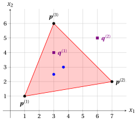

# Esercizi · Insiemi convessi

**Esercizi · Capitolo 1** · ogni soluzione si apre con un clic · [:material-book-open-variant: Capitolo 1](../preliminari/01-insiemi-convessi.md) · [:material-file-pdf-box: Eserciziario, volume 1 (PDF)](../pdf/esercizi-1-preliminari.pdf)

!!! esercizio "Esercizio 1.1: Insiemi convessi (E1)"

    Consideriamo i seguenti due punti di $\R^2$:

    $$
    {\boldsymbol p}=\begin{pmatrix} 1 \\[0.3ex] 4 \end{pmatrix}
    \qquad \text{e} \qquad
    {\boldsymbol w}=\begin{pmatrix} 7 \\[0.3ex] 1 \end{pmatrix}
    $$

    e i seguenti tre punti di $\R^2$:

    $$
    {\boldsymbol q}^{(1)}=\begin{pmatrix} 2 \\[0.3ex] \frac{7}{2} \end{pmatrix},
    \qquad
    {\boldsymbol q}^{(2)}=\begin{pmatrix} 5 \\[0.3ex] 3 \end{pmatrix}
    \qquad \text{e} \qquad
    {\boldsymbol q}^{(3)}=\begin{pmatrix} 9 \\[0.3ex] 0 \end{pmatrix}.
    $$

    **Domande**

    1. Calcolare le combinazioni convesse di ${\boldsymbol p}$ e ${\boldsymbol w}$ con $\lambda = \frac{1}{3}$, $\lambda=\frac{1}{2}$ e $\lambda=\frac{2}{3}$.

    2. Disegnare i punti ${\boldsymbol p}$ e ${\boldsymbol w}$, le tre combinazioni convesse e l'insieme di tutte le combinazioni convesse di ${\boldsymbol p}$ e ${\boldsymbol w}$.

    3. Determinare quali dei punti ${\boldsymbol q}^{(1)}$, ${\boldsymbol q}^{(2)}$ e ${\boldsymbol q}^{(3)}$ sono combinazioni convesse di ${\boldsymbol p}$ e ${\boldsymbol w}$.

??? soluzione "Soluzione"

    1. Per ogni $\lambda \in [0,1]$, la combinazione convessa di ${\boldsymbol p}$ e ${\boldsymbol w}$ con lo scalare $\lambda$ è il punto:

        $$
        \lambda \begin{pmatrix} 1 \\[0.3ex] 4 \end{pmatrix} + (1-\lambda) \begin{pmatrix} 7 \\[0.3ex] 1 \end{pmatrix}
        =
        \begin{pmatrix} \lambda + 7 - 7\lambda \\[0.3ex] 4\lambda + 1 - \lambda \end{pmatrix}
        =
        \begin{pmatrix} 7 - 6\lambda \\[0.3ex] 1 + 3\lambda \end{pmatrix}.
        $$

        Quindi, abbiamo:

        \begin{align*}
        \lambda = \frac{1}{3}: &\qquad
        \begin{pmatrix} \frac{1}{3}\cdot 1 + \frac{2}{3}\cdot 7 \\[1.2ex] \frac{1}{3}\cdot 4 + \frac{2}{3}\cdot 1 \end{pmatrix}
        = \begin{pmatrix} 5 \\[0.3ex] 2 \end{pmatrix}\\[2ex]
        \lambda = \frac{1}{2}: &\qquad
        \begin{pmatrix} \frac{1}{2}\cdot 1 + \frac{1}{2}\cdot 7 \\[1.2ex] \frac{1}{2}\cdot 4 + \frac{1}{2}\cdot 1 \end{pmatrix}
        = \begin{pmatrix} 4 \\[0.3ex] \frac{5}{2} \end{pmatrix}\\[2ex]
        \lambda = \frac{2}{3}: &\qquad
        \begin{pmatrix} \frac{2}{3}\cdot 1 + \frac{1}{3}\cdot 7 \\[1.2ex] \frac{2}{3}\cdot 4 + \frac{1}{3}\cdot 1 \end{pmatrix}
        = \begin{pmatrix} 3 \\[0.3ex] 3 \end{pmatrix}
        \end{align*}

    2. L'insieme di tutte le combinazioni convesse di ${\boldsymbol p}$ e ${\boldsymbol w}$ è il segmento che congiunge i due punti (in rosso). Le tre combinazioni convesse della domanda precedente sono i punti blu: con $\lambda=\frac{1}{3}$ il punto è più vicino a ${\boldsymbol w}$, con $\lambda=\frac{2}{3}$ è più vicino a ${\boldsymbol p}$.

        { .fig .ovale loading=lazy style="width:50%" }

    3. Un punto ${\boldsymbol q} \in \R^2$ è combinazione convessa di ${\boldsymbol p}$ e ${\boldsymbol w}$ se e solo se esiste $\lambda \in [0,1]$ tale che

        $$
        \begin{pmatrix} 7 - 6\lambda \\[0.3ex] 1 + 3\lambda \end{pmatrix} = \begin{pmatrix} q_1 \\[0.3ex] q_2 \end{pmatrix}.
        $$

        La prima equazione dà $\lambda = \frac{7-q_1}{6}$; poi verifichiamo la seconda equazione e la condizione $\lambda \in [0,1]$.

        - Per ${\boldsymbol q}^{(1)}$, la prima equazione dà $\lambda = \frac{7-2}{6}=\frac{5}{6}$ e la seconda equazione è soddisfatta: $1 + 3 \cdot \frac{5}{6} = \frac{7}{2}$. Poiché $\frac{5}{6} \in [0,1]$, il punto ${\boldsymbol q}^{(1)}$ è la combinazione convessa di ${\boldsymbol p}$ e ${\boldsymbol w}$ con $\lambda = \frac{5}{6}$.

        - Per ${\boldsymbol q}^{(2)}$, la prima equazione dà $\lambda = \frac{7-5}{6}=\frac{1}{3}$, ma $1 + 3 \cdot \frac{1}{3} = 2 \neq 3$. Il punto ${\boldsymbol q}^{(2)}$ non si trova nemmeno sulla retta passante per ${\boldsymbol p}$ e ${\boldsymbol w}$: non è combinazione convessa di ${\boldsymbol p}$ e ${\boldsymbol w}$.

        - Per ${\boldsymbol q}^{(3)}$, la prima equazione dà $\lambda = \frac{7-9}{6}=-\frac{1}{3}$ e la seconda equazione è soddisfatta: $1 + 3 \cdot \big(-\frac{1}{3}\big) = 0$. Il punto ${\boldsymbol q}^{(3)}$ si trova sulla retta passante per ${\boldsymbol p}$ e ${\boldsymbol w}$ (tratteggiata in figura), ma $-\frac{1}{3} \notin [0,1]$: non è combinazione convessa di ${\boldsymbol p}$ e ${\boldsymbol w}$.

!!! esercizio "Esercizio 1.2: Insiemi convessi (E2)"

    Consideriamo i seguenti tre punti di $\R^2$:

    $$
    {\boldsymbol p}^{(1)}=\begin{pmatrix} 1 \\[0.3ex] 1 \end{pmatrix},
    \qquad
    {\boldsymbol p}^{(2)}=\begin{pmatrix} 7 \\[0.3ex] 2 \end{pmatrix}
    \qquad \text{e} \qquad
    {\boldsymbol p}^{(3)}=\begin{pmatrix} 3 \\[0.3ex] 6 \end{pmatrix}
    $$

    e i seguenti due punti di $\R^2$:

    $$
    {\boldsymbol q}^{(1)}=\begin{pmatrix} 3 \\[0.3ex] 4 \end{pmatrix}
    \qquad \text{e} \qquad
    {\boldsymbol q}^{(2)}=\begin{pmatrix} 6 \\[0.3ex] 5 \end{pmatrix}.
    $$

    **Domande**

    1. Calcolare la combinazione convessa di ${\boldsymbol p}^{(1)}$, ${\boldsymbol p}^{(2)}$ e ${\boldsymbol p}^{(3)}$ con $\lambda_1 = \frac{1}{2}$, $\lambda_2=\frac{1}{4}$ e $\lambda_3=\frac{1}{4}$.

    2. Calcolare la combinazione convessa di ${\boldsymbol p}^{(1)}$, ${\boldsymbol p}^{(2)}$ e ${\boldsymbol p}^{(3)}$ con $\lambda_1 = \lambda_2=\lambda_3=\frac{1}{3}$.

    3. Mostrare che ${\boldsymbol q}^{(1)}$ è combinazione convessa di ${\boldsymbol p}^{(1)}$, ${\boldsymbol p}^{(2)}$ e ${\boldsymbol p}^{(3)}$, e trovare gli scalari.

    4. Mostrare che ${\boldsymbol q}^{(2)}$ non è combinazione convessa di ${\boldsymbol p}^{(1)}$, ${\boldsymbol p}^{(2)}$ e ${\boldsymbol p}^{(3)}$.

    5. Disegnare l'involucro convesso di ${\boldsymbol p}^{(1)}$, ${\boldsymbol p}^{(2)}$ e ${\boldsymbol p}^{(3)}$ e tutti i punti delle domande precedenti.

??? soluzione "Soluzione"

    1. La combinazione convessa con $\lambda_1 = \frac{1}{2}$, $\lambda_2=\frac{1}{4}$ e $\lambda_3=\frac{1}{4}$ (scalari non negativi con somma $1$) è il punto:

        $$
        \frac{1}{2}\begin{pmatrix} 1 \\[0.3ex] 1 \end{pmatrix}
        +\frac{1}{4}\begin{pmatrix} 7 \\[0.3ex] 2 \end{pmatrix}
        +\frac{1}{4}\begin{pmatrix} 3 \\[0.3ex] 6 \end{pmatrix}
        =
        \begin{pmatrix} \frac{1}{2}+\frac{7}{4}+\frac{3}{4} \\[1.2ex] \frac{1}{2}+\frac{1}{2}+\frac{3}{2} \end{pmatrix}
        =
        \begin{pmatrix} 3 \\[0.3ex] \frac{5}{2} \end{pmatrix}.
        $$

    2. La combinazione convessa con $\lambda_1 = \lambda_2=\lambda_3=\frac{1}{3}$ (scalari non negativi con somma $1$) è il punto:

        $$
        \frac{1}{3}\begin{pmatrix} 1 \\[0.3ex] 1 \end{pmatrix}
        +\frac{1}{3}\begin{pmatrix} 7 \\[0.3ex] 2 \end{pmatrix}
        +\frac{1}{3}\begin{pmatrix} 3 \\[0.3ex] 6 \end{pmatrix}
        =
        \begin{pmatrix} \frac{1+7+3}{3} \\[1.2ex] \frac{1+2+6}{3} \end{pmatrix}
        =
        \begin{pmatrix} \frac{11}{3} \\[0.6ex] 3 \end{pmatrix}.
        $$

    3. Un punto ${\boldsymbol q} \in \R^2$ è combinazione convessa dei tre punti se e solo se esistono $\lambda_1,\lambda_2,\lambda_3 \ge 0$ tali che

        $$
        \left\{ \begin{array}{rcl}
        \lambda_1 + \lambda_2 + \lambda_3 & = & 1\\[1ex]
        \lambda_1 + 7\,\lambda_2 + 3\,\lambda_3 & = & q_1\\[1ex]
        \lambda_1 + 2\,\lambda_2 + 6\,\lambda_3 & = & q_2
        \end{array} \right.
        $$

        Sostituendo $\lambda_1 = 1 - \lambda_2 - \lambda_3$ nelle ultime due equazioni, otteniamo il sistema

        $$
        \left\{ \begin{array}{rcl}
        6\,\lambda_2 + 2\,\lambda_3 & = & q_1 - 1\\[1ex]
        \lambda_2 + 5\,\lambda_3 & = & q_2 - 1
        \end{array} \right.
        $$

        il cui determinante è $6 \cdot 5 - 2 \cdot 1 = 28 \neq 0$: gli scalari sono unici. Per ${\boldsymbol q}^{(1)}$ abbiamo $q_1 - 1 = 2$ e $q_2 - 1 = 3$, da cui

        $$
        \lambda_2 = \frac{2 \cdot 5 - 2 \cdot 3}{28} = \frac{1}{7},
        \qquad
        \lambda_3 = \frac{6 \cdot 3 - 2 \cdot 1}{28} = \frac{4}{7},
        \qquad
        \lambda_1 = 1 - \frac{1}{7} - \frac{4}{7} = \frac{2}{7}.
        $$

        I tre scalari sono non negativi e la loro somma è $1$, quindi ${\boldsymbol q}^{(1)}$ è combinazione convessa dei tre punti:

        $$
        \frac{2}{7}\begin{pmatrix} 1 \\[0.3ex] 1 \end{pmatrix}
        +\frac{1}{7}\begin{pmatrix} 7 \\[0.3ex] 2 \end{pmatrix}
        +\frac{4}{7}\begin{pmatrix} 3 \\[0.3ex] 6 \end{pmatrix}
        =
        \begin{pmatrix} \frac{2+7+12}{7} \\[1.2ex] \frac{2+2+24}{7} \end{pmatrix}
        =
        \begin{pmatrix} 3 \\[0.3ex] 4 \end{pmatrix}.
        $$

    4. Per ${\boldsymbol q}^{(2)}$ abbiamo $q_1 - 1 = 5$ e $q_2 - 1 = 4$, da cui

        $$
        \lambda_2 = \frac{5 \cdot 5 - 2 \cdot 4}{28} = \frac{17}{28},
        \qquad
        \lambda_3 = \frac{6 \cdot 4 - 5 \cdot 1}{28} = \frac{19}{28},
        \qquad
        \lambda_1 = 1 - \frac{17}{28} - \frac{19}{28} = -\frac{2}{7}.
        $$

        Questi sono gli unici scalari con somma $1$ che danno ${\boldsymbol q}^{(2)}$, e $\lambda_1 < 0$: il punto ${\boldsymbol q}^{(2)}$ non è combinazione convessa dei tre punti.

    5. L'involucro convesso dei tre punti è il triangolo di vertici ${\boldsymbol p}^{(1)}$, ${\boldsymbol p}^{(2)}$ e ${\boldsymbol p}^{(3)}$ (in rosso). I punti delle prime due domande sono in blu, ${\boldsymbol q}^{(1)}$ (interno al triangolo) e ${\boldsymbol q}^{(2)}$ (esterno al triangolo) sono in viola.

        { .fig .ovale loading=lazy style="width:50%" }

!!! esercizio "Esercizio 1.3: Insiemi convessi (E3)"

    Consideriamo il seguente insieme:

    $$
    F=\left\{~ \begin{pmatrix} x_1 \\[0.3ex] x_2 \end{pmatrix} \in \R^2:~~ x_1 + 2\,x_2 \le 8,~~ 3\,x_1 + x_2 \le 9,~~ x_1 \ge 0,~~ x_2 \ge 0 ~\right\}
    $$

    e i seguenti due punti di $F$ e il seguente scalare:

    $$
    {\boldsymbol q}^{(1)}=\begin{pmatrix} 0 \\[0.3ex] 4 \end{pmatrix},
    \qquad
    {\boldsymbol q}^{(2)}=\begin{pmatrix} 3 \\[0.3ex] 0 \end{pmatrix}
    \qquad \text{e} \qquad
    \lambda = \frac{1}{3}.
    $$

    **Domande**

    1. Dimostrare che $F$ è un insieme convesso.

    2. Trovare i vertici di $F$ e disegnare l'insieme.

    3. Calcolare la combinazione convessa di ${\boldsymbol q}^{(1)}$ e ${\boldsymbol q}^{(2)}$ con lo scalare $\lambda$ e verificare che appartiene a $F$.

??? soluzione "Soluzione"

    1. Ciascuna delle quattro disuguaglianze che definiscono $F$ ha la forma $a_1\,x_1 + a_2\,x_2 \le b$, con

        $$
        (a_1,a_2,b) \in \big\{\,(1,2,8),~(3,1,9),~(-1,0,0),~(0,-1,0)\,\big\}
        $$

        (le ultime due sono $x_1 \ge 0$ e $x_2 \ge 0$). Per ogni coppia di punti ${\boldsymbol p}, {\boldsymbol w} \in F$ e per ogni $\lambda \in [0,1]$, per ciascuna delle quattro disuguaglianze abbiamo:

        \begin{align*}
        & a_1\,\big(\lambda p_1 + (1-\lambda) w_1\big) + a_2\,\big(\lambda p_2 + (1-\lambda) w_2\big) \\[2ex]
        &\quad = \lambda\,(a_1\,p_1 + a_2\,p_2) + (1-\lambda)\,(a_1\,w_1 + a_2\,w_2) \\[2ex]
        &\quad \le \lambda\, b + (1-\lambda)\, b \\[1ex]
        &\qquad\quad (\text{poiché } {\boldsymbol p}, {\boldsymbol w} \in F,~ \lambda \ge 0 \text{ e } 1-\lambda \ge 0)\\[2ex]
        &\quad = b
        \end{align*}

        Quindi, $\lambda {\boldsymbol p} + (1-\lambda){\boldsymbol w} \in F$ e l'insieme è convesso.

        Lo stesso calcolo mostra che ciascuno dei quattro insiemi definiti da una sola disuguaglianza (un semipiano) è convesso: $F$ è la loro intersezione, che è convessa poiché l'intersezione di insiemi convessi è convessa (capitolo «Insiemi convessi»).

    2. I vertici di $F$ sono l'origine, i punti in cui le rette $x_1 + 2\,x_2 = 8$ e $3\,x_1 + x_2 = 9$ incontrano gli assi all'interno di $F$, cioè $\begin{pmatrix} 0 \\[0.3ex] 4 \end{pmatrix}$ e $\begin{pmatrix} 3 \\[0.3ex] 0 \end{pmatrix}$, e il punto di intersezione delle due rette:

        \begin{equation*}
        \left\{ \begin{array}{ll}
        x_1 + 2\,x_2  & = 8\\[2ex]
        3\,x_1 + x_2  & = 9
        \end{array} \right.
        ~~\Longrightarrow~~
        \begin{pmatrix}
        x_1 \\[0.5ex]
        x_2
        \end{pmatrix} = \begin{pmatrix}
        \frac{8 \cdot 1 - 2 \cdot 9}{1 \cdot 1 - 2 \cdot 3} \\[2ex]
        \frac{1 \cdot 9  - 8 \cdot 3}{1 \cdot 1 - 2 \cdot 3}
        \end{pmatrix}
        = \begin{pmatrix}
        2 \\[0.5ex]
        3
        \end{pmatrix}
        \end{equation*}

        L'insieme $F$ è il quadrilatero di vertici $\begin{pmatrix} 0 \\[0.3ex] 0 \end{pmatrix}$, $\begin{pmatrix} 3 \\[0.3ex] 0 \end{pmatrix}$, $\begin{pmatrix} 2 \\[0.3ex] 3 \end{pmatrix}$ e $\begin{pmatrix} 0 \\[0.3ex] 4 \end{pmatrix}$ (in rosso). La figura mostra anche il segmento che congiunge ${\boldsymbol q}^{(1)}$ e ${\boldsymbol q}^{(2)}$ (in blu) e la combinazione convessa della domanda successiva.

        { .fig .ovale loading=lazy style="width:50%" }

    3. La combinazione convessa di ${\boldsymbol q}^{(1)}$ e ${\boldsymbol q}^{(2)}$ con $\lambda = \frac{1}{3}$ è il punto:

        $$
        \frac{1}{3}\begin{pmatrix} 0 \\[0.3ex] 4 \end{pmatrix} + \frac{2}{3}\begin{pmatrix} 3 \\[0.3ex] 0 \end{pmatrix}
        = \begin{pmatrix} 2 \\[0.3ex] \frac{4}{3} \end{pmatrix}.
        $$

        Appartiene a $F$, come garantito dalla prima domanda:

        $$
        2 + 2 \cdot \frac{4}{3} = \frac{14}{3} \le 8,
        \qquad
        3 \cdot 2 + \frac{4}{3} = \frac{22}{3} \le 9,
        \qquad
        2 \ge 0,
        \qquad
        \frac{4}{3} \ge 0.
        $$

!!! esercizio "Esercizio 1.4: Insiemi convessi (E4)"

    Consideriamo la seguente matrice simmetrica

    $$
    {\boldsymbol Q}=\begin{pmatrix}
    2 & -1\\[1ex]
    -1 & 2
    \end{pmatrix}
    $$

    e il seguente insieme:

    $$
    F=\left\{~ {\boldsymbol x} \in \R^2:~~
    \underbrace{\sqrt{\sum_{i=1}^2 \sum_{j=1}^2 q_{ij}\;x_i\;x_j} }_{\sqrt{{\boldsymbol x }' \; {\boldsymbol Q} \; {\boldsymbol x}}}  \le 1  ~\right\}.
    $$

    **Domande**

    1. Mostrare che ${\boldsymbol x}' \, {\boldsymbol Q} \, {\boldsymbol x} = x_1^2 + (x_1 - x_2)^2 + x_2^2$ per ogni ${\boldsymbol x} \in \R^2$.

    2. Dimostrare che $F$ è un insieme convesso.

    3. Stabilire se i punti $\begin{pmatrix} \frac{1}{2} \\[0.6ex] \frac{1}{2} \end{pmatrix}$ e $\begin{pmatrix} \frac{1}{2} \\[0.6ex] -\frac{1}{2} \end{pmatrix}$ appartengono a $F$.

    4. Disegnare l'insieme $F$.

??? soluzione "Soluzione"

    1. Per ogni ${\boldsymbol x} \in \R^2$ abbiamo:

        \begin{align*}
        & \begin{pmatrix} x_1 & x_2 \end{pmatrix} \begin{pmatrix} 2 & -1 \\[1ex] -1 & 2 \end{pmatrix} \begin{pmatrix} x_1 \\[1ex] x_2 \end{pmatrix} \\[2ex]
        &\quad = (2\,x_1-x_2)\,x_1 + (-x_1+2\,x_2)\, x_2  \\[2ex]
        &\quad = 2\,x_1^2 - 2\,x_1\,x_2 + 2\,x_2^2  \\[2ex]
        &\quad = x_1^2+ \big(x_1^2 - 2\,x_1\,x_2 + x_2^2\big) + x_2^2  \\[2ex]
        &\quad = x_1^2 + (x_1-x_2)^2 + x_2^2 .
        \end{align*}

        Quindi, per ogni ${\boldsymbol x} \in \R^2$, il numero $\sqrt{{\boldsymbol x}' \, {\boldsymbol Q} \, {\boldsymbol x}}$ è la norma euclidea di un vettore di $\R^3$:

        $$
        \sqrt{{\boldsymbol x}' \, {\boldsymbol Q} \, {\boldsymbol x}} = \big\| {\boldsymbol u}({\boldsymbol x}) \big\|_2,
        \qquad \text{dove} \qquad
        {\boldsymbol u}({\boldsymbol x}) = \begin{pmatrix} x_1 \\[0.3ex] x_1 - x_2 \\[0.3ex] x_2 \end{pmatrix} \in \R^3 .
        $$

        Il vettore ${\boldsymbol u}({\boldsymbol x})$ dipende linearmente da ${\boldsymbol x}$: per ogni ${\boldsymbol p}, {\boldsymbol w} \in \R^2$ e ogni $\lambda \in [0,1]$, abbiamo ${\boldsymbol u}\big(\lambda {\boldsymbol p} + (1-\lambda){\boldsymbol w}\big) = \lambda\, {\boldsymbol u}({\boldsymbol p}) + (1-\lambda)\, {\boldsymbol u}({\boldsymbol w})$.

    2. Per ogni coppia di punti ${\boldsymbol p}, {\boldsymbol w} \in F$ e per ogni $\lambda \in [0,1]$, abbiamo:

        \begin{align*}
        & \sqrt{\big(\lambda {\boldsymbol p} + (1-\lambda){\boldsymbol w}\big)' \, {\boldsymbol Q} \, \big(\lambda {\boldsymbol p} + (1-\lambda){\boldsymbol w}\big)} \\[2ex]
        &\quad = \big\| \lambda\, {\boldsymbol u}({\boldsymbol p}) + (1-\lambda)\, {\boldsymbol u}({\boldsymbol w}) \big\|_2 \\[1ex]
        &\qquad\quad \text{(per la prima domanda)}\\[2ex]
        &\quad \le \big\| \lambda\, {\boldsymbol u}({\boldsymbol p}) \big\|_2 + \big\| (1-\lambda)\, {\boldsymbol u}({\boldsymbol w}) \big\|_2 \\[1ex]
        &\qquad\quad \text{(per la disuguaglianza triangolare)}\\[2ex]
        &\quad = |\lambda| \; \| {\boldsymbol u}({\boldsymbol p}) \|_2 + |1-\lambda| \; \| {\boldsymbol u}({\boldsymbol w}) \|_2 \\[1ex]
        &\qquad\quad \text{(per l'omogeneità assoluta)}\\[2ex]
        &\quad = \lambda \; \| {\boldsymbol u}({\boldsymbol p}) \|_2 + (1-\lambda) \; \| {\boldsymbol u}({\boldsymbol w}) \|_2 \\[1ex]
        &\qquad\quad (\text{poiché } \lambda \ge 0 \text{ e } 1-\lambda \ge 0)\\[2ex]
        &\quad = \lambda \, \sqrt{{\boldsymbol p}' \, {\boldsymbol Q} \, {\boldsymbol p}} + (1-\lambda) \, \sqrt{{\boldsymbol w}' \, {\boldsymbol Q} \, {\boldsymbol w}} \\[1ex]
        &\qquad\quad \text{(per la prima domanda)}\\[2ex]
        &\quad \le \lambda \cdot 1 + (1-\lambda) \cdot 1 \\[1ex]
        &\qquad\quad (\text{poiché } {\boldsymbol p}, {\boldsymbol w} \in F,~ \lambda \ge 0 \text{ e } 1-\lambda \ge 0)\\[2ex]
        &\quad = 1
        \end{align*}

        Quindi, $\lambda {\boldsymbol p} + (1-\lambda){\boldsymbol w} \in F$ e l'insieme è convesso.

    3. Abbiamo:

        \begin{align*}
        \begin{pmatrix} \frac{1}{2} \\[0.6ex] \frac{1}{2} \end{pmatrix}:&\qquad
        \left(\frac{1}{2}\right)^2 + \left(\frac{1}{2} - \frac{1}{2}\right)^2 + \left(\frac{1}{2}\right)^2 = \frac{1}{2} \le 1
        \quad \Longrightarrow \quad \text{appartiene a } F, \\[2ex]
        \begin{pmatrix} \frac{1}{2} \\[0.6ex] -\frac{1}{2} \end{pmatrix}:&\qquad
        \left(\frac{1}{2}\right)^2 + \left(\frac{1}{2} + \frac{1}{2}\right)^2 + \left(-\frac{1}{2}\right)^2 = \frac{3}{2} > 1
        \quad \Longrightarrow \quad \text{non appartiene a } F.
        \end{align*}

        (Poiché la radice quadrata è crescente, $\sqrt{{\boldsymbol x}' \, {\boldsymbol Q} \, {\boldsymbol x}} \le 1$ se e solo se ${\boldsymbol x}' \, {\boldsymbol Q} \, {\boldsymbol x} \le 1$.)

    4. Il bordo di $F$ è dato dai punti tali che

        $$
        2\,x_1^2 - 2\,x_1\,x_2 + 2\,x_2^2 = 1.
        $$

        Esprimiamo $x_2$ in funzione di $x_1$. Scrivendo l'equazione precedente come

        $$
        2\,x_2^2 - 2\,x_1\,x_2 + (2\,x_1^2-1)=0,
        $$

        con $a=2$, $b=- 2\,x_1$ e $c=2\,x_1^2-1$ abbiamo $x_2= \frac{-b \pm \sqrt{b^2 - 4 a c}}{2 a}$, da cui:

        \begin{align*}
        x_2
        &= \frac{2\,x_1  \pm \sqrt{ 4\,x_1^2  - 8\,\big(2\,x_1^2-1\big)}}{4}
        = \frac{ 2\,x_1  \pm \sqrt{ 8 - 12\,x_1^2}}{4}
        = \frac{ x_1  \pm \sqrt{  2  - 3\,x_1^2 }}{2}.
        \end{align*}

        Questi valori esistono se e solo se

        $$
        2  - 3\,x_1^2 \ge 0
        ~~~\Longleftrightarrow~~~
        x_1 \in \left[-\sqrt{\frac{2}{3}},\sqrt{\frac{2}{3}} \right].
        $$

        Alcuni punti di riferimento del bordo:

        - se $x_2=0$, allora $2\,x_1^2=1$, quindi $x_1=\pm\frac{1}{\sqrt{2}}$; se $x_1=0$, allora $2\,x_2^2=1$, quindi $x_2=\pm\frac{1}{\sqrt{2}}$;

        - se $x_1=\pm\sqrt{\frac{2}{3}}$, allora $2-3\,x_1^2=0$ e $x_2=\frac{x_1}{2}=\pm\frac{1}{\sqrt{6}}$; allo stesso modo, se $x_2=\pm\sqrt{\frac{2}{3}}$, allora $x_1=\pm\frac{1}{\sqrt{6}}$.

        L'insieme $F$ è la regione interna a un'ellisse (bordo compreso) i cui assi sono le rette $x_2 = x_1$ e $x_2 = -x_1$ (in rosso). La figura mostra i punti di riferimento (in nero), il punto $\big(\frac{1}{2},\frac{1}{2}\big)$ che appartiene a $F$ (in blu) e il punto $\big(\frac{1}{2},-\frac{1}{2}\big)$ che non appartiene a $F$ (in viola).

        { .fig .ovale loading=lazy style="width:50%" }

!!! esercizio "Esercizio 1.5: Insiemi convessi (E5)"

    Consideriamo i seguenti insiemi:

    \begin{align*}
    A &= \left\{~ \begin{pmatrix} x_1 \\[0.3ex] x_2 \end{pmatrix} \in \R^2:~~ 1 \le x_1^2 + x_2^2 \le 4 ~\right\},\\[2ex]
    B_1 &= \left\{~ \begin{pmatrix} x_1 \\[0.3ex] x_2 \end{pmatrix} \in \R^2:~~ 0 \le x_1 \le 4,~~ 0 \le x_2 \le 1 ~\right\},\\[2ex]
    B_2 &= \left\{~ \begin{pmatrix} x_1 \\[0.3ex] x_2 \end{pmatrix} \in \R^2:~~ 0 \le x_1 \le 1,~~ 0 \le x_2 \le 4 ~\right\}
    \qquad \text{e} \qquad
    B = B_1 \cup B_2 .
    \end{align*}

    **Domande**

    1. Disegnare gli insiemi $A$ e $B$.

    2. Mostrare che $A$ non è un insieme convesso.

    3. Dimostrare che $B_1$ e $B_2$ sono insiemi convessi.

    4. Mostrare che $B$ non è un insieme convesso.

??? soluzione "Soluzione"

    1. L'insieme $A$ è la corona circolare compresa fra la circonferenza di raggio $1$ e la circonferenza di raggio $2$ con centro nell'origine (in rosso, a sinistra). L'insieme $B$ è l'unione a forma di L dei rettangoli $B_1$ e $B_2$ (in rosso, a destra). Le figure mostrano anche i segmenti usati nelle domande successive (in blu), il cui punto medio (in viola) non appartiene all'insieme.

        { .fig .ovale loading=lazy style="width:50%" }

        { .fig .ovale loading=lazy style="width:50%" }

    2. Per mostrare che un insieme non è convesso, basta trovare due punti dell'insieme e uno scalare $\lambda \in [0,1]$ la cui combinazione convessa non appartiene all'insieme. Prendiamo

        $$
        {\boldsymbol q}^{(1)}=\begin{pmatrix} -\frac{3}{2} \\[0.6ex] 0 \end{pmatrix},
        \qquad
        {\boldsymbol q}^{(2)}=\begin{pmatrix} \frac{3}{2} \\[0.6ex] 0 \end{pmatrix}
        \qquad \text{e} \qquad
        \lambda = \frac{1}{2}.
        $$

        Entrambi i punti appartengono ad $A$, poiché $\big(\pm\frac{3}{2}\big)^2 + 0^2 = \frac{9}{4} \in [1,4]$. La loro combinazione convessa è

        $$
        \frac{1}{2}\begin{pmatrix} -\frac{3}{2} \\[0.6ex] 0 \end{pmatrix} + \frac{1}{2}\begin{pmatrix} \frac{3}{2} \\[0.6ex] 0 \end{pmatrix} = \begin{pmatrix} 0 \\[0.3ex] 0 \end{pmatrix},
        \qquad \text{con} \qquad 0^2 + 0^2 = 0 < 1 .
        $$

        La combinazione convessa non appartiene ad $A$: l'insieme $A$ non è convesso.

    3. Sia $k \in \{1,2\}$. L'insieme $B_k$ è definito dai limiti $0 \le x_1 \le u_1$ e $0 \le x_2 \le u_2$, con $(u_1,u_2) = (4,1)$ per $B_1$ e $(u_1,u_2) = (1,4)$ per $B_2$. Per ogni coppia di punti ${\boldsymbol p}, {\boldsymbol w} \in B_k$ e per ogni $\lambda \in [0,1]$, per ciascuna coordinata $i \in \{1,2\}$ abbiamo:

        \begin{align*}
        \lambda p_i + (1-\lambda) w_i
        &\in \big[\,\lambda \cdot 0 + (1-\lambda) \cdot 0,~~ \lambda\, u_i + (1-\lambda)\, u_i\,\big] \\[1ex]
        &\qquad\quad (\text{poiché } p_i, w_i \in [0,u_i],~ \lambda \ge 0 \text{ e } 1-\lambda \ge 0)\\[2ex]
        &= [\,0,~u_i\,]
        \end{align*}

        Quindi, $\lambda {\boldsymbol p} + (1-\lambda){\boldsymbol w} \in B_k$ e l'insieme $B_k$ è convesso.

    4. Prendiamo

        $$
        {\boldsymbol q}^{(1)}=\begin{pmatrix} 1 \\[0.3ex] 4 \end{pmatrix} \in B_2,
        \qquad
        {\boldsymbol q}^{(2)}=\begin{pmatrix} 4 \\[0.3ex] 1 \end{pmatrix} \in B_1
        \qquad \text{e} \qquad
        \lambda = \frac{1}{2}.
        $$

        Entrambi i punti appartengono a $B$. La loro combinazione convessa è

        $$
        \frac{1}{2}\begin{pmatrix} 1 \\[0.3ex] 4 \end{pmatrix} + \frac{1}{2}\begin{pmatrix} 4 \\[0.3ex] 1 \end{pmatrix} = \begin{pmatrix} \frac{5}{2} \\[0.6ex] \frac{5}{2} \end{pmatrix},
        $$

        che non appartiene né a $B_1$ (poiché $x_2 = \frac{5}{2} > 1$) né a $B_2$ (poiché $x_1 = \frac{5}{2} > 1$), quindi non appartiene a $B$: l'insieme $B$ non è convesso.

        L'intersezione di insiemi convessi è sempre convessa (capitolo «Insiemi convessi»), mentre l'unione di due insiemi convessi, come $B = B_1 \cup B_2$, può non essere convessa.
