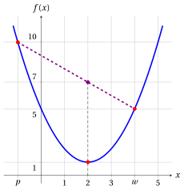
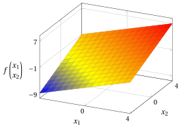

# Esercizi · Funzioni convesse e concave

**Esercizi · Capitolo 3** · ogni soluzione si apre con un clic · [:material-book-open-variant: Capitolo 3: Funzioni convesse e concave](../preliminari/03-funzioni-convesse-concave.md) · [:material-file-pdf-box: Eserciziario, volume 1 (PDF)](../pdf/esercizi-1-preliminari.pdf)

Negli esercizi di questo capitolo la convessità e la concavità si dimostrano solo con le definizioni del capitolo «Funzioni convesse e concave», usando le due disuguaglianze seguenti.

!!! nota ""

    Per ogni $a,b\in\R$ e ogni $\lambda\in[0,1]$, abbiamo:

    \begin{align*}
    (\lambda a+(1-\lambda)b)^2
    &= \lambda^2 a^2+2\lambda(1-\lambda)ab+(1-\lambda)^2b^2 \\[1ex]
    &= \lambda a^2+(1-\lambda)b^2-\lambda(1-\lambda)a^2+2\lambda(1-\lambda)ab-\lambda(1-\lambda)b^2 \\[1ex]
    &= \lambda a^2+(1-\lambda)b^2-\lambda(1-\lambda)(a^2-2ab+b^2) \\[1ex]
    &= \lambda a^2+(1-\lambda)b^2-\underbrace {\lambda(1-\lambda)(a-b)^2}_{\ge 0} \\[1ex]
    &\le \lambda a^2+(1-\lambda)b^2 \quad (\text{poiché } \lambda \ge 0,~ 1-\lambda \ge 0 \text{ e } (a-b)^2 \ge 0)
    \end{align*}

!!! nota ""

    Per ogni ${\boldsymbol u}, {\boldsymbol v} \in \R^n$ e ogni $\alpha \in \R$, la norma euclidea $\|{\boldsymbol u}\|_2 = \sqrt{u_1^2+u_2^2+\cdots+u_n^2}$ soddisfa:

    \begin{align*}
    \|{\boldsymbol u}+{\boldsymbol v}\|_2 &\le \|{\boldsymbol u}\|_2+\|{\boldsymbol v}\|_2
    && \text{(disuguaglianza triangolare)}\\[1ex]
    \|\alpha\,{\boldsymbol u}\|_2 &= |\alpha|\;\|{\boldsymbol u}\|_2
    && \text{(omogeneità assoluta)}
    \end{align*}

!!! esercizio "Esercizio 3.1: Funzioni convesse e concave (E1)"

    Consideriamo le seguenti funzioni a valori reali:

    $$
    f: \R \rightarrow \R,~~ f: x \mapsto x^2 - 4x + 5
    \qquad \text{e} \qquad
    g: \R \rightarrow \R,~~ g: x \mapsto -x^2 + 4x - 5
    $$

    e i seguenti due punti di $\R$ e scalare:

    $$
    p = -1, \qquad w = 4 \qquad \text{e} \qquad \lambda = \frac{2}{5}.
    $$

    **Domande**

    1. Dimostrare che la funzione $f$ è convessa nel suo dominio.

    2. Calcolare i due membri della disuguaglianza della definizione di funzione convessa per $f$ con i $p$, $w$ e $\lambda$ dati.

    3. Disegnare il grafico di $f$, i punti $\big(p,f(p)\big)$ e $\big(w,f(w)\big)$ e il segmento che li congiunge.

    4. Dimostrare che la funzione $g$ è concava nel suo dominio.

??? soluzione "Soluzione"

    1. Per ogni $x \in \R$ abbiamo $f(x) = (x-2)^2 + 1$. Per ogni coppia di punti $p, w \in \R$ e ogni $\lambda \in [0,1]$, abbiamo:

        \begin{align*}
        f\big(\lambda p+(1-\lambda)w\big)
        &= \big(\lambda p+(1-\lambda)w-2\big)^2 + 1 \\[2ex]
        &= \big(\lambda (p-2)+(1-\lambda)(w-2)\big)^2 + 1 \\[2ex]
        &\le \lambda (p-2)^2+(1-\lambda)(w-2)^2 + 1 \\[1ex]
        &\qquad \text{(poiché } (\lambda a+(1-\lambda)b)^2\le \lambda a^2+(1-\lambda)b^2\text{)} \\[2ex]
        &= \lambda\,\big((p-2)^2+1\big)+(1-\lambda)\,\big((w-2)^2+1\big) \\[2ex]
        &= \lambda f(p)+(1-\lambda)f(w)
        \end{align*}

        Quindi,

        $$
        f\big(\lambda p + (1-\lambda) w\big) \le \lambda f(p) + (1-\lambda) f(w)
        $$

        Per natura, il dominio $\R$ è un insieme convesso. Di conseguenza, la funzione è convessa nel suo dominio.

    2. Con $p=-1$, $w=4$ e $\lambda=\frac{2}{5}$ abbiamo

        $$
        \lambda p + (1-\lambda) w = \frac{2}{5}\cdot(-1) + \frac{3}{5}\cdot 4 = 2,
        \qquad
        f(-1) = 10,
        \qquad
        f(4) = 5,
        $$

        e i due membri della disuguaglianza sono:

        $$
        f(2) = 1 \;\le\; \frac{2}{5}\, f(-1) + \frac{3}{5}\, f(4) = \frac{2}{5}\cdot 10 + \frac{3}{5}\cdot 5 = 7 .
        $$

    3. In figura, il segmento che congiunge $\big(p,f(p)\big)$ e $\big(w,f(w)\big)$ (in viola) si trova sopra il grafico di $f$ (in blu). Il punto rosso è $\big(2, f(2)\big)$ e il punto viola è $\big(2, \frac{2}{5} f(p) + \frac{3}{5} f(w)\big)$.

        { .fig .ovale loading=lazy style="width:50%" }

    4. Per ogni $x \in \R$ abbiamo $g(x) = -(x-2)^2 - 1$. Per ogni coppia di punti $p, w \in \R$ e ogni $\lambda \in [0,1]$, abbiamo:

        \begin{align*}
        g\big(\lambda p+(1-\lambda)w\big)
        &= -\big(\lambda (p-2)+(1-\lambda)(w-2)\big)^2 - 1 \\[2ex]
        &\ge -\lambda (p-2)^2-(1-\lambda)(w-2)^2 - 1 \\[1ex]
        &\qquad \text{(poiché } (\lambda a+(1-\lambda)b)^2\le \lambda a^2+(1-\lambda)b^2\text{)} \\[2ex]
        &= \lambda\,\big(-(p-2)^2-1\big)+(1-\lambda)\,\big(-(w-2)^2-1\big) \\[2ex]
        &= \lambda g(p)+(1-\lambda)g(w)
        \end{align*}

        Quindi,

        $$
        g\big(\lambda p + (1-\lambda) w\big) \ge \lambda g(p) + (1-\lambda) g(w)
        $$

        Per natura, il dominio $\R$ è un insieme convesso. Di conseguenza, la funzione è concava nel suo dominio.

        La stessa conclusione segue dalla prima domanda, poiché $g = -f$ (capitolo «Funzioni convesse e concave»: $f$ è convessa se e solo se $-f$ è concava).

!!! esercizio "Esercizio 3.2: Funzioni convesse e concave (E2)"

    Consideriamo la seguente funzione a valori reali:

    $$
    f: [-1,4] \rightarrow \R,~~ f: x \mapsto \max\Big\{\, 1-x,~ \frac{1}{2}\,x,~ 2x-3 \,\Big\}
    $$

    e i seguenti due punti di $[-1,4]$ e scalare:

    $$
    p = -1, \qquad w = 4 \qquad \text{e} \qquad \lambda = \frac{3}{5}.
    $$

    **Domande**

    1. Calcolare $f(-1)$, $f\big(\frac{2}{3}\big)$, $f(2)$ e $f(4)$, e disegnare il grafico della funzione.

    2. Dimostrare che la funzione è convessa nel suo dominio.

    3. Calcolare i due membri della disuguaglianza della definizione di funzione convessa con i $p$, $w$ e $\lambda$ dati.

    4. Mostrare che la funzione non è concava nel suo dominio.

??? soluzione "Soluzione"

    1. Abbiamo:

        \begin{align*}
        f(-1) &= \max\Big\{\, 2,~ -\frac{1}{2},~ -5 \,\Big\} = 2, &
        f\Big(\frac{2}{3}\Big) &= \max\Big\{\, \frac{1}{3},~ \frac{1}{3},~ -\frac{5}{3} \,\Big\} = \frac{1}{3},\\[2ex]
        f(2) &= \max\big\{\, -1,~ 1,~ 1 \,\big\} = 1, &
        f(4) &= \max\big\{\, -3,~ 2,~ 5 \,\big\} = 5 .
        \end{align*}

        Le rette $1-x$ e $\frac{1}{2}x$ si incontrano in $x=\frac{2}{3}$, e le rette $\frac{1}{2}x$ e $2x-3$ si incontrano in $x=2$. Il grafico di $f$ (in blu) è formato da tre segmenti: $f(x) = 1-x$ su $\big[-1,\frac{2}{3}\big]$, $f(x)=\frac{1}{2}x$ su $\big[\frac{2}{3},2\big]$ e $f(x)=2x-3$ su $[2,4]$. Il dominio è in rosso; il segmento viola e i punti sono quelli della terza domanda.

        { .fig .ovale loading=lazy style="width:50%" }

    2. Per ogni $x \in [-1,4]$, $f(x)$ è il più grande dei tre valori $h_1(x) = 1-x$, $h_2(x)=\frac{1}{2}x$ e $h_3(x)=2x-3$, e ciascuno di essi ha la forma $h_k(x) = a_k\,x + b_k$. Per ogni coppia di punti $p, w \in [-1,4]$ e ogni $\lambda \in [0,1]$, abbiamo:

        \begin{align*}
        f\big(\lambda p+(1-\lambda)w\big)
        &= h_k\big(\lambda p+(1-\lambda)w\big) \\[1ex]
        &\qquad \text{(per un indice $k \in \{1,2,3\}$ che realizza il massimo)} \\[2ex]
        &= a_k\,\big(\lambda p+(1-\lambda)w\big) + b_k \\[2ex]
        &= \lambda\,(a_k\,p + b_k) + (1-\lambda)\,(a_k\,w + b_k) \\[1ex]
        &\qquad (\text{poiché } \lambda + (1-\lambda) = 1) \\[2ex]
        &\le \lambda f(p)+(1-\lambda)f(w)\\[1ex]
        &\qquad (\text{poiché } a_k\,p + b_k \le f(p),~ a_k\,w + b_k \le f(w),~ \lambda, 1-\lambda \ge 0)
        \end{align*}

        Quindi,

        $$
        f\big(\lambda p + (1-\lambda) w\big) \le \lambda f(p) + (1-\lambda) f(w)
        $$

        Il dominio $[-1,4]$ è un intervallo, quindi un insieme convesso. Di conseguenza, la funzione è convessa nel suo dominio.

        La stessa conclusione segue dalla proprietà «il massimo di funzioni convesse è convesso» (capitolo «Funzioni convesse e concave»), poiché $h_1$, $h_2$ e $h_3$ sono lineari.

    3. Con $p=-1$, $w=4$ e $\lambda=\frac{3}{5}$ abbiamo

        $$
        \lambda p + (1-\lambda) w = \frac{3}{5}\cdot(-1) + \frac{2}{5}\cdot 4 = 1,
        \qquad
        f(1) = \max\Big\{\, 0,~ \frac{1}{2},~ -1 \,\Big\} = \frac{1}{2},
        $$

        e i due membri della disuguaglianza sono:

        $$
        f(1) = \frac{1}{2} \;\le\; \frac{3}{5}\, f(-1) + \frac{2}{5}\, f(4) = \frac{3}{5}\cdot 2 + \frac{2}{5}\cdot 5 = \frac{16}{5} .
        $$

    4. La funzione è concava se $f\big(\lambda p + (1-\lambda) w\big) \ge \lambda f(p) + (1-\lambda) f(w)$ per ogni $p, w$ del dominio e ogni $\lambda \in [0,1]$. Con i punti e lo scalare della domanda precedente abbiamo

        $$
        f(1) = \frac{1}{2} \;<\; \frac{16}{5} = \frac{3}{5}\, f(-1) + \frac{2}{5}\, f(4):
        $$

        la disuguaglianza della definizione di funzione concava non vale, quindi la funzione non è concava nel suo dominio.

!!! esercizio "Esercizio 3.3: Funzioni convesse e concave (E3)"

    Consideriamo le seguenti funzioni a valori reali:

    $$
    f: \R^2 \rightarrow \R,~~ f: \begin{pmatrix} x_1 \\ x_2 \end{pmatrix} \mapsto
    \underbrace{x_1^2 + x_2^2 - 9}_{\left\| \begin{pmatrix} x_1 \\ x_2 \end{pmatrix} \right\|_2^2 - 9}
    $$

    e

    $$
    g: \R^2 \rightarrow \R,~~ g: \begin{pmatrix} x_1 \\ x_2 \end{pmatrix} \mapsto
    \left\| \begin{pmatrix} x_1 \\ x_2 \end{pmatrix} - \begin{pmatrix} 2 \\ 2 \end{pmatrix} \right\|_2 + 1 .
    $$

    **Domande**

    1. Dimostrare che la funzione $f$ è convessa nel suo dominio.

    2. Dimostrare che la funzione $g$ è convessa nel suo dominio.

    3. Dimostrare che l'insieme $\big\{\, {\boldsymbol x} \in \R^2 : x_1^2 + x_2^2 \le 9 \,\big\}$ è convesso.

    4. Disegnare il grafico della funzione $f$.

??? soluzione "Soluzione"

    1. Per ogni coppia di punti ${\boldsymbol p}, {\boldsymbol w} \in \R^2$ e ogni $\lambda \in [0,1]$, abbiamo:

        \begin{align*}
        f\big(\lambda {\boldsymbol p}+(1-\lambda){\boldsymbol w}\big)
        &= \big(\lambda p_1+(1-\lambda)w_1\big)^2 + \big(\lambda p_2+(1-\lambda)w_2\big)^2 - 9 \\[2ex]
        &\le \lambda p_1^2+(1-\lambda)w_1^2 + \lambda p_2^2+(1-\lambda)w_2^2 - 9 \\[1ex]
        &\qquad \text{(poiché } (\lambda a+(1-\lambda)b)^2\le \lambda a^2+(1-\lambda)b^2\text{)} \\[2ex]
        &= \lambda\,\big(p_1^2+p_2^2-9\big)+(1-\lambda)\,\big(w_1^2+w_2^2-9\big) \\[2ex]
        &= \lambda f({\boldsymbol p})+(1-\lambda)f({\boldsymbol w})
        \end{align*}

        Quindi,

        $$
        f\big(\lambda {\boldsymbol p} + (1-\lambda){\boldsymbol w}\big) \le \lambda f({\boldsymbol p}) + (1-\lambda) f({\boldsymbol w})
        $$

        Per natura, il dominio $\R^2$ è un insieme convesso. Di conseguenza, la funzione è convessa nel suo dominio.

    2. Sia ${\boldsymbol c} = \begin{pmatrix} 2 \\ 2 \end{pmatrix}$. Per ogni coppia di punti ${\boldsymbol p}, {\boldsymbol w} \in \R^2$ e ogni $\lambda \in [0,1]$, abbiamo:

        \begin{align*}
        g\big(\lambda {\boldsymbol p}+(1-\lambda){\boldsymbol w}\big)
        &= \big\| \lambda {\boldsymbol p}+(1-\lambda){\boldsymbol w} - {\boldsymbol c} \big\|_2 + 1 \\[2ex]
        &= \big\| \lambda ({\boldsymbol p}-{\boldsymbol c})+(1-\lambda)({\boldsymbol w} - {\boldsymbol c}) \big\|_2 + 1 \\[2ex]
        &\le \big\| \lambda ({\boldsymbol p}-{\boldsymbol c}) \big\|_2 + \big\| (1-\lambda)({\boldsymbol w} - {\boldsymbol c}) \big\|_2 + 1 \\[1ex]
        &\qquad \text{(per la disuguaglianza triangolare)} \\[2ex]
        &= |\lambda| \; \| {\boldsymbol p}-{\boldsymbol c} \|_2 + |1-\lambda| \; \| {\boldsymbol w} - {\boldsymbol c} \|_2 + 1 \\[1ex]
        &\qquad \text{(per l'omogeneità assoluta)} \\[2ex]
        &= \lambda \; \| {\boldsymbol p}-{\boldsymbol c} \|_2 + (1-\lambda) \; \| {\boldsymbol w} - {\boldsymbol c} \|_2 + 1 \\[1ex]
        &\qquad (\text{poiché } \lambda \ge 0 \text{ e } 1-\lambda \ge 0) \\[2ex]
        &= \lambda\,\big(\| {\boldsymbol p}-{\boldsymbol c} \|_2 + 1\big)+(1-\lambda)\,\big(\| {\boldsymbol w}-{\boldsymbol c} \|_2 + 1\big) \\[2ex]
        &= \lambda g({\boldsymbol p})+(1-\lambda)g({\boldsymbol w})
        \end{align*}

        Quindi,

        $$
        g\big(\lambda {\boldsymbol p} + (1-\lambda){\boldsymbol w}\big) \le \lambda g({\boldsymbol p}) + (1-\lambda) g({\boldsymbol w})
        $$

        Per natura, il dominio $\R^2$ è un insieme convesso. Di conseguenza, la funzione è convessa nel suo dominio.

    3. L'insieme è $\big\{\, {\boldsymbol x} \in \R^2 : f({\boldsymbol x}) \le 0 \,\big\}$. Per ogni coppia di punti ${\boldsymbol p}$ e ${\boldsymbol w}$ dell'insieme e per ogni $\lambda \in [0,1]$, abbiamo:

        \begin{align*}
        f\big(\lambda {\boldsymbol p}+(1-\lambda){\boldsymbol w}\big)
        &\le \lambda f({\boldsymbol p})+(1-\lambda)f({\boldsymbol w}) \\[1ex]
        &\qquad \text{(per la prima domanda)} \\[2ex]
        &\le \lambda \cdot 0 + (1-\lambda) \cdot 0 \\[1ex]
        &\qquad (\text{poiché } f({\boldsymbol p}) \le 0,~ f({\boldsymbol w}) \le 0,~ \lambda \ge 0 \text{ e } 1-\lambda \ge 0) \\[2ex]
        &= 0
        \end{align*}

        Quindi,

        $$
        f\big(\lambda {\boldsymbol p} + (1-\lambda){\boldsymbol w}\big) \le 0
        $$

        Di conseguenza, $\lambda {\boldsymbol p} + (1-\lambda){\boldsymbol w}$ appartiene all'insieme e l'insieme è convesso. È il disco di raggio $3$ centrato nell'origine.

    4. Questo è il grafico della funzione $f$ nel dominio $\begin{pmatrix} x_1 \\ x_2 \end{pmatrix} \in [-4,4] \times [-4,4]$; il suo punto più basso è $\big(0,0,f(0,0)\big) = (0,0,-9)$.

        { .fig .ovale loading=lazy style="width:59%" }

!!! esercizio "Esercizio 3.4: Funzioni convesse e concave (E4)"

    Consideriamo le seguenti funzioni a valori reali:

    $$
    f: \R^2 \rightarrow \R,~~ f: \begin{pmatrix} x_1 \\ x_2 \end{pmatrix} \mapsto
    \underbrace{x_1 + x_2 - 1}_{\begin{pmatrix} 1 & 1 \end{pmatrix} \begin{pmatrix} x_1 \\ x_2 \end{pmatrix} - 1}
    $$

    e

    $$
    g: \R^2 \rightarrow \R,~~ g: \begin{pmatrix} x_1 \\ x_2 \end{pmatrix} \mapsto
    \min\big\{\, x_1 + x_2 - 1,~ 2 - x_1 \,\big\}
    $$

    e i seguenti due punti di $\R^2$ e scalare:

    $$
    {\boldsymbol p}=\begin{pmatrix} 0 \\[0.3ex] 0 \end{pmatrix},
    \qquad
    {\boldsymbol w}=\begin{pmatrix} 4 \\[0.3ex] 2 \end{pmatrix}
    \qquad \text{e} \qquad
    \lambda = \frac{1}{2}.
    $$

    **Domande**

    1. Dimostrare che la funzione $f$ è sia convessa sia concava nel suo dominio.

    2. Disegnare il grafico della funzione $f$.

    3. Dimostrare che la funzione $g$ è concava nel suo dominio.

    4. Calcolare i due membri della disuguaglianza della definizione di funzione concava per $g$ con i ${\boldsymbol p}$, ${\boldsymbol w}$ e $\lambda$ dati, e mostrare che $g$ non è convessa nel suo dominio.

??? soluzione "Soluzione"

    1. Per ogni coppia di punti ${\boldsymbol p}, {\boldsymbol w} \in \R^2$ e ogni $\lambda \in [0,1]$, abbiamo:

        \begin{align*}
        f\big(\lambda {\boldsymbol p}+(1-\lambda){\boldsymbol w}\big)
        &= \big(\lambda p_1+(1-\lambda)w_1\big) + \big(\lambda p_2+(1-\lambda)w_2\big) - \big(\lambda + (1-\lambda)\big) \\[2ex]
        &= \lambda\,\big(p_1+p_2-1\big)+(1-\lambda)\,\big(w_1+w_2-1\big) \\[2ex]
        &= \lambda f({\boldsymbol p})+(1-\lambda)f({\boldsymbol w})
        \end{align*}

        Quindi, valgono le disuguaglianze di entrambe le definizioni (con l'uguaglianza):

        $$
        f\big(\lambda {\boldsymbol p} + (1-\lambda){\boldsymbol w}\big) \le \lambda f({\boldsymbol p}) + (1-\lambda) f({\boldsymbol w})
        $$

        e

        $$
        f\big(\lambda {\boldsymbol p} + (1-\lambda){\boldsymbol w}\big) \ge \lambda f({\boldsymbol p}) + (1-\lambda) f({\boldsymbol w})
        $$

        Per natura, il dominio $\R^2$ è un insieme convesso. Di conseguenza, la funzione è sia convessa sia concava nel suo dominio.

    2. Questo è il grafico della funzione $f$ nel dominio $\begin{pmatrix} x_1 \\ x_2 \end{pmatrix} \in [-4,4] \times [-4,4]$: un piano.

        { .fig .ovale loading=lazy style="width:59%" }

    3. Per ogni ${\boldsymbol x} \in \R^2$, $g({\boldsymbol x})$ è il più piccolo dei due valori $h_1({\boldsymbol x}) = x_1 + x_2 - 1$ e $h_2({\boldsymbol x}) = 2 - x_1$; come mostrato per $f$ nella prima domanda, ciascuno di essi soddisfa $h_k\big(\lambda {\boldsymbol p}+(1-\lambda){\boldsymbol w}\big) = \lambda h_k({\boldsymbol p}) + (1-\lambda) h_k({\boldsymbol w})$. Per ogni coppia di punti ${\boldsymbol p}, {\boldsymbol w} \in \R^2$ e ogni $\lambda \in [0,1]$, abbiamo:

        \begin{align*}
        g\big(\lambda {\boldsymbol p}+(1-\lambda){\boldsymbol w}\big)
        &= h_k\big(\lambda {\boldsymbol p}+(1-\lambda){\boldsymbol w}\big) \\[1ex]
        &\qquad \text{(per un indice $k \in \{1,2\}$ che realizza il minimo)} \\[2ex]
        &= \lambda\, h_k({\boldsymbol p}) + (1-\lambda)\, h_k({\boldsymbol w}) \\[1ex]
        &\qquad \text{(come mostrato per $f$ nella prima domanda)} \\[2ex]
        &\ge \lambda g({\boldsymbol p})+(1-\lambda)g({\boldsymbol w}) \\[1ex]
        &\qquad (\text{poiché } h_k({\boldsymbol p}) \ge g({\boldsymbol p}),~ h_k({\boldsymbol w}) \ge g({\boldsymbol w}),~ \lambda, 1-\lambda \ge 0)
        \end{align*}

        Quindi,

        $$
        g\big(\lambda {\boldsymbol p} + (1-\lambda){\boldsymbol w}\big) \ge \lambda g({\boldsymbol p}) + (1-\lambda) g({\boldsymbol w})
        $$

        Per natura, il dominio $\R^2$ è un insieme convesso. Di conseguenza, la funzione è concava nel suo dominio.

        La stessa conclusione segue dalla proprietà «il minimo di funzioni concave è concavo» (capitolo «Funzioni convesse e concave»), poiché $h_1$ e $h_2$ sono lineari.

    4. Con ${\boldsymbol p}=\begin{pmatrix} 0 \\ 0 \end{pmatrix}$, ${\boldsymbol w}=\begin{pmatrix} 4 \\ 2 \end{pmatrix}$ e $\lambda=\frac{1}{2}$ abbiamo

        $$
        \lambda {\boldsymbol p} + (1-\lambda) {\boldsymbol w} = \begin{pmatrix} 2 \\ 1 \end{pmatrix},
        \qquad
        g({\boldsymbol p}) = \min\{-1,\, 2\} = -1,
        \qquad
        g({\boldsymbol w}) = \min\{5,\, -2\} = -2,
        $$

        e i due membri della disuguaglianza sono:

        $$
        g\begin{pmatrix} 2 \\ 1 \end{pmatrix} = \min\{2,\, 0\} = 0 \;\ge\; \frac{1}{2}\, g({\boldsymbol p}) + \frac{1}{2}\, g({\boldsymbol w}) = \frac{1}{2}\cdot (-1) + \frac{1}{2}\cdot (-2) = -\frac{3}{2} .
        $$

        Poiché $0 > -\frac{3}{2}$, la disuguaglianza della definizione di funzione convessa non vale per questi punti e questo scalare: la funzione $g$ non è convessa nel suo dominio.

!!! esercizio "Esercizio 3.5: Funzioni convesse e concave (E5)"

    Dati $a,b \in \R$ con $a<b$, consideriamo la seguente funzione a valori reali:

    $$
    f: [a,b] \rightarrow \R,~~ f: x \mapsto 2 + 9x - 6x^2 + x^3
    $$

    il cui dominio è l'intervallo $[a,b]$.

    **Domande**

    1. Dimostrare che per ogni $p, w \in \R$ e ogni $\lambda \in [0,1]$, con $m = \lambda p + (1-\lambda) w$, abbiamo

        $$
        \lambda f(p) + (1-\lambda) f(w) - f(m) = \lambda (1-\lambda) (p-w)^2 \, (p + w + m - 6).
        $$

    2. Dimostrare che con $a=2$ e $b=4$ la funzione è convessa.

    3. Dimostrare che con $a=-1$ e $b=2$ la funzione è concava.

    4. Mostrare che con $a=-1$ e $b=4$ la funzione non è né convessa né concava.

    5. Disegnare il grafico della funzione con $a=-1$ e $b=4$.

??? soluzione "Soluzione"

    1. Per ogni $p, w \in \R$ e ogni $\lambda \in [0,1]$, sia $d = p - w$, così che $p = w + d$ e $m = w + \lambda d$. Abbiamo:

        \begin{align*}
        \lambda f(p) + (1-\lambda) f(w) - f(m)
        &= 2\,\big(\lambda + (1-\lambda) - 1\big) + 9\,\big(\lambda p + (1-\lambda) w - m\big) \\
        &\qquad - 6\,\big(\lambda p^2 + (1-\lambda) w^2 - m^2\big) \\
        &\qquad + \lambda p^3 + (1-\lambda) w^3 - m^3 \\[2ex]
        &= - 6\,\big(\lambda p^2 + (1-\lambda) w^2 - m^2\big) \\
        &\qquad + \lambda p^3 + (1-\lambda) w^3 - m^3 \\[1ex]
        &\qquad (\text{poiché } \lambda + (1-\lambda) = 1 \\
        &\qquad\quad \text{e } m = \lambda p + (1-\lambda) w) \\[2ex]
        &= - 6\,\bigl(\lambda w^2 + 2\lambda w d + \lambda d^2 + (1-\lambda) w^2 \\
        &\qquad - w^2 - 2\lambda w d - \lambda^2 d^2\bigr) \\
        &\qquad + \lambda\,\big(w^3 + 3w^2 d + 3 w d^2 + d^3\big) + (1-\lambda)\,w^3 \\
        &\qquad - \big(w^3 + 3\lambda w^2 d + 3\lambda^2 w d^2 + \lambda^3 d^3\big) \\[1ex]
        &\qquad (\text{sviluppando le potenze, poiché } p = w + d \\
        &\qquad\quad \text{e } m = w + \lambda d) \\[2ex]
        &= - 6\,(\lambda - \lambda^2)\, d^2 + 3\,(\lambda - \lambda^2)\, w\, d^2 + (\lambda - \lambda^3)\, d^3 \\[2ex]
        &= \lambda(1-\lambda)\, d^2\, \big(3w + (1+\lambda)\, d - 6\big) \\[2ex]
        &= \lambda(1-\lambda)\, d^2\, (p + w + m - 6) \\[1ex]
        &\qquad (\text{poiché } 3w + (1+\lambda)\,d = (w+d) + w + (w + \lambda d) \\
        &\qquad\quad = p + w + m) \\[2ex]
        &= \lambda (1-\lambda) (p-w)^2 \, (p + w + m - 6)
        \end{align*}

    2. Per ogni coppia di punti $p, w \in [2,4]$ e ogni $\lambda \in [0,1]$, con $m = \lambda p + (1-\lambda) w \in [2,4]$, abbiamo:

        \begin{align*}
        f\big(\lambda p+(1-\lambda)w\big)
        &= \lambda f(p)+(1-\lambda)f(w) - \lambda (1-\lambda) (p-w)^2 \, (p + w + m - 6) \\[1ex]
        &\qquad \text{(per la domanda 1)} \\[2ex]
        &\le \lambda f(p)+(1-\lambda)f(w)\\[1ex]
        &\qquad (\text{poiché } \lambda (1-\lambda) (p-w)^2 \ge 0,~ p, w, m \ge 2)
        \end{align*}

        Quindi,

        $$
        f\big(\lambda p + (1-\lambda) w\big) \le \lambda f(p) + (1-\lambda) f(w)
        $$

        Il dominio $[2,4]$ è un intervallo, quindi un insieme convesso. Di conseguenza, la funzione è convessa nel suo dominio.

    3. Per ogni coppia di punti $p, w \in [-1,2]$ e ogni $\lambda \in [0,1]$, con $m = \lambda p + (1-\lambda) w \in [-1,2]$, abbiamo:

        \begin{align*}
        f\big(\lambda p+(1-\lambda)w\big)
        &= \lambda f(p)+(1-\lambda)f(w) - \lambda (1-\lambda) (p-w)^2 \, (p + w + m - 6) \\[1ex]
        &\qquad \text{(per la domanda 1)} \\[2ex]
        &\ge \lambda f(p)+(1-\lambda)f(w) \\[1ex]
        &\qquad (\text{poiché } \lambda (1-\lambda) (p-w)^2 \ge 0,~ p, w, m \le 2)
        \end{align*}

        Quindi,

        $$
        f\big(\lambda p + (1-\lambda) w\big) \ge \lambda f(p) + (1-\lambda) f(w)
        $$

        Il dominio $[-1,2]$ è un intervallo, quindi un insieme convesso. Di conseguenza, la funzione è concava nel suo dominio.

    4. Abbiamo $f(0)=2$, $f(1)=6$, $f(2)=4$, $f(3)=2$ e $f(4)=6$.

        - Con $p=0$, $w=2$ e $\lambda=\frac{1}{2}$ abbiamo $\lambda p + (1-\lambda) w = 1$ e

            $$
            f(1) = 6 \;>\; \frac{1}{2}\, f(0) + \frac{1}{2}\, f(2) = \frac{1}{2}\cdot 2 + \frac{1}{2}\cdot 4 = 3:
            $$

            la disuguaglianza della definizione di funzione convessa non vale, quindi la funzione non è convessa in $[-1,4]$.

        - Con $p=2$, $w=4$ e $\lambda=\frac{1}{2}$ abbiamo $\lambda p + (1-\lambda) w = 3$ e

            $$
            f(3) = 2 \;<\; \frac{1}{2}\, f(2) + \frac{1}{2}\, f(4) = \frac{1}{2}\cdot 4 + \frac{1}{2}\cdot 6 = 5:
            $$

            la disuguaglianza della definizione di funzione concava non vale, quindi la funzione non è concava in $[-1,4]$.

        Le due differenze concordano con la prima domanda: $\frac{1}{4}\cdot 4 \cdot (0+2+1-6) = -3 = 3 - 6$ e $\frac{1}{4}\cdot 4 \cdot (2+4+3-6) = 3 = 5 - 2$.

    5. Questo è il grafico della funzione (in blu) nel dominio $[-1,4]$ (in rosso), con $f(-1) = -14$. I segmenti viola congiungono i punti della domanda precedente: il primo si trova sotto il grafico (su $[-1,2]$ la funzione è concava), il secondo si trova sopra il grafico (su $[2,4]$ la funzione è convessa).

        { .fig .ovale loading=lazy style="width:50%" }
