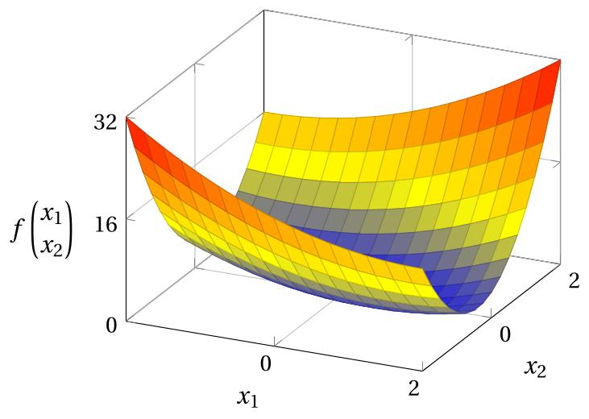
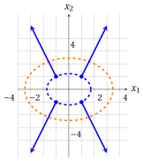

# Esercizi · Funzioni quadratiche

**Esercizi · Capitolo 4** · ogni soluzione si apre con un clic · [:material-book-open-variant: Capitolo 4](../preliminari/04-funzioni-quadratiche.md) · [:material-file-pdf-box: Eserciziario, volume 1 (PDF)](../pdf/esercizi-1-preliminari.pdf)

Negli esercizi di questo capitolo la convessità si dimostra solo con la definizione di funzione convessa del capitolo «Funzioni convesse e concave»: la funzione quadratica si scrive come somma di quadrati di funzioni lineari, e la disuguaglianza

$$
\big(\lambda a+(1-\lambda)b\big)^2 \le \lambda a^2+(1-\lambda)b^2, \qquad \forall a,b\in\R,~ \forall \lambda\in[0,1]
$$

dello stesso capitolo si applica a ciascun quadrato.

!!! esercizio "Esercizio 4.1: Funzioni quadratiche (E1)"

    Consideriamo la seguente funzione a valori reali:

    $$
    f: \R^2 \rightarrow \R,~~ f: \begin{pmatrix} x_1 \\ x_2 \end{pmatrix} \mapsto x_1^2 + 2\,x_1 x_2 + 5\,x_2^2
    $$

    **Domande**

    1. Scrivere la funzione nella forma matriciale $f({\boldsymbol x}) = {\boldsymbol x}' {\boldsymbol Q} \; {\boldsymbol x}$ con una matrice simmetrica ${\boldsymbol Q}$.

    2. Mostrare che la matrice non simmetrica $\begin{pmatrix} 1 & 6 \\ -4 & 5 \end{pmatrix}$ definisce la stessa funzione, e che sostituendo ogni coppia di elementi fuori diagonale con la loro media si ottiene la matrice ${\boldsymbol Q}$ della prima domanda.

    3. Calcolare il gradiente e la matrice Hessiana della funzione, e il gradiente nei punti $\begin{pmatrix} 1 \\ 1 \end{pmatrix}$ e $\begin{pmatrix} -1 \\ 2 \end{pmatrix}$.

    4. Mostrare che $f({\boldsymbol x}) = (x_1 + x_2)^2 + 4\,x_2^2$ e dimostrare, a partire dalla definizione, che la funzione è convessa nel suo dominio.

    5. Disegnare il grafico della funzione.

??? soluzione "Soluzione"

    1. Il coefficiente $2$ di $x_1 x_2$ si ripartisce in parti uguali fra i due elementi fuori diagonale:

        $$
        f\left(\begin{pmatrix} x_1 \\ x_2 \end{pmatrix}\right) =
        \begin{pmatrix} x_1 & x_2 \end{pmatrix}
        \underbrace{\begin{pmatrix} 1 & 1 \\ 1 & 5 \end{pmatrix}}_{{\boldsymbol Q}}
        \begin{pmatrix} x_1 \\ x_2 \end{pmatrix}
        = x_1^2 + x_1 x_2 + x_2 x_1 + 5\,x_2^2 = x_1^2 + 2\,x_1 x_2 + 5\,x_2^2
        $$

    2. Con la matrice non simmetrica abbiamo:

        $$
        \begin{pmatrix} x_1 & x_2 \end{pmatrix}
        \begin{pmatrix} 1 & 6 \\ -4 & 5 \end{pmatrix}
        \begin{pmatrix} x_1 \\ x_2 \end{pmatrix}
        = x_1^2 + 6\,x_1 x_2 - 4\,x_2 x_1 + 5\,x_2^2 = x_1^2 + 2\,x_1 x_2 + 5\,x_2^2
        $$

        che è la stessa funzione. Sostituendo la coppia di elementi fuori diagonale con la loro media:

        $$
        \begin{pmatrix} 1 & \frac{6+(-4)}{2} \\[1ex] \frac{6+(-4)}{2} & 5 \end{pmatrix}
        = \begin{pmatrix} 1 & 1 \\ 1 & 5 \end{pmatrix} = {\boldsymbol Q}
        $$

    3. Il gradiente è $2\,{\boldsymbol Q}\,{\boldsymbol x}$ e la matrice Hessiana è $2\,{\boldsymbol Q}$:

        $$
        \nabla f\left(\begin{pmatrix} x_1 \\ x_2 \end{pmatrix}\right) =
        \begin{pmatrix} 2\,x_1 + 2\,x_2 \\[0.5ex] 2\,x_1 + 10\,x_2 \end{pmatrix},
        \qquad
        \nabla^2 f\left(\begin{pmatrix} x_1 \\ x_2 \end{pmatrix}\right) =
        \begin{pmatrix} 2 & 2 \\ 2 & 10 \end{pmatrix}
        $$

        Nei due punti:

        $$
        \nabla f\left(\begin{pmatrix} 1 \\ 1 \end{pmatrix}\right) = \begin{pmatrix} 4 \\ 12 \end{pmatrix},
        \qquad
        \nabla f\left(\begin{pmatrix} -1 \\ 2 \end{pmatrix}\right) = \begin{pmatrix} -2 + 4 \\ -2 + 20 \end{pmatrix} = \begin{pmatrix} 2 \\ 18 \end{pmatrix}
        $$

    4. Sviluppando il quadrato:

        $$
        (x_1 + x_2)^2 + 4\,x_2^2 = x_1^2 + 2\,x_1 x_2 + x_2^2 + 4\,x_2^2 = x_1^2 + 2\,x_1 x_2 + 5\,x_2^2 = f({\boldsymbol x})
        $$

        Per dimostrare che la funzione è convessa nel suo dominio, osserviamo che per ogni coppia di punti ${\boldsymbol p}, {\boldsymbol w} \in \R^2$ e ogni $\lambda \in [0,1]$, abbiamo:

        \begin{align*}
        & f\big(\lambda {\boldsymbol p}+(1-\lambda){\boldsymbol w}\big) \\[2ex]
        &\quad = \big(\lambda p_1+(1-\lambda)w_1 + \lambda p_2+(1-\lambda)w_2\big)^2 + 4\,\big(\lambda p_2+(1-\lambda)w_2\big)^2 \\[2ex]
        &\quad = \big(\lambda (p_1+p_2)+(1-\lambda)(w_1+w_2)\big)^2 + 4\,\big(\lambda p_2+(1-\lambda)w_2\big)^2 \\[2ex]
        &\quad \le \lambda (p_1+p_2)^2+(1-\lambda)(w_1+w_2)^2 + 4\,\big(\lambda p_2^2+(1-\lambda)w_2^2\big) \\[1ex]
        &\qquad \text{(poiché } (\lambda a+(1-\lambda)b)^2\le \lambda a^2+(1-\lambda)b^2\text{, due volte)} \\[2ex]
        &\quad = \lambda\,\big((p_1+p_2)^2+4\,p_2^2\big)+(1-\lambda)\,\big((w_1+w_2)^2+4\,w_2^2\big) \\[2ex]
        &\quad = \lambda f({\boldsymbol p})+(1-\lambda)f({\boldsymbol w})
        \end{align*}

        Quindi,

        $$
        f(\lambda {\boldsymbol p} + (1-\lambda){\boldsymbol w})
        \le
        \lambda f({\boldsymbol p}) + (1-\lambda) f({\boldsymbol w})
        $$

        Il dominio $\R^2$ è, per sua natura, un insieme convesso. Di conseguenza, la funzione è convessa nel suo dominio.

    5. Questo è il grafico della funzione nel dominio $\begin{pmatrix} x_1 \\ x_2 \end{pmatrix} \in [-2,2] \times [-2,2]$; il suo punto più basso è $\big(0,0,f(0,0)\big) = (0,0,0)$ e i suoi punti più alti sono in $(2,2)$ e $(-2,-2)$, dove $f = 32$.

        { .fig .ovale loading=lazy style="width:59%" }

!!! esercizio "Esercizio 4.2: Funzioni quadratiche (E2)"

    Consideriamo la seguente funzione a valori reali:

    $$
    f: \R^2 \rightarrow \R,~~ f: \begin{pmatrix} x_1 \\ x_2 \end{pmatrix} \mapsto x_1^2 + 2\,x_2^2
    $$

    **Domande**

    1. Scrivere la funzione nella forma matriciale $f({\boldsymbol x}) = {\boldsymbol x}' {\boldsymbol Q} \; {\boldsymbol x}$ con una matrice simmetrica ${\boldsymbol Q}$.

    2. Calcolare il gradiente della funzione e il suo valore nei quattro punti $\begin{pmatrix} 1 \\ 1 \end{pmatrix}$, $\begin{pmatrix} -1 \\ 1 \end{pmatrix}$, $\begin{pmatrix} -1 \\ -1 \end{pmatrix}$ e $\begin{pmatrix} 1 \\ -1 \end{pmatrix}$.

    3. Descrivere gli insiemi di livello della funzione per $k=3$ e $k=12$ (con le loro intersezioni con gli assi) e disegnarli, insieme ai gradienti della domanda precedente applicati nei rispettivi punti.

    4. Dimostrare, a partire dalla definizione, che la funzione è convessa nel suo dominio.

??? soluzione "Soluzione"

    1. La funzione non ha il termine $x_1 x_2$, quindi gli elementi fuori diagonale sono nulli:

        $$
        f\left(\begin{pmatrix} x_1 \\ x_2 \end{pmatrix}\right) =
        \begin{pmatrix} x_1 & x_2 \end{pmatrix}
        \underbrace{\begin{pmatrix} 1 & 0 \\ 0 & 2 \end{pmatrix}}_{{\boldsymbol Q}}
        \begin{pmatrix} x_1 \\ x_2 \end{pmatrix}
        = x_1^2 + 2\,x_2^2
        $$

    2. Il gradiente è $2\,{\boldsymbol Q}\,{\boldsymbol x}$:

        $$
        \nabla f\left(\begin{pmatrix} x_1 \\ x_2 \end{pmatrix}\right) =
        \begin{pmatrix} 2\,x_1 \\[0.5ex] 4\,x_2 \end{pmatrix}
        $$

        Nei quattro punti:

        \begin{align*}
        \nabla f\left(\begin{pmatrix} 1 \\ 1 \end{pmatrix}\right) &= \begin{pmatrix} 2 \\ 4 \end{pmatrix}, &
        \nabla f\left(\begin{pmatrix} -1 \\ 1 \end{pmatrix}\right) &= \begin{pmatrix} -2 \\ 4 \end{pmatrix}, \\[1ex]
        \nabla f\left(\begin{pmatrix} -1 \\ -1 \end{pmatrix}\right) &= \begin{pmatrix} -2 \\ -4 \end{pmatrix}, &
        \nabla f\left(\begin{pmatrix} 1 \\ -1 \end{pmatrix}\right) &= \begin{pmatrix} 2 \\ -4 \end{pmatrix}
        \end{align*}

    3. L'insieme di livello per $k=3$ è l'ellisse $x_1^2 + 2\,x_2^2 = 3$, che interseca l'asse $x_1$ in $x_1 = \pm\sqrt{3}$ e l'asse $x_2$ in $x_2 = \pm\sqrt{3/2}$; contiene i quattro punti della domanda precedente, poiché $1 + 2 = 3$. L'insieme di livello per $k=12$ è l'ellisse $x_1^2 + 2\,x_2^2 = 12$, che interseca l'asse $x_1$ in $x_1 = \pm\sqrt{12} = \pm 2\sqrt{3}$ e l'asse $x_2$ in $x_2 = \pm\sqrt{6}$; contiene i quattro punti $\begin{pmatrix} \pm 2 \\ \pm 2 \end{pmatrix}$, poiché $4 + 8 = 12$. Nella figura, l'insieme di livello $k=3$ è in blu, l'insieme di livello $k=12$ è in arancione e i gradienti nei quattro punti dell'insieme di livello $k=3$ sono le frecce blu: ogni gradiente è perpendicolare all'insieme di livello.

        { .fig .ovale loading=lazy style="width:65%" }

    4. Per dimostrare che la funzione è convessa nel suo dominio, osserviamo che per ogni coppia di punti ${\boldsymbol p}, {\boldsymbol w} \in \R^2$ e ogni $\lambda \in [0,1]$, abbiamo:

        \begin{align*}
        f\big(\lambda {\boldsymbol p}+(1-\lambda){\boldsymbol w}\big)
        &= \big(\lambda p_1+(1-\lambda)w_1\big)^2 + 2\,\big(\lambda p_2+(1-\lambda)w_2\big)^2 \\[2ex]
        &\le \lambda p_1^2+(1-\lambda)w_1^2 + 2\,\big(\lambda p_2^2+(1-\lambda)w_2^2\big) \\[1ex]
        &\qquad \text{(poiché } (\lambda a+(1-\lambda)b)^2\le \lambda a^2+(1-\lambda)b^2\text{, due volte)} \\[2ex]
        &= \lambda\,\big(p_1^2+2\,p_2^2\big)+(1-\lambda)\,\big(w_1^2+2\,w_2^2\big) \\[2ex]
        &= \lambda f({\boldsymbol p})+(1-\lambda)f({\boldsymbol w})
        \end{align*}

        Quindi,

        $$
        f(\lambda {\boldsymbol p} + (1-\lambda){\boldsymbol w})
        \le
        \lambda f({\boldsymbol p}) + (1-\lambda) f({\boldsymbol w})
        $$

        Il dominio $\R^2$ è, per sua natura, un insieme convesso. Di conseguenza, la funzione è convessa nel suo dominio.

!!! esercizio "Esercizio 4.3: Funzioni quadratiche (E3)"

    Consideriamo la seguente funzione a valori reali:

    $$
    g: \R^2 \rightarrow \R,~~ g: \begin{pmatrix} x_1 \\ x_2 \end{pmatrix} \mapsto x_1^2 - 2\,x_1 x_2 + 2\,x_2^2 - 2\,x_1 + 4
    $$

    **Domande**

    1. Scrivere la funzione nella forma $g({\boldsymbol x}) = {\boldsymbol x}' {\boldsymbol Q} \; {\boldsymbol x} + {\boldsymbol c}' {\boldsymbol x} + d$ con una matrice simmetrica ${\boldsymbol Q}$, un vettore ${\boldsymbol c}$ e uno scalare $d$.

    2. Calcolare il gradiente della funzione e il punto in cui il gradiente è il vettore nullo.

    3. Mostrare che $g({\boldsymbol x}) = (x_1 - x_2 - 1)^2 + (x_2 - 1)^2 + 2$ e dedurre che $g({\boldsymbol x}) \ge 2$ per ogni ${\boldsymbol x} \in \R^2$, con l'uguaglianza solo nel punto della domanda precedente.

    4. Descrivere gli insiemi di livello della funzione per $k=3$ e $k=6$ e disegnarli.

    5. Dimostrare, a partire dalla definizione, che la funzione è convessa nel suo dominio.

??? soluzione "Soluzione"

    1. Il coefficiente $-2$ di $x_1 x_2$ si ripartisce in parti uguali fra i due elementi fuori diagonale, e la parte lineare è $-2\,x_1 + 0\,x_2$:

        $$
        {\boldsymbol Q} = \begin{pmatrix} 1 & -1 \\ -1 & 2 \end{pmatrix}, \qquad
        {\boldsymbol c} = \begin{pmatrix} -2 \\ 0 \end{pmatrix}, \qquad
        d = 4
        $$

        Infatti:

        $$
        \begin{pmatrix} x_1 & x_2 \end{pmatrix}
        \begin{pmatrix} 1 & -1 \\ -1 & 2 \end{pmatrix}
        \begin{pmatrix} x_1 \\ x_2 \end{pmatrix}
        + \begin{pmatrix} -2 & 0 \end{pmatrix} \begin{pmatrix} x_1 \\ x_2 \end{pmatrix} + 4
        = x_1^2 - 2\,x_1 x_2 + 2\,x_2^2 - 2\,x_1 + 4
        $$

    2. Il gradiente è $2\,{\boldsymbol Q}\,{\boldsymbol x} + {\boldsymbol c}$:

        $$
        \nabla g\left(\begin{pmatrix} x_1 \\ x_2 \end{pmatrix}\right) =
        \begin{pmatrix} 2\,x_1 - 2\,x_2 - 2 \\[0.5ex] -2\,x_1 + 4\,x_2 \end{pmatrix}
        $$

        Il gradiente è il vettore nullo quando:

        $$
        \left\{
        \begin{array}{rcl}
        2\,x_1 - 2\,x_2 - 2 &=& 0 \\[0.5ex]
        -2\,x_1 + 4\,x_2 &=& 0
        \end{array}
        \right.
        $$

        Dalla seconda equazione $x_1 = 2\,x_2$; sostituendo nella prima, $4\,x_2 - 2\,x_2 - 2 = 0$, cioè $x_2 = 1$ e $x_1 = 2$. Il punto è $\begin{pmatrix} 2 \\ 1 \end{pmatrix}$.

    3. Sviluppando i quadrati:

        \begin{align*}
        & (x_1 - x_2 - 1)^2 + (x_2 - 1)^2 + 2 \\[2ex]
        &\quad = x_1^2 + x_2^2 + 1 - 2\,x_1 x_2 - 2\,x_1 + 2\,x_2 + x_2^2 - 2\,x_2 + 1 + 2 \\[2ex]
        &\quad = x_1^2 - 2\,x_1 x_2 + 2\,x_2^2 - 2\,x_1 + 4 = g({\boldsymbol x})
        \end{align*}

        Poiché i due quadrati sono non negativi, $g({\boldsymbol x}) \ge 2$ per ogni ${\boldsymbol x} \in \R^2$. L'uguaglianza vale solo se entrambi i quadrati sono nulli, cioè $x_2 = 1$ e $x_1 = x_2 + 1 = 2$: il punto $\begin{pmatrix} 2 \\ 1 \end{pmatrix}$ della domanda precedente, in cui $g = 2$.

    4. Per la domanda precedente, l'insieme di livello per $k=3$ è

        $$
        \left\{ {\boldsymbol x} \in \R^2 : (x_1 - x_2 - 1)^2 + (x_2 - 1)^2 = 1 \right\}
        $$

        un'ellisse di centro $\begin{pmatrix} 2 \\ 1 \end{pmatrix}$ che contiene, per esempio, i punti $\begin{pmatrix} 3 \\ 1 \end{pmatrix}$, $\begin{pmatrix} 1 \\ 1 \end{pmatrix}$, $\begin{pmatrix} 3 \\ 2 \end{pmatrix}$ e $\begin{pmatrix} 1 \\ 0 \end{pmatrix}$. L'insieme di livello per $k=6$ è

        $$
        \left\{ {\boldsymbol x} \in \R^2 : (x_1 - x_2 - 1)^2 + (x_2 - 1)^2 = 4 \right\}
        $$

        un'ellisse con lo stesso centro che contiene, per esempio, i punti $\begin{pmatrix} 4 \\ 1 \end{pmatrix}$, $\begin{pmatrix} 0 \\ 1 \end{pmatrix}$, $\begin{pmatrix} 4 \\ 3 \end{pmatrix}$ e $\begin{pmatrix} 0 \\ -1 \end{pmatrix}$. Nella figura, l'insieme di livello $k=3$ è in blu, l'insieme di livello $k=6$ è in arancione e il centro $\begin{pmatrix} 2 \\ 1 \end{pmatrix}$ è in nero.

        { .fig .ovale loading=lazy style="width:65%" }

    5. Per dimostrare che la funzione è convessa nel suo dominio, osserviamo che per ogni coppia di punti ${\boldsymbol p}, {\boldsymbol w} \in \R^2$ e ogni $\lambda \in [0,1]$, abbiamo:

        \begin{align*}
        & g\big(\lambda {\boldsymbol p}+(1-\lambda){\boldsymbol w}\big) \\[2ex]
        &\quad = \big(\lambda p_1+(1-\lambda)w_1 - \lambda p_2-(1-\lambda)w_2 - 1\big)^2 + \big(\lambda p_2+(1-\lambda)w_2 - 1\big)^2 + 2 \\[2ex]
        &\quad = \big(\lambda (p_1-p_2-1)+(1-\lambda)(w_1-w_2-1)\big)^2 + \big(\lambda (p_2-1)+(1-\lambda)(w_2-1)\big)^2 + 2 \\[1ex]
        &\qquad (\text{poiché } \lambda + (1-\lambda) = 1) \\[2ex]
        &\quad \le \lambda (p_1-p_2-1)^2+(1-\lambda)(w_1-w_2-1)^2 + \lambda (p_2-1)^2+(1-\lambda)(w_2-1)^2 + 2 \\[1ex]
        &\qquad \text{(poiché } (\lambda a+(1-\lambda)b)^2\le \lambda a^2+(1-\lambda)b^2\text{, due volte)} \\[2ex]
        &\quad = \lambda\,\big((p_1-p_2-1)^2+(p_2-1)^2+2\big)+(1-\lambda)\,\big((w_1-w_2-1)^2+(w_2-1)^2+2\big) \\[1ex]
        &\qquad (\text{poiché } \lambda + (1-\lambda) = 1) \\[2ex]
        &\quad = \lambda g({\boldsymbol p})+(1-\lambda)g({\boldsymbol w})
        \end{align*}

        Quindi,

        $$
        g(\lambda {\boldsymbol p} + (1-\lambda){\boldsymbol w})
        \le
        \lambda g({\boldsymbol p}) + (1-\lambda) g({\boldsymbol w})
        $$

        Il dominio $\R^2$ è, per sua natura, un insieme convesso. Di conseguenza, la funzione è convessa nel suo dominio.

!!! esercizio "Esercizio 4.4: Funzioni quadratiche (E4)"

    Consideriamo le seguenti funzioni a valori reali:

    $$
    f: \R^3 \rightarrow \R,~~ f: \begin{pmatrix} x_1 \\ x_2 \\ x_3 \end{pmatrix} \mapsto
    \begin{pmatrix} x_1 & x_2 & x_3 \end{pmatrix}
    \begin{pmatrix} 1 & 4 & 0 \\ -2 & 2 & -6 \\ 0 & 4 & 3 \end{pmatrix}
    \begin{pmatrix} x_1 \\ x_2 \\ x_3 \end{pmatrix}
    $$

    e

    $$
    h: \R^2 \rightarrow \R,~~ h: \begin{pmatrix} x_1 \\ x_2 \end{pmatrix} \mapsto x_1^2 + 4\,x_1 x_2 + x_2^2
    $$

    **Domande**

    1. Trovare la matrice simmetrica ${\boldsymbol Q}$ che definisce la stessa funzione $f$, e scrivere $f$ come polinomio in $x_1, x_2, x_3$.

    2. Calcolare il gradiente e la matrice Hessiana di $f$, e il gradiente nel punto $\begin{pmatrix} 1 \\ -1 \\ 1 \end{pmatrix}$.

    3. Mostrare che $f({\boldsymbol x}) = (x_1 + x_2)^2 + (x_2 - x_3)^2 + 2\,x_3^2$ e dimostrare, a partire dalla definizione, che $f$ è convessa nel suo dominio.

    4. Scrivere $h$ in forma matriciale con una matrice simmetrica e mostrare che $h$ non è convessa nel suo dominio, trovando due punti e un valore di $\lambda$ per cui la disuguaglianza della definizione di funzione convessa non è verificata.

??? soluzione "Soluzione"

    1. Sostituendo ogni coppia di elementi fuori diagonale con la loro media:

        $$
        {\boldsymbol Q} =
        \begin{pmatrix}
        1 & \frac{4+(-2)}{2} & 0 \\[1ex]
        \frac{4+(-2)}{2} & 2 & \frac{-6+4}{2} \\[1ex]
        0 & \frac{-6+4}{2} & 3
        \end{pmatrix}
        =
        \begin{pmatrix}
        1 & 1 & 0 \\
        1 & 2 & -1 \\
        0 & -1 & 3
        \end{pmatrix}
        $$

        e la funzione è:

        \begin{align*}
        f({\boldsymbol x})
        &= x_1^2 + x_1x_2 + x_2x_1 + 2\,x_2^2 - x_2x_3 - x_3x_2 + 3\,x_3^2 \\[2ex]
        &= x_1^2 + 2\,x_2^2 + 3\,x_3^2 + 2\,x_1x_2 - 2\,x_2x_3
        \end{align*}

    2. Il gradiente è $2\,{\boldsymbol Q}\,{\boldsymbol x}$ e la matrice Hessiana è $2\,{\boldsymbol Q}$:

        $$
        \nabla f({\boldsymbol x}) =
        \begin{pmatrix} 2\,x_1 + 2\,x_2 \\[0.5ex] 2\,x_1 + 4\,x_2 - 2\,x_3 \\[0.5ex] -2\,x_2 + 6\,x_3 \end{pmatrix},
        \qquad
        \nabla^2 f({\boldsymbol x}) =
        \begin{pmatrix} 2 & 2 & 0 \\ 2 & 4 & -2 \\ 0 & -2 & 6 \end{pmatrix}
        $$

        Nel punto:

        $$
        \nabla f\left(\begin{pmatrix} 1 \\ -1 \\ 1 \end{pmatrix}\right) = \begin{pmatrix} 2 - 2 \\ 2 - 4 - 2 \\ 2 + 6 \end{pmatrix} = \begin{pmatrix} 0 \\ -4 \\ 8 \end{pmatrix}
        $$

    3. Sviluppando i quadrati:

        \begin{align*}
        & (x_1 + x_2)^2 + (x_2 - x_3)^2 + 2\,x_3^2 \\[2ex]
        &\quad = x_1^2 + 2\,x_1x_2 + x_2^2 + x_2^2 - 2\,x_2x_3 + x_3^2 + 2\,x_3^2 \\[2ex]
        &\quad = x_1^2 + 2\,x_2^2 + 3\,x_3^2 + 2\,x_1x_2 - 2\,x_2x_3 = f({\boldsymbol x})
        \end{align*}

        Per dimostrare che la funzione è convessa nel suo dominio, osserviamo che per ogni coppia di punti ${\boldsymbol p}, {\boldsymbol w} \in \R^3$ e ogni $\lambda \in [0,1]$, abbiamo:

        \begin{align*}
        & f\big(\lambda {\boldsymbol p}+(1-\lambda){\boldsymbol w}\big) \\[2ex]
        &\quad = \big(\lambda (p_1+p_2)+(1-\lambda)(w_1+w_2)\big)^2 + \big(\lambda (p_2-p_3)+(1-\lambda)(w_2-w_3)\big)^2 \\[1ex]
        &\qquad + 2\,\big(\lambda p_3+(1-\lambda)w_3\big)^2 \\[2ex]
        &\quad \le \lambda (p_1+p_2)^2+(1-\lambda)(w_1+w_2)^2 + \lambda (p_2-p_3)^2+(1-\lambda)(w_2-w_3)^2 \\[1ex]
        &\qquad + 2\,\big(\lambda p_3^2+(1-\lambda)w_3^2\big) \\[1ex]
        &\qquad \text{(poiché } (\lambda a+(1-\lambda)b)^2\le \lambda a^2+(1-\lambda)b^2\text{, tre volte)} \\[2ex]
        &\quad = \lambda\,\big((p_1+p_2)^2+(p_2-p_3)^2+2\,p_3^2\big) \\[1ex]
        &\qquad +(1-\lambda)\,\big((w_1+w_2)^2+(w_2-w_3)^2+2\,w_3^2\big) \\[2ex]
        &\quad = \lambda f({\boldsymbol p})+(1-\lambda)f({\boldsymbol w})
        \end{align*}

        Quindi,

        $$
        f(\lambda {\boldsymbol p} + (1-\lambda){\boldsymbol w})
        \le
        \lambda f({\boldsymbol p}) + (1-\lambda) f({\boldsymbol w})
        $$

        Il dominio $\R^3$ è, per sua natura, un insieme convesso. Di conseguenza, la funzione è convessa nel suo dominio.

    4. Il coefficiente $4$ di $x_1 x_2$ si ripartisce in parti uguali fra i due elementi fuori diagonale:

        $$
        h\left(\begin{pmatrix} x_1 \\ x_2 \end{pmatrix}\right) =
        \begin{pmatrix} x_1 & x_2 \end{pmatrix}
        \begin{pmatrix} 1 & 2 \\ 2 & 1 \end{pmatrix}
        \begin{pmatrix} x_1 \\ x_2 \end{pmatrix}
        $$

        Con ${\boldsymbol p} = \begin{pmatrix} 1 \\ -1 \end{pmatrix}$, ${\boldsymbol w} = \begin{pmatrix} -1 \\ 1 \end{pmatrix}$ e $\lambda = \frac{1}{2}$, abbiamo $\frac{1}{2}\,{\boldsymbol p} + \frac{1}{2}\,{\boldsymbol w} = \begin{pmatrix} 0 \\ 0 \end{pmatrix}$ e:

        $$
        h({\boldsymbol p}) = 1 - 4 + 1 = -2, \qquad h({\boldsymbol w}) = 1 - 4 + 1 = -2, \qquad h\left(\begin{pmatrix} 0 \\ 0 \end{pmatrix}\right) = 0
        $$

        Quindi,

        $$
        h\left(\frac{1}{2}\,{\boldsymbol p} + \frac{1}{2}\,{\boldsymbol w}\right) = 0 ~>~ -2 = \frac{1}{2}\,h({\boldsymbol p}) + \frac{1}{2}\,h({\boldsymbol w})
        $$

        La disuguaglianza della definizione non è verificata, quindi la funzione $h$ non è convessa nel suo dominio. In accordo con il capitolo, la matrice $\begin{pmatrix} 1 & 2 \\ 2 & 1 \end{pmatrix}$ non è semidefinita positiva, poiché $h({\boldsymbol p}) = -2 < 0$.
