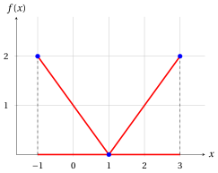
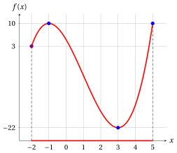
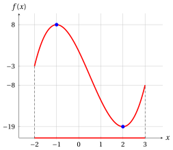
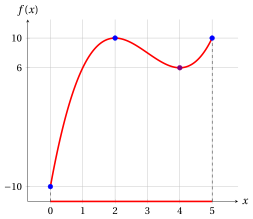
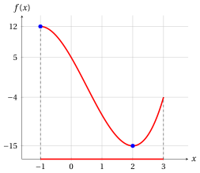
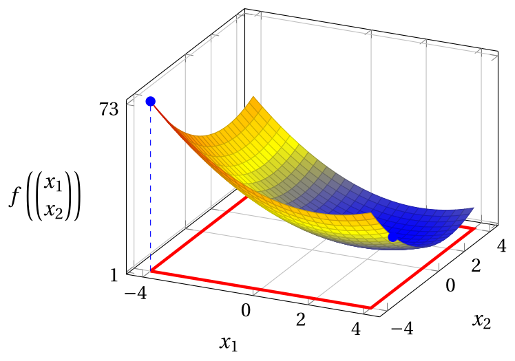
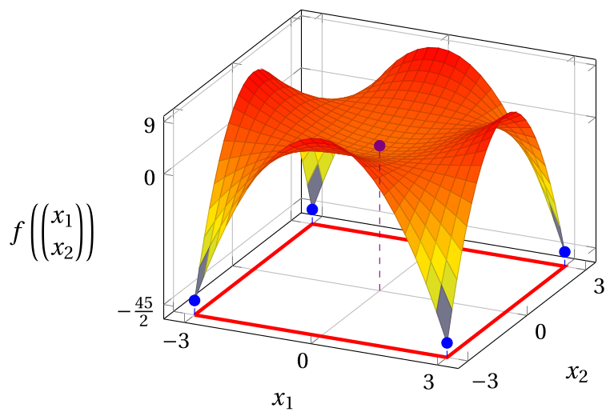
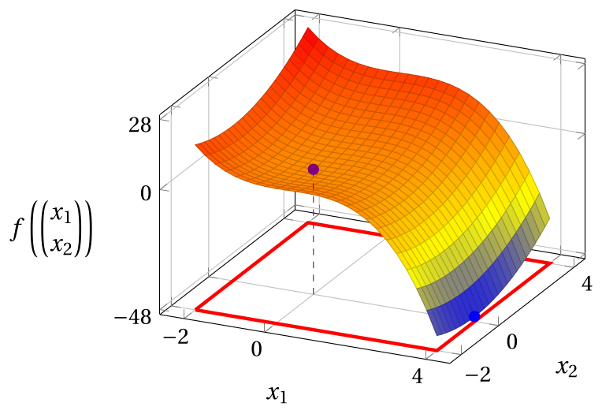
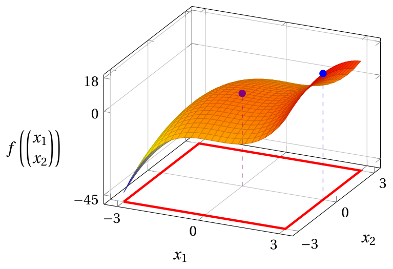
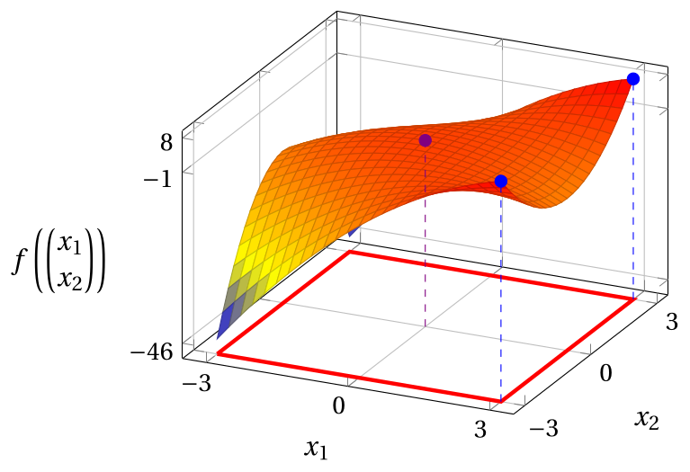

# Esercizi · Problemi di ottimizzazione

**Esercizi · Capitolo 5** · ogni soluzione si apre con un clic · [:material-book-open-variant: Capitolo 5](../problemi/05-problemi-ottimizzazione.md) · [:material-file-pdf-box: Eserciziario, volume 2 (PDF)](../pdf/esercizi-2-problemi-di-ottimizzazione.pdf)

## Problemi in una variabile

!!! esercizio "Esercizio 5.1: Problema di ottimizzazione (E1)"

    Consideriamo la seguente funzione obiettivo e la seguente regione ammissibile:

    $$
    f:\R \to \R,~ f: x \mapsto |x - 1|
    \qquad \text{e} \qquad
    F=\{\, x \in \R : -1 \le x \le 3 \,\} = [-1,3].
    $$

    **Domande**

    1. Scrivere i problemi di ottimizzazione associati in forma di minimo e in forma di massimo.

    2. Disegnare il grafico della funzione obiettivo sulla regione ammissibile.

    3. Trovare tutte le soluzioni ottime e il valore ottimo per entrambe le forme.

??? soluzione "Soluzione"

    1. I problemi di ottimizzazione associati, in forma di minimo e in forma di massimo, sono:

        \begin{equation*}
        \min \bigg\{\, |x - 1| \ \text{ soggetto a } -1 \le x \le 3 \,\bigg\}
        \end{equation*}

        \begin{equation*}
        \max \bigg\{\, |x - 1| \ \text{ soggetto a } -1 \le x \le 3 \,\bigg\}
        \end{equation*}

    2. Il grafico della funzione obiettivo sulla regione ammissibile è rosso; la regione ammissibile è la parte rossa dell'asse $x$ e le soluzioni ottime sono indicate in blu. Il grafico è formato da due segmenti, che si incontrano nel punto $(1,0)$.

        { .fig .ovale loading=lazy style="width:50%" }

    3. La regione ammissibile è l'intervallo $F=[-1,3]$. La funzione obiettivo vale $f(x) = 1 - x$ per $x \le 1$ e $f(x) = x - 1$ per $x \ge 1$: non è lineare, il suo grafico è formato da due segmenti.

        - Per la forma di minimo, poiché $f(x) = |x-1| \ge 0 = f(1)$ per ogni $x$ ammissibile, e $|x-1| = 0$ solo per $x = 1$, l'unica soluzione ottima e il valore ottimo sono:

            $$
            \tilde{\boldsymbol x}(P) = \left(1\right)
            \quad \text{e} \quad
            z(P) = 0.
            $$

        - Per la forma di massimo, per ogni $x$ ammissibile abbiamo $-2 \le x - 1 \le 2$ e quindi $f(x) = |x-1| \le 2$, con $|x-1| = 2$ solo per $x=-1$ e $x=3$. Il problema ha <strong>due</strong> soluzioni ottime e il valore ottimo è:

            $$
            \argmax \big\{\, |x - 1| \ \text{ soggetto a } -1 \le x \le 3 \,\big\} = \{-1,\,3\}
            \quad \text{e} \quad
            z(P) = 2.
            $$

!!! esercizio "Esercizio 5.2: Problema di ottimizzazione (E2)"

    Consideriamo la seguente funzione obiettivo e la seguente regione ammissibile:

    $$
    f:\R \to \R,~ f: x \mapsto -x^2 + 4x + 1
    \qquad \text{e} \qquad
    F=\{\, x \in \R : 0 \le x \le 5 \,\} = [0,5].
    $$

    **Domande**

    1. Scrivere i problemi di ottimizzazione associati in forma di minimo e in forma di massimo.

    2. Disegnare il grafico della funzione obiettivo sulla regione ammissibile.

    3. Trovare tutte le soluzioni ottime e il valore ottimo per entrambe le forme.

??? soluzione "Soluzione"

    1. I problemi di ottimizzazione associati, in forma di minimo e in forma di massimo, sono:

        \begin{equation*}
        \min \bigg\{\, -x^2 + 4x + 1 \ \text{ soggetto a } 0 \le x \le 5 \,\bigg\}
        \end{equation*}

        \begin{equation*}
        \max \bigg\{\, -x^2 + 4x + 1 \ \text{ soggetto a } 0 \le x \le 5 \,\bigg\}
        \end{equation*}

    2. Il grafico della funzione obiettivo sulla regione ammissibile è rosso; la regione ammissibile è la parte rossa dell'asse $x$ e le soluzioni ottime sono indicate in blu. Poiché $f$ assume valori negativi, l'asse $x$ è disegnato in basso nella figura; la linea orizzontale della griglia ad altezza $0$ è la retta $f(x)=0$.

        { .fig .ovale loading=lazy style="width:50%" }

    3. Completando il quadrato, la funzione obiettivo si può scrivere come

        $$
        f(x) = -x^2 + 4x + 1 = 5 - (x^2 - 4x + 4) = 5 - (x-2)^2 .
        $$

        - Per la forma di minimo, per ogni $x$ ammissibile abbiamo $-2 \le x - 2 \le 3$ e quindi $(x-2)^2 \le 9$, con $(x-2)^2 = 9$ solo per $x=5$ (l'altra soluzione $x=-1$ non è ammissibile). Quindi $f(x) = 5 - (x-2)^2 \ge -4 = f(5)$ e l'unica soluzione ottima e il valore ottimo sono:

            $$
            \tilde{\boldsymbol x}(P) = \left(5\right)
            \quad \text{e} \quad
            z(P) = -4.
            $$

        - Per la forma di massimo, poiché $(x-2)^2 \ge 0$, abbiamo $f(x) = 5 - (x-2)^2 \le 5 = f(2)$ per ogni $x$ ammissibile, con l'uguaglianza solo per $x=2$. L'unica soluzione ottima e il valore ottimo sono:

            $$
            \tilde{\boldsymbol x}(P) = \left(2\right)
            \quad \text{e} \quad
            z(P) = 5.
            $$

        Il valore nell'altro estremo della regione ammissibile, $f(0) = 1$, non è né il minimo né il massimo.

!!! esercizio "Esercizio 5.3: Problema di ottimizzazione (E3)"

    Consideriamo la seguente funzione obiettivo e la seguente regione ammissibile:

    $$
    f:\R \to \R,~ f: x \mapsto |x-1| + |x+1|
    \qquad \text{e} \qquad
    F=\{\, x \in \R : -3 \le x \le 2 \,\} = [-3,2].
    $$

    **Domande**

    1. Scrivere i problemi di ottimizzazione associati in forma di minimo e in forma di massimo.

    2. Disegnare il grafico della funzione obiettivo sulla regione ammissibile.

    3. Trovare tutte le soluzioni ottime e il valore ottimo per entrambe le forme.

??? soluzione "Soluzione"

    1. I problemi di ottimizzazione associati, in forma di minimo e in forma di massimo, sono:

        \begin{equation*}
        \min \bigg\{\, |x-1| + |x+1| \ \text{ soggetto a } -3 \le x \le 2 \,\bigg\}
        \end{equation*}

        \begin{equation*}
        \max \bigg\{\, |x-1| + |x+1| \ \text{ soggetto a } -3 \le x \le 2 \,\bigg\}
        \end{equation*}

    2. Il grafico della funzione obiettivo sulla regione ammissibile è rosso; la regione ammissibile è la parte rossa dell'asse $x$ e le soluzioni ottime sono indicate in blu. Eliminando i valori assoluti su ciascun intervallo, la funzione obiettivo è

        $$
        f(x) = \begin{cases} -2x & \text{se } x \le -1,\\ 2 & \text{se } -1 \le x \le 1,\\ 2x & \text{se } x \ge 1, \end{cases}
        $$

        e il suo grafico è formato da tre segmenti.

        { .fig .ovale loading=lazy style="width:50%" }

    3. La regione ammissibile è l'intervallo $F=[-3,2]$.

        - Per la forma di minimo, per la disuguaglianza triangolare,

            $$
            f(x) = |1-x| + |x+1| \ge |(1-x) + (x+1)| = 2 \qquad \forall x \in \R .
            $$

            Per $-1 \le x \le 1$ abbiamo $f(x) = (1-x) + (x+1) = 2$, mentre $f(x) = -2x > 2$ per $x < -1$ e $f(x) = 2x > 2$ per $x > 1$. Il problema ha <strong>infinite</strong> soluzioni ottime (il segmento blu) e il valore ottimo è:

            $$
            \argmin \big\{\, |x-1| + |x+1| \ \text{ soggetto a } -3 \le x \le 2 \,\big\} = [-1,1]
            \quad \text{e} \quad
            z(P) = 2.
            $$

        - Per la forma di massimo, confrontiamo i tre tratti: per $-3 \le x \le -1$ abbiamo $f(x) = -2x \le 6$, con l'uguaglianza solo per $x=-3$; per $-1 \le x \le 1$ abbiamo $f(x) = 2$; per $1 \le x \le 2$ abbiamo $f(x) = 2x \le 4$. L'unica soluzione ottima e il valore ottimo sono:

            $$
            \tilde{\boldsymbol x}(P) = \left(-3\right)
            \quad \text{e} \quad
            z(P) = 6.
            $$

!!! esercizio "Esercizio 5.4: Problema di ottimizzazione (E4)"

    Consideriamo la seguente funzione obiettivo e la seguente regione ammissibile:

    $$
    f:\R \to \R,~ f: x \mapsto x^2 - 4x + 5
    \qquad \text{e} \qquad
    F=\{\, x \in \R : x \ge 0 \,\} = [0,+\infty).
    $$

    **Domande**

    1. Scrivere i problemi di ottimizzazione associati in forma di minimo e in forma di massimo.

    2. Disegnare il grafico della funzione obiettivo sulla regione ammissibile.

    3. Trovare tutte le soluzioni ottime e il valore ottimo per entrambe le forme, oppure spiegare perché non esistono.

??? soluzione "Soluzione"

    1. I problemi di ottimizzazione associati, in forma di minimo e in forma di massimo, sono:

        \begin{equation*}
        \min \bigg\{\, x^2 - 4x + 5 \ \text{ soggetto a } x \ge 0 \,\bigg\}
        \end{equation*}

        \begin{equation*}
        \max \bigg\{\, x^2 - 4x + 5 \ \text{ soggetto a } x \ge 0 \,\bigg\}
        \end{equation*}

    2. Il grafico della funzione obiettivo sulla regione ammissibile è rosso; la regione ammissibile è la parte rossa dell'asse $x$ e le soluzioni ottime sono indicate in blu. La regione ammissibile è una semiretta: il grafico prosegue verso l'alto a destra della figura.

        { .fig .ovale loading=lazy style="width:50%" }

    3. Completando il quadrato, la funzione obiettivo si può scrivere come

        $$
        f(x) = x^2 - 4x + 5 = (x-2)^2 + 1 .
        $$

        - Per la forma di minimo, poiché $(x-2)^2 \ge 0$, abbiamo $f(x) \ge 1 = f(2)$ per ogni $x$ ammissibile, con l'uguaglianza solo per $x=2$. L'unica soluzione ottima e il valore ottimo sono:

            $$
            \tilde{\boldsymbol x}(P) = \left(2\right)
            \quad \text{e} \quad
            z(P) = 1.
            $$

        - Per la forma di massimo, la funzione obiettivo cresce indefinitamente: per ogni valore $M \ge 0$, il punto $x = M+3$ è ammissibile e

            $$
            f(M+3) = (M+1)^2 + 1 > M .
            $$

            Quindi nessuna soluzione ammissibile può essere ottima: il problema è <strong>illimitato</strong> e

            $$
            z(P) = +\infty .
            $$

!!! esercizio "Esercizio 5.5: Problema di ottimizzazione (E5)"

    Consideriamo la seguente funzione obiettivo e la seguente regione ammissibile:

    $$
    f:\R \to \R,~ f: x \mapsto x^2 + 1
    \qquad \text{e} \qquad
    F=\{\, x \in \R : x \ge 3,~ x^2 \le 4 \,\}.
    $$

    **Domande**

    1. Scrivere i problemi di ottimizzazione associati in forma di minimo e in forma di massimo.

    2. Disegnare sull'asse $x$ l'insieme dei punti che soddisfano ciascun vincolo.

    3. Trovare tutte le soluzioni ottime e il valore ottimo per entrambe le forme, oppure spiegare perché non esistono.

??? soluzione "Soluzione"

    1. I problemi di ottimizzazione associati, in forma di minimo e in forma di massimo, sono:

        \begin{equation*}
        \min \bigg\{\, x^2 + 1 \ \text{ soggetto a } x \ge 3,~ x^2 \le 4 \,\bigg\}
        \end{equation*}

        \begin{equation*}
        \max \bigg\{\, x^2 + 1 \ \text{ soggetto a } x \ge 3,~ x^2 \le 4 \,\bigg\}
        \end{equation*}

    2. Il vincolo $x^2 \le 4$ è soddisfatto esattamente dai punti dell'intervallo $[-2,2]$ (viola), poiché $x^2 \le 4$ se e solo se $|x| \le 2$. Il vincolo $x \ge 3$ è soddisfatto dai punti della semiretta $[3,+\infty)$ (arancione). I due insiemi non hanno punti in comune.

        { .fig .ovale loading=lazy style="width:50%" }

    3. Ogni punto con $x \ge 3$ ha $x^2 \ge 9 > 4$, quindi viola il secondo vincolo: nessun punto soddisfa entrambi i vincoli e la regione ammissibile è vuota,

        $$
        F = \{\, x \in \R : x \ge 3 \,\} \cap [-2,2] = \emptyset .
        $$

        Sia la forma di minimo sia la forma di massimo sono <strong>inammissibili</strong>: non hanno soluzioni ammissibili, quindi nemmeno soluzioni ottime, e $z(P)$ non è definito. La funzione obiettivo non ha alcun ruolo: lo stesso vale per ogni funzione obiettivo con questa regione ammissibile.

!!! esercizio "Esercizio 5.6: Problema di ottimizzazione (E6)"

    Consideriamo la seguente funzione obiettivo e la seguente regione ammissibile:

    $$
    f:\R \to \R,~ f: x \mapsto x^2 - 2x + 2
    \qquad \text{e} \qquad
    F=\{\, x \in \R : -1 \le x < 1 \,\} = [-1,1).
    $$

    **Domande**

    1. Scrivere i problemi di ottimizzazione associati in forma di minimo e in forma di massimo.

    2. Disegnare il grafico della funzione obiettivo sulla regione ammissibile.

    3. Trovare tutte le soluzioni ottime e il valore ottimo per entrambe le forme, oppure spiegare perché non esistono.

??? soluzione "Soluzione"

    1. I problemi di ottimizzazione associati, in forma di minimo e in forma di massimo, sono:

        \begin{equation*}
        \min \bigg\{\, x^2 - 2x + 2 \ \text{ soggetto a } -1 \le x < 1 \,\bigg\}
        \end{equation*}

        \begin{equation*}
        \max \bigg\{\, x^2 - 2x + 2 \ \text{ soggetto a } -1 \le x < 1 \,\bigg\}
        \end{equation*}

    2. Il grafico della funzione obiettivo sulla regione ammissibile è rosso; la regione ammissibile è la parte rossa dell'asse $x$ e le soluzioni ottime sono indicate in blu. Il punto $x=1$ non appartiene alla regione ammissibile (cerchi vuoti).

        { .fig .ovale loading=lazy style="width:50%" }

    3. Completando il quadrato, la funzione obiettivo si può scrivere come

        $$
        f(x) = x^2 - 2x + 2 = (x-1)^2 + 1 .
        $$

        - Per la forma di minimo, poiché $x \neq 1$ per ogni $x$ ammissibile, abbiamo $f(x) = (x-1)^2 + 1 > 1$; d'altra parte, i valori di $f$ si avvicinano a $1$ quanto vogliamo: per esempio $f\big(1-\frac{1}{k}\big) = 1 + \frac{1}{k^2}$ per ogni intero $k \ge 1$. L'estremo inferiore di $f$ su $F$ è $1$, ma nessuna soluzione ammissibile è ottima: per ogni $x \in F$, il punto $\frac{x+1}{2}$ è ammissibile (si trova tra $x$ e $1$) e

            $$
            f\Big(\frac{x+1}{2}\Big) = \Big(\frac{x-1}{2}\Big)^2 + 1 = \frac{(x-1)^2}{4} + 1 < (x-1)^2 + 1 = f(x).
            $$

            Il problema ha un <strong>estremo inferiore non raggiunto</strong>: non esiste una soluzione ottima e $z(P)$ non è definito.

        - Per la forma di massimo, per ogni $x$ ammissibile abbiamo $-2 \le x - 1 < 0$ e quindi $(x-1)^2 \le 4$, con l'uguaglianza solo per $x=-1$. Quindi $f(x) \le 5 = f(-1)$ e l'unica soluzione ottima e il valore ottimo sono:

            $$
            \tilde{\boldsymbol x}(P) = \left(-1\right)
            \quad \text{e} \quad
            z(P) = 5.
            $$

!!! esercizio "Esercizio 5.7: Problema di ottimizzazione (E7)"

    Consideriamo la seguente funzione obiettivo e la seguente regione ammissibile:

    $$
    f:\R \to \R,~ f: x \mapsto x^3 - 3x^2 - 9x + 5
    \qquad \text{e} \qquad
    F=\{\, x \in \R : -2 \le x \le 5 \,\} = [-2,5].
    $$

    **Domande**

    1. Scrivere i problemi di ottimizzazione associati in forma di minimo e in forma di massimo.

    2. Disegnare il grafico della funzione obiettivo sulla regione ammissibile.

    3. Trovare tutte le soluzioni ottime e il valore ottimo per entrambe le forme.

    4. Dimostrare che $x=-2$ è un punto di minimo locale di $f$ in $F$, ma non un punto di minimo (globale).

??? soluzione "Soluzione"

    1. I problemi di ottimizzazione associati, in forma di minimo e in forma di massimo, sono:

        \begin{equation*}
        \min \bigg\{\, x^3 - 3x^2 - 9x + 5 \ \text{ soggetto a } -2 \le x \le 5 \,\bigg\}
        \end{equation*}

        \begin{equation*}
        \max \bigg\{\, x^3 - 3x^2 - 9x + 5 \ \text{ soggetto a } -2 \le x \le 5 \,\bigg\}
        \end{equation*}

    2. Il grafico della funzione obiettivo sulla regione ammissibile è rosso; la regione ammissibile è la parte rossa dell'asse $x$ e le soluzioni ottime sono indicate in blu. Il punto di minimo locale che non è un punto di minimo globale è viola. Poiché $f$ assume valori negativi, l'asse $x$ è disegnato in basso nella figura.

        { .fig .ovale loading=lazy style="width:50%" }

    3. Confrontiamo $f$ con i valori ottimi candidati usando le seguenti fattorizzazioni, che si verificano sviluppando i prodotti:

        \begin{align*}
        f(x) + 22 &= x^3 - 3x^2 - 9x + 27 = (x-3)^2\,(x+3),\\
        f(x) - 10 &= x^3 - 3x^2 - 9x - 5 = (x+1)^2\,(x-5).
        \end{align*}

        - Per la forma di minimo, per ogni $x$ ammissibile abbiamo $x + 3 \ge 1 > 0$ e $(x-3)^2 \ge 0$, quindi $f(x) + 22 \ge 0$, cioè $f(x) \ge -22 = f(3)$, con l'uguaglianza solo per $x=3$. L'unica soluzione ottima e il valore ottimo sono:

            $$
            \tilde{\boldsymbol x}(P) = \left(3\right)
            \quad \text{e} \quad
            z(P) = -22.
            $$

        - Per la forma di massimo, per ogni $x$ ammissibile abbiamo $x - 5 \le 0$ e $(x+1)^2 \ge 0$, quindi $f(x) - 10 \le 0$, cioè $f(x) \le 10$, con l'uguaglianza solo per $x=-1$ e $x=5$. Il problema ha <strong>due</strong> soluzioni ottime e il valore ottimo è:

            $$
            \argmax \big\{\, x^3 - 3x^2 - 9x + 5 \ \text{ soggetto a } -2 \le x \le 5 \,\big\} = \{-1,\,5\}
            $$

            e

            $$
            z(P) = 10.
            $$

    4. Abbiamo $f(-2) = -8 - 12 + 18 + 5 = 3$ e

        $$
        f(x) - 3 = x^3 - 3x^2 - 9x + 2 = (x+2)\,(x^2 - 5x + 1).
        $$

        Per l'intorno sferico di raggio $\delta$ dato da $N\big((-2),1\big)$ abbiamo $N\big((-2),1\big) \cap [-2,5] = [-2,-1)$. Per ogni $x \in [-2,-1)$ abbiamo $x + 2 \ge 0$ e, poiché $x^2 \ge 1$ e $-5x > 5$, $x^2 - 5x + 1 > 7 > 0$. Quindi

        $$
        f(-2) = 3 ~\le~ f(x), \qquad \forall x \in N\big((-2),1\big) \cap [-2,5] = [-2,-1),
        $$

        e $x=-2$ è un punto di minimo locale di $f$ in $F$, con minimo locale $3$. Non è un punto di minimo (globale), poiché $f(3) = -22 < 3 = f(-2)$: un metodo di ottimizzazione che guardasse solo i punti vicini a $x=-2$ non troverebbe la soluzione ottima della forma di minimo.

!!! esercizio "Esercizio 5.8: Problema di ottimizzazione (E9)"

    Consideriamo la seguente funzione obiettivo lineare e la seguente regione ammissibile:

    $$
    f:\R \to \R,~ f: x \mapsto x - 1
    \qquad \text{e} \qquad
    F=\{\, x \in \R : 0 \le x < 3 \,\} = [0,3).
    $$

    **Domande**

    1. Scrivere i problemi di ottimizzazione associati in forma di minimo e in forma di massimo.

    2. Disegnare il grafico della funzione obiettivo sulla regione ammissibile.

    3. Trovare tutte le soluzioni ottime e il valore ottimo per entrambe le forme.

??? soluzione "Soluzione"

    1. I problemi di ottimizzazione associati, in forma di minimo e in forma di massimo, sono:

        \begin{equation*}
        \min \bigg\{\, x - 1 \ \text{ soggetto a } 0 \le x < 3 \,\bigg\}
        \end{equation*}

        \begin{equation*}
        \max \bigg\{\, x - 1 \ \text{ soggetto a } 0 \le x < 3 \,\bigg\}
        \end{equation*}

    2. Il grafico della funzione obiettivo sulla regione ammissibile è rosso; la regione ammissibile è la parte rossa dell'asse $x$ e le soluzioni ottime sono indicate in blu. Il punto $x=3$ non appartiene alla regione ammissibile: i cerchi vuoti indicano l'estremo escluso della regione ammissibile e del grafico.

        { .fig .ovale loading=lazy style="width:50%" }

    3. La regione ammissibile è l'intervallo $F=[0,3)$, che contiene $0$ ma non $3$, e la funzione lineare $f$ è strettamente crescente.

        - Per la forma di minimo, poiché per ogni $x$ ammissibile abbiamo $x \ge 0$ e quindi $f(x) = x - 1 \ge -1 = f(0)$, l'unica soluzione ottima e il valore ottimo sono:

            $$
            \tilde{\boldsymbol x}(P) = \left(0\right)
            \quad \text{e} \quad
            z(P) = -1.
            $$

        - Per la forma di massimo, per ogni $x$ ammissibile abbiamo $x < 3$ e quindi $f(x) = x - 1 < 2$; inoltre, per ogni $x$ ammissibile il punto $\frac{x+3}{2}$ è ammissibile e

            $$
            f\Big(\frac{x+3}{2}\Big) = \frac{x+1}{2} > x - 1 = f(x),
            $$

            quindi nessun punto ammissibile è ottimo, mentre $f(x)$ si avvicina a $2$ quanto vogliamo quando $x$ si avvicina a $3$. Il problema ha un <strong>estremo superiore non raggiunto</strong>: $\sup\{\, f(x) : x \in F \,\} = 2$ non è raggiunto, non esiste una soluzione ottima e

            $$
            \argmax \big\{\, x - 1 \ \text{ soggetto a } 0 \le x < 3 \,\big\} = \emptyset
            \quad \text{e} \quad
            z(P) \text{ non è definito}.
            $$

!!! esercizio "Esercizio 5.9: Problema di ottimizzazione (E10)"

    Consideriamo la seguente funzione:

    $$
    f:[-1,4] \to \R,~ f: x \mapsto 2 + 9x - 6x^2 + x^3.
    $$

    **Domande**

    1. Dimostrare, usando la definizione, che il punto $(3)$ è un punto di minimo locale di $f$ in $[-1,4]$.

    2. Dimostrare, usando la definizione, che il punto $(1)$ è un punto di massimo locale di $f$ in $[-1,4]$.

    3. Trovare tutti i punti di minimo e di massimo (globale) di $f$ in $[-1,4]$, cioè le soluzioni ottime dei problemi di ottimizzazione $\min\{\, f(x) \text{ soggetto a } -1 \le x \le 4 \,\}$ e $\max\{\, f(x) \text{ soggetto a } -1 \le x \le 4 \,\}$.

    4. Disegnare il grafico della funzione.

??? soluzione "Soluzione"

    1. Abbiamo $f(3) = 2 + 27 - 54 + 27 = 2$ e

        $$
        f(x) - f(3) = x^3 - 6x^2 + 9x = x\,(x-3)^2.
        $$

        Usiamo l'intorno sferico di raggio $\delta$ dato da $N\big((3),\frac{1}{2}\big)$, per il quale $N\big((3),\frac{1}{2}\big) \cap [-1,4] = \big(\frac{5}{2},\frac{7}{2}\big)$. Per ogni $x$ in questo intervallo abbiamo $x > 0$ e $(x-3)^2 \ge 0$, per cui $f(x) - f(3) \ge 0$. Quindi,

        $$
        f(3) = 2 ~\le~ f(x), \qquad \forall x \in N\Big((3),\frac{1}{2}\Big) \cap [-1,4] = \Big(\frac{5}{2},\frac{7}{2}\Big),
        $$

        e $x=3$ è un punto di minimo locale di $f$ in $[-1,4]$, con minimo locale $2$.

    2. Abbiamo $f(1) = 2 + 9 - 6 + 1 = 6$ e

        $$
        f(x) - f(1) = x^3 - 6x^2 + 9x - 4 = (x-4)\,(x-1)^2.
        $$

        Usiamo l'intorno sferico di raggio $\delta$ dato da $N\big((1),\frac{1}{2}\big)$, per il quale $N\big((1),\frac{1}{2}\big) \cap [-1,4] = \big(\frac{1}{2},\frac{3}{2}\big)$. Per ogni $x$ in questo intervallo abbiamo $x - 4 < 0$ e $(x-1)^2 \ge 0$, per cui $f(x) - f(1) \le 0$. Quindi,

        $$
        f(1) = 6 ~\ge~ f(x), \qquad \forall x \in N\Big((1),\frac{1}{2}\Big) \cap [-1,4] = \Big(\frac{1}{2},\frac{3}{2}\Big),
        $$

        e $x=1$ è un punto di massimo locale di $f$ in $[-1,4]$, con massimo locale $6$.

    3. Studiamo separatamente il minimo e il massimo.

        - <strong>Minimo.</strong> Abbiamo $f(-1) = 2 - 9 - 6 - 1 = -14$ e

            $$
            f(x) + 14 = x^3 - 6x^2 + 9x + 16 = (x+1)\,(x^2 - 7x + 16) = (x+1)\left(\Big(x-\frac{7}{2}\Big)^2 + \frac{15}{4}\right).
            $$

            Per ogni $x \in [-1,4]$ abbiamo $x + 1 \ge 0$, e il secondo fattore è positivo, quindi $f(x) \ge -14 = f(-1)$, con l'uguaglianza solo per $x=-1$. L'unico punto di minimo è $x=-1$ e il minimo è $-14$. Il punto di minimo locale $x=3$ non è un punto di minimo (globale), poiché $f(-1) = -14 < 2 = f(3)$.

        - <strong>Massimo.</strong> La fattorizzazione della seconda domanda vale per ogni $x$: per ogni $x \in [-1,4]$ abbiamo $x - 4 \le 0$, quindi $f(x) - 6 = (x-4)(x-1)^2 \le 0$, con l'uguaglianza solo per $x=1$ e $x=4$. La funzione ha <strong>due</strong> punti di massimo e il massimo è $6$:

            $$
            \argmax \big\{\, f(x) \ \text{ soggetto a } -1 \le x \le 4 \,\big\} = \{1,\,4\}.
            $$

            Il punto di massimo locale $x=1$ è anche un punto di massimo (globale).

    4. Il grafico della funzione è rosso; il dominio è la parte rossa dell'asse $x$, i punti di minimo e di massimo (globale) sono blu e i punti di minimo o di massimo locale che non sono globali sono viola. Poiché $f$ assume valori negativi, l'asse $x$ è disegnato in basso nella figura.

        { .fig .ovale loading=lazy style="width:50%" }

!!! esercizio "Esercizio 5.10: Problema di ottimizzazione (E11)"

    Consideriamo la seguente funzione:

    $$
    f:[0,4] \to \R,~ f: x \mapsto 5 + 54x - 2x^3.
    $$

    **Domande**

    1. Dimostrare, usando la definizione, che il punto $(3)$ è un punto di massimo locale di $f$ in $[0,4]$.

    2. Dimostrare, usando la definizione, che il punto $(4)$ è un punto di minimo locale di $f$ in $[0,4]$.

    3. Trovare tutti i punti di minimo e di massimo (globale) di $f$ in $[0,4]$, cioè le soluzioni ottime dei problemi di ottimizzazione $\min\{\, f(x) \text{ soggetto a } 0 \le x \le 4 \,\}$ e $\max\{\, f(x) \text{ soggetto a } 0 \le x \le 4 \,\}$.

    4. Disegnare il grafico della funzione.

??? soluzione "Soluzione"

    1. Abbiamo $f(3) = 5 + 162 - 54 = 113$ e

        $$
        f(3) - f(x) = 2x^3 - 54x + 108 = 2\,(x-3)^2\,(x+6).
        $$

        Usiamo l'intorno sferico di raggio $\delta$ dato da $N\big((3),1\big)$, per il quale $N\big((3),1\big) \cap [0,4] = (2,4)$. Per ogni $x$ in questo intervallo abbiamo $x + 6 > 0$ e $(x-3)^2 \ge 0$, per cui $f(3) - f(x) \ge 0$. Quindi,

        $$
        f(3) = 113 ~\ge~ f(x), \qquad \forall x \in N\big((3),1\big) \cap [0,4] = (2,4),
        $$

        e $x=3$ è un punto di massimo locale di $f$ in $[0,4]$, con massimo locale $113$.

    2. Abbiamo $f(4) = 5 + 216 - 128 = 93$ e

        $$
        f(x) - f(4) = -2x^3 + 54x - 88 = -2\,(x-4)\,(x^2 + 4x - 11).
        $$

        Usiamo l'intorno sferico di raggio $\delta$ dato da $N\big((4),\frac{1}{2}\big)$, per il quale $N\big((4),\frac{1}{2}\big) \cap [0,4] = \big(\frac{7}{2},4\big]$. Per ogni $x$ in questo intervallo abbiamo $x - 4 \le 0$ e, poiché $x > \frac{7}{2}$,

        $$
        x^2 + 4x - 11 > \frac{49}{4} + 14 - 11 = \frac{61}{4} > 0,
        $$

        quindi $f(x) - f(4) = -2\,(x-4)\,(x^2+4x-11) \ge 0$. Quindi,

        $$
        f(4) = 93 ~\le~ f(x), \qquad \forall x \in N\Big((4),\frac{1}{2}\Big) \cap [0,4] = \Big(\frac{7}{2},4\Big],
        $$

        e $x=4$ è un punto di minimo locale di $f$ in $[0,4]$, con minimo locale $93$.

    3. Studiamo separatamente il minimo e il massimo.

        - <strong>Massimo.</strong> La fattorizzazione della prima domanda vale per ogni $x$: per ogni $x \in [0,4]$ abbiamo $x + 6 > 0$, quindi $f(3) - f(x) = 2(x-3)^2(x+6) \ge 0$, con l'uguaglianza solo per $x=3$. L'unico punto di massimo è $x=3$ e il massimo è $113$: il punto di massimo locale è anche un punto di massimo (globale).

        - <strong>Minimo.</strong> Abbiamo $f(0) = 5$ e

            $$
            f(x) - 5 = 54x - 2x^3 = 2x\,(27 - x^2).
            $$

            Per ogni $x \in [0,4]$ abbiamo $x \ge 0$ e $x^2 \le 16 < 27$, quindi $f(x) \ge 5 = f(0)$, con l'uguaglianza solo per $x=0$. L'unico punto di minimo è $x=0$ e il minimo è $5$. Il punto di minimo locale $x=4$ non è un punto di minimo (globale), poiché $f(0) = 5 < 93 = f(4)$.

    4. Il grafico della funzione è rosso; il dominio è la parte rossa dell'asse $x$, i punti di minimo e di massimo (globale) sono blu e i punti di minimo o di massimo locale che non sono globali sono viola.

        { .fig .ovale loading=lazy style="width:50%" }

!!! esercizio "Esercizio 5.11: Problema di ottimizzazione (E12)"

    Consideriamo la seguente funzione:

    $$
    f:[-2,3] \to \R,~ f: x \mapsto 1 - 12x - 3x^2 + 2x^3.
    $$

    **Domande**

    1. Dimostrare, usando la definizione, che il punto $(-1)$ è un punto di massimo locale di $f$ in $[-2,3]$.

    2. Dimostrare, usando la definizione, che il punto $(2)$ è un punto di minimo locale di $f$ in $[-2,3]$.

    3. Trovare tutti i punti di minimo e di massimo (globale) di $f$ in $[-2,3]$, cioè le soluzioni ottime dei problemi di ottimizzazione $\min\{\, f(x) \text{ soggetto a } -2 \le x \le 3 \,\}$ e $\max\{\, f(x) \text{ soggetto a } -2 \le x \le 3 \,\}$.

    4. Disegnare il grafico della funzione.

??? soluzione "Soluzione"

    1. Abbiamo $f(-1) = 1 + 12 - 3 - 2 = 8$ e

        $$
        f(x) - f(-1) = 2x^3 - 3x^2 - 12x - 7 = (x+1)^2\,(2x-7).
        $$

        Usiamo l'intorno sferico di raggio $\delta$ dato da $N\big((-1),1\big)$, per il quale $N\big((-1),1\big) \cap [-2,3] = (-2,0)$. Per ogni $x$ in questo intervallo abbiamo $2x - 7 < 0$ e $(x+1)^2 \ge 0$, per cui $f(x) - f(-1) \le 0$. Quindi,

        $$
        f(-1) = 8 ~\ge~ f(x), \qquad \forall x \in N\big((-1),1\big) \cap [-2,3] = (-2,0),
        $$

        e $x=-1$ è un punto di massimo locale di $f$ in $[-2,3]$, con massimo locale $8$.

    2. Abbiamo $f(2) = 1 - 24 - 12 + 16 = -19$ e

        $$
        f(x) - f(2) = 2x^3 - 3x^2 - 12x + 20 = (x-2)^2\,(2x+5).
        $$

        Usiamo l'intorno sferico di raggio $\delta$ dato da $N\big((2),1\big)$, per il quale $N\big((2),1\big) \cap [-2,3] = (1,3)$. Per ogni $x$ in questo intervallo abbiamo $2x + 5 > 0$ e $(x-2)^2 \ge 0$, per cui $f(x) - f(2) \ge 0$. Quindi,

        $$
        f(2) = -19 ~\le~ f(x), \qquad \forall x \in N\big((2),1\big) \cap [-2,3] = (1,3),
        $$

        e $x=2$ è un punto di minimo locale di $f$ in $[-2,3]$, con minimo locale $-19$.

    3. Le due fattorizzazioni valgono per ogni $x$, e ogni $x \in [-2,3]$ soddisfa $2x - 7 \le -1 < 0$ e $2x + 5 \ge 1 > 0$. Allora, per ogni $x \in [-2,3]$,

        $$
        f(x) - 8 = (x+1)^2\,(2x-7) \le 0
        \qquad \text{e} \qquad
        f(x) + 19 = (x-2)^2\,(2x+5) \ge 0,
        $$

        con l'uguaglianza, rispettivamente, solo per $x=-1$ e solo per $x=2$. L'unico punto di massimo è $x=-1$, con massimo $8$, e l'unico punto di minimo è $x=2$, con minimo $-19$: entrambi i punti delle prime due domande sono ottimi globali.

    4. Il grafico della funzione è rosso; il dominio è la parte rossa dell'asse $x$, i punti di minimo e di massimo (globale) sono blu. Poiché $f$ assume valori negativi, l'asse $x$ è disegnato in basso nella figura. Negli estremi abbiamo $f(-2) = -3$ e $f(3) = -8$: poiché $f$ è crescente vicino a entrambi gli estremi, $x=-2$ è un punto di minimo locale e $x=3$ è un punto di massimo locale, che non sono globali, e sono viola.

        { .fig .ovale loading=lazy style="width:50%" }

!!! esercizio "Esercizio 5.12: Problema di ottimizzazione (E13)"

    Consideriamo la seguente funzione:

    $$
    f:[-2,3] \to \R,~ f: x \mapsto 3 - 2x^2 + x^4.
    $$

    **Domande**

    1. Dimostrare, usando la definizione, che il punto $(-1)$ è un punto di minimo locale di $f$ in $[-2,3]$.

    2. Dimostrare, usando la definizione, che il punto $(0)$ è un punto di massimo locale di $f$ in $[-2,3]$.

    3. Dimostrare, usando la definizione, che il punto $(1)$ è un punto di minimo locale di $f$ in $[-2,3]$.

    4. Trovare tutti i punti di minimo e di massimo (globale) di $f$ in $[-2,3]$, cioè le soluzioni ottime dei problemi di ottimizzazione $\min\{\, f(x) \text{ soggetto a } -2 \le x \le 3 \,\}$ e $\max\{\, f(x) \text{ soggetto a } -2 \le x \le 3 \,\}$.

    5. Disegnare il grafico della funzione nell'intervallo $[-2,2]$.

??? soluzione "Soluzione"

    1. Abbiamo $f(-1) = 3 - 2 + 1 = 2$ e

        $$
        f(x) - f(-1) = x^4 - 2x^2 + 1 = (x^2-1)^2 \ge 0, \qquad \forall x \in \R.
        $$

        In particolare, per l'intorno sferico di raggio $\delta$ dato da $N\big((-1),\frac{1}{2}\big)$ abbiamo

        $$
        f(-1) = 2 ~\le~ f(x), \qquad \forall x \in N\Big((-1),\frac{1}{2}\Big) \cap [-2,3] = \Big(-\frac{3}{2},-\frac{1}{2}\Big),
        $$

        e $x=-1$ è un punto di minimo locale di $f$ in $[-2,3]$, con minimo locale $2$.

    2. Abbiamo $f(0) = 3$ e

        $$
        f(x) - f(0) = x^4 - 2x^2 = x^2\,(x^2-2).
        $$

        Usiamo l'intorno sferico di raggio $\delta$ dato da $N\big((0),\frac{1}{2}\big)$, per il quale $N\big((0),\frac{1}{2}\big) \cap [-2,3] = {\big(-\frac{1}{2},\frac{1}{2}\big)}$. Per ogni $x$ in questo intervallo abbiamo $x^2 < \frac{1}{4} < 2$, per cui $f(x) - f(0) \le 0$. Quindi,

        $$
        f(0) = 3 ~\ge~ f(x), \qquad \forall x \in N\Big((0),\frac{1}{2}\Big) \cap [-2,3] = \Big(-\frac{1}{2},\frac{1}{2}\Big),
        $$

        e $x=0$ è un punto di massimo locale di $f$ in $[-2,3]$, con massimo locale $3$.

    3. Abbiamo $f(1) = 2$ e, come nella prima domanda, $f(x) - f(1) = (x^2-1)^2 \ge 0$ per ogni $x \in \R$. In particolare,

        $$
        f(1) = 2 ~\le~ f(x), \qquad \forall x \in N\Big((1),\frac{1}{2}\Big) \cap [-2,3] = \Big(\frac{1}{2},\frac{3}{2}\Big),
        $$

        e $x=1$ è un punto di minimo locale di $f$ in $[-2,3]$, con minimo locale $2$.

    4. Studiamo separatamente il minimo e il massimo.

        - <strong>Minimo.</strong> Per ogni $x \in [-2,3]$ abbiamo $f(x) - 2 = (x^2-1)^2 \ge 0$, con l'uguaglianza solo per $x=-1$ e $x=1$. La funzione ha <strong>due</strong> punti di minimo e il minimo è $2$:

            $$
            \argmin \big\{\, f(x) \ \text{ soggetto a } -2 \le x \le 3 \,\big\} = \{-1,\,1\}.
            $$

        - <strong>Massimo.</strong> Abbiamo $f(3) = 3 - 18 + 81 = 66$ e

            $$
            66 - f(x) = 63 + 2x^2 - x^4 = (9 - x^2)\,(x^2 + 7).
            $$

            Per ogni $x \in [-2,3]$ abbiamo $x^2 \le 9$, quindi $f(x) \le 66 = f(3)$, con l'uguaglianza solo per $x=3$ (il valore $x=-3$ non appartiene al dominio). L'unico punto di massimo è $x=3$ e il massimo è $66$. Il punto di massimo locale $x=0$ non è un punto di massimo (globale), poiché $f(0) = 3 < 66 = f(3)$.

    5. Il grafico della funzione nell'intervallo $[-2,2]$ è rosso e l'intervallo $[-2,2]$, che è una parte del dominio, è la parte rossa dell'asse $x$; i punti di minimo (globale) sono blu e il punto di massimo locale che non è globale è viola. Il punto di massimo $x=3$, con $f(3)=66$, è fuori dalla figura.

        { .fig .ovale loading=lazy style="width:50%" }

!!! esercizio "Esercizio 5.13: Problema di ottimizzazione (E14)"

    Consideriamo la seguente funzione:

    $$
    f:[0,5] \to \R,~ f: x \mapsto x^3 - 9x^2 + 24x - 10.
    $$

    **Domande**

    1. Dimostrare, usando la definizione, che il punto $(2)$ è un punto di massimo locale di $f$ in $[0,5]$.

    2. Dimostrare, usando la definizione, che il punto $(4)$ è un punto di minimo locale di $f$ in $[0,5]$.

    3. Trovare tutti i punti di minimo e di massimo (globale) di $f$ in $[0,5]$, cioè le soluzioni ottime dei problemi di ottimizzazione $\min\{\, f(x) \text{ soggetto a } 0 \le x \le 5 \,\}$ e $\max\{\, f(x) \text{ soggetto a } 0 \le x \le 5 \,\}$.

    4. Disegnare il grafico della funzione.

??? soluzione "Soluzione"

    1. Abbiamo $f(2) = 8 - 36 + 48 - 10 = 10$ e

        $$
        f(x) - f(2) = x^3 - 9x^2 + 24x - 20 = (x-2)^2\,(x-5).
        $$

        Usiamo l'intorno sferico di raggio $\delta$ dato da $N\big((2),1\big)$, per il quale $N\big((2),1\big) \cap [0,5] = (1,3)$. Per ogni $x$ in questo intervallo abbiamo $x - 5 < 0$ e $(x-2)^2 \ge 0$, per cui $f(x) - f(2) \le 0$. Quindi,

        $$
        f(2) = 10 ~\ge~ f(x), \qquad \forall x \in N\big((2),1\big) \cap [0,5] = (1,3),
        $$

        e $x=2$ è un punto di massimo locale di $f$ in $[0,5]$, con massimo locale $10$.

    2. Abbiamo $f(4) = 64 - 144 + 96 - 10 = 6$ e

        $$
        f(x) - f(4) = x^3 - 9x^2 + 24x - 16 = (x-4)^2\,(x-1).
        $$

        Usiamo l'intorno sferico di raggio $\delta$ dato da $N\big((4),1\big)$, per il quale $N\big((4),1\big) \cap [0,5] = (3,5)$. Per ogni $x$ in questo intervallo abbiamo $x - 1 > 0$ e $(x-4)^2 \ge 0$, per cui $f(x) - f(4) \ge 0$. Quindi,

        $$
        f(4) = 6 ~\le~ f(x), \qquad \forall x \in N\big((4),1\big) \cap [0,5] = (3,5),
        $$

        e $x=4$ è un punto di minimo locale di $f$ in $[0,5]$, con minimo locale $6$.

    3. Studiamo separatamente il minimo e il massimo.

        - <strong>Massimo.</strong> La fattorizzazione della prima domanda vale per ogni $x$: per ogni $x \in [0,5]$ abbiamo $x - 5 \le 0$, quindi $f(x) - 10 = (x-2)^2(x-5) \le 0$, con l'uguaglianza solo per $x=2$ e $x=5$. La funzione ha <strong>due</strong> punti di massimo e il massimo è $10$:

            $$
            \argmax \big\{\, f(x) \ \text{ soggetto a } 0 \le x \le 5 \,\big\} = \{2,\,5\}.
            $$

            Il punto di massimo locale $x=2$ è anche un punto di massimo (globale).

        - <strong>Minimo.</strong> Abbiamo $f(0) = -10$ e

            $$
            f(x) + 10 = x^3 - 9x^2 + 24x = x\,(x^2 - 9x + 24) = x\left(\Big(x-\frac{9}{2}\Big)^2 + \frac{15}{4}\right).
            $$

            Per ogni $x \in [0,5]$ abbiamo $x \ge 0$, e il secondo fattore è positivo, quindi $f(x) \ge -10 = f(0)$, con l'uguaglianza solo per $x=0$. L'unico punto di minimo è $x=0$ e il minimo è $-10$. Il punto di minimo locale $x=4$ non è un punto di minimo (globale), poiché $f(0) = -10 < 6 = f(4)$.

    4. Il grafico della funzione è rosso; il dominio è la parte rossa dell'asse $x$, i punti di minimo e di massimo (globale) sono blu e i punti di minimo o di massimo locale che non sono globali sono viola. Poiché $f$ assume valori negativi, l'asse $x$ è disegnato in basso nella figura.

        { .fig .ovale loading=lazy style="width:50%" }

!!! esercizio "Esercizio 5.14: Problema di ottimizzazione (E15)"

    Consideriamo la seguente funzione:

    $$
    f:[-1,3] \to \R,~ f: x \mapsto 2x^3 - 3x^2 - 12x + 5.
    $$

    **Domande**

    1. Dimostrare, usando la definizione, che il punto $(-1)$ è un punto di massimo locale di $f$ in $[-1,3]$.

    2. Dimostrare, usando la definizione, che il punto $(2)$ è un punto di minimo locale di $f$ in $[-1,3]$.

    3. Trovare tutti i punti di minimo e di massimo (globale) di $f$ in $[-1,3]$, cioè le soluzioni ottime dei problemi di ottimizzazione $\min\{\, f(x) \text{ soggetto a } -1 \le x \le 3 \,\}$ e $\max\{\, f(x) \text{ soggetto a } -1 \le x \le 3 \,\}$.

    4. Disegnare il grafico della funzione.

??? soluzione "Soluzione"

    1. Abbiamo $f(-1) = -2 - 3 + 12 + 5 = 12$ e

        $$
        f(x) - f(-1) = 2x^3 - 3x^2 - 12x - 7 = (x+1)^2\,(2x-7).
        $$

        Usiamo l'intorno sferico di raggio $\delta$ dato da $N\big((-1),\frac{1}{2}\big) = \big(-\frac{3}{2},-\frac{1}{2}\big)$. Il punto $x=-1$ è l'estremo sinistro del dominio, quindi si considerano solo i punti alla sua destra: $N\big((-1),\frac{1}{2}\big) \cap [-1,3] = \big[-1,-\frac{1}{2}\big)$. Per ogni $x$ in questo intervallo abbiamo $2x - 7 < 0$ e $(x+1)^2 \ge 0$, per cui $f(x) - f(-1) \le 0$. Quindi,

        $$
        f(-1) = 12 ~\ge~ f(x), \qquad \forall x \in N\Big((-1),\frac{1}{2}\Big) \cap [-1,3] = \Big[-1,-\frac{1}{2}\Big),
        $$

        e $x=-1$ è un punto di massimo locale di $f$ in $[-1,3]$, con massimo locale $12$.

    2. Abbiamo $f(2) = 16 - 12 - 24 + 5 = -15$ e

        $$
        f(x) - f(2) = 2x^3 - 3x^2 - 12x + 20 = (x-2)^2\,(2x+5).
        $$

        Usiamo l'intorno sferico di raggio $\delta$ dato da $N\big((2),\frac{1}{2}\big)$, per il quale $N\big((2),\frac{1}{2}\big) \cap [-1,3] = \big(\frac{3}{2},\frac{5}{2}\big)$. Per ogni $x$ in questo intervallo abbiamo $2x + 5 > 0$ e $(x-2)^2 \ge 0$, per cui $f(x) - f(2) \ge 0$. Quindi,

        $$
        f(2) = -15 ~\le~ f(x), \qquad \forall x \in N\Big((2),\frac{1}{2}\Big) \cap [-1,3] = \Big(\frac{3}{2},\frac{5}{2}\Big),
        $$

        e $x=2$ è un punto di minimo locale di $f$ in $[-1,3]$, con minimo locale $-15$.

    3. Le due fattorizzazioni valgono per ogni $x$, e ogni $x \in [-1,3]$ soddisfa $2x - 7 \le -1 < 0$ e $2x + 5 \ge 3 > 0$. Allora, per ogni $x \in [-1,3]$,

        $$
        f(x) - 12 = (x+1)^2\,(2x-7) \le 0
        \qquad \text{e} \qquad
        f(x) + 15 = (x-2)^2\,(2x+5) \ge 0,
        $$

        con l'uguaglianza, rispettivamente, solo per $x=-1$ e solo per $x=2$. L'unico punto di massimo è $x=-1$, con massimo $12$, e l'unico punto di minimo è $x=2$, con minimo $-15$: entrambi i punti delle prime due domande sono ottimi globali.

    4. Il grafico della funzione è rosso; il dominio è la parte rossa dell'asse $x$, i punti di minimo e di massimo (globale) sono blu. Poiché $f$ assume valori negativi, l'asse $x$ è disegnato in basso nella figura. Nell'estremo destro abbiamo $f(3) = -4$: poiché $f$ è crescente vicino a $x=3$, è un punto di massimo locale che non è globale, ed è viola.

        { .fig .ovale loading=lazy style="width:50%" }

## Problemi in due variabili

!!! esercizio "Esercizio 5.15: Problema di ottimizzazione (E8)"

    Consideriamo la seguente funzione obiettivo di due variabili e la seguente regione ammissibile:

    $$
    f:\R^2 \to \R,~ f: \begin{pmatrix}x_1\\x_2\end{pmatrix} \mapsto (x_1 - x_2)^2
    $$

    e

    $$
    F=\{\, \boldsymbol x \in \R^2 : 0 \le x_1 \le 2,~ 0 \le x_2 \le 2 \,\} = [0,2]\times[0,2].
    $$

    **Domande**

    1. Scrivere i problemi di ottimizzazione associati in forma di minimo e in forma di massimo.

    2. Disegnare la regione ammissibile e le curve di livello della funzione obiettivo di valore $0$, $1$ e $4$.

    3. Trovare tutte le soluzioni ottime e il valore ottimo per entrambe le forme.

??? soluzione "Soluzione"

    1. I problemi di ottimizzazione associati, in forma di minimo e in forma di massimo, sono:

        \begin{equation*}
        \min \bigg\{\, (x_1 - x_2)^2 \ \text{ soggetto a } 0 \le x_1 \le 2,~ 0 \le x_2 \le 2 \,\bigg\}
        \end{equation*}

        \begin{equation*}
        \max \bigg\{\, (x_1 - x_2)^2 \ \text{ soggetto a } 0 \le x_1 \le 2,~ 0 \le x_2 \le 2 \,\bigg\}
        \end{equation*}

    2. La regione ammissibile è il quadrato rosso. Poiché $f(\boldsymbol x) = c$ se e solo se $x_1 - x_2 = \sqrt{c}$ oppure $x_1 - x_2 = -\sqrt{c}$, le curve di livello sono rette parallele alla retta $x_1 = x_2$: la curva di livello di valore $0$ è la retta $x_1 = x_2$, quella di valore $1$ è formata dalle due rette $x_1 - x_2 = \pm 1$ (tratteggiate) e quella di valore $4$ è formata dalle due rette $x_1 - x_2 = \pm 2$, che toccano il quadrato solo nei vertici $(2,0)$ e $(0,2)$. Le soluzioni ottime sono blu.

        { .fig .ovale loading=lazy style="width:50%" }

    3. La regione ammissibile è il quadrato $F=[0,2]\times[0,2]$.

        - Per la forma di minimo, $f(\boldsymbol x) = (x_1 - x_2)^2 \ge 0$ per ogni $\boldsymbol x$ ammissibile, con l'uguaglianza esattamente quando $x_1 = x_2$. Il problema ha <strong>infinite</strong> soluzioni ottime (la diagonale blu del quadrato) e il valore ottimo è:

            $$
            \argmin \big\{\, (x_1 - x_2)^2 \ \text{ soggetto a } \boldsymbol x \in F \,\big\} = \left\{ \begin{pmatrix} t\\ t \end{pmatrix} : 0 \le t \le 2 \right\}
            \quad \text{e} \quad
            z(P) = 0.
            $$

        - Per la forma di massimo, per ogni $\boldsymbol x$ ammissibile abbiamo $0 \le x_1 \le 2$ e $-2 \le -x_2 \le 0$, quindi $-2 \le x_1 - x_2 \le 2$ e $f(\boldsymbol x) \le 4$. L'uguaglianza $x_1 - x_2 = 2$ vale solo per $x_1 = 2$ e $x_2 = 0$, e $x_1 - x_2 = -2$ solo per $x_1 = 0$ e $x_2 = 2$. Il problema ha <strong>due</strong> soluzioni ottime e il valore ottimo è:

            $$
            \argmax \big\{\, (x_1 - x_2)^2 \ \text{ soggetto a } \boldsymbol x \in F \,\big\} = \left\{ \begin{pmatrix} 2\\ 0 \end{pmatrix},\, \begin{pmatrix} 0\\ 2 \end{pmatrix} \right\}
            \quad \text{e} \quad
            z(P) = 4.
            $$

!!! esercizio "Esercizio 5.16: Problema di ottimizzazione (E16)"

    Consideriamo la seguente funzione:

    $$
    f: D \to \R,~ f: \begin{pmatrix}x_1\\x_2\end{pmatrix} \mapsto x_1 + x_2,
    \qquad \text{con} \qquad
    D = [-2,2]\times[-2,2].
    $$

    **Domande**

    1. Dimostrare, usando la definizione, che il punto $\begin{pmatrix}-2\\-2\end{pmatrix}$ è l'unico punto di minimo di $f$ in $D$.

    2. Dimostrare, usando la definizione, che il punto $\begin{pmatrix}2\\2\end{pmatrix}$ è l'unico punto di massimo di $f$ in $D$.

    3. Disegnare il grafico della funzione nel dominio $D$.

??? soluzione "Soluzione"

    1. Per ogni $\begin{pmatrix}x_1\\x_2\end{pmatrix}\in D$ abbiamo $x_1 \ge -2$ e $x_2 \ge -2$. Quindi,

        $$
        f\!\left(\begin{pmatrix}x_1\\x_2\end{pmatrix}\right)
        = x_1 + x_2
        \ge -2 + (-2)
        = -4
        = f\!\left(\begin{pmatrix}-2\\-2\end{pmatrix}\right),
        $$

        con l'uguaglianza solo per $x_1 = x_2 = -2$. Di conseguenza,

        $$
        f\!\left(\begin{pmatrix}-2\\-2\end{pmatrix}\right)
        ~\le~
        f\!\left(\begin{pmatrix}x_1\\x_2\end{pmatrix}\right),
        \qquad
        \forall \begin{pmatrix}x_1\\x_2\end{pmatrix}\in D,
        $$

        e $\begin{pmatrix}-2\\-2\end{pmatrix}$ è l'unico punto di minimo di $f$ in $D$, con minimo $-4$.

    2. Per ogni $\begin{pmatrix}x_1\\x_2\end{pmatrix}\in D$ abbiamo $x_1 \le 2$ e $x_2 \le 2$. Quindi,

        $$
        f\!\left(\begin{pmatrix}x_1\\x_2\end{pmatrix}\right)
        = x_1 + x_2
        \le 2 + 2
        = 4
        = f\!\left(\begin{pmatrix}2\\2\end{pmatrix}\right),
        $$

        con l'uguaglianza solo per $x_1 = x_2 = 2$, e $\begin{pmatrix}2\\2\end{pmatrix}$ è l'unico punto di massimo di $f$ in $D$, con massimo $4$.

    3. Il grafico della funzione è la superficie sopra il dominio $D$, che è il quadrato rosso disegnato sul piano di base; i punti del grafico corrispondenti al punto di minimo e al punto di massimo sono blu, con un segmento tratteggiato che li collega al piano di base.

        { .fig .ovale loading=lazy style="width:59%" }

!!! esercizio "Esercizio 5.17: Problema di ottimizzazione (E17)"

    Consideriamo la seguente funzione:

    $$
    f: D \to \R,~ f: \begin{pmatrix}x_1\\x_2\end{pmatrix} \mapsto (x_1-2)^2 + (x_2-2)^2 + 1,
    \qquad \text{con} \qquad
    D = [-4,4]\times[-4,4].
    $$

    **Domande**

    1. Dimostrare, usando la definizione, che il punto $\begin{pmatrix}2\\2\end{pmatrix}$ è un punto di minimo locale di $f$ in $D$.

    2. Dimostrare che $\begin{pmatrix}2\\2\end{pmatrix}$ è anche l'unico punto di minimo (globale) di $f$ in $D$, e trovare tutti i punti di massimo di $f$ in $D$.

    3. Disegnare il grafico della funzione nel dominio $D$.

??? soluzione "Soluzione"

    1. Abbiamo $f\!\left(\begin{pmatrix}2\\2\end{pmatrix}\right)= 1$. Usiamo l'intorno sferico di raggio $\delta$ dato da $N\!\left(\begin{pmatrix}2\\2\end{pmatrix},1\right)$: per ogni $\begin{pmatrix}x_1\\x_2\end{pmatrix}$ in esso,

        $$
        f\!\left(\begin{pmatrix}x_1\\x_2\end{pmatrix}\right)-f\!\left(\begin{pmatrix}2\\2\end{pmatrix}\right)
        = (x_1-2)^2 + (x_2-2)^2 \ge 0.
        $$

        Quindi,

        $$
        f\!\left(\begin{pmatrix}2\\2\end{pmatrix}\right) ~\le~ f\!\left(\begin{pmatrix}x_1\\x_2\end{pmatrix}\right),
        \qquad
        \forall \begin{pmatrix}x_1\\x_2\end{pmatrix}\in N\!\left(\begin{pmatrix}2\\2\end{pmatrix},1\right)\cap D,
        $$

        e $\begin{pmatrix}2\\2\end{pmatrix}$ è un punto di minimo locale di $f$ in $D$, con minimo locale $1$.

    2. Studiamo separatamente il minimo e il massimo.

        - <strong>Minimo.</strong> La disuguaglianza $f\!\left(\begin{pmatrix}x_1\\x_2\end{pmatrix}\right)-f\!\left(\begin{pmatrix}2\\2\end{pmatrix}\right)= (x_1-2)^2 + (x_2-2)^2 \ge 0$ vale per ogni $\begin{pmatrix}x_1\\x_2\end{pmatrix}\in D$, non solo nell'intorno, con l'uguaglianza solo per $x_1 = x_2 = 2$. Il punto $\begin{pmatrix}2\\2\end{pmatrix}$ è l'unico punto di minimo di $f$ in $D$ e il minimo è $1$.

        - <strong>Massimo.</strong> Per ogni $\begin{pmatrix}x_1\\x_2\end{pmatrix}\in D$ abbiamo $-6 \le x_1 - 2 \le 2$ e $-6 \le x_2 - 2 \le 2$, quindi $(x_1-2)^2 \le 36$ e $(x_2-2)^2 \le 36$, con l'uguaglianza, rispettivamente, solo per $x_1 = -4$ e solo per $x_2 = -4$. Quindi,

            $$
            f\!\left(\begin{pmatrix}x_1\\x_2\end{pmatrix}\right)\le 36 + 36 + 1 = 73 = f\!\left(\begin{pmatrix}-4\\-4\end{pmatrix}\right),
            $$

            e $\begin{pmatrix}-4\\-4\end{pmatrix}$ è l'unico punto di massimo di $f$ in $D$, con massimo $73$.

    3. Il grafico della funzione è la superficie sopra il dominio $D$, che è il quadrato rosso disegnato sul piano di base; i punti del grafico corrispondenti al punto di minimo e al punto di massimo sono blu, con un segmento tratteggiato che li collega al piano di base.

        { .fig .ovale loading=lazy style="width:59%" }

!!! esercizio "Esercizio 5.18: Problema di ottimizzazione (E18)"

    Consideriamo la seguente funzione:

    $$
    f: D \to \R,~ f: \begin{pmatrix}x_1\\x_2\end{pmatrix} \mapsto x_1^2 + x_2^2 + 2 - \frac{1}{10}\big(x_1^4 + x_2^4\big),
    \qquad \text{con} \qquad
    D = [-4,4]\times[-4,4].
    $$

    **Domande**

    1. Dimostrare, usando la definizione, che il punto $\begin{pmatrix}0\\0\end{pmatrix}$ è un punto di minimo locale di $f$ in $D$.

    2. Dimostrare che $\begin{pmatrix}0\\0\end{pmatrix}$ non è un punto di minimo (globale) di $f$ in $D$, e trovare tutti i punti di minimo di $f$ in $D$, cioè le soluzioni ottime del problema di ottimizzazione $\min\{\, f({\boldsymbol x}) \text{ soggetto a } {\boldsymbol x} \in D \,\}$.

    3. Disegnare il grafico della funzione nel dominio $D$.

??? soluzione "Soluzione"

    1. Abbiamo $f\!\left(\begin{pmatrix}0\\0\end{pmatrix}\right)= 2$. Usiamo l'intorno sferico di raggio $\delta$ dato da $N\!\left(\begin{pmatrix}0\\0\end{pmatrix},2\right)$: per ogni $\begin{pmatrix}x_1\\x_2\end{pmatrix}$ in esso abbiamo $x_1^2 \le x_1^2 + x_2^2 < 4$ e $x_2^2 < 4$, da cui

        $$
        1-\frac{x_1^2}{10} > 1-\frac{4}{10} = \frac{3}{5} > 0
        \qquad \text{e} \qquad
        1-\frac{x_2^2}{10} > \frac{3}{5} > 0,
        $$

        e quindi

        $$
        f\!\left(\begin{pmatrix}x_1\\x_2\end{pmatrix}\right)-f\!\left(\begin{pmatrix}0\\0\end{pmatrix}\right)
        = x_1^2\left(1-\frac{x_1^2}{10}\right) + x_2^2\left(1-\frac{x_2^2}{10}\right) \ge 0.
        $$

        Quindi,

        $$
        f\!\left(\begin{pmatrix}0\\0\end{pmatrix}\right) ~\le~ f\!\left(\begin{pmatrix}x_1\\x_2\end{pmatrix}\right),
        \qquad
        \forall \begin{pmatrix}x_1\\x_2\end{pmatrix}\in N\!\left(\begin{pmatrix}0\\0\end{pmatrix},2\right)\cap D,
        $$

        e $\begin{pmatrix}0\\0\end{pmatrix}$ è un punto di minimo locale di $f$ in $D$, con minimo locale $2$.

    2. Scriviamo $f$ come somma di due funzioni di una variabile:

        $$
        f\!\left(\begin{pmatrix}x_1\\x_2\end{pmatrix}\right)= 2 + g(x_1) + g(x_2),
        \qquad \text{con} \qquad
        g(t) = t^2 - \frac{t^4}{10}.
        $$

        Abbiamo $g(4) = 16 - \frac{256}{10} = -\frac{48}{5}$ e

        $$
        g(t) + \frac{48}{5} = \frac{-t^4 + 10t^2 + 96}{10} = \frac{(16-t^2)\,(t^2+6)}{10}.
        $$

        Per ogni $t \in [-4,4]$ abbiamo $t^2 \le 16$, quindi $g(t) \ge -\frac{48}{5}$, con l'uguaglianza solo per $t=-4$ e $t=4$. Quindi, per ogni $\begin{pmatrix}x_1\\x_2\end{pmatrix}\in D$,

        $$
        f\!\left(\begin{pmatrix}x_1\\x_2\end{pmatrix}\right)\ge 2 - \frac{48}{5} - \frac{48}{5} = -\frac{86}{5},
        $$

        con l'uguaglianza solo quando sia $x_1$ sia $x_2$ valgono $-4$ oppure $4$. La funzione ha <strong>quattro</strong> punti di minimo, i vertici di $D$, e il minimo è $-\frac{86}{5}$:

        $$
        \argmin \big\{\, f({\boldsymbol x}) \ \text{ soggetto a } {\boldsymbol x} \in D \,\big\}
        = \left\{ \begin{pmatrix}-4\\-4\end{pmatrix},\begin{pmatrix}-4\\4\end{pmatrix},\begin{pmatrix}4\\-4\end{pmatrix},\begin{pmatrix}4\\4\end{pmatrix} \right\}.
        $$

        Il punto di minimo locale $\begin{pmatrix}0\\0\end{pmatrix}$ non è un punto di minimo (globale), poiché $-\frac{86}{5} < 2$.

    3. Il grafico della funzione è la superficie sopra il dominio $D$, che è il quadrato rosso disegnato sul piano di base; i punti del grafico corrispondenti ai quattro punti di minimo sono blu e il punto corrispondente al punto di minimo locale che non è globale è viola, con un segmento tratteggiato che li collega al piano di base.

        { .fig .ovale loading=lazy style="width:59%" }

!!! esercizio "Esercizio 5.19: Problema di ottimizzazione (E19)"

    Consideriamo la seguente funzione:

    $$
    f: D \to \R,~ f: \begin{pmatrix}x_1\\x_2\end{pmatrix} \mapsto x_1^2 + x_2^2 - \frac{1}{2}x_1^2 x_2^2,
    \qquad \text{con} \qquad
    D = [-3,3]\times[-3,3].
    $$

    **Domande**

    1. Dimostrare, usando la definizione, che il punto $\begin{pmatrix}0\\0\end{pmatrix}$ è un punto di minimo locale di $f$ in $D$.

    2. Dimostrare che $\begin{pmatrix}0\\0\end{pmatrix}$ non è un punto di minimo (globale) di $f$ in $D$, e trovare tutti i punti di minimo di $f$ in $D$, cioè le soluzioni ottime del problema di ottimizzazione $\min\{\, f({\boldsymbol x}) \text{ soggetto a } {\boldsymbol x} \in D \,\}$.

    3. Disegnare il grafico della funzione nel dominio $D$.

??? soluzione "Soluzione"

    1. Abbiamo $f\!\left(\begin{pmatrix}0\\0\end{pmatrix}\right)= 0$. Usiamo l'intorno sferico di raggio $\delta$ dato da $N\!\left(\begin{pmatrix}0\\0\end{pmatrix},1\right)$: per ogni $\begin{pmatrix}x_1\\x_2\end{pmatrix}$ in esso abbiamo $x_2^2 \le x_1^2 + x_2^2 < 1$, da cui $1-\dfrac{x_2^2}{2} > \dfrac{1}{2}$, e quindi

        $$
        f\!\left(\begin{pmatrix}x_1\\x_2\end{pmatrix}\right)-f\!\left(\begin{pmatrix}0\\0\end{pmatrix}\right)
        = x_1^2\left(1-\frac{x_2^2}{2}\right)+x_2^2
        \ge \frac{1}{2}x_1^2 + x_2^2 \ge 0.
        $$

        Quindi,

        $$
        f\!\left(\begin{pmatrix}0\\0\end{pmatrix}\right) ~\le~ f\!\left(\begin{pmatrix}x_1\\x_2\end{pmatrix}\right),
        \qquad
        \forall \begin{pmatrix}x_1\\x_2\end{pmatrix}\in N\!\left(\begin{pmatrix}0\\0\end{pmatrix},1\right)\cap D,
        $$

        e $\begin{pmatrix}0\\0\end{pmatrix}$ è un punto di minimo locale di $f$ in $D$, con minimo locale $0$.

    2. Abbiamo $f\!\left(\begin{pmatrix}3\\3\end{pmatrix}\right)= 9 + 9 - \frac{81}{2} = -\frac{45}{2} < 0$, quindi $\begin{pmatrix}0\\0\end{pmatrix}$ non è un punto di minimo (globale). Per trovare i punti di minimo, scriviamo

        $$
        f\!\left(\begin{pmatrix}x_1\\x_2\end{pmatrix}\right)= 2 - \frac{1}{2}\,u\,v,
        \qquad \text{con} \qquad
        u = x_1^2 - 2 \quad \text{e} \quad v = x_2^2 - 2.
        $$

        Per ogni $\begin{pmatrix}x_1\\x_2\end{pmatrix}\in D$ abbiamo $0 \le x_1^2 \le 9$ e $0 \le x_2^2 \le 9$, quindi $-2 \le u \le 7$ e $-2 \le v \le 7$. Allora:

        - se $u \ge 0$ e $v \ge 0$, abbiamo $u\,v \le 7 \cdot 7 = 49$, con l'uguaglianza solo per $u = v = 7$;

        - se $u$ e $v$ hanno segni opposti, abbiamo $u\,v \le 0$;

        - se $u < 0$ e $v < 0$, abbiamo $u\,v = |u|\,|v| \le 2 \cdot 2 = 4$.

        In tutti i casi $u\,v \le 49$, quindi $f({\boldsymbol x}) \ge 2 - \frac{49}{2} = -\frac{45}{2}$, con l'uguaglianza solo per $x_1^2 = x_2^2 = 9$. La funzione ha <strong>quattro</strong> punti di minimo, i vertici di $D$, e il minimo è $-\frac{45}{2}$:

        $$
        \argmin \big\{\, f({\boldsymbol x}) \ \text{ soggetto a } {\boldsymbol x} \in D \,\big\}
        = \left\{ \begin{pmatrix}-3\\-3\end{pmatrix},\begin{pmatrix}-3\\3\end{pmatrix},\begin{pmatrix}3\\-3\end{pmatrix},\begin{pmatrix}3\\3\end{pmatrix} \right\}.
        $$

    3. Il grafico della funzione è la superficie sopra il dominio $D$, che è il quadrato rosso disegnato sul piano di base; i punti del grafico corrispondenti ai quattro punti di minimo sono blu e il punto corrispondente al punto di minimo locale che non è globale è viola, con un segmento tratteggiato che li collega al piano di base.

        { .fig .ovale loading=lazy style="width:59%" }

!!! esercizio "Esercizio 5.20: Problema di ottimizzazione (E20)"

    Consideriamo la seguente funzione:

    $$
    f: D \to \R,~ f: \begin{pmatrix}x_1\\x_2\end{pmatrix} \mapsto x_1^2 + x_2^2 - x_1^3,
    \qquad \text{con} \qquad
    D = [-2,4]\times[-2,4].
    $$

    **Domande**

    1. Dimostrare, usando la definizione, che il punto $\begin{pmatrix}0\\0\end{pmatrix}$ è un punto di minimo locale di $f$ in $D$.

    2. Dimostrare che $\begin{pmatrix}0\\0\end{pmatrix}$ non è un punto di minimo (globale) di $f$ in $D$, e trovare tutti i punti di minimo di $f$ in $D$, cioè le soluzioni ottime del problema di ottimizzazione $\min\{\, f({\boldsymbol x}) \text{ soggetto a } {\boldsymbol x} \in D \,\}$.

    3. Disegnare il grafico della funzione nel dominio $D$.

??? soluzione "Soluzione"

    1. Abbiamo $f\!\left(\begin{pmatrix}0\\0\end{pmatrix}\right)= 0$. Usiamo l'intorno sferico di raggio $\delta$ dato da $N\!\left(\begin{pmatrix}0\\0\end{pmatrix},\frac{1}{2}\right)$: per ogni $\begin{pmatrix}x_1\\x_2\end{pmatrix}$ in esso abbiamo $|x_1| < \frac{1}{2}$, da cui $1 - x_1 > \frac{1}{2}$, e quindi

        $$
        f\!\left(\begin{pmatrix}x_1\\x_2\end{pmatrix}\right)-f\!\left(\begin{pmatrix}0\\0\end{pmatrix}\right)
        = x_1^2\,(1-x_1)+x_2^2
        \ge \frac{1}{2}x_1^2 + x_2^2 \ge 0.
        $$

        Quindi,

        $$
        f\!\left(\begin{pmatrix}0\\0\end{pmatrix}\right) ~\le~ f\!\left(\begin{pmatrix}x_1\\x_2\end{pmatrix}\right),
        \qquad
        \forall \begin{pmatrix}x_1\\x_2\end{pmatrix}\in N\!\left(\begin{pmatrix}0\\0\end{pmatrix},\frac{1}{2}\right)\cap D,
        $$

        e $\begin{pmatrix}0\\0\end{pmatrix}$ è un punto di minimo locale di $f$ in $D$, con minimo locale $0$.

    2. Abbiamo $f\!\left(\begin{pmatrix}4\\0\end{pmatrix}\right)= 16 - 64 = -48 < 0$, quindi $\begin{pmatrix}0\\0\end{pmatrix}$ non è un punto di minimo (globale). Inoltre,

        $$
        f\!\left(\begin{pmatrix}x_1\\x_2\end{pmatrix}\right)+ 48 = \big(48 + x_1^2 - x_1^3\big) + x_2^2 = (4 - x_1)\,\big(x_1^2 + 3x_1 + 12\big) + x_2^2,
        $$

        dove $x_1^2 + 3x_1 + 12 = \big(x_1 + \frac{3}{2}\big)^2 + \frac{39}{4} > 0$. Per ogni $\begin{pmatrix}x_1\\x_2\end{pmatrix}\in D$ abbiamo $4 - x_1 \ge 0$, quindi $f({\boldsymbol x}) \ge -48$, con l'uguaglianza solo per $x_1 = 4$ e $x_2 = 0$. Il punto $\begin{pmatrix}4\\0\end{pmatrix}$ è l'unico punto di minimo di $f$ in $D$ e il minimo è $-48$.

    3. Il grafico della funzione è la superficie sopra il dominio $D$, che è il quadrato rosso disegnato sul piano di base; il punto del grafico corrispondente al punto di minimo è blu e il punto corrispondente al punto di minimo locale che non è globale è viola, con un segmento tratteggiato che li collega al piano di base.

        { .fig .ovale loading=lazy style="width:59%" }

!!! esercizio "Esercizio 5.21: Problema di ottimizzazione (E21)"

    Consideriamo la seguente funzione:

    $$
    f: D \to \R,~ f: \begin{pmatrix}x_1\\x_2\end{pmatrix} \mapsto x_1^2 + x_2^2 + 1 - x_1 x_2^2,
    \qquad \text{con} \qquad
    D = [-1,5]\times[-3,3].
    $$

    **Domande**

    1. Dimostrare, usando la definizione, che il punto $\begin{pmatrix}0\\0\end{pmatrix}$ è un punto di minimo locale di $f$ in $D$.

    2. Dimostrare che $\begin{pmatrix}0\\0\end{pmatrix}$ non è un punto di minimo (globale) di $f$ in $D$, e trovare tutti i punti di minimo di $f$ in $D$, cioè le soluzioni ottime del problema di ottimizzazione $\min\{\, f({\boldsymbol x}) \text{ soggetto a } {\boldsymbol x} \in D \,\}$.

    3. Disegnare il grafico della funzione nel dominio $D$.

??? soluzione "Soluzione"

    1. Abbiamo $f\!\left(\begin{pmatrix}0\\0\end{pmatrix}\right)= 1$. Usiamo l'intorno sferico di raggio $\delta$ dato da $N\!\left(\begin{pmatrix}0\\0\end{pmatrix},\frac{1}{2}\right)$: per ogni $\begin{pmatrix}x_1\\x_2\end{pmatrix}$ in esso abbiamo $|x_1| < \frac{1}{2}$, da cui $1 - x_1 > \frac{1}{2}$, e quindi

        $$
        f\!\left(\begin{pmatrix}x_1\\x_2\end{pmatrix}\right)-f\!\left(\begin{pmatrix}0\\0\end{pmatrix}\right)
        = x_1^2 + x_2^2\,(1-x_1)
        \ge x_1^2 + \frac{1}{2}x_2^2 \ge 0.
        $$

        Quindi,

        $$
        f\!\left(\begin{pmatrix}0\\0\end{pmatrix}\right) ~\le~ f\!\left(\begin{pmatrix}x_1\\x_2\end{pmatrix}\right),
        \qquad
        \forall \begin{pmatrix}x_1\\x_2\end{pmatrix}\in N\!\left(\begin{pmatrix}0\\0\end{pmatrix},\frac{1}{2}\right)\cap D,
        $$

        e $\begin{pmatrix}0\\0\end{pmatrix}$ è un punto di minimo locale di $f$ in $D$, con minimo locale $1$.

    2. Abbiamo $f\!\left(\begin{pmatrix}5\\3\end{pmatrix}\right)= 25 + 9 + 1 - 45 = -10 < 1$, quindi $\begin{pmatrix}0\\0\end{pmatrix}$ non è un punto di minimo (globale). Per trovare i punti di minimo, verifichiamo sviluppando i prodotti che

        $$
        f\!\left(\begin{pmatrix}x_1\\x_2\end{pmatrix}\right)+ \frac{41}{4} = \Big(x_1 - \frac{9}{2}\Big)^2 + (x_1 - 1)\,(9 - x_2^2).
        $$

        Per ogni $\begin{pmatrix}x_1\\x_2\end{pmatrix}\in D$ abbiamo $0 \le 9 - x_2^2 \le 9$, e:

        - se $x_1 \ge 1$, entrambi i termini sono non negativi, quindi $f({\boldsymbol x}) + \frac{41}{4} \ge 0$, con l'uguaglianza solo per $x_1 = \frac{9}{2}$ e $x_2^2 = 9$;

        - se $x_1 < 1$, abbiamo $x_1 - 1 < 0$ e quindi $(x_1 - 1)(9 - x_2^2) \ge 9\,(x_1 - 1)$, per cui

            $$
            f({\boldsymbol x}) + \frac{41}{4} \ge \Big(x_1 - \frac{9}{2}\Big)^2 + 9\,(x_1 - 1) = x_1^2 + \frac{45}{4} > 0.
            $$

        La funzione ha <strong>due</strong> punti di minimo e il minimo è $-\frac{41}{4}$:

        $$
        \argmin \big\{\, f({\boldsymbol x}) \ \text{ soggetto a } {\boldsymbol x} \in D \,\big\}
        = \left\{ \begin{pmatrix}\frac{9}{2}\\-3\end{pmatrix},\begin{pmatrix}\frac{9}{2}\\3\end{pmatrix} \right\}.
        $$

    3. Il grafico della funzione è la superficie sopra il dominio $D$, che è il quadrato rosso disegnato sul piano di base; i punti del grafico corrispondenti ai due punti di minimo sono blu e il punto corrispondente al punto di minimo locale che non è globale è viola, con un segmento tratteggiato che li collega al piano di base.

        { .fig .ovale loading=lazy style="width:59%" }

!!! esercizio "Esercizio 5.22: Problema di ottimizzazione (E22)"

    Consideriamo la seguente funzione:

    $$
    f: D \to \R,~ f: \begin{pmatrix}x_1\\x_2\end{pmatrix} \mapsto -(x_1-2)^2 - (x_2-2)^2 + 5,
    \qquad \text{con} \qquad
    D = [-4,4]\times[-4,4].
    $$

    **Domande**

    1. Dimostrare, usando la definizione, che il punto $\begin{pmatrix}2\\2\end{pmatrix}$ è un punto di massimo locale di $f$ in $D$.

    2. Dimostrare che $\begin{pmatrix}2\\2\end{pmatrix}$ è anche l'unico punto di massimo (globale) di $f$ in $D$, e trovare tutti i punti di minimo di $f$ in $D$.

    3. Disegnare il grafico della funzione nel dominio $D$.

??? soluzione "Soluzione"

    1. Abbiamo $f\!\left(\begin{pmatrix}2\\2\end{pmatrix}\right)= 5$. Usiamo l'intorno sferico di raggio $\delta$ dato da $N\!\left(\begin{pmatrix}2\\2\end{pmatrix},1\right)$: per ogni $\begin{pmatrix}x_1\\x_2\end{pmatrix}$ in esso,

        $$
        f\!\left(\begin{pmatrix}x_1\\x_2\end{pmatrix}\right)-f\!\left(\begin{pmatrix}2\\2\end{pmatrix}\right)
        = -\big((x_1-2)^2 + (x_2-2)^2\big) \le 0.
        $$

        Quindi,

        $$
        f\!\left(\begin{pmatrix}2\\2\end{pmatrix}\right) ~\ge~ f\!\left(\begin{pmatrix}x_1\\x_2\end{pmatrix}\right),
        \qquad
        \forall \begin{pmatrix}x_1\\x_2\end{pmatrix}\in N\!\left(\begin{pmatrix}2\\2\end{pmatrix},1\right)\cap D,
        $$

        e $\begin{pmatrix}2\\2\end{pmatrix}$ è un punto di massimo locale di $f$ in $D$, con massimo locale $5$.

    2. Studiamo separatamente il minimo e il massimo.

        - <strong>Massimo.</strong> La disuguaglianza $f\!\left(\begin{pmatrix}x_1\\x_2\end{pmatrix}\right)-f\!\left(\begin{pmatrix}2\\2\end{pmatrix}\right)= -\big((x_1-2)^2 + (x_2-2)^2\big) \le 0$ vale per ogni $\begin{pmatrix}x_1\\x_2\end{pmatrix}\in D$, non solo nell'intorno, con l'uguaglianza solo per $x_1 = x_2 = 2$. Il punto $\begin{pmatrix}2\\2\end{pmatrix}$ è l'unico punto di massimo di $f$ in $D$ e il massimo è $5$.

        - <strong>Minimo.</strong> Per ogni $\begin{pmatrix}x_1\\x_2\end{pmatrix}\in D$ abbiamo $-6 \le x_1 - 2 \le 2$ e $-6 \le x_2 - 2 \le 2$, quindi $(x_1-2)^2 \le 36$ e $(x_2-2)^2 \le 36$, con l'uguaglianza, rispettivamente, solo per $x_1 = -4$ e solo per $x_2 = -4$. Quindi,

            $$
            f\!\left(\begin{pmatrix}x_1\\x_2\end{pmatrix}\right)\ge -36 - 36 + 5 = -67 = f\!\left(\begin{pmatrix}-4\\-4\end{pmatrix}\right),
            $$

            e $\begin{pmatrix}-4\\-4\end{pmatrix}$ è l'unico punto di minimo di $f$ in $D$, con minimo $-67$.

    3. Il grafico della funzione è la superficie sopra il dominio $D$, che è il quadrato rosso disegnato sul piano di base; i punti del grafico corrispondenti al punto di massimo e al punto di minimo sono blu, con un segmento tratteggiato che li collega al piano di base.

        { .fig .ovale loading=lazy style="width:59%" }

!!! esercizio "Esercizio 5.23: Problema di ottimizzazione (E23)"

    Consideriamo la seguente funzione:

    $$
    f: D \to \R,~ f: \begin{pmatrix}x_1\\x_2\end{pmatrix} \mapsto -x_1^2 - x_2^2 + 2 + \frac{1}{10}\big(x_1^4 + x_2^4\big),
    \qquad \text{con} \qquad
    D = [-4,4]\times[-4,4].
    $$

    **Domande**

    1. Dimostrare, usando la definizione, che il punto $\begin{pmatrix}0\\0\end{pmatrix}$ è un punto di massimo locale di $f$ in $D$.

    2. Dimostrare che $\begin{pmatrix}0\\0\end{pmatrix}$ non è un punto di massimo (globale) di $f$ in $D$, e trovare tutti i punti di massimo di $f$ in $D$, cioè le soluzioni ottime del problema di ottimizzazione $\max\{\, f({\boldsymbol x}) \text{ soggetto a } {\boldsymbol x} \in D \,\}$.

    3. Disegnare il grafico della funzione nel dominio $D$.

??? soluzione "Soluzione"

    1. Abbiamo $f\!\left(\begin{pmatrix}0\\0\end{pmatrix}\right)= 2$. Usiamo l'intorno sferico di raggio $\delta$ dato da $N\!\left(\begin{pmatrix}0\\0\end{pmatrix},1\right)$: per ogni $\begin{pmatrix}x_1\\x_2\end{pmatrix}$ in esso abbiamo $|x_1| < 1$ e $|x_2| < 1$, da cui $x_1^4 \le x_1^2$ e $x_2^4 \le x_2^2$, e quindi

        $$
        f\!\left(\begin{pmatrix}x_1\\x_2\end{pmatrix}\right)
        \le 2 - (x_1^2+x_2^2) + \frac{1}{10}(x_1^2+x_2^2)
        = 2 - \frac{9}{10}(x_1^2+x_2^2)
        \le 2 = f\!\left(\begin{pmatrix}0\\0\end{pmatrix}\right).
        $$

        Quindi,

        $$
        f\!\left(\begin{pmatrix}0\\0\end{pmatrix}\right) ~\ge~ f\!\left(\begin{pmatrix}x_1\\x_2\end{pmatrix}\right),
        \qquad
        \forall \begin{pmatrix}x_1\\x_2\end{pmatrix}\in N\!\left(\begin{pmatrix}0\\0\end{pmatrix},1\right)\cap D,
        $$

        e $\begin{pmatrix}0\\0\end{pmatrix}$ è un punto di massimo locale di $f$ in $D$, con massimo locale $2$.

    2. Scriviamo $f$ come somma di due funzioni di una variabile:

        $$
        f\!\left(\begin{pmatrix}x_1\\x_2\end{pmatrix}\right)= 2 - g(x_1) - g(x_2),
        \qquad \text{con} \qquad
        g(t) = t^2 - \frac{t^4}{10}.
        $$

        Abbiamo $g(4) = 16 - \frac{256}{10} = -\frac{48}{5}$ e

        $$
        g(t) + \frac{48}{5} = \frac{-t^4 + 10t^2 + 96}{10} = \frac{(16-t^2)\,(t^2+6)}{10}.
        $$

        Per ogni $t \in [-4,4]$ abbiamo $t^2 \le 16$, quindi $g(t) \ge -\frac{48}{5}$, con l'uguaglianza solo per $t=-4$ e $t=4$. Quindi, per ogni $\begin{pmatrix}x_1\\x_2\end{pmatrix}\in D$,

        $$
        f\!\left(\begin{pmatrix}x_1\\x_2\end{pmatrix}\right)\le 2 + \frac{48}{5} + \frac{48}{5} = \frac{106}{5},
        $$

        con l'uguaglianza solo quando sia $x_1$ sia $x_2$ valgono $-4$ oppure $4$. La funzione ha <strong>quattro</strong> punti di massimo, i vertici di $D$, e il massimo è $\frac{106}{5}$:

        $$
        \argmax \big\{\, f({\boldsymbol x}) \ \text{ soggetto a } {\boldsymbol x} \in D \,\big\}
        = \left\{ \begin{pmatrix}-4\\-4\end{pmatrix},\begin{pmatrix}-4\\4\end{pmatrix},\begin{pmatrix}4\\-4\end{pmatrix},\begin{pmatrix}4\\4\end{pmatrix} \right\}.
        $$

        Il punto di massimo locale $\begin{pmatrix}0\\0\end{pmatrix}$ non è un punto di massimo (globale), poiché $2 < \frac{106}{5}$.

    3. Il grafico della funzione è la superficie sopra il dominio $D$, che è il quadrato rosso disegnato sul piano di base; i punti del grafico corrispondenti ai quattro punti di massimo sono blu e il punto corrispondente al punto di massimo locale che non è globale è viola, con un segmento tratteggiato che li collega al piano di base.

        { .fig .ovale loading=lazy style="width:59%" }

!!! esercizio "Esercizio 5.24: Problema di ottimizzazione (E24)"

    Consideriamo la seguente funzione:

    $$
    f: D \to \R,~ f: \begin{pmatrix}x_1\\x_2\end{pmatrix} \mapsto -x_1^2 - x_2^2 + \frac{1}{2}x_1^2 x_2^2,
    \qquad \text{con} \qquad
    D = [-4,4]\times[-4,4].
    $$

    **Domande**

    1. Dimostrare, usando la definizione, che il punto $\begin{pmatrix}0\\0\end{pmatrix}$ è un punto di massimo locale di $f$ in $D$.

    2. Dimostrare che $\begin{pmatrix}0\\0\end{pmatrix}$ non è un punto di massimo (globale) di $f$ in $D$, e trovare tutti i punti di massimo di $f$ in $D$, cioè le soluzioni ottime del problema di ottimizzazione $\max\{\, f({\boldsymbol x}) \text{ soggetto a } {\boldsymbol x} \in D \,\}$.

    3. Disegnare il grafico della funzione nel dominio $D$.

??? soluzione "Soluzione"

    1. Abbiamo $f\!\left(\begin{pmatrix}0\\0\end{pmatrix}\right)= 0$. Usiamo l'intorno sferico di raggio $\delta$ dato da $N\!\left(\begin{pmatrix}0\\0\end{pmatrix},1\right)$: per ogni $\begin{pmatrix}x_1\\x_2\end{pmatrix}$ in esso abbiamo $x_2^2 \le x_1^2 + x_2^2 < 1$, da cui $1-\dfrac{x_2^2}{2} > \dfrac{1}{2}$, e quindi

        $$
        f\!\left(\begin{pmatrix}x_1\\x_2\end{pmatrix}\right)-f\!\left(\begin{pmatrix}0\\0\end{pmatrix}\right)
        = -x_2^2 - x_1^2\left(1-\frac{x_2^2}{2}\right)
        \le -x_2^2 - \frac{1}{2}x_1^2 \le 0.
        $$

        Quindi,

        $$
        f\!\left(\begin{pmatrix}0\\0\end{pmatrix}\right) ~\ge~ f\!\left(\begin{pmatrix}x_1\\x_2\end{pmatrix}\right),
        \qquad
        \forall \begin{pmatrix}x_1\\x_2\end{pmatrix}\in N\!\left(\begin{pmatrix}0\\0\end{pmatrix},1\right)\cap D,
        $$

        e $\begin{pmatrix}0\\0\end{pmatrix}$ è un punto di massimo locale di $f$ in $D$, con massimo locale $0$.

    2. Abbiamo $f\!\left(\begin{pmatrix}4\\4\end{pmatrix}\right)= -16 - 16 + 128 = 96 > 0$, quindi $\begin{pmatrix}0\\0\end{pmatrix}$ non è un punto di massimo (globale). Per trovare i punti di massimo, scriviamo

        $$
        f\!\left(\begin{pmatrix}x_1\\x_2\end{pmatrix}\right)= \frac{1}{2}\,u\,v - 2,
        \qquad \text{con} \qquad
        u = x_1^2 - 2 \quad \text{e} \quad v = x_2^2 - 2.
        $$

        Per ogni $\begin{pmatrix}x_1\\x_2\end{pmatrix}\in D$ abbiamo $0 \le x_1^2 \le 16$ e $0 \le x_2^2 \le 16$, quindi $-2 \le u \le 14$ e $-2 \le v \le 14$. Allora:

        - se $u \ge 0$ e $v \ge 0$, abbiamo $u\,v \le 14 \cdot 14 = 196$, con l'uguaglianza solo per $u = v = 14$;

        - se $u$ e $v$ hanno segni opposti, abbiamo $u\,v \le 0$;

        - se $u < 0$ e $v < 0$, abbiamo $u\,v = |u|\,|v| \le 2 \cdot 2 = 4$.

        In tutti i casi $u\,v \le 196$, quindi $f({\boldsymbol x}) \le 98 - 2 = 96$, con l'uguaglianza solo per $x_1^2 = x_2^2 = 16$. La funzione ha <strong>quattro</strong> punti di massimo, i vertici di $D$, e il massimo è $96$:

        $$
        \argmax \big\{\, f({\boldsymbol x}) \ \text{ soggetto a } {\boldsymbol x} \in D \,\big\}
        = \left\{ \begin{pmatrix}-4\\-4\end{pmatrix},\begin{pmatrix}-4\\4\end{pmatrix},\begin{pmatrix}4\\-4\end{pmatrix},\begin{pmatrix}4\\4\end{pmatrix} \right\}.
        $$

    3. Il grafico della funzione è la superficie sopra il dominio $D$, che è il quadrato rosso disegnato sul piano di base; i punti del grafico corrispondenti ai quattro punti di massimo sono blu e il punto corrispondente al punto di massimo locale che non è globale è viola, con un segmento tratteggiato che li collega al piano di base.

        { .fig .ovale loading=lazy style="width:59%" }

!!! esercizio "Esercizio 5.25: Problema di ottimizzazione (E25)"

    Consideriamo la seguente funzione:

    $$
    f: D \to \R,~ f: \begin{pmatrix}x_1\\x_2\end{pmatrix} \mapsto -x_1^2 - x_2^2 + x_1^3,
    \qquad \text{con} \qquad
    D = [-3,3]\times[-3,3].
    $$

    **Domande**

    1. Dimostrare, usando la definizione, che il punto $\begin{pmatrix}0\\0\end{pmatrix}$ è un punto di massimo locale di $f$ in $D$.

    2. Dimostrare che $\begin{pmatrix}0\\0\end{pmatrix}$ non è un punto di massimo (globale) di $f$ in $D$, e trovare tutti i punti di massimo di $f$ in $D$, cioè le soluzioni ottime del problema di ottimizzazione $\max\{\, f({\boldsymbol x}) \text{ soggetto a } {\boldsymbol x} \in D \,\}$.

    3. Disegnare il grafico della funzione nel dominio $D$.

??? soluzione "Soluzione"

    1. Abbiamo $f\!\left(\begin{pmatrix}0\\0\end{pmatrix}\right)= 0$. Usiamo l'intorno sferico di raggio $\delta$ dato da $N\!\left(\begin{pmatrix}0\\0\end{pmatrix},\frac{1}{2}\right)$: per ogni $\begin{pmatrix}x_1\\x_2\end{pmatrix}$ in esso abbiamo $|x_1| < \frac{1}{2}$, da cui

        $$
        x_1^3 = x_1 \cdot x_1^2 \le |x_1|\,x_1^2 \le \frac{1}{2}\,x_1^2,
        $$

        e quindi

        $$
        f\!\left(\begin{pmatrix}x_1\\x_2\end{pmatrix}\right)-f\!\left(\begin{pmatrix}0\\0\end{pmatrix}\right)
        = -x_1^2 - x_2^2 + x_1^3
        \le -x_1^2 - x_2^2 + \frac{1}{2}x_1^2
        = -\frac{1}{2}x_1^2 - x_2^2 \le 0.
        $$

        Quindi,

        $$
        f\!\left(\begin{pmatrix}0\\0\end{pmatrix}\right) ~\ge~ f\!\left(\begin{pmatrix}x_1\\x_2\end{pmatrix}\right),
        \qquad
        \forall \begin{pmatrix}x_1\\x_2\end{pmatrix}\in N\!\left(\begin{pmatrix}0\\0\end{pmatrix},\frac{1}{2}\right)\cap D,
        $$

        e $\begin{pmatrix}0\\0\end{pmatrix}$ è un punto di massimo locale di $f$ in $D$, con massimo locale $0$.

    2. Abbiamo $f\!\left(\begin{pmatrix}3\\0\end{pmatrix}\right)= -9 + 27 = 18 > 0$, quindi $\begin{pmatrix}0\\0\end{pmatrix}$ non è un punto di massimo (globale). Inoltre, per ogni $\begin{pmatrix}x_1\\x_2\end{pmatrix}\in D$ abbiamo $-x_2^2 \le 0$ e

        $$
        18 - \big(x_1^3 - x_1^2\big) = (3 - x_1)\,\big(x_1^2 + 2x_1 + 6\big) = (3 - x_1)\,\big((x_1+1)^2 + 5\big) \ge 0,
        $$

        poiché $x_1 \le 3$. Quindi,

        $$
        f\!\left(\begin{pmatrix}x_1\\x_2\end{pmatrix}\right)= \big(x_1^3 - x_1^2\big) - x_2^2 \le 18,
        $$

        con l'uguaglianza solo per $x_1 = 3$ e $x_2 = 0$. Il punto $\begin{pmatrix}3\\0\end{pmatrix}$ è l'unico punto di massimo di $f$ in $D$ e il massimo è $18$.

    3. Il grafico della funzione è la superficie sopra il dominio $D$, che è il quadrato rosso disegnato sul piano di base; il punto del grafico corrispondente al punto di massimo è blu e il punto corrispondente al punto di massimo locale che non è globale è viola, con un segmento tratteggiato che li collega al piano di base.

        { .fig .ovale loading=lazy style="width:59%" }

!!! esercizio "Esercizio 5.26: Problema di ottimizzazione (E26)"

    Consideriamo la seguente funzione:

    $$
    f: D \to \R,~ f: \begin{pmatrix}x_1\\x_2\end{pmatrix} \mapsto -x_1^2 - x_2^2 - 1 + x_1 x_2^2,
    \qquad \text{con} \qquad
    D = [-3,3]\times[-3,3].
    $$

    **Domande**

    1. Dimostrare, usando la definizione, che il punto $\begin{pmatrix}0\\0\end{pmatrix}$ è un punto di massimo locale di $f$ in $D$.

    2. Dimostrare che $\begin{pmatrix}0\\0\end{pmatrix}$ non è un punto di massimo (globale) di $f$ in $D$, e trovare tutti i punti di massimo di $f$ in $D$, cioè le soluzioni ottime del problema di ottimizzazione $\max\{\, f({\boldsymbol x}) \text{ soggetto a } {\boldsymbol x} \in D \,\}$.

    3. Disegnare il grafico della funzione nel dominio $D$.

??? soluzione "Soluzione"

    1. Abbiamo $f\!\left(\begin{pmatrix}0\\0\end{pmatrix}\right)= -1$. Usiamo l'intorno sferico di raggio $\delta$ dato da $N\!\left(\begin{pmatrix}0\\0\end{pmatrix},\frac{1}{2}\right)$: per ogni $\begin{pmatrix}x_1\\x_2\end{pmatrix}$ in esso abbiamo $|x_1| < \frac{1}{2}$, da cui

        $$
        x_1 x_2^2 \le |x_1|\,x_2^2 \le \frac{1}{2}\,x_2^2,
        $$

        e quindi

        $$
        f\!\left(\begin{pmatrix}x_1\\x_2\end{pmatrix}\right)-f\!\left(\begin{pmatrix}0\\0\end{pmatrix}\right)
        = -x_1^2 - x_2^2 + x_1 x_2^2
        \le -x_1^2 - x_2^2 + \frac{1}{2}x_2^2
        = -x_1^2 - \frac{1}{2}x_2^2 \le 0.
        $$

        Quindi,

        $$
        f\!\left(\begin{pmatrix}0\\0\end{pmatrix}\right) ~\ge~ f\!\left(\begin{pmatrix}x_1\\x_2\end{pmatrix}\right),
        \qquad
        \forall \begin{pmatrix}x_1\\x_2\end{pmatrix}\in N\!\left(\begin{pmatrix}0\\0\end{pmatrix},\frac{1}{2}\right)\cap D,
        $$

        e $\begin{pmatrix}0\\0\end{pmatrix}$ è un punto di massimo locale di $f$ in $D$, con massimo locale $-1$.

    2. Abbiamo $f\!\left(\begin{pmatrix}3\\3\end{pmatrix}\right)= -9 - 9 - 1 + 27 = 8 > -1$, quindi $\begin{pmatrix}0\\0\end{pmatrix}$ non è un punto di massimo (globale). Per trovare i punti di massimo, scriviamo

        $$
        f\!\left(\begin{pmatrix}x_1\\x_2\end{pmatrix}\right)= -x_1^2 - 1 + (x_1 - 1)\,x_2^2,
        $$

        e osserviamo che $0 \le x_2^2 \le 9$ per ogni $\begin{pmatrix}x_1\\x_2\end{pmatrix}\in D$:

        - se $x_1 \le 1$, abbiamo $(x_1 - 1)\,x_2^2 \le 0$, quindi $f({\boldsymbol x}) \le -x_1^2 - 1 \le -1 < 8$;

        - se $x_1 > 1$, abbiamo $(x_1 - 1)\,x_2^2 \le 9\,(x_1 - 1)$, con l'uguaglianza solo per $x_2^2 = 9$, quindi

            $$
            f({\boldsymbol x}) \le -x_1^2 + 9x_1 - 10 = 8 - (x_1 - 3)(x_1 - 6) \le 8,
            $$

            poiché $x_1 \le 3$ implica $(x_1 - 3)(x_1 - 6) \ge 0$, con l'uguaglianza solo per $x_1 = 3$.

        La funzione ha <strong>due</strong> punti di massimo e il massimo è $8$:

        $$
        \argmax \big\{\, f({\boldsymbol x}) \ \text{ soggetto a } {\boldsymbol x} \in D \,\big\}
        = \left\{ \begin{pmatrix}3\\-3\end{pmatrix},\begin{pmatrix}3\\3\end{pmatrix} \right\}.
        $$

    3. Il grafico della funzione è la superficie sopra il dominio $D$, che è il quadrato rosso disegnato sul piano di base; i punti del grafico corrispondenti ai due punti di massimo sono blu e il punto corrispondente al punto di massimo locale che non è globale è viola, con un segmento tratteggiato che li collega al piano di base.

        { .fig .ovale loading=lazy style="width:59%" }
