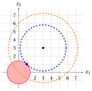

# Esercizi · Problemi di ottimizzazione convessi e concavi

**Esercizi · Capitolo 6** · ogni soluzione si apre con un clic · [:material-book-open-variant: Capitolo 6: Problemi di ottimizzazione convessi e concavi](../problemi/06-problemi-convessi-concavi.md) · [:material-file-pdf-box: Eserciziario, volume 2 (PDF)](../pdf/esercizi-2-problemi-di-ottimizzazione.pdf)

## Problemi in una variabile

Negli esercizi di questo capitolo la convessità e la concavità delle funzioni obiettivo si dimostrano solo con le definizioni del capitolo «Funzioni convesse e concave», usando la disuguaglianza

$$
\big(\lambda a+(1-\lambda)b\big)^2 \le \lambda a^2+(1-\lambda)b^2, \qquad \forall a,b\in\R,~ \forall \lambda\in[0,1]
$$

dello stesso capitolo. Le regioni ammissibili sono descritte da vincoli $g_i({\boldsymbol x}) \le 0$: quando ogni funzione $g_i$ è convessa, la regione ammissibile è un insieme convesso, per la proprietà degli insiemi definiti da funzioni convesse del capitolo «Funzioni convesse e concave».

!!! esercizio "Esercizio 6.1: Problemi di ottimizzazione convessi e concavi (E1)"

    Consideriamo il seguente problema di ottimizzazione:

    $$
    \min \bigg\{\, (x-3)^2 + 1 \ \text{ soggetto a } \ x^2 - 4 \le 0 \,\bigg\}
    $$

    con funzione obiettivo $f:\R \to \R,~ f: x \mapsto (x-3)^2+1$ e regione ammissibile $F = \{\, x \in \R : x^2 - 4 \le 0 \,\}$.

    **Domande**

    1. Dimostrare che la funzione $g:\R \to \R,~ g: x \mapsto x^2 - 4$ è convessa nel suo dominio, dedurre che la regione ammissibile è un insieme convesso e descriverla come un intervallo.

    2. Dimostrare che la funzione obiettivo è convessa nel suo dominio, e dedurre che il problema è un problema di minimizzazione convesso.

    3. Disegnare il grafico della funzione obiettivo sulla regione ammissibile.

    4. Dimostrare che il punto $x=2$ è un punto di minimo locale, e dedurre la soluzione ottima e il valore ottimo del problema.

??? soluzione "Soluzione"

    1. Per dimostrare che la funzione $g$ è convessa nel suo dominio, osserviamo che per ogni coppia di punti $p,w\in\R$ e ogni $\lambda\in[0,1]$, abbiamo:

        \begin{align*}
        g\big(\lambda p+(1-\lambda)w\big)
        &= \big(\lambda p+(1-\lambda)w\big)^2 - \lambda\,4 - (1-\lambda)\,4 \\[1ex]
        &\qquad (\text{poiché } \lambda + (1-\lambda) = 1) \\[2ex]
        &\le \lambda p^2+(1-\lambda)w^2 - \lambda\,4 - (1-\lambda)\,4 \\[1ex]
        &\qquad \text{(poiché } \big(\lambda a+(1-\lambda)b\big)^2\le \lambda a^2+(1-\lambda)b^2\text{)} \\[2ex]
        &= \lambda\,(p^2-4)+(1-\lambda)\,(w^2-4) \\[2ex]
        &= \lambda\, g(p)+(1-\lambda)\, g(w)
        \end{align*}

        Quindi,

        $$
        g\big(\lambda p + (1-\lambda) w\big) \le \lambda\, g(p) + (1-\lambda)\, g(w)
        $$

        Per natura, il dominio $\R$ è un insieme convesso. Di conseguenza, la funzione $g$ è convessa nel suo dominio.

        La regione ammissibile $F = \{\, x \in \R : g(x) \le 0 \,\}$ è definita da un vincolo con una funzione convessa, quindi è un insieme convesso. Poiché $x^2 - 4 = (x-2)(x+2) \le 0$ se e solo se $-2 \le x \le 2$, la regione ammissibile è l'intervallo $F = [-2,2]$.

    2. Per dimostrare che la funzione obiettivo è convessa nel suo dominio, osserviamo che per ogni coppia di punti $p,w\in\R$ e ogni $\lambda\in[0,1]$, abbiamo:

        \begin{align*}
        f\big(\lambda p+(1-\lambda)w\big)
        &= \big(\lambda (p-3)+(1-\lambda)(w-3)\big)^2 + \lambda + (1-\lambda) \\[1ex]
        &\qquad (\text{poiché } \lambda + (1-\lambda) = 1) \\[2ex]
        &\le \lambda (p-3)^2+(1-\lambda)(w-3)^2 + \lambda + (1-\lambda) \\[1ex]
        &\qquad \text{(poiché } \big(\lambda a+(1-\lambda)b\big)^2\le \lambda a^2+(1-\lambda)b^2\text{)} \\[2ex]
        &= \lambda \big((p-3)^2+1\big)+(1-\lambda)\big((w-3)^2+1\big) \\[2ex]
        &= \lambda f(p)+(1-\lambda)f(w)
        \end{align*}

        Quindi,

        $$
        f\big(\lambda p + (1-\lambda) w\big) \le \lambda f(p) + (1-\lambda) f(w)
        $$

        Per natura, il dominio $\R$ è un insieme convesso. Di conseguenza, la funzione è convessa nel suo dominio, e in particolare sulla regione ammissibile convessa $F$: il problema è un problema di minimizzazione convesso.

    3. Abbiamo $f(-2) = 26$, $f(0) = 10$, $f(1) = 5$ e $f(2) = 2$. Il grafico della funzione obiettivo sulla regione ammissibile è rosso, la regione ammissibile è la parte rossa dell'asse $x$ e la soluzione ottima dell'ultima domanda è blu; la parte tratteggiata del grafico è fuori dalla regione ammissibile, e il suo punto più basso $x=3$ non è ammissibile.

        { .fig .ovale loading=lazy style="width:50%" }

    4. Nell'intorno $N\big((2),1\big) = (1,3)$, i punti ammissibili sono quelli di $N\big((2),1\big) \cap F = (1,2]$. Per ognuno di questi punti abbiamo $-2 < x-3 \le -1$, quindi $(x-3)^2 \ge 1$ e

        $$
        f(x) = (x-3)^2+1 \ge 2 = f(2), \qquad \forall x \in N\big((2),1\big) \cap F = (1,2].
        $$

        Il punto $x=2$ è un punto di minimo locale. Poiché il problema è un problema di minimizzazione convesso, per la proposizione «minimi locali dei problemi di minimizzazione convessi» del capitolo «Problemi di ottimizzazione convessi e concavi», il punto $x=2$ è anche un punto di minimo. La soluzione ottima e il valore ottimo sono:

        $$
        \tilde{\boldsymbol x}(P) = (2)
        \qquad \text{e} \qquad
        z(P) = f(2) = 2.
        $$

        La soluzione ottima si trova sul bordo della regione ammissibile: il punto $x=3$, in cui la funzione obiettivo raggiunge il suo valore più piccolo $1$ su $\R$, non è ammissibile.

!!! esercizio "Esercizio 6.2: Problemi di ottimizzazione convessi e concavi (E3)"

    Consideriamo la seguente funzione obiettivo e la seguente regione ammissibile:

    $$
    f:\R \to \R,~ f: x \mapsto 3 - (x-1)^2
    \qquad \text{e} \qquad
    F = \{\, x \in \R : -1 \le x \le 4 \,\} = [-1,4],
    $$

    e i problemi di ottimizzazione associati in forma di minimo e in forma di massimo:

    \begin{gather*}
    \min \bigg\{\, 3 - (x-1)^2 \ \text{ soggetto a } \ -1 \le x \le 4 \,\bigg\}
    \\[1ex] \text{e} \\[1ex]
    \max \bigg\{\, 3 - (x-1)^2 \ \text{ soggetto a } \ -1 \le x \le 4 \,\bigg\}
    \end{gather*}

    **Domande**

    1. Dimostrare che la funzione obiettivo è concava nel suo dominio e che non è convessa su $F$, usando i punti $p=-1$, $w=3$ e lo scalare $\lambda=\frac{1}{2}$. Il problema di minimo è un problema di minimizzazione convesso?

    2. Disegnare il grafico della funzione obiettivo sulla regione ammissibile.

    3. Dimostrare che $x=-1$ è un punto di minimo locale, ma non un punto di minimo. Trovare la soluzione ottima e il valore ottimo del problema di minimo.

    4. Spiegare perché la domanda precedente non contraddice la proposizione «minimi locali dei problemi di minimizzazione convessi».

    5. Dimostrare che $x=1$ è un punto di massimo locale, e dedurre la soluzione ottima e il valore ottimo del problema di massimo.

??? soluzione "Soluzione"

    1. Per dimostrare che la funzione è concava nel suo dominio, osserviamo che per ogni coppia di punti $p,w\in\R$ e ogni $\lambda\in[0,1]$, abbiamo:

        \begin{align*}
        f\big(\lambda p+(1-\lambda)w\big)
        &= \lambda\,3 + (1-\lambda)\,3 - \big(\lambda (p-1)+(1-\lambda)(w-1)\big)^2 \\[1ex]
        &\qquad (\text{poiché } \lambda + (1-\lambda) = 1) \\[2ex]
        &\ge \lambda\,3 + (1-\lambda)\,3 - \lambda (p-1)^2-(1-\lambda)(w-1)^2 \\[1ex]
        &\qquad \text{(poiché } \big(\lambda a+(1-\lambda)b\big)^2\le \lambda a^2+(1-\lambda)b^2\text{,} \\
        &\qquad \phantom{\text{(}}\text{e il fattore $-1$ inverte la disuguaglianza)} \\[2ex]
        &= \lambda \big(3-(p-1)^2\big)+(1-\lambda)\big(3-(w-1)^2\big) \\[2ex]
        &= \lambda f(p)+(1-\lambda)f(w)
        \end{align*}

        Quindi,

        $$
        f\big(\lambda p + (1-\lambda) w\big) \ge \lambda f(p) + (1-\lambda) f(w)
        $$

        Per natura, il dominio $\R$ è un insieme convesso. Di conseguenza, la funzione è concava nel suo dominio.

        Con $p=-1$, $w=3$ e $\lambda=\frac{1}{2}$, entrambi i punti appartengono a $F$, $\lambda p + (1-\lambda) w = 1$ e

        $$
        f(1) = 3 \;>\; -1 = \frac{1}{2}\, f(-1) + \frac{1}{2}\, f(3) = \frac{1}{2}\cdot(-1) + \frac{1}{2}\cdot(-1):
        $$

        la disuguaglianza della definizione di funzione convessa non vale, e la funzione obiettivo non è convessa su $F$. Il problema di minimo <strong>non</strong> è un problema di minimizzazione convesso, anche se la sua regione ammissibile è convessa.

    2. Abbiamo $f(-1) = -1$, $f(1) = 3$, $f(3) = -1$ e $f(4) = -6$. Il grafico della funzione obiettivo sulla regione ammissibile è rosso e la regione ammissibile è la parte rossa dell'asse $x$; le soluzioni ottime dei due problemi sono blu e il punto di minimo locale che non è un punto di minimo è viola.

        { .fig .ovale loading=lazy style="width:50%" }

    3. Nell'intorno $N\big((-1),1\big) = (-2,0)$, i punti ammissibili sono quelli di $N\big((-1),1\big) \cap F = [-1,0)$. Per ognuno di questi punti abbiamo $-2 \le x-1 < -1$, quindi $(x-1)^2 \le 4$ e

        $$
        f(x) = 3-(x-1)^2 \ge -1 = f(-1), \qquad \forall x \in N\big((-1),1\big) \cap F = [-1,0).
        $$

        Il punto $x=-1$ è un punto di minimo locale. Non è un punto di minimo, poiché $4 \in F$ e $f(4) = -6 < -1 = f(-1)$.

        Per ogni $x \in F$ abbiamo $-2 \le x-1 \le 3$, quindi $(x-1)^2 \le 9$ e $f(x) = 3-(x-1)^2 \ge -6 = f(4)$, con l'uguaglianza solo se $x-1 = 3$, cioè $x=4$ (il valore $x-1=-3$ non è ammissibile). L'unica soluzione ottima e il valore ottimo del problema di minimo sono:

        $$
        \tilde{\boldsymbol x}(P) = (4)
        \qquad \text{e} \qquad
        z(P) = -6.
        $$

    4. La proposizione «minimi locali dei problemi di minimizzazione convessi» del capitolo «Problemi di ottimizzazione convessi e concavi» richiede una funzione obiettivo convessa sulla regione ammissibile. Per la prima domanda, la funzione obiettivo non è convessa su $F$: il problema di minimo non è un problema di minimizzazione convesso, e uno dei suoi punti di minimo locale non è un punto di minimo. Un metodo che esplora solo i punti vicini a $x=-1$ si ferma al punto di minimo locale $x=-1$, con minimo locale $f(-1) = -1$, mentre il valore ottimo è $-6$.

    5. Nell'intorno $N\big((1),1\big) = (0,2)$, tutti i punti sono ammissibili e

        $$
        f(x) = 3-(x-1)^2 \le 3 = f(1), \qquad \forall x \in N\big((1),1\big) \cap F = (0,2).
        $$

        Il punto $x=1$ è un punto di massimo locale. Per la prima domanda, la funzione obiettivo è concava sulla regione ammissibile convessa $F$, e il problema di massimo è un problema di massimizzazione concavo. Per il corollario «massimi locali dei problemi di massimizzazione concavi» del capitolo «Problemi di ottimizzazione convessi e concavi», il punto $x=1$ è anche un punto di massimo, e la soluzione ottima e il valore ottimo del problema di massimo sono:

        $$
        \tilde{\boldsymbol x}(P) = (1)
        \qquad \text{e} \qquad
        z(P) = 3.
        $$

## Problemi in due variabili

!!! esercizio "Esercizio 6.3: Problemi di ottimizzazione convessi e concavi (E2)"

    Consideriamo il seguente problema di ottimizzazione:

    $$
    \min \bigg\{\, (x_1-2)^2 + (x_2-2)^2 \ \text{ soggetto a } \ x_1 + x_2 \le 2,~ x_1 \ge 0,~ x_2 \ge 0 \,\bigg\}
    $$

    con funzione obiettivo $f:\R^2 \to \R,~ f: {\boldsymbol x} \mapsto (x_1-2)^2 + (x_2-2)^2$ e regione ammissibile $F$.

    **Domande**

    1. Dimostrare che la regione ammissibile è un insieme convesso.

    2. Dimostrare che la funzione obiettivo è convessa nel suo dominio, e dedurre che il problema è un problema di minimizzazione convesso.

    3. Descrivere gli insiemi di livello della funzione obiettivo per $k=2$ e $k=8$, e disegnarli insieme alla regione ammissibile.

    4. Dimostrare che ${\boldsymbol x} = \begin{pmatrix} 1 \\ 1 \end{pmatrix}$ è l'unica soluzione ottima e calcolare il valore ottimo.

    5. Il problema ha un punto di minimo locale diverso da $\begin{pmatrix} 1 \\ 1 \end{pmatrix}$?

??? soluzione "Soluzione"

    1. La regione ammissibile è l'insieme dei punti che soddisfano i tre vincoli

        $$
        g_1({\boldsymbol x}) = x_1 + x_2 - 2 \le 0, \qquad g_2({\boldsymbol x}) = -x_1 \le 0, \qquad g_3({\boldsymbol x}) = -x_2 \le 0 .
        $$

        Ogni funzione $g_i$ è lineare, ed è convessa, poiché la definizione vale con l'uguaglianza: per ogni coppia di punti ${\boldsymbol p}, {\boldsymbol w} \in \R^2$ e ogni $\lambda \in [0,1]$, abbiamo

        $$
        g_1\big(\lambda {\boldsymbol p}+(1-\lambda){\boldsymbol w}\big) = \lambda\,(p_1+p_2-2) + (1-\lambda)\,(w_1+w_2-2) = \lambda\, g_1({\boldsymbol p}) + (1-\lambda)\, g_1({\boldsymbol w}),
        $$

        e allo stesso modo per $g_2$ e $g_3$. La regione ammissibile è definita da vincoli con funzioni convesse, quindi è un insieme convesso: è il triangolo con vertici $\begin{pmatrix} 0 \\ 0 \end{pmatrix}$, $\begin{pmatrix} 2 \\ 0 \end{pmatrix}$ e $\begin{pmatrix} 0 \\ 2 \end{pmatrix}$, intersezione di tre semipiani.

    2. Per dimostrare che la funzione obiettivo è convessa nel suo dominio, osserviamo che per ogni coppia di punti ${\boldsymbol p}, {\boldsymbol w} \in \R^2$ e ogni $\lambda \in [0,1]$, abbiamo:

        \begin{align*}
        f\big(\lambda {\boldsymbol p}+(1-\lambda){\boldsymbol w}\big)
        &= \big(\lambda (p_1-2)+(1-\lambda)(w_1-2)\big)^2 \\
        &\qquad + \big(\lambda (p_2-2)+(1-\lambda)(w_2-2)\big)^2 \\[1ex]
        &\qquad (\text{poiché } \lambda + (1-\lambda) = 1) \\[2ex]
        &\le \lambda (p_1-2)^2+(1-\lambda)(w_1-2)^2 + \lambda (p_2-2)^2+(1-\lambda)(w_2-2)^2 \\[1ex]
        &\qquad \text{(poiché } \big(\lambda a+(1-\lambda)b\big)^2\le \lambda a^2+(1-\lambda)b^2\text{,} \\
        &\qquad \phantom{\text{(}}\text{due volte)} \\[2ex]
        &= \lambda \big((p_1-2)^2+(p_2-2)^2\big)+(1-\lambda)\big((w_1-2)^2+(w_2-2)^2\big) \\[2ex]
        &= \lambda f({\boldsymbol p})+(1-\lambda)f({\boldsymbol w})
        \end{align*}

        Quindi,

        $$
        f\big(\lambda {\boldsymbol p} + (1-\lambda) {\boldsymbol w}\big) \le \lambda f({\boldsymbol p}) + (1-\lambda) f({\boldsymbol w})
        $$

        Per natura, il dominio $\R^2$ è un insieme convesso. Di conseguenza, la funzione è convessa nel suo dominio, e in particolare sulla regione ammissibile convessa $F$: il problema è un problema di minimizzazione convesso.

    3. L'insieme di livello per $k$ è l'insieme dei punti con $(x_1-2)^2 + (x_2-2)^2 = k$, cioè la circonferenza di centro $\begin{pmatrix} 2 \\ 2 \end{pmatrix}$ e raggio $\sqrt{k}$. Per $k=2$, il raggio è $\sqrt{2}$ e la circonferenza passa per $\begin{pmatrix} 1 \\ 1 \end{pmatrix}$, poiché $1+1=2$; per $k=8$, il raggio è $2\sqrt{2}$ e la circonferenza passa per $\begin{pmatrix} 0 \\ 0 \end{pmatrix}$, poiché $4+4=8$. Nella figura, la regione ammissibile è rossa, l'insieme di livello $k=2$ è blu, l'insieme di livello $k=8$ è arancione e la soluzione ottima della domanda successiva è blu: la circonferenza $k=2$ tocca la regione ammissibile solo in questo punto.

        { .fig .ovale loading=lazy style="width:50%" }

    4. Per ogni punto ammissibile ${\boldsymbol x}$, poniamo $a = x_1 - 2$ e $b = x_2 - 2$. Poiché $x_1 + x_2 \le 2$, abbiamo $a + b = x_1 + x_2 - 4 \le -2$, e quindi $(a+b)^2 \ge 4$. Inoltre, $2\,(a^2+b^2) - (a+b)^2 = (a-b)^2 \ge 0$. Quindi:

        $$
        f({\boldsymbol x}) = a^2 + b^2 \ge \frac{(a+b)^2}{2} \ge \frac{4}{2} = 2 = f\left(\begin{pmatrix} 1 \\ 1 \end{pmatrix}\right), \qquad \forall {\boldsymbol x} \in F,
        $$

        e il punto $\begin{pmatrix} 1 \\ 1 \end{pmatrix}$ è ammissibile, poiché $1+1 = 2$. L'uguaglianza vale solo se $a = b$ e $a + b = -2$, cioè $a=b=-1$ e ${\boldsymbol x} = \begin{pmatrix} 1 \\ 1 \end{pmatrix}$. L'unica soluzione ottima e il valore ottimo sono:

        $$
        \tilde{\boldsymbol x}(P) = \begin{pmatrix} 1 \\ 1 \end{pmatrix}
        \qquad \text{e} \qquad
        z(P) = 2.
        $$

    5. No. Il problema è un problema di minimizzazione convesso: per la proposizione «minimi locali dei problemi di minimizzazione convessi» del capitolo «Problemi di ottimizzazione convessi e concavi», ogni punto di minimo locale è un punto di minimo, cioè una soluzione ottima, e la soluzione ottima è unica.

!!! esercizio "Esercizio 6.4: Problemi di ottimizzazione convessi e concavi (E4)"

    Consideriamo il seguente problema di ottimizzazione:

    $$
    \max \bigg\{\, 4\,x_1 + 2\,x_2 - x_1^2 - x_2^2 \ \text{ soggetto a } \ x_1 + 2\,x_2 \le 2,~ x_1 \ge 0,~ x_2 \ge 0 \,\bigg\}
    $$

    con funzione obiettivo $f:\R^2 \to \R,~ f: {\boldsymbol x} \mapsto 4\,x_1 + 2\,x_2 - x_1^2 - x_2^2$ e regione ammissibile $F$.

    **Domande**

    1. Completare i quadrati per scrivere la funzione obiettivo come $f({\boldsymbol x}) = c - (x_1-\alpha_1)^2 - (x_2-\alpha_2)^2$, con $c, \alpha_1, \alpha_2 \in \R$.

    2. Dimostrare che la regione ammissibile è un insieme convesso e che la funzione obiettivo è concava nel suo dominio. Di che tipo di problema si tratta?

    3. Descrivere gli insiemi di livello della funzione obiettivo per $k=2$ e $k=\frac{21}{5}$, e disegnarli insieme alla regione ammissibile.

    4. Dimostrare che ${\boldsymbol x} = \begin{pmatrix} 8/5 \\ 1/5 \end{pmatrix}$ è l'unica soluzione ottima e calcolare il valore ottimo.

    5. Il problema ha un punto di massimo locale diverso da $\begin{pmatrix} 8/5 \\ 1/5 \end{pmatrix}$?

??? soluzione "Soluzione"

    1. Poiché $x_1^2 - 4\,x_1 = (x_1-2)^2 - 4$ e $x_2^2 - 2\,x_2 = (x_2-1)^2 - 1$, abbiamo:

        $$
        f({\boldsymbol x}) = -\big(x_1^2 - 4\,x_1\big) - \big(x_2^2 - 2\,x_2\big) = 5 - (x_1-2)^2 - (x_2-1)^2,
        $$

        cioè $c = 5$, $\alpha_1 = 2$ e $\alpha_2 = 1$. La funzione obiettivo vale al più $5$, e vale $5$ solo in $\begin{pmatrix} 2 \\ 1 \end{pmatrix}$, che non è ammissibile, poiché $2 + 2\cdot 1 = 4 > 2$.

    2. La regione ammissibile è l'insieme dei punti che soddisfano i tre vincoli

        $$
        g_1({\boldsymbol x}) = x_1 + 2\,x_2 - 2 \le 0, \qquad g_2({\boldsymbol x}) = -x_1 \le 0, \qquad g_3({\boldsymbol x}) = -x_2 \le 0 .
        $$

        Ogni funzione $g_i$ è lineare, ed è convessa, poiché la definizione vale con l'uguaglianza: per ogni coppia di punti ${\boldsymbol p}, {\boldsymbol w} \in \R^2$ e ogni $\lambda \in [0,1]$, abbiamo

        $$
        g_1\big(\lambda {\boldsymbol p}+(1-\lambda){\boldsymbol w}\big) = \lambda\,(p_1+2\,p_2-2) + (1-\lambda)\,(w_1+2\,w_2-2) = \lambda\, g_1({\boldsymbol p}) + (1-\lambda)\, g_1({\boldsymbol w}),
        $$

        e allo stesso modo per $g_2$ e $g_3$. La regione ammissibile è definita da vincoli con funzioni convesse, quindi è un insieme convesso: è il triangolo con vertici $\begin{pmatrix} 0 \\ 0 \end{pmatrix}$, $\begin{pmatrix} 2 \\ 0 \end{pmatrix}$ e $\begin{pmatrix} 0 \\ 1 \end{pmatrix}$.

        Per dimostrare che la funzione obiettivo è concava nel suo dominio, osserviamo che per ogni coppia di punti ${\boldsymbol p}, {\boldsymbol w} \in \R^2$ e ogni $\lambda \in [0,1]$, abbiamo:

        \begin{align*}
        f\big(\lambda {\boldsymbol p}+(1-\lambda){\boldsymbol w}\big)
        &= \lambda\,5 + (1-\lambda)\,5 - \big(\lambda (p_1-2)+(1-\lambda)(w_1-2)\big)^2 \\
        &\qquad - \big(\lambda (p_2-1)+(1-\lambda)(w_2-1)\big)^2 \\[1ex]
        &\qquad (\text{poiché } \lambda + (1-\lambda) = 1) \\[2ex]
        &\ge \lambda\,5 + (1-\lambda)\,5 - \lambda (p_1-2)^2-(1-\lambda)(w_1-2)^2 \\
        &\qquad - \lambda (p_2-1)^2-(1-\lambda)(w_2-1)^2 \\[1ex]
        &\qquad \text{(poiché } \big(\lambda a+(1-\lambda)b\big)^2\le \lambda a^2+(1-\lambda)b^2\text{, due volte,} \\
        &\qquad \phantom{\text{(}}\text{e il fattore $-1$ inverte la disuguaglianza)} \\[2ex]
        &= \lambda \big(5-(p_1-2)^2-(p_2-1)^2\big) \\
        &\qquad +(1-\lambda)\big(5-(w_1-2)^2-(w_2-1)^2\big) \\[2ex]
        &= \lambda f({\boldsymbol p})+(1-\lambda)f({\boldsymbol w})
        \end{align*}

        Quindi,

        $$
        f\big(\lambda {\boldsymbol p} + (1-\lambda) {\boldsymbol w}\big) \ge \lambda f({\boldsymbol p}) + (1-\lambda) f({\boldsymbol w})
        $$

        Per natura, il dominio $\R^2$ è un insieme convesso. Di conseguenza, la funzione è concava nel suo dominio, e in particolare sulla regione ammissibile convessa $F$: il problema è un <strong>problema di massimizzazione concavo</strong>.

    3. L'insieme di livello per $k < 5$ è l'insieme dei punti con $(x_1-2)^2 + (x_2-1)^2 = 5-k$, cioè la circonferenza di centro $\begin{pmatrix} 2 \\ 1 \end{pmatrix}$ e raggio $\sqrt{5-k}$. Per $k=2$, il raggio è $\sqrt{3}$; per $k=\frac{21}{5}$, il raggio è $\sqrt{\frac{4}{5}} = \frac{2}{\sqrt{5}}$ e la circonferenza passa per $\begin{pmatrix} 8/5 \\ 1/5 \end{pmatrix}$, poiché $\big(\frac{2}{5}\big)^2 + \big(\frac{4}{5}\big)^2 = \frac{4}{5}$. Nella figura, la regione ammissibile è rossa, l'insieme di livello $k=2$ è arancione, l'insieme di livello $k=\frac{21}{5}$ è blu e la soluzione ottima della domanda successiva è blu: la circonferenza $k=\frac{21}{5}$ tocca la regione ammissibile solo in questo punto, sul lato $x_1 + 2\,x_2 = 2$.

        { .fig .ovale loading=lazy style="width:50%" }

    4. Per ogni punto ammissibile ${\boldsymbol x}$, poniamo $a = x_1 - 2$ e $b = x_2 - 1$, così che $f({\boldsymbol x}) = 5 - (a^2+b^2)$. Poiché $x_1 + 2\,x_2 \le 2$, abbiamo $a + 2\,b = x_1 + 2\,x_2 - 4 \le -2$, e quindi $(a+2\,b)^2 \ge 4$. Inoltre, $5\,(a^2+b^2) - (a+2\,b)^2 = 4\,a^2 - 4\,ab + b^2 = (2\,a-b)^2 \ge 0$. Quindi:

        $$
        a^2 + b^2 \ge \frac{(a+2\,b)^2}{5} \ge \frac{4}{5}
        \qquad \text{e} \qquad
        f({\boldsymbol x}) = 5 - (a^2+b^2) \le 5 - \frac{4}{5} = \frac{21}{5}, \qquad \forall {\boldsymbol x} \in F.
        $$

        L'uguaglianza vale solo se $b = 2\,a$ e $a + 2\,b = -2$, cioè $5\,a = -2$, $a = -\frac{2}{5}$, $b = -\frac{4}{5}$ e ${\boldsymbol x} = \begin{pmatrix} 8/5 \\ 1/5 \end{pmatrix}$. Questo punto è ammissibile, poiché $\frac{8}{5} + \frac{2}{5} = 2$, $\frac{8}{5} \ge 0$ e $\frac{1}{5} \ge 0$, e

        $$
        f\left(\begin{pmatrix} 8/5 \\ 1/5 \end{pmatrix}\right) = \frac{32}{5} + \frac{2}{5} - \frac{64}{25} - \frac{1}{25} = \frac{34}{5} - \frac{13}{5} = \frac{21}{5}.
        $$

        L'unica soluzione ottima e il valore ottimo sono:

        $$
        \tilde{\boldsymbol x}(P) = \begin{pmatrix} 8/5 \\ 1/5 \end{pmatrix}
        \qquad \text{e} \qquad
        z(P) = \frac{21}{5}.
        $$

    5. No. Il problema è un problema di massimizzazione concavo: per il corollario «massimi locali dei problemi di massimizzazione concavi» del capitolo «Problemi di ottimizzazione convessi e concavi», ogni punto di massimo locale è un punto di massimo, cioè una soluzione ottima, e la soluzione ottima è unica.

!!! esercizio "Esercizio 6.5: Problemi di ottimizzazione convessi e concavi (E5)"

    Consideriamo la funzione obiettivo

    $$
    f:\R^2 \to \R,~ f: {\boldsymbol x} \mapsto (x_1-3)^2 + (x_2-3)^2
    $$

    e i due problemi di ottimizzazione:

    \begin{gather*}
    (P_1)~~ \min \bigg\{\, f({\boldsymbol x}) \ \text{ soggetto a } \ x_1^2 + x_2^2 - 2 \le 0 \,\bigg\}
    \\[1ex] \text{e} \\[1ex]
    (P_2)~~ \min \bigg\{\, f({\boldsymbol x}) \ \text{ soggetto a } \ x_1^2 + x_2^2 - 2 \ge 0 \,\bigg\}
    \end{gather*}

    con regioni ammissibili $F_1$ e $F_2$, rispettivamente.

    **Domande**

    1. Dimostrare che la funzione $g:\R^2 \to \R,~ g: {\boldsymbol x} \mapsto x_1^2 + x_2^2 - 2$ è convessa nel suo dominio, e dedurre che $F_1$ è un insieme convesso.

    2. Dimostrare che $F_2$ non è un insieme convesso, usando i punti $\begin{pmatrix} 2 \\ 0 \end{pmatrix}$, $\begin{pmatrix} -2 \\ 0 \end{pmatrix}$ e lo scalare $\lambda = \frac{1}{2}$.

    3. Dimostrare che la funzione obiettivo è convessa nel suo dominio. Quale dei due problemi è un problema di minimizzazione convesso?

    4. Descrivere gli insiemi di livello della funzione obiettivo per $k=8$ e $k=18$, e disegnarli insieme alla regione ammissibile $F_1$.

    5. Dimostrare che ${\boldsymbol x} = \begin{pmatrix} 1 \\ 1 \end{pmatrix}$ è l'unica soluzione ottima di $(P_1)$ e calcolare il valore ottimo.

??? soluzione "Soluzione"

    1. Per dimostrare che la funzione $g$ è convessa nel suo dominio, osserviamo che per ogni coppia di punti ${\boldsymbol p}, {\boldsymbol w} \in \R^2$ e ogni $\lambda \in [0,1]$, abbiamo:

        \begin{align*}
        g\big(\lambda {\boldsymbol p}+(1-\lambda){\boldsymbol w}\big)
        &= \big(\lambda p_1+(1-\lambda)w_1\big)^2 + \big(\lambda p_2+(1-\lambda)w_2\big)^2 - \lambda\,2 - (1-\lambda)\,2 \\[1ex]
        &\qquad (\text{poiché } \lambda + (1-\lambda) = 1) \\[2ex]
        &\le \lambda p_1^2+(1-\lambda)w_1^2 + \lambda p_2^2+(1-\lambda)w_2^2 - \lambda\,2 - (1-\lambda)\,2 \\[1ex]
        &\qquad \text{(poiché } \big(\lambda a+(1-\lambda)b\big)^2\le \lambda a^2+(1-\lambda)b^2\text{,} \\
        &\qquad \phantom{\text{(}}\text{due volte)} \\[2ex]
        &= \lambda \big(p_1^2+p_2^2-2\big)+(1-\lambda)\big(w_1^2+w_2^2-2\big) \\[2ex]
        &= \lambda\, g({\boldsymbol p})+(1-\lambda)\, g({\boldsymbol w})
        \end{align*}

        Quindi,

        $$
        g\big(\lambda {\boldsymbol p} + (1-\lambda) {\boldsymbol w}\big) \le \lambda\, g({\boldsymbol p}) + (1-\lambda)\, g({\boldsymbol w})
        $$

        Per natura, il dominio $\R^2$ è un insieme convesso. Di conseguenza, la funzione $g$ è convessa nel suo dominio. La regione ammissibile $F_1 = \{\, {\boldsymbol x} \in \R^2 : g({\boldsymbol x}) \le 0 \,\}$ è definita da un vincolo con una funzione convessa, quindi è un insieme convesso: è il disco di centro l'origine e raggio $\sqrt{2}$.

    2. I due punti appartengono a $F_2$, poiché $2^2 + 0^2 - 2 = 2 \ge 0$ e $(-2)^2 + 0^2 - 2 = 2 \ge 0$. Con $\lambda = \frac{1}{2}$, la loro combinazione convessa è

        $$
        \frac{1}{2}\begin{pmatrix} 2 \\ 0 \end{pmatrix} + \frac{1}{2}\begin{pmatrix} -2 \\ 0 \end{pmatrix} = \begin{pmatrix} 0 \\ 0 \end{pmatrix},
        \qquad \text{con} \qquad
        0^2 + 0^2 - 2 = -2 < 0,
        $$

        e non appartiene a $F_2$. L'insieme $F_2$ (i punti fuori dal disco aperto di raggio $\sqrt{2}$) non è convesso.

    3. Per dimostrare che la funzione obiettivo è convessa nel suo dominio, osserviamo che per ogni coppia di punti ${\boldsymbol p}, {\boldsymbol w} \in \R^2$ e ogni $\lambda \in [0,1]$, abbiamo:

        \begin{align*}
        f\big(\lambda {\boldsymbol p}+(1-\lambda){\boldsymbol w}\big)
        &= \big(\lambda (p_1-3)+(1-\lambda)(w_1-3)\big)^2 \\
        &\qquad + \big(\lambda (p_2-3)+(1-\lambda)(w_2-3)\big)^2 \\[1ex]
        &\qquad (\text{poiché } \lambda + (1-\lambda) = 1) \\[2ex]
        &\le \lambda (p_1-3)^2+(1-\lambda)(w_1-3)^2 + \lambda (p_2-3)^2+(1-\lambda)(w_2-3)^2 \\[1ex]
        &\qquad \text{(poiché } \big(\lambda a+(1-\lambda)b\big)^2\le \lambda a^2+(1-\lambda)b^2\text{,} \\
        &\qquad \phantom{\text{(}}\text{due volte)} \\[2ex]
        &= \lambda \big((p_1-3)^2+(p_2-3)^2\big)+(1-\lambda)\big((w_1-3)^2+(w_2-3)^2\big) \\[2ex]
        &= \lambda f({\boldsymbol p})+(1-\lambda)f({\boldsymbol w})
        \end{align*}

        Quindi,

        $$
        f\big(\lambda {\boldsymbol p} + (1-\lambda) {\boldsymbol w}\big) \le \lambda f({\boldsymbol p}) + (1-\lambda) f({\boldsymbol w})
        $$

        Per natura, il dominio $\R^2$ è un insieme convesso. Di conseguenza, la funzione è convessa nel suo dominio. Il problema $(P_1)$ è un problema di minimizzazione convesso, poiché la sua regione ammissibile è convessa e la funzione obiettivo è convessa su di essa. Il problema $(P_2)$ non è un problema di ottimizzazione convesso, poiché la sua regione ammissibile non è convessa: la definizione richiede una regione ammissibile convessa, qualunque sia la funzione obiettivo.

    4. L'insieme di livello per $k$ è l'insieme dei punti con $(x_1-3)^2 + (x_2-3)^2 = k$, cioè la circonferenza di centro $\begin{pmatrix} 3 \\ 3 \end{pmatrix}$ e raggio $\sqrt{k}$. Per $k=8$, il raggio è $2\sqrt{2}$ e la circonferenza passa per $\begin{pmatrix} 1 \\ 1 \end{pmatrix}$, poiché $4+4=8$; per $k=18$, il raggio è $3\sqrt{2}$ e la circonferenza passa per $\begin{pmatrix} 0 \\ 0 \end{pmatrix}$, poiché $9+9=18$. Nella figura, la regione ammissibile $F_1$ è rossa, l'insieme di livello $k=8$ è blu, l'insieme di livello $k=18$ è arancione e la soluzione ottima della domanda successiva è blu: la circonferenza $k=8$ tocca il disco $F_1$ solo in questo punto.

        { .fig .ovale loading=lazy style="width:50%" }

    5. Scriviamo la funzione obiettivo come

        $$
        f({\boldsymbol x}) = x_1^2 - 6\,x_1 + 9 + x_2^2 - 6\,x_2 + 9 = q - 6\,s + 18,
        \qquad \text{con} \qquad
        q = x_1^2 + x_2^2, \quad s = x_1 + x_2 .
        $$

        Poiché $2\,q - s^2 = (x_1 - x_2)^2 \ge 0$, abbiamo $q \ge \frac{s^2}{2}$. Per ogni ${\boldsymbol x} \in F_1$ abbiamo $q \le 2$, quindi $s^2 \le 2\,q \le 4$ e $s \le 2$. Quindi:

        \begin{align*}
        f({\boldsymbol x}) &= q - 6\,s + 18 \ge \frac{s^2}{2} - 6\,s + 18 = \frac{(s-6)^2}{2} \\[1ex]
        &\ge \frac{(2-6)^2}{2} = 8 = f\left(\begin{pmatrix} 1 \\ 1 \end{pmatrix}\right), \qquad \forall {\boldsymbol x} \in F_1,
        \end{align*}

        dove l'ultima disuguaglianza vale poiché $6 - s \ge 4 > 0$. Il punto $\begin{pmatrix} 1 \\ 1 \end{pmatrix}$ è ammissibile, poiché $1 + 1 - 2 = 0$. L'uguaglianza vale solo se $x_1 = x_2$ e $s = 2$, cioè ${\boldsymbol x} = \begin{pmatrix} 1 \\ 1 \end{pmatrix}$. L'unica soluzione ottima e il valore ottimo di $(P_1)$ sono:

        $$
        \tilde{\boldsymbol x}(P_1) = \begin{pmatrix} 1 \\ 1 \end{pmatrix}
        \qquad \text{e} \qquad
        z(P_1) = 8.
        $$

        Per la proposizione «minimi locali dei problemi di minimizzazione convessi» del capitolo «Problemi di ottimizzazione convessi e concavi», $(P_1)$ non ha altri punti di minimo locale.
