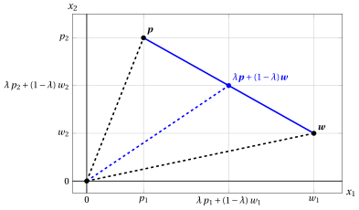
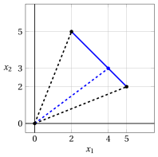
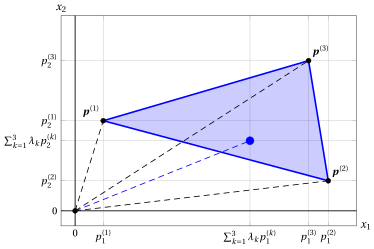
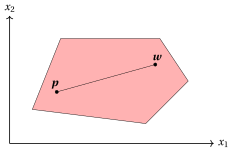
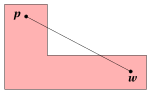
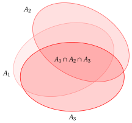
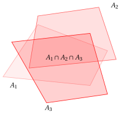
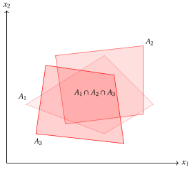

# Insiemi convessi

**Parte 1 · Preliminari · Capitolo 1** · [:material-file-pdf-box: Dispensa, volume 1 (PDF)](../pdf/dispensa-1-preliminari.pdf) · [:material-pencil: Esercizi](../esercizi/es-01-insiemi-convessi.md)

## 1.1 Combinazione convessa

!!! definizione "Definizione 1.1: combinazione convessa"

    Dati due punti

    $$
    \underbrace{
    \begin{pmatrix}
    p_1 \\
    p_2 \\
    \vdots \\
    p_n
    \end{pmatrix}
    }_{{\boldsymbol p}} \in \mathbb{R}^{n}
    \qquad \text{e} \qquad
    \underbrace{
    \begin{pmatrix}
    w_1 \\
    w_2 \\
    \vdots \\
    w_n
    \end{pmatrix}
    }_{{\boldsymbol w}} \in \mathbb{R}^{n}
    $$

    la loro <strong>combinazione convessa</strong> con uno scalare $\lambda \in [0,1]$ è il punto

    $$
    \underbrace{
    \begin{pmatrix}
    \lambda p_1 + (1-\lambda) w_1 \\
    \lambda p_2 + (1-\lambda) w_2 \\
    \vdots \\
    \lambda p_n + (1-\lambda) w_n
    \end{pmatrix}
    }_{\;\lambda {\boldsymbol p} + (1-\lambda){\boldsymbol w}}
    $$

- Le combinazioni convesse per tutti i valori $\lambda \in [0,1]$ sono i punti del segmento che congiunge i due punti ${\boldsymbol p}$ e ${\boldsymbol w}$. In $\R^2$, il segmento blu della figura seguente:

    { .fig .ovale loading=lazy style="width:82%" }

!!! esempio "Esempio 1.1: combinazione convessa"

    Consideriamo i punti $\begin{pmatrix}2 \\[0.3ex] 5\end{pmatrix}$ e $\begin{pmatrix}5 \\[0.3ex] 2\end{pmatrix}$ in $\mathbb{R}^2$. La loro combinazione convessa con $\lambda = \tfrac{1}{3}$ è il punto:

    $$
    \begin{pmatrix}
    \tfrac{1}{3}\cdot 2 + \!\left(1-\tfrac{1}{3}\right)\!5 \\[1.2ex]
    \tfrac{1}{3}\cdot 5 + \!\left(1-\tfrac{1}{3}\right)\!2
    \end{pmatrix}
    =\;\begin{pmatrix}4 \\[0.3ex] 3\end{pmatrix}
    $$

    { .fig .ovale loading=lazy style="width:71%" }

!!! definizione "Definizione 1.2: combinazione convessa di $m$ punti"

    Dati $m$ punti

    $$
    \underbrace{
    \begin{pmatrix}
    p^{(1)}_1 \\
    p^{(1)}_2 \\
    \vdots \\
    p^{(1)}_n
    \end{pmatrix}
    }_{{\boldsymbol p}^{(1)}} \in \mathbb{R}^{n}
    \qquad
    \underbrace{
    \begin{pmatrix}
    p^{(2)}_1 \\
    p^{(2)}_2 \\
    \vdots \\
    p^{(2)}_n
    \end{pmatrix}
    }_{{\boldsymbol p}^{(2)}} \in \mathbb{R}^{n}
    \qquad \cdots \qquad
    \underbrace{
    \begin{pmatrix}
    p^{(m)}_1 \\
    p^{(m)}_2 \\
    \vdots \\
    p^{(m)}_n
    \end{pmatrix}
    }_{{\boldsymbol p}^{(m)}} \in \mathbb{R}^{n}
    $$

    la loro <strong>combinazione convessa</strong> con scalari $\lambda_1, \lambda_2, \ldots, \lambda_m \ge 0$ tali che

    $$
    \sum_{k=1}^{m} \lambda_k = 1
    $$

    è il punto

    $$
    \underbrace{
    \begin{pmatrix}
    \lambda_1\, p^{(1)}_1 + \lambda_2\, p^{(2)}_1 + \cdots + \lambda_m\, p^{(m)}_1 \\[0.5ex]
    \lambda_1\, p^{(1)}_2 + \lambda_2\, p^{(2)}_2 + \cdots + \lambda_m\, p^{(m)}_2 \\[0.5ex]
    \vdots \\[0.5ex]
    \lambda_1\, p^{(1)}_n + \lambda_2\, p^{(2)}_n + \cdots + \lambda_m\, p^{(m)}_n
    \end{pmatrix}
    }_{{\displaystyle\sum_{k=1}^{m} \lambda_k\, {\boldsymbol p}^{(k)}}}
    $$

- Le combinazioni convesse che si ottengono con tutti gli scalari ammessi $\lambda_1, \lambda_2, \ldots, \lambda_m \ge 0$ sono i punti dell'<strong>involucro convesso</strong> degli $m$ punti.

- In $\R^2$ con $m=3$ punti, l'involucro convesso è formato da tutti i punti interni (e sul bordo) del triangolo che ha per vertici i tre punti: la regione blu della figura seguente, dove il punto blu è la combinazione convessa con $\lambda_1=\frac{1}{3}$, $\lambda_2=\frac{1}{2}$ e $\lambda_3=\frac{1}{6}$:

    { .fig .ovale loading=lazy style="width:82%" }

!!! esempio "Esempio 1.2: combinazione convessa di $3$ punti"

    Consideriamo i tre punti $\begin{pmatrix}1 \\[0.3ex] 1\end{pmatrix}$, $\begin{pmatrix}5 \\[0.3ex] 3\end{pmatrix}$ e $\begin{pmatrix}3 \\[0.3ex] 5\end{pmatrix}$ in $\mathbb{R}^2$. La loro combinazione convessa con $\lambda_1 = \lambda_2 = \lambda_3 = \tfrac{1}{3}$ è il punto:

    $$
    \begin{pmatrix}
    \tfrac{1}{3}\cdot 1 \;+\; \tfrac{1}{3}\cdot 5 \;+\; \tfrac{1}{3}\cdot 3 \\[1.2ex]
    \tfrac{1}{3}\cdot 1 \;+\; \tfrac{1}{3}\cdot 3 \;+\; \tfrac{1}{3}\cdot 5
    \end{pmatrix}
    =\;\begin{pmatrix}3 \\[0.3ex] 3\end{pmatrix}
    $$

    { .fig .ovale loading=lazy style="width:71%" }

## 1.2 Insiemi convessi

!!! definizione "Definizione 1.3: insieme convesso"

    Un insieme $A \subseteq \R^n$ è <strong>convesso</strong> se

    $$
    \forall {\boldsymbol p}, {\boldsymbol w} \in A {\rm ~~e~~} \forall \lambda \in [0,1] \text{   abbiamo   } \underbrace{\lambda\; {\boldsymbol p} + (1-\lambda)\: {\boldsymbol w}}_{\text{combinazione convessa}} \in A
    $$

!!! chiave ""

    Un sottoinsieme dello spazio $n$-dimensionale è convesso se, per ogni coppia di suoi punti, ogni combinazione convessa dei due punti appartiene al sottoinsieme. In altre parole, se tutti i punti del segmento che congiunge due punti qualsiasi del sottoinsieme appartengono al sottoinsieme.

- In $\R^2$ (lo spazio a 2 dimensioni), un esempio di insieme convesso e un esempio di insieme non convesso sono dati dalla figura seguente, prima con bordi curvi:

{ .fig .ovale loading=lazy style="width:82%" }

{ .fig .ovale loading=lazy style="width:82%" }

- Lo stesso con insiemi a lati rettilinei: a sinistra un poligono convesso, a destra uno non convesso.

{ .fig .ovale loading=lazy style="width:82%" }

{ .fig .ovale loading=lazy style="width:82%" }

## 1.3 Esempi di insiemi convessi

!!! teorema "Osservazione 1.4"

    Per ogni vettore $\boldsymbol c \in \mathbb{R}^{n}$ e ogni scalare $r \in \mathbb{R}_{>0}$, l'insieme

    $$
    \left\{~
    \boldsymbol x
    \in \mathbb{R}^n :
    \|\boldsymbol x-\boldsymbol c\|_1 \le r
    ~\right\}
    $$

    è convesso.

!!! chiave ""

    È l'insieme dei punti di $\mathbb{R}^n$ la cui somma degli scarti assoluti da $\boldsymbol c$ è al più $r$. In $\mathbb{R}^2$ è un rombo (un quadrato ruotato di $45^\circ$), e in $\mathbb{R}^3$ è un ottaedro regolare.

??? dimostrazione "Dimostrazione"

    Per ogni coppia di punti ${\boldsymbol p}$ e ${\boldsymbol w}$ dell'insieme e per ogni $\lambda \in [0,1]$, abbiamo:

    \begin{align*}
    \| \lambda {\boldsymbol p} + (1-\lambda){\boldsymbol w} - {\boldsymbol c} \|_1
    &= \| \lambda ({\boldsymbol p}-{\boldsymbol c}) + (1-\lambda)({\boldsymbol w}-{\boldsymbol c})\|_1 \\[2ex]
    & \le \|\lambda ({\boldsymbol p}-{\boldsymbol c}) \|_1 + \| (1-\lambda)({\boldsymbol w}-{\boldsymbol c}) \|_1\\[1ex]
    & \qquad \text{(per la disuguaglianza triangolare)}\\[2ex]
    &= |\lambda| \; \| {\boldsymbol p} - {\boldsymbol c} \|_1 + |1-\lambda|\; \|  {\boldsymbol w} - {\boldsymbol c} \|_1\\[1ex]
    & \qquad \text{(per l'omogeneità assoluta)}\\[2ex]
    & = \lambda \; \| {\boldsymbol p} - {\boldsymbol c} \|_1 + (1-\lambda)\; \|  {\boldsymbol w} - {\boldsymbol c} \|_1\\[1ex]
    &\qquad \textrm{(poiché } \lambda \ge 0,~ 1-\lambda \ge 0)\\[2ex]
    &\le \lambda r + (1-\lambda) r\\[1ex]
    &\qquad \textrm{(poiché } \| {\boldsymbol p} - {\boldsymbol c} \|_1 \le r {\rm ~e~} \| {\boldsymbol w} - {\boldsymbol c} \|_1 \le r)\\[2ex]
    & = r
    \end{align*}

    Allora $\lambda {\boldsymbol p} + (1-\lambda){\boldsymbol w}$ appartiene all'insieme e, quindi, l'insieme è convesso. □

!!! esempio "Esempio 1.3: rombo in $\R^2$"

    Per esempio, in $\mathbb{R}^2$, con $r = 3$ e ${\boldsymbol c} = \begin{pmatrix} 3 \\[0.3ex] 3 \end{pmatrix}$, abbiamo il seguente insieme convesso:

    $$
    \left\{~
    \begin{pmatrix}
    x_1 \\[0.3ex]
    x_2
    \end{pmatrix}
    \in \mathbb{R}^2 :~
    {|x_1 - 3| + |x_2 - 3|} \le 3
    ~\right\}
    $$

    I punti di questo insieme sono tutti quelli interni al rombo (quadrato ruotato) o sul suo bordo, con centro in  $\begin{pmatrix} 3 \\[0.3ex] 3 \end{pmatrix}$, con vertici in $\begin{pmatrix}0\\3\end{pmatrix}$, $\begin{pmatrix}3\\0\end{pmatrix}$, $\begin{pmatrix}6\\3\end{pmatrix}$, $\begin{pmatrix}3\\6\end{pmatrix}$, rappresentati dalla regione ombreggiata in rosso nella figura seguente.

    { .fig .ovale loading=lazy style="width:59%" }

!!! teorema "Osservazione 1.5"

    Per ogni vettore $\boldsymbol c \in \mathbb{R}^{n}$ e ogni scalare $r \in \mathbb{R}_{>0}$, l'insieme

    $$
    \left\{~
    \boldsymbol x
    \in \mathbb{R}^n :
    \|\boldsymbol x-\boldsymbol c\|_2 \le r
    ~\right\}
    $$

    è convesso.

!!! chiave ""

    È l'insieme dei punti di $\mathbb{R}^n$ contenuti nella palla chiusa di raggio $r$ e centro $\boldsymbol c$. In $\mathbb{R}^2$ è un disco, e in $\mathbb{R}^3$ è una sfera piena.

??? dimostrazione "Dimostrazione"

    Per ogni coppia di punti ${\boldsymbol p}$ e ${\boldsymbol w}$ dell'insieme e per ogni $\lambda \in [0,1]$, abbiamo:

    \begin{align*}
    \| \lambda {\boldsymbol p} + (1-\lambda){\boldsymbol w} - {\boldsymbol c} \|_2
    &= \| \lambda ({\boldsymbol p}-{\boldsymbol c}) + (1-\lambda)({\boldsymbol w}-{\boldsymbol c})\|_2 \\[2ex]
    & \le \|\lambda ({\boldsymbol p}-{\boldsymbol c}) \|_2 + \| (1-\lambda)({\boldsymbol w}-{\boldsymbol c}) \|_2\\[1ex]
    & \qquad \text{(per la disuguaglianza triangolare)}\\[2ex]
    &= |\lambda| \; \| {\boldsymbol p} - {\boldsymbol c} \|_2 + |1-\lambda|\; \|  {\boldsymbol w} - {\boldsymbol c} \|_2\\[1ex]
    & \qquad \text{(per l'omogeneità assoluta)}\\[2ex]
    & = \lambda \; \| {\boldsymbol p} - {\boldsymbol c} \|_2 + (1-\lambda)\; \|  {\boldsymbol w} - {\boldsymbol c} \|_2\\[1ex]
    &\qquad \textrm{(poiché } \lambda \ge 0,~ 1-\lambda \ge 0)\\[2ex]
    &\le \lambda r + (1-\lambda) r\\[1ex]
    &\qquad \textrm{(poiché } \| {\boldsymbol p} - {\boldsymbol c} \|_2 \le r {\rm ~e~} \| {\boldsymbol w} - {\boldsymbol c} \|_2 \le r)\\[2ex]
    & = r
    \end{align*}

    Allora $\lambda {\boldsymbol p} + (1-\lambda){\boldsymbol w}$ appartiene all'insieme e, quindi, l'insieme è convesso. □

!!! esempio "Esempio 1.4: palla chiusa in $\R^2$"

    Per esempio, in $\mathbb{R}^2$, con $r = 3$ e ${\boldsymbol c} = \begin{pmatrix} 3 \\[0.3ex] 3 \end{pmatrix}$, abbiamo il seguente insieme convesso:

    $$
    \left\{~
    \begin{pmatrix}
    x_1 \\[0.3ex]
    x_2
    \end{pmatrix}
    \in \mathbb{R}^2 :~
    \sqrt{(x_1 - 3)^2 + (x_2 - 3)^2} \le 3
    ~\right\}
    $$

    I punti di questo insieme sono tutti quelli interni alla circonferenza di raggio $3$ o su di essa, con centro in  $\begin{pmatrix} 3 \\[0.3ex] 3 \end{pmatrix}$, rappresentati dalla regione ombreggiata in rosso nella figura seguente.

    { .fig .ovale loading=lazy style="width:59%" }

!!! teorema "Osservazione 1.6"

    Per ogni vettore $\boldsymbol c \in \mathbb{R}^{n}$ e ogni scalare $r \in \mathbb{R}_{>0}$, l'insieme

    $$
    \left\{~
    \boldsymbol x
    \in \mathbb{R}^n :
    \|\boldsymbol x-\boldsymbol c\|_\infty
    \le r
    ~\right\}
    $$

    è convesso.

!!! chiave ""

    È l'insieme dei punti di $\mathbb{R}^n$ il cui massimo scarto assoluto da $\boldsymbol c$ è al più $r$. In $\mathbb{R}^2$ è un quadrato con i lati paralleli agli assi, di lato $2r$ e centro $\boldsymbol c$, e in $\mathbb{R}^3$ è un cubo.

??? dimostrazione "Dimostrazione"

    Per ogni coppia di punti ${\boldsymbol p}$ e ${\boldsymbol w}$ dell'insieme e per ogni $\lambda \in [0,1]$, abbiamo:

    \begin{align*}
    \| \lambda {\boldsymbol p} + (1-\lambda){\boldsymbol w} - {\boldsymbol c} \|_\infty
    &= \| \lambda ({\boldsymbol p}-{\boldsymbol c}) + (1-\lambda)({\boldsymbol w}-{\boldsymbol c})\|_\infty \\[2ex]
    & \le \|\lambda ({\boldsymbol p}-{\boldsymbol c}) \|_\infty + \| (1-\lambda)({\boldsymbol w}-{\boldsymbol c}) \|_\infty\\[1ex]
    & \qquad \text{(per la disuguaglianza triangolare)}\\[2ex]
    &= |\lambda| \; \| {\boldsymbol p} - {\boldsymbol c} \|_\infty + |1-\lambda|\; \|  {\boldsymbol w} - {\boldsymbol c} \|_\infty\\[1ex]
    & \qquad \text{(per l'omogeneità assoluta)}\\[2ex]
    & = \lambda \; \| {\boldsymbol p} - {\boldsymbol c} \|_\infty + (1-\lambda)\; \|  {\boldsymbol w} - {\boldsymbol c} \|_\infty\\[1ex]
    &\qquad \textrm{(poiché } \lambda \ge 0,~ 1-\lambda \ge 0)\\[2ex]
    &\le \lambda r + (1-\lambda) r\\[1ex]
    &\qquad \textrm{(poiché } \| {\boldsymbol p} - {\boldsymbol c} \|_\infty \le r {\rm ~e~} \| {\boldsymbol w} - {\boldsymbol c} \|_\infty \le r)\\[2ex]
    & = r
    \end{align*}

    Allora $\lambda {\boldsymbol p} + (1-\lambda){\boldsymbol w}$ appartiene all'insieme e, quindi, l'insieme è convesso. □

!!! esempio "Esempio 1.5: quadrato in $\R^2$"

    Per esempio, in $\mathbb{R}^2$, con $r = 3$ e ${\boldsymbol c} = \begin{pmatrix} 3 \\[0.3ex] 3 \end{pmatrix}$, abbiamo il seguente insieme convesso:

    $$
    \left\{~
    \begin{pmatrix}
    x_1 \\[0.3ex]
    x_2
    \end{pmatrix}
    \in \mathbb{R}^2 :~
    \max\big\{|x_1 - 3|,\, |x_2 - 3|\big\} \le 3
    ~\right\}
    $$

    I punti di questo insieme sono tutti quelli interni al quadrato con i lati paralleli agli assi, di lato $6$, o sul suo bordo, con centro in  $\begin{pmatrix} 3 \\[0.3ex] 3 \end{pmatrix}$, con vertici in $\begin{pmatrix}0\\0\end{pmatrix}$, $\begin{pmatrix}6\\0\end{pmatrix}$, $\begin{pmatrix}6\\6\end{pmatrix}$, $\begin{pmatrix}0\\6\end{pmatrix}$, rappresentati dalla regione ombreggiata in rosso nella figura seguente.

    { .fig .ovale loading=lazy style="width:59%" }

## 1.4 Proprietà degli insiemi convessi

!!! teorema "Osservazione 1.7"

    Per ogni famiglia di $m$ insiemi convessi $A_i \subseteq \mathbb{R}^n$ con $i \in \{1,2,\dots,m\}$, l'insieme

    $$
    \bigcap_{i=1}^m A_i
    $$

    è convesso.

!!! chiave ""

    È l'insieme dei punti di $\mathbb{R}^n$ che appartengono contemporaneamente a tutti gli insiemi $A_1,A_2,\dots,A_m$.

??? dimostrazione "Dimostrazione"

    Per ogni coppia di punti ${\boldsymbol p}$ e ${\boldsymbol w}$ dell'insieme e per ogni $\lambda \in [0,1]$, abbiamo:

    \begin{align*}
    {\boldsymbol p},\,{\boldsymbol w} \in \bigcap_{i=1}^m A_i
    &\Longrightarrow {\boldsymbol p} \in A_i \text{ e } {\boldsymbol w} \in A_i,\quad \forall i \in \{1,2,\dots,m\} \\
    &\phantom{\Longrightarrow}~~ \text{(per definizione di intersezione)}\\[2ex]
    &\Longrightarrow \lambda\,{\boldsymbol p}+(1-\lambda)\,{\boldsymbol w} \in A_i,\quad \forall i \in \{1,2,\dots,m\} \\
    &\phantom{\Longrightarrow}~~ \text{(poiché ogni }A_i\text{ è convesso)}\\[2ex]
    &\Longrightarrow \lambda\,{\boldsymbol p}+(1-\lambda)\,{\boldsymbol w} \in \bigcap_{i=1}^m A_i  \\
    &\phantom{\Longrightarrow}~~ \text{(per definizione di intersezione)}
    \end{align*}

    Allora $\lambda\,{\boldsymbol p}+(1-\lambda)\,{\boldsymbol w}$ appartiene all'insieme e, quindi, l'insieme è convesso. □

- In $\R^2$ (lo spazio a 2 dimensioni), esempi di intersezione di tre insiemi convessi $A_1,A_2$ e $A_3$ sono dati dalle figure seguenti, prima con tre ellissi:

{ .fig .ovale loading=lazy style="width:37%" }

{ .fig .ovale loading=lazy style="width:37%" }

- Lo stesso con tre quadrilateri convessi (a lati rettilinei, come i poliedri della programmazione lineare, che sono tutti convessi):

{ .fig .ovale loading=lazy style="width:37%" }

{ .fig .ovale loading=lazy style="width:37%" }

