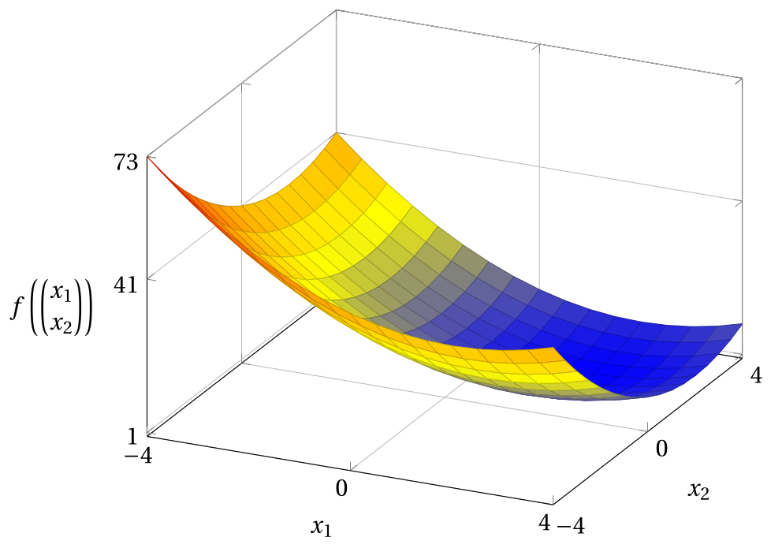
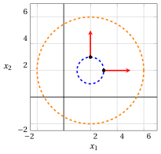

# Funzioni di più variabili

**Parte 1 · Preliminari · Capitolo 2** · [:material-file-pdf-box: Dispensa, volume 1 (PDF)](../pdf/dispensa-1-preliminari.pdf) · [:material-presentation: Slide](../pdf/slide-02-funzioni-piu-variabili.pdf) · [:material-pencil: Esercizi](../esercizi/es-02-funzioni-piu-variabili.md)

## 2.1 Funzioni di più variabili

!!! definizione "Definizione 2.1: funzione di più variabili reali"

    La funzione:

    \begin{equation*}
    f: D \subseteq \R^n \rightarrow \mathbb{R},~~~ f:
    \underbrace{
    \begin{pmatrix}
    x_1 \\
    x_2 \\
    \vdots \\
    x_n
    \end{pmatrix}
    }_{{\boldsymbol x}}
    \mapsto f({\boldsymbol x})
    \end{equation*}

    si chiama <strong>funzione (scalare) di $n$ variabili reali</strong> e $D \subseteq \R^n$ è il suo <strong>dominio</strong>.

- Una funzione, indicata di solito con $f$, di $n$ variabili reali prende in ingresso un vettore di $n$ numeri reali, rappresentato di solito dal vettore (colonna) delle variabili ${\boldsymbol x}$, e restituisce un numero reale, il valore della funzione, indicato di solito con $f({\boldsymbol x})$.

- I vettori si scrivono in grassetto e sono vettori colonna; il trasposto di un vettore ${\boldsymbol x}$ è il vettore riga ${\boldsymbol x}' = \begin{pmatrix} x_1 & x_2 & \dots & x_n \end{pmatrix}$.

!!! esempio "Esempio 2.1: una funzione di tre variabili"

    Consideriamo la funzione:

    $$
    f: \R^3 \rightarrow \R,~~ f: \begin{pmatrix} x_1 \\ x_2 \\ x_3 \end{pmatrix} \mapsto x_1\,x_2 + x_3^2
    $$

    Nel punto $\begin{pmatrix} 2 \\ -1 \\ 3 \end{pmatrix}$ il valore della funzione è:

    $$
    f\left(\begin{pmatrix} 2 \\ -1 \\ 3 \end{pmatrix}\right) = 2 \cdot (-1) + 3^2 = -2 + 9 = 7
    $$

## 2.2 Gradiente, matrice Hessiana e insiemi di livello

!!! definizione "Definizione 2.2: gradiente"

    Data $f:D\subseteq \R^n \to \R$, il <strong>gradiente</strong> $\nabla f(\boldsymbol x)$ di $f$ in $\boldsymbol x$ è il vettore (colonna) delle derivate parziali prime:

    $$
    \nabla f(\boldsymbol x) :=
    \begin{pmatrix}
    \frac{\partial f(\boldsymbol x)}{\partial x_1}\\[1ex]
    \frac{\partial f(\boldsymbol x)}{\partial x_2}\\[1ex]
    \vdots\\[1ex]
    \frac{\partial f(\boldsymbol x)}{\partial x_n}
    \end{pmatrix}
    $$

!!! chiave ""

    Il gradiente $\nabla f(\boldsymbol x)$ (se non è nullo) fornisce la direzione di massima crescita (massima derivata direzionale fra le direzioni unitarie), mentre $-\nabla f(\boldsymbol x)$ fornisce la direzione di massima decrescita.

!!! definizione "Definizione 2.3: matrice Hessiana"

    Data una funzione $f:D\subseteq \R^n \to \R$, la <strong>matrice Hessiana</strong> $\nabla^2 f(\boldsymbol x)$ di $f$ in $\boldsymbol x$ è la matrice delle derivate parziali seconde:

    $$
    \nabla^2 f(\boldsymbol x) :=
    \begin{pmatrix}
    \frac{\partial^2 f(\boldsymbol x)}{\partial x_1^2} & \frac{\partial^2 f(\boldsymbol x)}{\partial x_1\partial x_2} & \dots & \frac{\partial^2 f(\boldsymbol x)}{\partial x_1\partial x_n}\\[2ex]
    \frac{\partial^2 f(\boldsymbol x)}{\partial x_2\partial x_1} & \frac{\partial^2 f(\boldsymbol x)}{\partial x_2^2} & \dots & \frac{\partial^2 f(\boldsymbol x)}{\partial x_2\partial x_n}\\[2ex]
    \vdots & \vdots & \ddots & \vdots\\[2ex]
    \frac{\partial^2 f(\boldsymbol x)}{\partial x_n\partial x_1} & \frac{\partial^2 f(\boldsymbol x)}{\partial x_n\partial x_2} & \dots & \frac{\partial^2 f(\boldsymbol x)}{\partial x_n^2}
    \end{pmatrix}
    $$

- L'elemento di riga $i$ e colonna $j$ della matrice Hessiana si ottiene derivando $\frac{\partial f(\boldsymbol x)}{\partial x_j}$ rispetto a $x_i$.

- Se le derivate parziali seconde di $f$ sono continue (come per tutte le funzioni di queste dispense), l'ordine di derivazione non conta, $\frac{\partial^2 f(\boldsymbol x)}{\partial x_i\partial x_j} = \frac{\partial^2 f(\boldsymbol x)}{\partial x_j\partial x_i}$, e la matrice Hessiana è una matrice <strong>simmetrica</strong>.

!!! chiave ""

    La matrice Hessiana $\nabla^2 f(\boldsymbol x)$ descrive la curvatura locale di $f$ attorno a $\boldsymbol x$, cioè come varia il gradiente allontanandosi da $\boldsymbol x$.

!!! definizione "Definizione 2.4: insieme di livello"

    Data una funzione $f:D\subseteq \R^n \to \R$ e una costante $k\in\R$, l'<strong>insieme di livello</strong> $L(k)$ di $f$ al livello $k$ è:

    $$
    L(k) := \{\, \boldsymbol x \in D : f(\boldsymbol x)=k \,\}
    $$

!!! chiave ""

    Un insieme di livello $L(k)$ è l'insieme dei punti in cui la funzione assume il valore costante $k$. Il gradiente $\nabla f(\boldsymbol x)$ (se non è nullo) è perpendicolare all'insieme di livello passante per $\boldsymbol x$ e punta verso i valori crescenti di $f$.

!!! esempio "Esempio 2.2: gradiente, matrice Hessiana e insiemi di livello di una funzione quadratica"

    Consideriamo la funzione quadratica:

    $$
    f: \R^2 \rightarrow \R,~~f: \begin{pmatrix}
    x_1 \\
    x_2
    \end{pmatrix} \mapsto (x_1-2)^2 + (x_2-2)^2 +1
    $$

    - Il <strong>gradiente</strong> della funzione è:

        $$
        \nabla f\left(\begin{pmatrix}
        x_1 \\
        x_2
        \end{pmatrix}\right) =
        \begin{pmatrix}
        \frac{ \partial f}{ \partial x_1} \\[2ex]
        \frac{ \partial f}{ \partial x_2}
        \end{pmatrix}
        =
        \begin{pmatrix}
        2(x_1-2) \\[1ex]
        2(x_2-2)
        \end{pmatrix}
        $$

        Per esempio:

        - nel punto $\begin{pmatrix} 3 \\ 2 \end{pmatrix}$ abbiamo

            $$
            \nabla f\left(\begin{pmatrix} 3 \\ 2 \end{pmatrix}\right) = \begin{pmatrix} 2(3-2) \\ 2(2-2) \end{pmatrix} = \begin{pmatrix} 2 \\ 0 \end{pmatrix}
            $$

        - nel punto $\begin{pmatrix} 2 \\ 3 \end{pmatrix}$ abbiamo

            $$
            \nabla f\left(\begin{pmatrix} 2 \\ 3 \end{pmatrix}\right) = \begin{pmatrix} 2(2-2) \\ 2(3-2) \end{pmatrix} = \begin{pmatrix} 0 \\ 2 \end{pmatrix}
            $$

    - La <strong>matrice Hessiana</strong> della funzione è:

        $$
        \nabla^2 f\left(\begin{pmatrix}
        x_1 \\
        x_2
        \end{pmatrix}\right) =
        \begin{pmatrix}
        \frac{ \partial^2 f}{ \partial x_1^2} & \frac{ \partial^2 f}{ \partial x_1 \partial x_2} \\[2ex]
        \frac{ \partial^2 f}{ \partial x_2 \partial x_1} & \frac{ \partial^2 f}{ \partial x_2^2}
        \end{pmatrix}
        =
        \begin{pmatrix}
        2 & 0 \\[1ex]
        0 & 2
        \end{pmatrix}
        $$

        Si noti che la matrice Hessiana è costante (non dipende dal punto).

    - Gli <strong>insiemi di livello</strong> della funzione sono:

        $$
        L(k) = \left\{~\begin{pmatrix} x_1 \\ x_2 \end{pmatrix} \in \R^2:~ (x_1-2)^2 + (x_2-2)^2 +1= k ~\right\} , \qquad \forall k \in \mathbb{R}
        $$

        che sono circonferenze di centro $\begin{pmatrix} 2 \\ 2 \end{pmatrix}$ e raggio $\sqrt{k-1}$ per $k > 1$; l'insieme di livello $L(1)$ è il solo punto $\begin{pmatrix} 2 \\ 2 \end{pmatrix}$ e gli insiemi di livello con $k<1$ sono vuoti.

!!! esempio "Esempio 2.3: grafico, insiemi di livello e gradienti di una funzione quadratica"

    Per la funzione dell'esempio precedente, questo è il grafico nel dominio $[-4,4]\times[-4,4]$; il suo punto più basso è in $\begin{pmatrix} 2 \\ 2 \end{pmatrix}$, dove $f = 1$, e il suo punto più alto è in $\begin{pmatrix} -4 \\ -4 \end{pmatrix}$, dove $f = 73$:

    { .fig .ovale loading=lazy style="width:59%" }

    La figura seguente mostra gli insiemi di livello $L(2)$ (circonferenza di raggio $1$, in blu) e $L(17)$ (circonferenza di raggio $4$, in arancione), e i due gradienti dell'esempio precedente (in rosso), tracciati a partire dai punti $\begin{pmatrix} 3 \\ 2 \end{pmatrix}$ e $\begin{pmatrix} 2 \\ 3 \end{pmatrix}$ dell'insieme di livello $L(2)$:

    { .fig .ovale loading=lazy style="width:50%" }

    I vettori gradiente sono perpendicolari agli insiemi di livello e puntano nella direzione di massima crescita della funzione (allontanandosi dal centro).

## 2.3 Esempi di funzioni non quadratiche

- Per una funzione quadratica la matrice Hessiana è costante (capitolo «Funzioni quadratiche»). In generale, la matrice Hessiana dipende dal punto, come nei due esempi seguenti.

!!! esempio "Esempio 2.4: gradiente e matrice Hessiana di una funzione cubica"

    Consideriamo la funzione:

    $$
    f: \R^2 \rightarrow \R,~~f: \begin{pmatrix} x_1 \\ x_2 \end{pmatrix} \mapsto x_1^2\,x_2
    $$

    - Il <strong>gradiente</strong> e la <strong>matrice Hessiana</strong> della funzione sono:

        $$
        \nabla f\left(\begin{pmatrix} x_1 \\ x_2 \end{pmatrix}\right) =
        \begin{pmatrix} 2\,x_1 x_2 \\[1ex] x_1^2 \end{pmatrix},
        \qquad
        \nabla^2 f\left(\begin{pmatrix} x_1 \\ x_2 \end{pmatrix}\right) =
        \begin{pmatrix} 2\,x_2 & 2\,x_1 \\[1ex] 2\,x_1 & 0 \end{pmatrix}
        $$

    - Nel punto $\begin{pmatrix} 1 \\ 2 \end{pmatrix}$ abbiamo:

        $$
        \nabla f\left(\begin{pmatrix} 1 \\ 2 \end{pmatrix}\right) = \begin{pmatrix} 2 \cdot 1 \cdot 2 \\[0.5ex] 1^2 \end{pmatrix} = \begin{pmatrix} 4 \\ 1 \end{pmatrix},
        \qquad
        \nabla^2 f\left(\begin{pmatrix} 1 \\ 2 \end{pmatrix}\right) = \begin{pmatrix} 4 & 2 \\ 2 & 0 \end{pmatrix}
        $$

    - Nel punto $\begin{pmatrix} -1 \\ 3 \end{pmatrix}$ abbiamo:

        $$
        \nabla f\left(\begin{pmatrix} -1 \\ 3 \end{pmatrix}\right) = \begin{pmatrix} 2 \cdot (-1) \cdot 3 \\[0.5ex] (-1)^2 \end{pmatrix} = \begin{pmatrix} -6 \\ 1 \end{pmatrix},
        \qquad
        \nabla^2 f\left(\begin{pmatrix} -1 \\ 3 \end{pmatrix}\right) = \begin{pmatrix} 6 & -2 \\ -2 & 0 \end{pmatrix}
        $$

    La matrice Hessiana cambia da punto a punto e, come previsto, è simmetrica in ogni punto.

!!! esempio "Esempio 2.5: gradiente, matrice Hessiana e un insieme di livello di una funzione esponenziale"

    Consideriamo la funzione:

    $$
    f: \R^2 \rightarrow \R,~~f: \begin{pmatrix} x_1 \\ x_2 \end{pmatrix} \mapsto e^{x_1} + x_2^2
    $$

    - Il <strong>gradiente</strong> e la <strong>matrice Hessiana</strong> della funzione sono:

        $$
        \nabla f\left(\begin{pmatrix} x_1 \\ x_2 \end{pmatrix}\right) =
        \begin{pmatrix} e^{x_1} \\[1ex] 2\,x_2 \end{pmatrix},
        \qquad
        \nabla^2 f\left(\begin{pmatrix} x_1 \\ x_2 \end{pmatrix}\right) =
        \begin{pmatrix} e^{x_1} & 0 \\[1ex] 0 & 2 \end{pmatrix}
        $$

    - L'insieme di livello $L(2)$ è la curva $e^{x_1} + x_2^2 = 2$, cioè $x_1 = \ln(2 - x_2^2)$ per $|x_2| < \sqrt{2}$. Contiene i punti $\begin{pmatrix} 0 \\ 1 \end{pmatrix}$ e $\begin{pmatrix} \ln 2 \\ 0 \end{pmatrix}$, poiché $e^0 + 1^2 = 2$ e $e^{\ln 2} + 0^2 = 2$. In questi punti:

        $$
        \nabla f\left(\begin{pmatrix} 0 \\ 1 \end{pmatrix}\right) = \begin{pmatrix} 1 \\ 2 \end{pmatrix},
        \qquad
        \nabla f\left(\begin{pmatrix} \ln 2 \\ 0 \end{pmatrix}\right) = \begin{pmatrix} 2 \\ 0 \end{pmatrix}
        $$

        e

        $$
        \nabla^2 f\left(\begin{pmatrix} 0 \\ 1 \end{pmatrix}\right) = \begin{pmatrix} 1 & 0 \\ 0 & 2 \end{pmatrix},
        \qquad
        \nabla^2 f\left(\begin{pmatrix} \ln 2 \\ 0 \end{pmatrix}\right) = \begin{pmatrix} 2 & 0 \\ 0 & 2 \end{pmatrix}
        $$

    La figura seguente mostra l'insieme di livello $L(2)$ (in blu) e i due vettori gradiente (in rosso):

    { .fig .ovale loading=lazy style="width:50%" }

    La direzione tangente all'insieme di livello in $\begin{pmatrix} 0 \\ 1 \end{pmatrix}$ è $\begin{pmatrix} -2 \\ 1 \end{pmatrix}$ (la derivata di $x_1 = \ln(2-x_2^2)$ rispetto a $x_2$ è $\frac{-2\,x_2}{2-x_2^2}$, uguale a $-2$ per $x_2=1$), e infatti:

    $$
    \begin{pmatrix} 1 & 2 \end{pmatrix} \begin{pmatrix} -2 \\ 1 \end{pmatrix} = -2 + 2 = 0
    $$

    quindi il gradiente è perpendicolare all'insieme di livello anche quando l'insieme di livello non è una circonferenza.

!!! chiave ""

    Il gradiente $\nabla f(\boldsymbol x)$ è il vettore colonna delle derivate parziali prime: punta nella direzione di massima crescita ed è perpendicolare all'insieme di livello passante per $\boldsymbol x$. La matrice Hessiana $\nabla^2 f(\boldsymbol x)$ è la matrice (simmetrica) delle derivate parziali seconde e descrive la curvatura locale di $f$.
