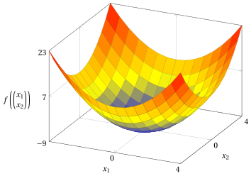
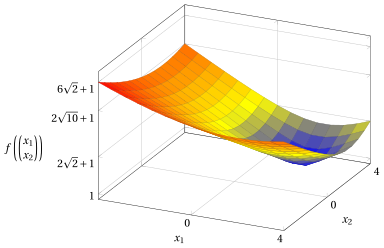
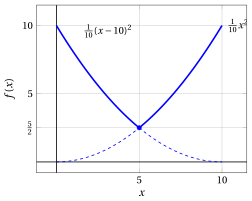
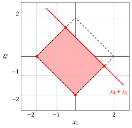

# Funzioni convesse e concave

**Parte 1 · Preliminari · Capitolo 3** · [:material-file-pdf-box: Dispensa, volume 1 (PDF)](../pdf/dispensa-1-preliminari.pdf) · [:material-pencil: Esercizi](../esercizi/es-03-funzioni-convesse-concave.md)

## 3.1 Funzioni convesse

!!! definizione "Definizione 3.1: funzione convessa"

    Una funzione $f: D \subseteq \R^n \rightarrow \R$ è <strong>convessa</strong> nel suo dominio $D$ se:

    \begin{equation*}
    \label{CONVEX}
    \forall {\boldsymbol p}, {\boldsymbol w} \in D {\rm ~~e~~} \forall \lambda \in [0,1]  \text{   abbiamo   } ~ f\big(\lambda \; {\boldsymbol p} + (1-\lambda)\;{\boldsymbol w}\big)~~ {\le}~~ \lambda \; f({\boldsymbol p}) + (1-\lambda)\; f({\boldsymbol w}) \tag{3.1}
    \end{equation*}

    e il dominio $D$ della funzione $f$ è un insieme convesso.

!!! chiave ""

    Una funzione è convessa nel suo dominio se, per ogni coppia di punti del suo dominio convesso, il valore in una qualsiasi combinazione convessa dei due punti è minore o uguale alla combinazione convessa dei valori in quei due punti.

- Se $D=[a,b] \subseteq \R$ (un intervallo, che per natura è un insieme convesso), il grafico di una funzione convessa è dato dalla seguente figura:

{ .fig .ovale loading=lazy style="width:71%" }

## 3.2 Funzioni concave

!!! definizione "Definizione 3.2: funzione concava"

    Una funzione $f: D \subseteq \R^n \rightarrow \R$ è <strong>concava</strong> nel suo dominio $D$ se:

    \begin{equation*}
    \label{CONCAVE}
    \forall {\boldsymbol p}, {\boldsymbol w} \in D {\rm ~~e~~} \forall \lambda \in [0,1]  \text{   abbiamo   } ~ f\big(\lambda \; {\boldsymbol p} + (1-\lambda)\;{\boldsymbol w}\big)~~ {\ge}~~ \lambda \; f({\boldsymbol p}) + (1-\lambda)\; f({\boldsymbol w}) \tag{3.2}
    \end{equation*}

    e il dominio $D$ della funzione $f$ è un insieme convesso.

!!! chiave ""

    Una funzione è concava nel suo dominio se, per ogni coppia di punti del suo dominio convesso, il valore in una qualsiasi combinazione convessa dei due punti è maggiore o uguale alla combinazione convessa dei valori in quei due punti.

- Se $D=[a,b] \subseteq \R$ (un intervallo, che per natura è un insieme convesso), il grafico di una funzione concava è dato dalla seguente figura:

{ .fig .ovale loading=lazy style="width:71%" }

## 3.3 Esempi di funzioni convesse e concave

- In questo capitolo consideriamo anche funzioni non lineari. La convessità di una funzione si dimostra sempre verificando la definizione: per punti arbitrari ${\boldsymbol p}, {\boldsymbol w}$ del dominio e un arbitrario $\lambda \in [0,1]$, verifichiamo la disuguaglianza della definizione. Per le funzioni quadratiche dei primi esempi, usiamo la seguente disuguaglianza.

!!! teorema "Osservazione 3.3"

    Per ogni $a, b \in \R$ e ogni $\lambda \in [0,1]$, abbiamo

    \begin{equation*}
    \label{eq:squares}
    \big(\lambda a+(1-\lambda)b\big)^2 \le \lambda a^2+(1-\lambda)b^2 . \tag{3.3}
    \end{equation*}

??? dimostrazione "Dimostrazione"

    Per ogni $a, b \in \R$ e ogni $\lambda \in [0,1]$, abbiamo:

    \begin{align*}
    \big(\lambda a+(1-\lambda)b\big)^2
    &= \lambda^2 a^2+2\lambda(1-\lambda)ab+(1-\lambda)^2b^2 \\[2ex]
    &= \lambda a^2+(1-\lambda)b^2-\lambda(1-\lambda)a^2+2\lambda(1-\lambda)ab-\lambda(1-\lambda)b^2 \\[2ex]
    &= \lambda a^2+(1-\lambda)b^2-\lambda(1-\lambda)(a^2-2ab+b^2) \\[2ex]
    &= \lambda a^2+(1-\lambda)b^2-\underbrace {\lambda(1-\lambda)(a-b)^2}_{\ge 0} \\[2ex]
    &\le \lambda a^2+(1-\lambda)b^2 \quad (\text{poiché } \lambda \ge 0,~ 1-\lambda \ge 0 \text{ e } (a-b)^2 \ge 0)
    \end{align*}

    
□

!!! esempio "Esempio 3.1: una funzione quadratica convessa"

    Consideriamo la seguente funzione:

    $$
    f: \R \rightarrow \R, ~~  f:x \mapsto  \frac{x^2}{10}
    $$

    { .fig .ovale loading=lazy style="width:50%" }

    Per dimostrare che la funzione è convessa nel suo dominio, osserviamo che per ogni coppia di punti $p,w\in\R$ e ogni $\lambda\in[0,1]$, abbiamo:

    \begin{align*}
    f\big(\lambda p+(1-\lambda)w\big)
    &= \frac{1}{10}\big(\lambda p+(1-\lambda)w\big)^2 \\[2ex]
    &\le \frac{1}{10}\Big(\lambda p^2+(1-\lambda)w^2\Big)
    \quad \text{(per la disuguaglianza \eqref{eq:squares})} \\[2ex]
    &= \lambda\,\frac{p^2}{10}+(1-\lambda)\,\frac{w^2}{10} \\[2ex]
    &= \lambda f(p)+(1-\lambda)f(w)
    \end{align*}

    Quindi,

    $$
    f\big(\lambda p + (1-\lambda) w\big) \le \lambda f(p) + (1-\lambda) f(w)
    $$

    Per natura, il dominio $\R$ è un insieme convesso. Di conseguenza, la funzione è convessa nel suo dominio.

!!! esempio "Esempio 3.2: una funzione quadratica convessa traslata"

    Consideriamo la seguente funzione:

    $$
    f: \R \rightarrow \R, ~~  f:x \mapsto  \frac{1}{10}(x-10)^2
    $$

    { .fig .ovale loading=lazy style="width:50%" }

    Per dimostrare che la funzione è convessa nel suo dominio, osserviamo che per ogni coppia di punti $p,w\in\R$ e ogni $\lambda\in[0,1]$, abbiamo:

    \begin{align*}
    f\big(\lambda p+(1-\lambda)w\big)
    &= \frac{1}{10}\big(\lambda p+(1-\lambda)w-10\big)^2 \\[2ex]
    &= \frac{1}{10}\big(\lambda (p-10)+(1-\lambda)(w-10)\big)^2
    \quad (\text{poiché } \lambda + (1-\lambda) = 1) \\[2ex]
    &\le \frac{1}{10}\Big(\lambda (p-10)^2+(1-\lambda)(w-10)^2\Big)
    \quad \text{(per la disuguaglianza \eqref{eq:squares})} \\[2ex]
    &= \lambda\,\frac{(p-10)^2}{10}+(1-\lambda)\,\frac{(w-10)^2}{10} \\[2ex]
    &= \lambda f(p)+(1-\lambda)f(w)
    \end{align*}

    Quindi,

    $$
    f\big(\lambda p + (1-\lambda) w\big) \le \lambda f(p) + (1-\lambda) f(w)
    $$

    Per natura, il dominio $\R$ è un insieme convesso. Di conseguenza, la funzione è convessa nel suo dominio.

!!! esempio "Esempio 3.3: una funzione lineare di due variabili"

    Consideriamo la seguente funzione:

    $$
    f: \R^2 \to \R,~~ f: \begin{pmatrix}
    x_1 \\
    x_2
    \end{pmatrix} \mapsto x_1 + x_2 - 1
    $$

    { .fig .ovale loading=lazy style="width:62%" }

    Per dimostrare che la funzione è convessa nel suo dominio, osserviamo che per ogni coppia di punti ${\boldsymbol p} = \begin{pmatrix} p_1 \\ p_2 \end{pmatrix}, {\boldsymbol w} = \begin{pmatrix} w_1 \\ w_2 \end{pmatrix} \in \R^2$ e ogni $\lambda \in [0,1]$, abbiamo:

    \begin{align*}
    f\big(\lambda {\boldsymbol p} + (1-\lambda){\boldsymbol w}\big)
    &= \bigl(\lambda p_1+(1-\lambda)w_1\bigr)+\bigl(\lambda p_2+(1-\lambda)w_2\bigr)-1 \\[2ex]
    &= \lambda(p_1+p_2)+(1-\lambda)(w_1+w_2)-\lambda-(1-\lambda)\\[1ex]
    &\qquad (\text{poiché } \lambda + (1-\lambda) = 1) \\[2ex]
    &= \lambda(p_1+p_2-1)+(1-\lambda)(w_1+w_2-1) \\[2ex]
    &= \lambda f({\boldsymbol p}) + (1-\lambda) f({\boldsymbol w})
    \end{align*}

    Quindi,

    $$
    f\big(\lambda {\boldsymbol p} + (1-\lambda){\boldsymbol w}\big) \le \lambda f({\boldsymbol p}) + (1-\lambda) f({\boldsymbol w})
    $$

    (con l'uguaglianza). Per natura, il dominio $\R^2$ è un insieme convesso. Di conseguenza, la funzione è convessa nel suo dominio. Poiché vale l'uguaglianza, vale anche la disuguaglianza con $\ge$: la funzione è anche concava nel suo dominio.

!!! esempio "Esempio 3.4: una funzione quadratica convessa di due variabili"

    Consideriamo la seguente funzione:

    $$
    f: \R^2 \to \R,~~ f:\begin{pmatrix}
    x_1 \\
    x_2
    \end{pmatrix} \mapsto x_1^2 + x_2^2 - 9
    $$

    { .fig .ovale loading=lazy style="width:62%" }

    Per dimostrare che la funzione è convessa nel suo dominio, osserviamo che per ogni coppia di punti ${\boldsymbol p} = \begin{pmatrix} p_1 \\ p_2 \end{pmatrix}, {\boldsymbol w} = \begin{pmatrix} w_1 \\ w_2 \end{pmatrix} \in \R^2$ e ogni $\lambda \in [0,1]$, abbiamo:

    \begin{align*}
    f\big(\lambda {\boldsymbol p} + (1-\lambda){\boldsymbol w}\big)
    &= (\lambda p_1+(1-\lambda)w_1)^2+(\lambda p_2+(1-\lambda)w_2)^2-9 \\[2ex]
    &\le \lambda p_1^2+(1-\lambda)w_1^2+\lambda p_2^2+(1-\lambda)w_2^2-9 \\[2ex]
    &\hspace{1cm} \text{(per la disuguaglianza \eqref{eq:squares}, due volte)} \\[2ex]
    &= \lambda(p_1^2+p_2^2-9)+(1-\lambda)(w_1^2+w_2^2-9) \\[2ex]
    &\hspace{1cm} (\text{poiché } \lambda + (1-\lambda) = 1) \\[2ex]
    &= \lambda f({\boldsymbol p}) + (1-\lambda) f({\boldsymbol w})
    \end{align*}

    Quindi,

    $$
    f\big(\lambda {\boldsymbol p} + (1-\lambda){\boldsymbol w}\big) \le \lambda f({\boldsymbol p}) + (1-\lambda) f({\boldsymbol w})
    $$

    Per natura, il dominio $\R^2$ è un insieme convesso. Di conseguenza, la funzione è convessa nel suo dominio.

- I due esempi seguenti sono funzioni di una variabile il cui grafico è formato da due segmenti.

!!! esempio "Esempio 3.5: il valore assoluto è una funzione convessa"

    Consideriamo la funzione $f: \R \rightarrow \R$, $f(x) = |x|$. Per dimostrare che la funzione è convessa nel suo dominio, osserviamo che per ogni coppia di punti $p, w \in \R$ e ogni $\lambda \in [0,1]$, abbiamo:

    \begin{align*}
    f\big(\lambda p + (1-\lambda) w\big)
    &= \big|\lambda p + (1-\lambda) w\big| \\[2ex]
    &\le |\lambda p| + |(1-\lambda) w| \quad \text{(per la disuguaglianza triangolare)} \\[2ex]
    &= |\lambda| \; |p| + |1-\lambda| \; |w| \quad \text{(per l'omogeneità assoluta)} \\[2ex]
    &= \lambda \; |p| + (1-\lambda) \; |w| \quad (\text{poiché } \lambda \ge 0 \text{ e } 1-\lambda \ge 0) \\[2ex]
    &= \lambda f(p) + (1-\lambda) f(w)
    \end{align*}

    Quindi,

    $$
    f\big(\lambda p + (1-\lambda) w\big) \le \lambda f(p) + (1-\lambda) f(w)
    $$

    Per natura, il dominio $\R$ è un insieme convesso. Di conseguenza, la funzione è convessa nel suo dominio.

    Ad esempio, con $p=-2$, $w=3$ e $\lambda=\frac{1}{2}$ otteniamo $\lambda \, p + (1-\lambda)\, w = \frac{1}{2}$ e

    $$
    f\Big(\frac{1}{2}\Big) = \frac{1}{2} \;\le\; \frac{1}{2}\; f(-2) + \frac{1}{2}\; f(3) = \frac{1}{2}\cdot 2 + \frac{1}{2} \cdot 3 = \frac{5}{2} .
    $$

    In figura, il segmento che congiunge $(p, f(p))$ e $(w, f(w))$ (in viola) si trova sopra il grafico di $f$ (in blu).

    { .fig .ovale loading=lazy style="width:50%" }

!!! esempio "Esempio 3.6: il minimo di due funzioni lineari è una funzione concava"

    Consideriamo la funzione $f: [-2,4] \rightarrow \R$, $f(x) = \min\{\, x+2, \; 4-\frac{1}{2}x \,\}$. Per dimostrare che la funzione è concava nel suo dominio, osserviamo che per ogni coppia di punti $p, w \in [-2,4]$ e ogni $\lambda \in [0,1]$, abbiamo:

    \begin{align*}
    f\big(\lambda p + (1-\lambda) w\big)
    &= \min\Big\{\, \lambda p + (1-\lambda) w + 2, \; 4 - \tfrac{1}{2}\big(\lambda p + (1-\lambda) w\big) \,\Big\} \\[2ex]
    &= \min\Big\{\, \lambda (p+2) + (1-\lambda)(w+2), \; \lambda \big(4-\tfrac{1}{2}p\big) + (1-\lambda)\big(4-\tfrac{1}{2}w\big) \,\Big\} \\[2ex]
    &\hspace{1cm} (\text{poiché } \lambda + (1-\lambda) = 1) \\[2ex]
    &\ge \min\Big\{\, \lambda f(p) + (1-\lambda) f(w), \; \lambda f(p) + (1-\lambda) f(w) \,\Big\} \\[2ex]
    &\hspace{1cm} (\text{poiché } f(p) \le p+2,~ f(p) \le 4-\tfrac{1}{2}p,~ f(w) \le w+2, \\
    &\hspace{1.3cm} f(w) \le 4-\tfrac{1}{2}w,~ \lambda \ge 0 \text{ e } 1-\lambda \ge 0) \\[2ex]
    &= \lambda f(p) + (1-\lambda) f(w)
    \end{align*}

    Quindi,

    $$
    f\big(\lambda p + (1-\lambda) w\big) \ge \lambda f(p) + (1-\lambda) f(w)
    $$

    Il dominio $[-2,4]$ è un intervallo, quindi un insieme convesso. Di conseguenza, la funzione è concava nel suo dominio.

    Le due rette si incontrano in $x=\frac{4}{3}$, dove $f(\frac{4}{3}) = \frac{10}{3}$. Ad esempio, con $p=-1$, $w=4$ e $\lambda=\frac{1}{2}$ otteniamo $\lambda \, p + (1-\lambda)\, w = \frac{3}{2}$ e

    $$
    f\Big(\frac{3}{2}\Big) = \min\Big\{\frac{7}{2},\, \frac{13}{4}\Big\} = \frac{13}{4} \;\ge\; \frac{1}{2}\; f(-1) + \frac{1}{2}\; f(4) = \frac{1}{2}\cdot 1 + \frac{1}{2} \cdot 2 = \frac{3}{2} .
    $$

    In figura, il segmento che congiunge $(p, f(p))$ e $(w, f(w))$ (in viola) si trova sotto il grafico di $f$ (in blu).

    { .fig .ovale loading=lazy style="width:50%" }

## 3.4 Funzioni convesse definite da norme

!!! definizione "Definizione 3.4: norma"

    Una <strong>norma</strong> su $\R^n$ è una funzione $\|\cdot\|: \R^n \rightarrow \R$ tale che, per ogni ${\boldsymbol p}, {\boldsymbol w} \in \R^n$ e ogni $\alpha \in \R$:

    - $\|{\boldsymbol p}\| \ge 0$, e $\|{\boldsymbol p}\| = 0$ se e solo se ${\boldsymbol p} = {\boldsymbol 0}$ (positività);

    - $\|\alpha \, {\boldsymbol p}\| = |\alpha| \; \|{\boldsymbol p}\|$ (omogeneità assoluta);

    - $\|{\boldsymbol p} + {\boldsymbol w}\| \le \|{\boldsymbol p}\| + \|{\boldsymbol w}\|$ (disuguaglianza triangolare).

!!! definizione "Definizione 3.5: le norme $1$, $2$, $q$ e $\infty$"

    Per ogni ${\boldsymbol x} \in \R^n$:

    \begin{align*}
    \|{\boldsymbol x}\|_1 &= \sum_{j=1}^{n} |x_j| && \text{(norma $1$, o norma di Manhattan)}\\[2ex]
    \|{\boldsymbol x}\|_2 &= \sqrt{\sum_{j=1}^{n} x_j^2} && \text{(norma $2$, o norma euclidea)}\\[2ex]
    \|{\boldsymbol x}\|_q &= \Big(\sum_{j=1}^{n} |x_j|^q\Big)^{\frac{1}{q}}, \quad q \ge 1 && \text{(norma $q$)}\\[2ex]
    \|{\boldsymbol x}\|_\infty &= \max_{j=1,\ldots,n} |x_j| && \text{(norma $\infty$, o norma del massimo)}
    \end{align*}

    Le norme $1$ e $2$ sono la norma $q$ con $q=1$ e $q=2$, e $\|{\boldsymbol x}\|_\infty = \lim_{q \to \infty} \|{\boldsymbol x}\|_q$.

!!! esempio "Esempio 3.7: le quattro norme di un vettore"

    Per ${\boldsymbol x} = \begin{pmatrix} 3 \\ -4 \end{pmatrix}$ abbiamo:

    \begin{align*}
    \|{\boldsymbol x}\|_1 &= |3| + |{-4}| = 7, &
    \|{\boldsymbol x}\|_2 &= \sqrt{3^2 + (-4)^2} = 5,\\[2ex]
    \|{\boldsymbol x}\|_3 &= \big(|3|^3 + |{-4}|^3\big)^{\frac{1}{3}} = \sqrt[3]{91}, &
    \|{\boldsymbol x}\|_\infty &= \max\{|3|, |{-4}|\} = 4.
    \end{align*}

!!! teorema "Osservazione 3.6: convessità della norma euclidea"

    La funzione

    $$
    f:\, \mathbb{R}^{n} \to \mathbb{R}, \qquad
    f: {\boldsymbol{x}} \mapsto
    \|\boldsymbol{x} \|_2
    $$

    è convessa nel suo dominio.

??? dimostrazione "Dimostrazione"

    Per ogni coppia di punti $\boldsymbol{p}, \boldsymbol{w} \in \mathbb{R}^n$ e ogni $\lambda \in [0,1]$, abbiamo:

    \begin{align*}
    f\big(\lambda {\boldsymbol p} + (1-\lambda){\boldsymbol w}\big)
    &= \|\lambda \boldsymbol{p} + (1 - \lambda) \boldsymbol{w} \|_2 \\[2ex]
    & \le \|\lambda \boldsymbol{p}\|_2 + \|(1 - \lambda) \boldsymbol{w}\|_2 \quad \text{(per la disuguaglianza triangolare)} \\[2ex]
    &= |\lambda| \; \|\boldsymbol{p}\|_2 + |1 - \lambda| \; \|\boldsymbol{w}\|_2 \quad \text{(per l'omogeneità assoluta)} \\[2ex]
    &= \lambda \; \|\boldsymbol{p}\|_2 + (1 - \lambda) \; \|\boldsymbol{w}\|_2 \quad (\text{poiché } \lambda \ge 0 \text{ e } 1-\lambda \ge 0) \\[2ex]
    &= \lambda f({\boldsymbol p}) + (1-\lambda) f({\boldsymbol w})
    \end{align*}

    Quindi,

    $$
    f(\lambda {\boldsymbol p} + (1-\lambda){\boldsymbol w})
    \le
    \lambda f({\boldsymbol p}) + (1-\lambda) f({\boldsymbol w})
    $$

    Per natura, il dominio $\mathbb{R}^{n}$ è un insieme convesso. Di conseguenza, la funzione è convessa nel suo dominio. □

!!! teorema "Osservazione 3.7: convessità di ogni norma"

    Per ogni norma $\|\cdot\|$ su $\R^n$ (in particolare $\|\cdot\|_1$, $\|\cdot\|_2$, $\|\cdot\|_q$ con $q \ge 1$, e $\|\cdot\|_\infty$), la funzione

    $$
    f:\, \mathbb{R}^{n} \to \mathbb{R}, \qquad
    f: {\boldsymbol{x}} \mapsto \|\boldsymbol{x}\|
    $$

    è convessa nel suo dominio.

??? dimostrazione "Dimostrazione"

    Per ogni coppia di punti $\boldsymbol{p}, \boldsymbol{w} \in \mathbb{R}^n$ e ogni $\lambda \in [0,1]$, abbiamo:

    \begin{align*}
    f\big(\lambda {\boldsymbol p} + (1-\lambda){\boldsymbol w}\big)
    &= \|\lambda \boldsymbol{p} + (1 - \lambda) \boldsymbol{w} \| \\[2ex]
    & \le \|\lambda \boldsymbol{p}\| + \|(1 - \lambda) \boldsymbol{w}\| \quad \text{(per la disuguaglianza triangolare)} \\[2ex]
    &= |\lambda| \; \|\boldsymbol{p}\| + |1 - \lambda| \; \|\boldsymbol{w}\| \quad \text{(per l'omogeneità assoluta)} \\[2ex]
    &= \lambda \; \|\boldsymbol{p}\| + (1 - \lambda) \; \|\boldsymbol{w}\| \quad (\text{poiché } \lambda \ge 0 \text{ e } 1-\lambda \ge 0) \\[2ex]
    &= \lambda f({\boldsymbol p}) + (1-\lambda) f({\boldsymbol w})
    \end{align*}

    Quindi,

    $$
    f(\lambda {\boldsymbol p} + (1-\lambda){\boldsymbol w})
    \le
    \lambda f({\boldsymbol p}) + (1-\lambda) f({\boldsymbol w})
    $$

    Per natura, il dominio $\mathbb{R}^{n}$ è un insieme convesso. Di conseguenza, la funzione è convessa nel suo dominio. □

!!! teorema "Corollario 3.8"

    Per ogni coppia di punti $\boldsymbol{p}, \boldsymbol{w} \in \mathbb{R}^n$ e ogni $\lambda \in [0,1]$, abbiamo

    \begin{equation*}
    \label{eq:normineq}
    \|\lambda \boldsymbol{p} + (1 - \lambda) \boldsymbol{w} \|_2  \le \lambda \; \|\boldsymbol{p}\|_2 + (1 - \lambda) \; \|\boldsymbol{w}\|_2 \tag{3.4}
    \end{equation*}

!!! esempio "Esempio 3.8: la distanza da un punto"

    Consideriamo il vettore ${\boldsymbol c} = \begin{pmatrix} 2 \\ 2 \end{pmatrix}$ e la funzione:

    \begin{equation*}
    f: \mathbb{R}^2 \to \mathbb{R}, \quad f: \begin{pmatrix}
    x_1 \\
    x_2 \\
    \end{pmatrix} \mapsto \left\| \begin{pmatrix}
    x_1 \\
    x_2 \\
    \end{pmatrix} - \begin{pmatrix}
    2 \\
    2 \\
    \end{pmatrix}  \right\|_2 + 1
    \end{equation*}

    { .fig .ovale loading=lazy style="width:62%" }

    Per dimostrare che la funzione è convessa nel suo dominio, osserviamo che per ogni coppia di punti ${\boldsymbol p}, {\boldsymbol w} \in \R^2$ e ogni $\lambda \in [0,1]$, abbiamo:

    \begin{align*}
    f\big(\lambda {\boldsymbol p} + (1-\lambda){\boldsymbol w}\big)
    &= \big\| \lambda {\boldsymbol p} + (1 - \lambda){\boldsymbol w} - {\boldsymbol c} \big\|_2 + 1 \\[2ex]
    &= \big\| \lambda ({\boldsymbol p} - {\boldsymbol c}) + (1 - \lambda)({\boldsymbol w} - {\boldsymbol c}) \big\|_2 + 1
    \quad (\text{poiché } \lambda + (1-\lambda) = 1) \\[2ex]
    &\le \lambda \, \|{\boldsymbol p} - {\boldsymbol c}\|_2 + (1 - \lambda)\, \|{\boldsymbol w} - {\boldsymbol c}\|_2 + 1
    \quad \text{(per la disuguaglianza \eqref{eq:normineq})}\\[2ex]
    &= \lambda \big( \|{\boldsymbol p} - {\boldsymbol c}\|_2 + 1 \big) + (1-\lambda) \big( \|{\boldsymbol w} - {\boldsymbol c}\|_2 + 1 \big) \\[2ex]
    &= \lambda f({\boldsymbol p}) + (1-\lambda) f({\boldsymbol w})
    \end{align*}

    Quindi,

    $$
    f\big(\lambda {\boldsymbol p} + (1-\lambda){\boldsymbol w}\big) \le \lambda f({\boldsymbol p}) + (1-\lambda) f({\boldsymbol w})
    $$

    Per natura, il dominio $\R^2$ è un insieme convesso. Di conseguenza, la funzione è convessa nel suo dominio.

!!! teorema "Osservazione 3.9: convessità del quadrato della norma euclidea"

    La funzione

    $$
    f:\, \mathbb{R}^{n} \to \mathbb{R}, \qquad
    f: {\boldsymbol{x}} \mapsto
    \|\boldsymbol{x} \|_2^2
    $$

    è convessa nel suo dominio.

??? dimostrazione "Dimostrazione"

    Per ogni coppia di punti $\boldsymbol{p}, \boldsymbol{w} \in \mathbb{R}^n$ e ogni $\lambda \in [0,1]$, abbiamo:

    \begin{align*}
    f\big(\lambda {\boldsymbol p} + (1-\lambda){\boldsymbol w}\big)
    &= \|\lambda \boldsymbol{p} + (1 - \lambda) \boldsymbol{w} \|_2^2 \\[2ex]
    &= \big(\lambda \boldsymbol{p} + (1 - \lambda) \boldsymbol{w}\big)' \;
    \big(\lambda \boldsymbol{p} + (1 - \lambda) \boldsymbol{w}\big) \\[2ex]
    &= \lambda^2 \|\boldsymbol{p}\|_2^2 + (1 - \lambda)^2 \|\boldsymbol{w}\|_2^2
    + 2\lambda(1 - \lambda)\,(\boldsymbol{p}' \; \boldsymbol{w}) \\[2ex]
    &\le \lambda^2 \|\boldsymbol{p}\|_2^2 + (1 - \lambda)^2 \|\boldsymbol{w}\|_2^2
    + 2\lambda(1 - \lambda)\,\|\boldsymbol{p}\|_2\,\|\boldsymbol{w}\|_2  \\[2ex]
    &\hspace{1cm}  \text{(per la disuguaglianza di Cauchy--Schwarz)} \\[2ex]
    &\le \lambda^2 \|\boldsymbol{p}\|_2^2 + (1 - \lambda)^2 \|\boldsymbol{w}\|_2^2
    + \lambda(1 - \lambda)\|\boldsymbol{p}\|_2^2 + \lambda(1 - \lambda)\|\boldsymbol{w}\|_2^2 \\[2ex]
    &\hspace{1cm}\text{(poiché $2ab\le a^2+b^2$ per ogni $a,b \in \R$,} \\
    &\hspace{1.3cm}\text{con $a=\|\boldsymbol{p}\|_2$ e $b=\|\boldsymbol{w}\|_2$)} \\[2ex]
    &= \big(\lambda^2+\lambda(1-\lambda)\big)\|\boldsymbol{p}\|_2^2
    + \big((1-\lambda)^2+\lambda(1-\lambda)\big)\|\boldsymbol{w}\|_2^2 \\[2ex]
    &= \lambda\|\boldsymbol{p}\|_2^2 + (1 - \lambda)\|\boldsymbol{w}\|_2^2 \\[2ex]
    &= \lambda f({\boldsymbol p}) + (1-\lambda) f({\boldsymbol w})
    \end{align*}

    Quindi,

    $$
    f(\lambda {\boldsymbol p} + (1-\lambda){\boldsymbol w})
    \le
    \lambda f({\boldsymbol p}) + (1-\lambda) f({\boldsymbol w})
    $$

    Per natura, il dominio $\mathbb{R}^{n}$ è un insieme convesso. Di conseguenza, la funzione è convessa nel suo dominio. □

- La dimostrazione seguente è più diretta e non richiede l'uso della disuguaglianza di Cauchy–Schwarz né della disuguaglianza $2ab \le a^2 + b^2$ per ogni $a,b \in \mathbb{R}$.

??? dimostrazione "Dimostrazione"

    Per ogni coppia di punti $\boldsymbol{p}, \boldsymbol{w} \in \mathbb{R}^n$ e ogni $\lambda \in [0,1]$, abbiamo:

    \begin{align*}
    f\big(\lambda {\boldsymbol p} + (1-\lambda){\boldsymbol w}\big)
    &= \big(\lambda \boldsymbol{p} + (1 - \lambda) \boldsymbol{w}\big)' \big(\lambda \boldsymbol{p} + (1 - \lambda) \boldsymbol{w}\big) \\[2ex]
    &= \lambda^2 \|\boldsymbol{p}\|_2^2 + (1 - \lambda)^2 \|\boldsymbol{w}\|_2^2 + 2\lambda(1 - \lambda)\,(\boldsymbol{p}' \boldsymbol{w}) \\[2ex]
    &= \lambda^2 \|\boldsymbol{p}\|_2^2 + (1 - \lambda)^2 \|\boldsymbol{w}\|_2^2 \\
    &\qquad + \lambda(1 - \lambda)\bigl(\|\boldsymbol{p}\|_2^2 + \|\boldsymbol{w}\|_2^2 - \|\boldsymbol{p}-\boldsymbol{w}\|_2^2\bigr) \\[2ex]
    &\hspace{1cm}\text{(poiché } \|\boldsymbol{p}-\boldsymbol{w}\|_2^2 = \|\boldsymbol{p}\|_2^2+\|\boldsymbol{w}\|_2^2-2\boldsymbol{p}'\boldsymbol{w}\text{)} \\[2ex]
    &= \big(\lambda^2+\lambda(1-\lambda)\big)\|\boldsymbol{p}\|_2^2 + \big((1-\lambda)^2+\lambda(1-\lambda)\big)\|\boldsymbol{w}\|_2^2 \\
    &\qquad - \lambda(1-\lambda)\|\boldsymbol{p}-\boldsymbol{w}\|_2^2 \\[2ex]
    &= \lambda\|\boldsymbol{p}\|_2^2 + (1 - \lambda)\|\boldsymbol{w}\|_2^2 - \lambda(1-\lambda)\|\boldsymbol{p}-\boldsymbol{w}\|_2^2 \\[2ex]
    &\le \lambda\|\boldsymbol{p}\|_2^2 + (1 - \lambda)\|\boldsymbol{w}\|_2^2 \quad \text{(poiché } \lambda(1-\lambda)\|\boldsymbol{p}-\boldsymbol{w}\|_2^2 \ge 0\text{)} \\[2ex]
    &= \lambda f({\boldsymbol p}) + (1-\lambda) f({\boldsymbol w})
    \end{align*}

    Quindi,

    $$
    f(\lambda {\boldsymbol p} + (1-\lambda){\boldsymbol w})
    \le
    \lambda f({\boldsymbol p}) + (1-\lambda) f({\boldsymbol w})
    $$

    Per natura, il dominio $\mathbb{R}^{n}$ è un insieme convesso. Di conseguenza, la funzione è convessa nel suo dominio. □

!!! teorema "Corollario 3.10"

    Per ogni coppia di punti $\boldsymbol{p}, \boldsymbol{w} \in \mathbb{R}^n$ e ogni $\lambda \in [0,1]$, abbiamo

    \begin{equation*}
    \label{eq:sqnormineq}
    \|\lambda \boldsymbol{p} + (1 - \lambda) \boldsymbol{w} \|_2^2  \le \lambda \; \|\boldsymbol{p}\|_2^2 + (1 - \lambda) \; \|\boldsymbol{w}\|_2^2 \tag{3.5}
    \end{equation*}

!!! esempio "Esempio 3.9: il quadrato della distanza da un punto"

    Consideriamo il vettore ${\boldsymbol c} = \begin{pmatrix} 2 \\ 2 \end{pmatrix}$ e la funzione:

    \begin{equation*}
    f: \R^2 \rightarrow \R,~~f: \begin{pmatrix}
    x_1 \\
    x_2 \\
    \end{pmatrix} \mapsto \left\| \begin{pmatrix}
    x_1 \\
    x_2 \\
    \end{pmatrix} - \begin{pmatrix}
    2 \\
    2 \\
    \end{pmatrix}  \right\|_2^2 +1
    \end{equation*}

    { .fig .ovale loading=lazy style="width:62%" }

    Per dimostrare che la funzione è convessa nel suo dominio, osserviamo che per ogni coppia di punti ${\boldsymbol p}, {\boldsymbol w} \in \R^2$ e ogni $\lambda \in [0,1]$, abbiamo:

    \begin{align*}
    f\big(\lambda {\boldsymbol p} + (1-\lambda){\boldsymbol w}\big)
    &= \big\| \lambda {\boldsymbol p} + (1 - \lambda){\boldsymbol w} - {\boldsymbol c} \big\|_2^2 + 1 \\[2ex]
    &= \big\| \lambda ({\boldsymbol p} - {\boldsymbol c}) + (1 - \lambda)({\boldsymbol w} - {\boldsymbol c}) \big\|_2^2 + 1
    \quad (\text{poiché } \lambda + (1-\lambda) = 1) \\[2ex]
    &\le \lambda \, \|{\boldsymbol p} - {\boldsymbol c}\|_2^2 + (1 - \lambda)\, \|{\boldsymbol w} - {\boldsymbol c}\|_2^2 + 1
    \quad \text{(per la disuguaglianza \eqref{eq:sqnormineq})}\\[2ex]
    &= \lambda \big( \|{\boldsymbol p} - {\boldsymbol c}\|_2^2 + 1 \big) + (1-\lambda) \big( \|{\boldsymbol w} - {\boldsymbol c}\|_2^2 + 1 \big) \\[2ex]
    &= \lambda f({\boldsymbol p}) + (1-\lambda) f({\boldsymbol w})
    \end{align*}

    Quindi,

    $$
    f\big(\lambda {\boldsymbol p} + (1-\lambda){\boldsymbol w}\big) \le \lambda f({\boldsymbol p}) + (1-\lambda) f({\boldsymbol w})
    $$

    Per natura, il dominio $\R^2$ è un insieme convesso. Di conseguenza, la funzione è convessa nel suo dominio.

## 3.5 Proprietà delle funzioni convesse e concave

!!! teorema "Osservazione 3.11"

    Una funzione $f: D \subseteq \R^n \rightarrow \R$ è convessa in $D$ se e solo se la funzione $-f$ è concava in $D$.

??? dimostrazione "Dimostrazione"

    Sia $f$ convessa in $D$. Per ogni coppia di punti ${\boldsymbol p}, {\boldsymbol w} \in D$ e ogni $\lambda \in [0,1]$, abbiamo:

    \begin{align*}
    (-f)\big(\lambda {\boldsymbol p} + (1-\lambda){\boldsymbol w}\big)
    &= -f\big(\lambda {\boldsymbol p} + (1-\lambda){\boldsymbol w}\big) \\[2ex]
    &\ge -\big(\lambda f({\boldsymbol p}) + (1-\lambda) f({\boldsymbol w})\big) \\[2ex]
    &\hspace{1cm} \text{(poiché $f$ è convessa, e $-1$ inverte la disuguaglianza)} \\[2ex]
    &= \lambda \, (-f)({\boldsymbol p}) + (1-\lambda) \, (-f)({\boldsymbol w})
    \end{align*}

    Quindi,

    $$
    (-f)\big(\lambda {\boldsymbol p} + (1-\lambda){\boldsymbol w}\big) \ge \lambda \, (-f)({\boldsymbol p}) + (1-\lambda) \, (-f)({\boldsymbol w})
    $$

    Il dominio $D$ è un insieme convesso, poiché $f$ è convessa in $D$. Di conseguenza, la funzione $-f$ è concava nel suo dominio. Il viceversa si dimostra allo stesso modo, partendo dalla disuguaglianza della funzione concava $-f$ e moltiplicandola per $-1$. □

!!! teorema "Osservazione 3.12"

    Siano $f, g: D \subseteq \R^n \rightarrow \R$ convesse in $D$ e siano $\alpha, \beta \ge 0$. Allora la funzione $\alpha \, f + \beta \, g$ è convessa in $D$. Lo stesso vale per le funzioni concave.

??? dimostrazione "Dimostrazione"

    Per ogni coppia di punti ${\boldsymbol p}, {\boldsymbol w} \in D$ e ogni $\lambda \in [0,1]$, abbiamo:

    \begin{align*}
    (\alpha f + \beta g)\big(\lambda {\boldsymbol p} + (1-\lambda){\boldsymbol w}\big)
    &= \alpha f\big(\lambda {\boldsymbol p} + (1-\lambda){\boldsymbol w}\big) + \beta g\big(\lambda {\boldsymbol p} + (1-\lambda){\boldsymbol w}\big) \\[2ex]
    &\le \alpha \big(\lambda f({\boldsymbol p}) + (1-\lambda) f({\boldsymbol w})\big) + \beta \big(\lambda g({\boldsymbol p}) + (1-\lambda) g({\boldsymbol w})\big) \\[2ex]
    &\hspace{1cm} \text{(poiché $f$ e $g$ sono convesse, e $\alpha \ge 0$, $\beta \ge 0$)} \\[2ex]
    &= \lambda \big(\alpha f({\boldsymbol p}) + \beta g({\boldsymbol p})\big) + (1-\lambda)\big(\alpha f({\boldsymbol w}) + \beta g({\boldsymbol w})\big) \\[2ex]
    &= \lambda \, (\alpha f + \beta g)({\boldsymbol p}) + (1-\lambda) \, (\alpha f + \beta g)({\boldsymbol w})
    \end{align*}

    Quindi,

    $$
    (\alpha f + \beta g)\big(\lambda {\boldsymbol p} + (1-\lambda){\boldsymbol w}\big) \le \lambda \, (\alpha f + \beta g)({\boldsymbol p}) + (1-\lambda) \, (\alpha f + \beta g)({\boldsymbol w})
    $$

    Il dominio $D$ è un insieme convesso, poiché $f$ è convessa in $D$. Di conseguenza, la funzione $\alpha f + \beta g$ è convessa nel suo dominio. Per le funzioni concave vale lo stesso ragionamento con $\ge$. □

- Il massimo puntuale di funzioni convesse è a sua volta una funzione convessa: questo ci permette di combinare più funzioni convesse in una sola preservando la convessità.

!!! teorema "Osservazione 3.13"

    Date $m$ funzioni $f_i : D_i \subseteq \R^n \rightarrow \R$ convesse nei loro domini, con $i \in \{1,2,\dots,m\}$, la funzione

    $$
    f: \bigcap_{i=1}^m D_i \subseteq \R^n \rightarrow \R, \qquad {\boldsymbol x} \mapsto \max\big\{\, f_i({\boldsymbol x}) : i \in \{1,2,\dots,m\} \,\big\}
    $$

    è convessa nel suo dominio. Analogamente, il minimo di $m$ funzioni concave è concavo nel suo dominio.

??? dimostrazione "Dimostrazione"

    Per ogni coppia di punti ${\boldsymbol p},{\boldsymbol w} \in \bigcap_{i=1}^m D_i$ e ogni $\lambda \in [0,1]$, poiché ogni dominio $D_i$ è convesso, abbiamo $\lambda {\boldsymbol p} + (1-\lambda){\boldsymbol w} \in \bigcap_{i=1}^m D_i$. Sia $k \in \{1,2,\dots,m\}$ tale che $f(\lambda {\boldsymbol p} + (1-\lambda){\boldsymbol w}) = f_k(\lambda {\boldsymbol p} + (1-\lambda){\boldsymbol w})$. Abbiamo:

    \begin{align*}
    f\big(\lambda {\boldsymbol p} + (1-\lambda){\boldsymbol w}\big)
    &= \max \big\{ f_i(\lambda {\boldsymbol p} + (1-\lambda){\boldsymbol w}) : i \in \{1,2,\dots,m\} \big\} \\[2ex]
    &= f_k\big(\lambda {\boldsymbol p} + (1-\lambda){\boldsymbol w}\big) \\[2ex]
    &\le \lambda f_k({\boldsymbol p}) + (1-\lambda) f_k({\boldsymbol w})
    \quad \text{(poiché $f_k$ è convessa)} \\[2ex]
    &\le \lambda \max \big\{ f_i({\boldsymbol p}) : i \in \{1,2,\dots,m\} \big\} \\
    &\qquad + (1-\lambda) \max \big\{ f_i({\boldsymbol w}) : i \in \{1,2,\dots,m\} \big\} \\[2ex]
    &\hspace{1cm} (\text{poiché } \lambda \ge 0 \text{ e } 1-\lambda \ge 0) \\[2ex]
    &= \lambda f({\boldsymbol p}) + (1-\lambda) f({\boldsymbol w})
    \end{align*}

    Quindi,

    $$
    f(\lambda {\boldsymbol p} + (1-\lambda){\boldsymbol w})
    \le
    \lambda f({\boldsymbol p}) + (1-\lambda) f({\boldsymbol w})
    $$

    Il dominio $\bigcap_{i=1}^m D_i$ è un insieme convesso, poiché è l'intersezione di insiemi convessi. Di conseguenza, la funzione $f$ è convessa nel suo dominio. L'enunciato per il minimo di funzioni concave segue applicando questo a $-f_1, \dots, -f_m$. □

- Il valore assoluto $|x| = \max\{x, -x\}$ dell'[Esempio 3.5](#box-8-exAbsConvex) è il massimo delle due funzioni $x$ e $-x$, che sono convesse (e concave), poiché la definizione vale con l'uguaglianza: $-\big(\lambda p + (1-\lambda) w\big) = \lambda (-p) + (1-\lambda)(-w)$. La funzione dell'[Esempio 3.6](#box-9-exMinConcave) è il minimo delle due funzioni $x+2$ e $4-\frac{1}{2}x$, che sono concave per la stessa ragione: $\big(\lambda p + (1-\lambda) w\big) + 2 = \lambda (p+2) + (1-\lambda)(w+2)$ e $4-\frac{1}{2}\big(\lambda p + (1-\lambda) w\big) = \lambda \big(4-\frac{1}{2}p\big) + (1-\lambda)\big(4-\frac{1}{2}w\big)$. Per l'osservazione precedente, ritroviamo che le due funzioni sono, rispettivamente, convessa e concava.

!!! esempio "Esempio 3.10: massimo di funzioni convesse"

    Consideriamo le seguenti due funzioni convesse (Esempi [3.2](#box-5-exSquareTen) e [Esempio 3.1](#box-4-exSquare)):

    $$
    f_1: \R \rightarrow \R, ~~  f_1:x \mapsto  \frac{1}{10}(x-10)^2  \qquad {~~\rm e ~~}  \qquad  f_2: \R \rightarrow \R, ~~  f_2:x \mapsto \frac{1}{10}\;x^2
    $$

    Per l'osservazione precedente, la seguente funzione è convessa nel suo dominio:

    $$
    f: \R \rightarrow \R, ~~  f:x \mapsto  \max \left\{~\frac{1}{10}(x-10)^2,~ \frac{1}{10}\;x^2 ~\right\}
    $$

    In figura, il grafico di $f$ è la linea blu continua; le parti tratteggiate delle due parabole si trovano sotto di essa.

    { .fig .ovale loading=lazy style="width:50%" }

!!! teorema "Osservazione 3.14"

    Date $m$ funzioni $f_i : D_i \subseteq \R^n \rightarrow \R$ convesse nei loro domini, con $i \in \{1,2,\dots,m\}$, l'insieme

    $$
    \Big\{\, {\boldsymbol x} \in \bigcap_{i=1}^m D_i : \; f_i({\boldsymbol x}) \le 0, \; \forall i \in \{1,2,\dots,m\} \,\Big\}
    $$

    è convesso.

??? dimostrazione "Dimostrazione"

    Per ogni coppia di punti ${\boldsymbol p}$ e ${\boldsymbol w}$ dell'insieme e ogni $\lambda \in [0,1]$, poiché ${\boldsymbol p},{\boldsymbol w} \in D_i$ e ogni dominio $D_i$ è convesso, abbiamo $\lambda {\boldsymbol p} + (1-\lambda){\boldsymbol w} \in \bigcap_{i=1}^m D_i$. Inoltre, per ogni $i \in \{1,2,\dots,m\}$, abbiamo:

    \begin{align*}
    f_i\big(\lambda {\boldsymbol p} + (1-\lambda){\boldsymbol w}\big)
    &\le \lambda f_i({\boldsymbol p}) + (1-\lambda) f_i({\boldsymbol w}) \quad \text{(poiché $f_i$ è convessa)} \\[2ex]
    &\le \lambda \, 0 + (1-\lambda) \, 0 \quad \text{(poiché $f_i({\boldsymbol p}) \le 0$, $f_i({\boldsymbol w}) \le 0$, $\lambda \ge 0$ e $1-\lambda \ge 0$)} \\[2ex]
    &= 0
    \end{align*}

    Allora $\lambda {\boldsymbol p} + (1-\lambda){\boldsymbol w}$ appartiene all'insieme e, quindi, l'insieme è convesso. □

!!! esempio "Esempio 3.11: insieme convesso da funzioni convesse"

    Consideriamo le seguenti due funzioni convesse (Esempi [3.4](#box-7-exParaboloid) e [Esempio 3.3](#box-6-exPlane)):

    $$
    f_1: \R^2 \to \R,~~ f_1:\begin{pmatrix}
    x_1 \\
    x_2
    \end{pmatrix} \mapsto x_1^2 + x_2^2 - 9 \qquad \text{e} \qquad
    f_2: \R^2 \to \R,~~ f_2: \begin{pmatrix}
    x_1 \\
    x_2
    \end{pmatrix} \mapsto x_1 + x_2 - 1
    $$

    Per l'osservazione precedente, il seguente è un insieme convesso:

    $$
    \left\{~ \begin{pmatrix}
    x_1 \\
    x_2
    \end{pmatrix} \in \R^2 :~ x_1^2 + x_2^2 -9 \le 0 \text{ e } x_1 + x_2 -1 \le 0 ~\right\}
    $$

    È il disco di raggio $3$ centrato nell'origine (circonferenza rossa) tagliato dal semipiano $x_1 + x_2 \le 1$ (retta rossa), ombreggiato in rosso.

    { .fig .ovale loading=lazy style="width:50%" }

!!! esempio "Esempio 3.12: insieme convesso da funzioni convesse"

    Consideriamo le seguenti due funzioni convesse:

    $$
    f_1: \R^2 \rightarrow \R, ~~ f_1: \begin{pmatrix} x_1 \\ x_2 \end{pmatrix} \mapsto |x_1| + |x_2| - 2
    \qquad \text{e} \qquad
    f_2: \R^2 \rightarrow \R, ~~ f_2: \begin{pmatrix} x_1 \\ x_2 \end{pmatrix} \mapsto x_1 + x_2 - 1 .
    $$

    La funzione $f_1$ è convessa perché $|x_1| = \max\{x_1, -x_1\}$ e $|x_2| = \max\{x_2, -x_2\}$ sono massimi di funzioni convesse (come $|x| = \max\{x,-x\}$ sopra), e la somma di funzioni convesse è convessa; $f_2$ è convessa per l'[Esempio 3.3](#box-6-exPlane). Anche in questo caso, per la stessa osservazione, il seguente è un insieme convesso:

    $$
    \left\{ \begin{pmatrix} x_1 \\ x_2 \end{pmatrix} \in \R^2 : \; |x_1| + |x_2| - 2 \le 0 ~~\text{e}~~ x_1 + x_2 - 1 \le 0 \right\} .
    $$

    È il quadrato di vertici $(\pm 2, 0)$ e $(0, \pm 2)$ (tratteggiato) tagliato dal semipiano $x_1 + x_2 \le 1$ (retta rossa): il quadrilatero di vertici $(-2,0)$, $(0,-2)$, $(\frac{3}{2},-\frac{1}{2})$ e $(-\frac{1}{2},\frac{3}{2})$ ombreggiato in rosso.

    { .fig .ovale loading=lazy style="width:50%" }

!!! chiave ""

    I punti che soddisfano un numero finito di vincoli $f_i({\boldsymbol x}) \le 0$ con funzioni convesse $f_i$ formano un insieme convesso. Ad esempio, ogni semispazio $\{{\boldsymbol x} \in \R^n : {\boldsymbol a}'{\boldsymbol x} \le b\}$, con ${\boldsymbol a} \in \R^n$ e $b \in \R$, è un insieme convesso di questo tipo, poiché la funzione lineare ${\boldsymbol a}'{\boldsymbol x} - b$ è convessa; lo è anche ogni intersezione di un numero finito di semispazi, come i poliedri della programmazione lineare.
