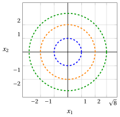
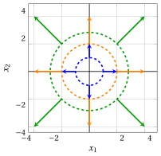
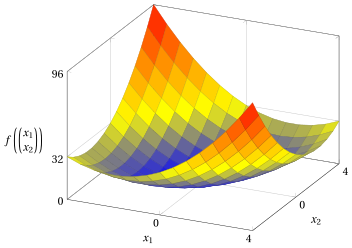

# Funzioni quadratiche

**Parte 1 · Preliminari · Capitolo 4** · [:material-file-pdf-box: Dispensa, volume 1 (PDF)](../pdf/dispensa-1-preliminari.pdf) · [:material-presentation: Slide](../pdf/slide-04-funzioni-quadratiche.pdf) · [:material-pencil: Esercizi: Funzioni quadratiche](../esercizi/es-04-funzioni-quadratiche.md) · [:material-gesture-tap: App: La matrice Q](../interattivi/matrice-q.md)

## 4.1 Funzioni quadratiche

!!! definizione "Definizione 4.1: funzione quadratica"

    Data una matrice quadrata simmetrica

    $$
    \underbrace{
    \begin{pmatrix}
    q_{11} & q_{12} & \dots & q_{1n} \\
    q_{21} & q_{22} & \dots & q_{2n} \\
    \vdots  & \vdots  & \ddots & \vdots \\
    q_{n1} & q_{n2} & \dots & q_{nn}
    \end{pmatrix}}_{\boldsymbol{Q}} \in \mathbb{R}^{n \times n}
    $$

    la funzione (scalare) associata

    \begin{equation*}
    \label{eq:quadratic}
    f:\, \mathbb{R}^{n} \to \mathbb{R}, \qquad
    f:\underbrace{\begin{pmatrix}
    x_1 \\
    x_2 \\
    \vdots \\
    x_n
    \end{pmatrix}}_{\boldsymbol{x}} \mapsto
    \underbrace{\sum_{i=1}^n \sum_{j=1}^n q_{ij} x_i x_j}_{\boldsymbol{x}' \boldsymbol{Q}\,\boldsymbol{x}} \tag{4.1}
    \end{equation*}

    si chiama <strong>funzione quadratica</strong>.

- Se la matrice quadrata di una funzione quadratica non è simmetrica, la si può rendere simmetrica sostituendo ogni coppia di elementi fuori diagonale con la loro media:

    $$
    q_{ij} \leftarrow \frac{q_{ij}+q_{ji}}{2},~~~
    q_{ji} \leftarrow \frac{q_{ij}+q_{ji}}{2},
    \qquad \forall\, i,j \in \{1,2,\dots,n\},~ i<j
    $$

    Ciò è lecito perché per ogni $i,j \in \{1,2,\dots,n\}$ con $i<j,$ abbiamo:

    \begin{align*}
    q_{ij}\,x_i x_j + q_{ji}\,x_j x_i
    &= q_{ij}\,x_i x_j + q_{ji}\,x_i x_j \\[2ex]
    &= (q_{ij}+q_{ji})\,x_i x_j \\[2ex]
    &= \tfrac12(q_{ij}+q_{ji})\,x_i x_j + \tfrac12(q_{ij}+q_{ji})\,x_i x_j \\[2ex]
    &= \frac{q_{ij}+q_{ji}}{2}\,x_i x_j
    + \frac{q_{ij}+q_{ji}}{2}\,x_j x_i
    \end{align*}

    Quindi, le funzioni quadratiche definite da $\boldsymbol{Q}$ e da $\tfrac{1}{2}(\boldsymbol{Q}+\boldsymbol{Q}')$ sono equivalenti, poiché assumono lo stesso valore per ogni $\boldsymbol{x} \in \mathbb{R}^n$.

!!! chiave ""

    Senza perdita di generalità, possiamo supporre che la matrice $\boldsymbol{Q}$ di una funzione quadratica sia simmetrica.

!!! esempio "Esempio 4.1: matrici equivalenti per le funzioni quadratiche"

    Consideriamo la seguente matrice $3\times 3$ non simmetrica:

    $$
    \begin{pmatrix}
    2 & -4 & 0 \\
    2 & 2 & 6 \\
    0 & -8 & 2
    \end{pmatrix}
    $$

    Si ottiene una funzione quadratica equivalente usando la seguente matrice simmetrica:

    $$
    \begin{pmatrix}
    2 & \frac{2+(-4)}{2} & 0 \\[1ex]
    \frac{2+(-4)}{2} & 2 & \frac{-8+6}{2} \\[1ex]
    0 & \frac{-8+6}{2} & 2
    \end{pmatrix}
    =
    \begin{pmatrix}
    2 & -1 & 0 \\
    -1 & 2 & -1 \\
    0 & -1 & 2
    \end{pmatrix}
    $$

    Infatti, le due matrici definiscono la stessa funzione:

    \begin{align*}
    f\left(\begin{pmatrix} x_1 \\ x_2 \\ x_3 \end{pmatrix}\right)
    &= 2x_1^2 - 4x_1x_2 + 2x_2x_1 + 2x_2^2 + 6x_2x_3 - 8x_3x_2 + 2x_3^2 \\[2ex]
    &= 2x_1^2 - x_1x_2 - x_2x_1 + 2x_2^2 - x_2x_3 - x_3x_2 + 2x_3^2 \\[2ex]
    &= 2x_1^2 + 2x_2^2 + 2x_3^2 - 2x_1x_2 - 2x_2x_3
    \end{align*}

## 4.2 Gradiente, matrice Hessiana e insiemi di livello

!!! teorema "Osservazione 4.2: gradiente di una funzione quadratica"

    Il <strong>gradiente</strong> (vettore delle derivate parziali) di una funzione quadratica è:

    \begin{align*}
    \nabla f({\boldsymbol x}) =
    \begin{pmatrix}
    \frac{ \partial f({\boldsymbol x})}{ \partial x_1} \\[1ex] \frac{ \partial f({\boldsymbol x})}{ \partial x_2} \\[1ex] \vdots \\[1ex]
    \frac{ \partial f({\boldsymbol x})}{ \partial x_n}
    \end{pmatrix} =
    \begin{pmatrix}
    \sum_{j=1}^n (q_{1j} + q_{j1}) x_j \\[1ex]
    \sum_{j=1}^n (q_{2j} + q_{j2}) x_j \\[1ex]
    \vdots \\[1ex]
    \sum_{j=1}^n (q_{nj} + q_{jn}) x_j
    \end{pmatrix}  =
    \underbrace{\begin{pmatrix}
    2 \sum_{j=1}^n q_{1j} x_j \\[1ex]
    2 \sum_{j=1}^n q_{2j} x_j \\[1ex]
    \vdots \\[1ex]
    2 \sum_{j=1}^n q_{nj} x_j
    \end{pmatrix}}_{   2 \; \boldsymbol{Q} \; {\boldsymbol x}}
    \end{align*}

??? dimostrazione "Dimostrazione"

    Per ogni $k \in \{1,2,\dots,n\}$, solo i termini della doppia sommatoria con $i=k$ o $j=k$ contengono la variabile $x_k$: i termini $q_{kj}\,x_k x_j$ contribuiscono alla derivata con $q_{kj}\,x_j$ e i termini $q_{ik}\,x_i x_k$ con $q_{ik}\,x_i$ (il termine $q_{kk}\,x_k^2$, con $i=j=k$, contribuisce con $2\,q_{kk}\,x_k$, una volta in ciascuna sommatoria). Quindi:

    $$
    \frac{ \partial f({\boldsymbol x})}{ \partial x_k} = \sum_{j=1}^n q_{kj}\, x_j + \sum_{i=1}^n q_{ik}\, x_i = \sum_{j=1}^n (q_{kj} + q_{jk})\, x_j = 2 \sum_{j=1}^n q_{kj}\, x_j
    $$

    dove l'ultima uguaglianza vale perché la matrice ${\boldsymbol Q}$ è simmetrica ($q_{jk} = q_{kj}$). □

!!! teorema "Osservazione 4.3: matrice Hessiana di una funzione quadratica"

    La <strong>matrice Hessiana</strong> (matrice delle derivate parziali del secondo ordine) di una funzione quadratica è:

    \begin{align*}
    \nabla^2 f({\boldsymbol x}) &=
    \begin{pmatrix}
    \frac{ \partial^2 f({\boldsymbol x})}{ \partial x_1^2} & \frac{ \partial^2 f({\boldsymbol x})}{ \partial x_1 \partial x_2} & \dots & \frac{ \partial^2 f({\boldsymbol x})}{ \partial x_1 \partial x_n} \\[2ex]
    \frac{ \partial^2 f({\boldsymbol x})}{ \partial x_2 \partial x_1} & \frac{ \partial^2 f({\boldsymbol x})}{ \partial x_2^2} & \dots & \frac{ \partial^2 f({\boldsymbol x})}{ \partial x_2 \partial x_n} \\[2ex]
    \vdots & \vdots & \ddots & \vdots \\[2ex]
    \frac{ \partial^2 f({\boldsymbol x})}{ \partial x_n \partial x_1} & \frac{ \partial^2 f({\boldsymbol x})}{ \partial x_n \partial x_2} & \dots & \frac{ \partial^2 f({\boldsymbol x})}{ \partial x_n^2}
    \end{pmatrix} \\[3ex]
    &= \underbrace{2
    \begin{pmatrix}
    q_{11} & q_{12} & \dots & q_{1n} \\
    q_{12} & q_{22} & \dots & q_{2n} \\
    \vdots & \vdots & \ddots & \vdots \\
    q_{1n} & q_{2n} & \dots & q_{nn}
    \end{pmatrix}}_{  2  \; \boldsymbol{Q}}
    \end{align*}

??? dimostrazione "Dimostrazione"

    Per l'osservazione precedente, per ogni $k \in \{1,2,\dots,n\}$ abbiamo $\frac{ \partial f({\boldsymbol x})}{ \partial x_k} = 2 \sum_{j=1}^n q_{kj}\, x_j$, la cui derivata rispetto a $x_h$ è $2\,q_{kh}$, per ogni $h \in \{1,2,\dots,n\}$. □

!!! definizione "Definizione 4.4: insiemi di livello di una funzione quadratica"

    Gli <strong>insiemi di livello</strong> di una funzione quadratica (gli insiemi dei punti in cui la funzione è <strong>costante</strong>) sono:

    \begin{align*}
    \left\{~~{\boldsymbol x} \in \R^{n}:~~ {\boldsymbol x}' \; {\boldsymbol Q} \; {\boldsymbol x}= k  ~~\right\} , \qquad \forall k \in \mathbb{R}
    \end{align*}

- A seconda della matrice $\boldsymbol Q$, gli insiemi di livello non vuoti possono essere <strong>ellissoidi</strong> (ellissi in $\R^2$), <strong>iperboloidi</strong> (iperboli in $\R^2$) oppure, quando alcune direzioni non cambiano il valore della funzione, <strong>cilindri</strong> (coppie di rette parallele in $\R^2$). Per $k=0$ ci sono anche casi degeneri: il solo punto ${\boldsymbol 0}$ al posto di un ellissoide, due rette incidenti nell'origine in $\R^2$ (un cono in $\R^n$) al posto di un iperboloide, e una sola retta passante per l'origine in $\R^2$ (un sottospazio lineare in $\R^n$) al posto di un cilindro. Il grafico delle funzioni quadratiche degli esempi seguenti è un <strong>paraboloide</strong>.

!!! chiave ""

    Per una funzione quadratica con matrice simmetrica ${\boldsymbol Q}$, il gradiente è $\nabla f({\boldsymbol x}) = 2\,{\boldsymbol Q}\,{\boldsymbol x}$ e la matrice Hessiana è la matrice costante $\nabla^2 f({\boldsymbol x}) = 2\,{\boldsymbol Q}$. In ogni punto in cui il gradiente non è nullo, il gradiente è perpendicolare all'insieme di livello passante per quel punto.

!!! esempio "Esempio 4.2: insiemi di livello di funzioni quadratiche"

    Con ${\boldsymbol Q}=\begin{pmatrix} 1 & 0\\ 0 & 1 \end{pmatrix}$, la funzione quadratica associata è:

    $$
    f: \mathbb{R}^{2} \rightarrow \mathbb{R},~~ f: \begin{pmatrix}
    x_1 \\
    x_2 \\
    \end{pmatrix} \mapsto
    \begin{pmatrix}
    x_{1} &
    x_{2}
    \end{pmatrix}
    \begin{pmatrix}
    1 & 0\\
    0 & 1
    \end{pmatrix}
    \;
    \begin{pmatrix}
    x_{1} \\
    x_{2} \\
    \end{pmatrix}= x_1^2 + x_2^2
    $$

    { .fig .ovale loading=lazy style="width:65%" }

    La figura mostra:

    - Circonferenza blu: insieme di livello $x_1^2+x_2^2=1$ (raggio $1$)

    - Circonferenza arancione: insieme di livello $x_1^2+x_2^2=4$ (raggio $2$)

    - Circonferenza verde: insieme di livello $x_1^2+x_2^2=8$ (raggio $\sqrt{8}$)

!!! esempio "Esempio 4.3: insiemi di livello di funzioni quadratiche"

    Con ${\boldsymbol Q}=\begin{pmatrix} 2 & -1\\ -1 & 2 \end{pmatrix}$, la funzione quadratica associata è:

    \begin{align*}
    f: \mathbb{R}^{2} \rightarrow \mathbb{R},~~ f: \begin{pmatrix}
    x_1 \\
    x_2 \\
    \end{pmatrix} \mapsto {}&
    \begin{pmatrix}
    x_{1} &
    x_{2}
    \end{pmatrix}
    \begin{pmatrix}
    2 & -1\\
    -1 & 2
    \end{pmatrix}
    \;
    \begin{pmatrix}
    x_{1} \\
    x_{2} \\
    \end{pmatrix} \\[2ex]
    &= 2\;x_1^2 - \;x_1\;x_2  - \;x_2\;x_1  + 2\;x_2^2 \\[2ex]
    &= 2\;x_1^2 - 2\;x_1\;x_2  + 2\;x_2^2
    \end{align*}

    { .fig .ovale loading=lazy style="width:65%" }

    La figura mostra:

    - Ellisse blu: insieme di livello $2\;x_1^2 - 2\;x_1\;x_2 + 2\;x_2^2=2$

    - Ellisse arancione: insieme di livello $2\;x_1^2 - 2\;x_1\;x_2 + 2\;x_2^2=8$

!!! esempio "Esempio 4.4: gradienti di funzioni quadratiche"

    Con ${\boldsymbol Q}=\begin{pmatrix} 1 & 0\\ 0 & 1 \end{pmatrix}$, il gradiente della funzione quadratica è:

    $$
    \nabla f\left(\begin{pmatrix}
    x_1 \\
    x_2 \\
    \end{pmatrix}\right) =
    \begin{pmatrix}
    2\;x_1 \\[0.5ex] 2\;x_2
    \end{pmatrix}
    $$

    { .fig .ovale loading=lazy style="width:65%" }

    La figura mostra:

    - Vettori blu (gradienti di norma $2$ sull'insieme di livello $x_1^2+x_2^2=1$):

        \begin{align*}
        \nabla f\left(\begin{pmatrix} -1 \\ 0 \end{pmatrix}\right) &= \begin{pmatrix} -2 \\ 0 \end{pmatrix}, &
        \nabla f\left(\begin{pmatrix} 0 \\ -1 \end{pmatrix}\right) &= \begin{pmatrix} 0 \\ -2 \end{pmatrix}, \\[1ex]
        \nabla f\left(\begin{pmatrix} 0 \\ 1 \end{pmatrix}\right) &= \begin{pmatrix} 0 \\ 2 \end{pmatrix}, &
        \nabla f\left(\begin{pmatrix} 1 \\ 0 \end{pmatrix}\right) &= \begin{pmatrix} 2 \\ 0 \end{pmatrix}
        \end{align*}

    - Vettori arancioni (gradienti di norma $4$ sull'insieme di livello $x_1^2+x_2^2=4$):

        \begin{align*}
        \nabla f\left(\begin{pmatrix} -2 \\ 0 \end{pmatrix}\right) &= \begin{pmatrix} -4 \\ 0 \end{pmatrix}, &
        \nabla f\left(\begin{pmatrix} 0 \\ -2 \end{pmatrix}\right) &= \begin{pmatrix} 0 \\ -4 \end{pmatrix}, \\[1ex]
        \nabla f\left(\begin{pmatrix} 0 \\ 2 \end{pmatrix}\right) &= \begin{pmatrix} 0 \\ 4 \end{pmatrix}, &
        \nabla f\left(\begin{pmatrix} 2 \\ 0 \end{pmatrix}\right) &= \begin{pmatrix} 4 \\ 0 \end{pmatrix}
        \end{align*}

    - Vettori verdi (gradienti di norma $4\sqrt{2}$ sull'insieme di livello $x_1^2+x_2^2=8$):

        \begin{align*}
        \nabla f\left(\begin{pmatrix} 2 \\ 2 \end{pmatrix}\right) &= \begin{pmatrix} 4 \\ 4 \end{pmatrix}, &
        \nabla f\left(\begin{pmatrix} -2 \\ -2 \end{pmatrix}\right) &= \begin{pmatrix} -4 \\ -4 \end{pmatrix}, \\[1ex]
        \nabla f\left(\begin{pmatrix} -2 \\ 2 \end{pmatrix}\right) &= \begin{pmatrix} -4 \\ 4 \end{pmatrix}, &
        \nabla f\left(\begin{pmatrix} 2 \\ -2 \end{pmatrix}\right) &= \begin{pmatrix} 4 \\ -4 \end{pmatrix}
        \end{align*}

    Ogni gradiente è perpendicolare all'insieme di livello passante per il suo punto.

!!! esempio "Esempio 4.5: gradienti di funzioni quadratiche"

    Con ${\boldsymbol Q}=\begin{pmatrix} 2 & -1\\ -1 & 2 \end{pmatrix}$, il gradiente della funzione quadratica è:

    $$
    \nabla f\left(\begin{pmatrix}
    x_1 \\
    x_2 \\
    \end{pmatrix}\right) =
    \begin{pmatrix}
    4\;x_1-2\;x_2 \\[0.5ex] -2\;x_1+4\;x_2
    \end{pmatrix}
    $$

    { .fig .ovale loading=lazy style="width:65%" }

    La figura mostra:

    - Ellisse blu: insieme di livello $2\;x_1^2 - 2\;x_1\;x_2  + 2\;x_2^2=2$

    - Vettori blu (gradienti sull'insieme di livello, di norma $2\sqrt{2}$ nei punti sulla diagonale e di norma $2\sqrt{5}$ nei punti sugli assi):

        \begin{align*}
        \nabla f\left(\begin{pmatrix} 1 \\ 1 \end{pmatrix}\right) &= \begin{pmatrix} 2 \\ 2 \end{pmatrix}, &
        \nabla f\left(\begin{pmatrix} -1 \\ -1 \end{pmatrix}\right) &= \begin{pmatrix} -2 \\ -2 \end{pmatrix}, \\[1ex]
        \nabla f\left(\begin{pmatrix} 1 \\ 0 \end{pmatrix}\right) &= \begin{pmatrix} 4 \\ -2 \end{pmatrix}, &
        \nabla f\left(\begin{pmatrix} -1 \\ 0 \end{pmatrix}\right) &= \begin{pmatrix} -4 \\ 2 \end{pmatrix}, \\[1ex]
        \nabla f\left(\begin{pmatrix} 0 \\ 1 \end{pmatrix}\right) &= \begin{pmatrix} -2 \\ 4 \end{pmatrix}, &
        \nabla f\left(\begin{pmatrix} 0 \\ -1 \end{pmatrix}\right) &= \begin{pmatrix} 2 \\ -4 \end{pmatrix}
        \end{align*}

    Anche in questo caso, ogni gradiente è perpendicolare all'insieme di livello passante per il suo punto.

!!! esempio "Esempio 4.6: grafici di funzioni quadratiche"

    Con ${\boldsymbol Q}=\begin{pmatrix} 1 & 0\\[1ex] 0 & 1 \\ \end{pmatrix}$, abbiamo $f\left(\begin{pmatrix} x_1 \\ x_2 \\ \end{pmatrix}\right)=x_1^2+x_2^2$. Il suo grafico è:

    { .fig .ovale loading=lazy style="width:62%" }

!!! esempio "Esempio 4.7: grafici di funzioni quadratiche"

    Con ${\boldsymbol Q}=\begin{pmatrix} 2 & -1\\[1ex] -1 & 2 \\ \end{pmatrix}$, abbiamo $f\left(\begin{pmatrix} x_1 \\ x_2 \\ \end{pmatrix}\right) = 2\;x_1^2 - 2 \;x_1\;x_2  + 2\;x_2^2$. Il suo grafico è:

    { .fig .ovale loading=lazy style="width:62%" }

## 4.3 Convessità delle funzioni quadratiche

!!! definizione "Definizione 4.5: matrice semidefinita positiva"

    Una matrice quadrata simmetrica ${\boldsymbol Q} \in \R^{n \times n}$ è <strong>semidefinita positiva</strong> se:

    $$
    {\boldsymbol x}' {\boldsymbol Q} \; {\boldsymbol x} \ge 0, \qquad \forall {\boldsymbol x} \in \R^n
    $$

!!! teorema "Proposizione 4.6"

    Per ogni matrice quadrata  ${\boldsymbol Q}$, se ${\boldsymbol Q}$ è semidefinita positiva allora la funzione quadratica associata è  convessa nel suo dominio.

??? dimostrazione "Dimostrazione"

    Se la matrice ${\boldsymbol Q}$ è semidefinita positiva, per ogni coppia di punti ${\boldsymbol p}, {\boldsymbol w} \in \R^n$ e per ogni $\lambda \in [0,1]$, abbiamo:

    \begin{align*}
    & f\big(\lambda \; {\boldsymbol p} + (1-\lambda)\;{\boldsymbol w}\big) \\[2ex]
    &\quad = (\lambda \;{\boldsymbol p} + (1-\lambda)\; {\boldsymbol w} )' ~{\boldsymbol Q} \; (\lambda \;{\boldsymbol p} + (1-\lambda)\; {\boldsymbol w} ) \\[2ex]
    &\quad = \lambda^2 \; {\boldsymbol p}' {\boldsymbol Q} \; {\boldsymbol p} + (1-\lambda)^2\; {\boldsymbol w}' {\boldsymbol Q} \; {\boldsymbol w} \\[1ex]
    &\qquad + \lambda\;(1-\lambda)\; {\boldsymbol p}' {\boldsymbol Q} \; {\boldsymbol w} + \lambda\;(1-\lambda) \;{\boldsymbol w}' {\boldsymbol Q} \; {\boldsymbol p} \\[2ex]
    &\quad = \lambda \; {\boldsymbol p}' {\boldsymbol Q} \; {\boldsymbol p} + (1-\lambda)\;{\boldsymbol w}' {\boldsymbol Q} \; {\boldsymbol w} \\[1ex]
    &\qquad - \lambda\;(1-\lambda) \; \big( {\boldsymbol p}' {\boldsymbol Q} \; {\boldsymbol p} + {\boldsymbol w}' {\boldsymbol Q} \; {\boldsymbol w} - {\boldsymbol p}' {\boldsymbol Q} \; {\boldsymbol w} - {\boldsymbol w}' {\boldsymbol Q} \; {\boldsymbol p} \big) \\[1ex]
    &\qquad \text{(poiché $\lambda^2 = \lambda - \lambda\;(1-\lambda)$ e $(1-\lambda)^2 = (1-\lambda) - \lambda\;(1-\lambda)$)} \\[2ex]
    &\quad = \lambda \; {\boldsymbol p}' {\boldsymbol Q} \; {\boldsymbol p} + (1-\lambda)\;{\boldsymbol w}' {\boldsymbol Q} \; {\boldsymbol w} - \lambda\;(1-\lambda) \; ({\boldsymbol p}-{\boldsymbol w})' {\boldsymbol Q} \;  ({\boldsymbol p}-{\boldsymbol w}) \\[2ex]
    &\quad \le \lambda \; {\boldsymbol p}' {\boldsymbol Q} \; {\boldsymbol p} + (1-\lambda)\;{\boldsymbol w}' {\boldsymbol Q} \; {\boldsymbol w} \\[1ex]
    &\qquad \text{(poiché ${\boldsymbol Q}$ è semidefinita positiva e $\lambda\;(1-\lambda) \ge 0$)} \\[2ex]
    &\quad = \lambda \; f({\boldsymbol p}) + (1-\lambda)\; f({\boldsymbol w})
    \end{align*}

    Quindi,

    $$
    f\big(\lambda \; {\boldsymbol p} + (1-\lambda)\;{\boldsymbol w}\big)  \le \lambda \; f({\boldsymbol p}) + (1-\lambda)\; f({\boldsymbol w})
    $$

    Per natura, il dominio $\mathbb{R}^{n}$ è un insieme convesso. Di conseguenza, la funzione è convessa nel suo dominio. □

- Abbiamo dimostrato che:

    \begin{equation*}
    {\boldsymbol Q} \text{  semidefinita positiva} ~~~\Longrightarrow~~~ \text{  funzione quadratica convessa}
    \end{equation*}

    quindi “${\boldsymbol Q}$ semidefinita positiva” è una condizione sufficiente per “funzione quadratica convessa” e “funzione quadratica convessa” è una condizione necessaria per “${\boldsymbol Q}$ semidefinita positiva”.

- L'implicazione vale anche nella direzione opposta, come afferma la seguente proposizione.

!!! teorema "Proposizione 4.7"

    Per ogni funzione quadratica, se la funzione  è convessa nel suo dominio allora  la matrice quadrata associata ${\boldsymbol Q}$ è semidefinita positiva.

??? dimostrazione "Dimostrazione"

    Se la funzione quadratica è convessa, per ogni coppia di vettori colonna ${\boldsymbol p},{\boldsymbol w} \in \R^{n}$ e ogni scalare $\lambda \in (0,1)$, abbiamo:

    $$
    {(\lambda \;{\boldsymbol p} + (1-\lambda)\; {\boldsymbol w} )}' ~{\boldsymbol Q} \; (\lambda \;{\boldsymbol p} + (1-\lambda)\; {\boldsymbol w} )
    \le \lambda \; {\boldsymbol p}' {\boldsymbol Q} \; {\boldsymbol p} + (1-\lambda)\;{\boldsymbol w}' {\boldsymbol Q} \; {\boldsymbol w}
    $$

    dove il membro sinistro è:

    \begin{align*}
    & {(\lambda \;{\boldsymbol p} + (1-\lambda)\; {\boldsymbol w} )}' ~{\boldsymbol Q} \; (\lambda \;{\boldsymbol p} + (1-\lambda)\; {\boldsymbol w} ) \\[1ex]
    & \qquad = \lambda^2 \; {\boldsymbol p}' {\boldsymbol Q} \; {\boldsymbol p} + (1-\lambda)^2\; {\boldsymbol w}' {\boldsymbol Q} \; {\boldsymbol w} + \lambda\;(1-\lambda)\; {\boldsymbol p}' {\boldsymbol Q} \; {\boldsymbol w} + \lambda\;(1-\lambda) \;{\boldsymbol w}' {\boldsymbol Q} \; {\boldsymbol p}
    \end{align*}

    Riordinando e semplificando, ciò implica che:

    \begin{align*}
    & \lambda\;(1-\lambda) \; {\boldsymbol p}' {\boldsymbol Q} \; {\boldsymbol p} + \lambda\;(1-\lambda)\; {\boldsymbol w}' {\boldsymbol Q} \; {\boldsymbol w} \\[1ex]
    & \qquad - \lambda\;(1-\lambda) \; {\boldsymbol p}' {\boldsymbol Q} \; {\boldsymbol w} - \lambda\;(1-\lambda)\; {\boldsymbol w}' {\boldsymbol Q} \; {\boldsymbol p} \ge 0
    \end{align*}

    che, poiché $\lambda\;(1-\lambda) >0$, implica:

    $$
    \underbrace{
    {\boldsymbol p}' {\boldsymbol Q} \; {\boldsymbol p} +  {\boldsymbol w}' {\boldsymbol Q} \; {\boldsymbol w} -  {\boldsymbol p}' {\boldsymbol Q} \; {\boldsymbol w} -  {\boldsymbol w}' {\boldsymbol Q} \; {\boldsymbol p}}_{=({\boldsymbol p}-{\boldsymbol w})' {\boldsymbol Q} \;  ({\boldsymbol p}-{\boldsymbol w})}
    \ge 0
    $$

    Ogni vettore ${\boldsymbol x} \in \R^n$ si può scrivere come ${\boldsymbol x} = {\boldsymbol p} - {\boldsymbol w}$ (per esempio, con ${\boldsymbol p} = {\boldsymbol x}$ e ${\boldsymbol w} = {\boldsymbol 0}$). Quindi, ${\boldsymbol x}' {\boldsymbol Q} \; {\boldsymbol x} \ge 0$ per ogni ${\boldsymbol x} \in \R^n$, e la matrice quadrata ${\boldsymbol Q}$ è semidefinita positiva. □

- Abbiamo dimostrato che:

    \begin{equation*}
    \text{  funzione quadratica convessa}  ~~~\Longrightarrow~~~ {\boldsymbol Q} \text{  semidefinita positiva}
    \end{equation*}

    quindi “funzione quadratica convessa” è una condizione sufficiente per “${\boldsymbol Q}$ semidefinita positiva” e “${\boldsymbol Q}$ semidefinita positiva” è una condizione necessaria per “funzione quadratica convessa”.

- Abbiamo quindi, infine:

    \begin{equation*}
    {\boldsymbol Q} \text{  semidefinita positiva} ~~~\Longleftrightarrow~~~ \text{  funzione quadratica convessa}
    \end{equation*}

    quindi “${\boldsymbol Q}$ semidefinita positiva” è una condizione necessaria e sufficiente per “funzione quadratica convessa” e viceversa.

!!! teorema "Corollario 4.8"

    Per ogni matrice quadrata  ${\boldsymbol Q}$,  la funzione  quadratica associata è  convessa nel suo dominio se e solo se  ${\boldsymbol Q}$ è semidefinita positiva.

- Con ${\boldsymbol Q}$ uguale alla matrice identità, la funzione quadratica è $f({\boldsymbol x}) = {\boldsymbol x}'{\boldsymbol x} = \|{\boldsymbol x}\|_2^2$, il quadrato della norma euclidea, la cui convessità è dimostrata nel capitolo «Funzioni convesse e concave» direttamente dalla definizione. La matrice identità è semidefinita positiva, poiché ${\boldsymbol x}'{\boldsymbol x} = x_1^2 + x_2^2 + \dots + x_n^2 \ge 0$, in accordo con il corollario.

- Quando ${\boldsymbol x}' {\boldsymbol Q} \; {\boldsymbol x}$ si può scrivere come somma di quadrati di funzioni lineari, come nell'esempio seguente, la matrice ${\boldsymbol Q}$ è semidefinita positiva, e la convessità si può dimostrare anche direttamente dalla definizione, con la disuguaglianza $\big(\lambda a+(1-\lambda)b\big)^2 \le \lambda a^2+(1-\lambda)b^2$ del capitolo «Funzioni convesse e concave».

!!! esempio "Esempio 4.8: una funzione quadratica convessa"

    Con ${\boldsymbol Q}=\begin{pmatrix} 2 & -1\\ -1 & 2 \end{pmatrix}$, per ogni ${\boldsymbol x} \in \R^2$ abbiamo:

    $$
    {\boldsymbol x}' {\boldsymbol Q} \; {\boldsymbol x} = 2\;x_1^2 - 2\;x_1\;x_2  + 2\;x_2^2 = x_1^2 + x_2^2 + (x_1 - x_2)^2 \ge 0
    $$

    Quindi, la matrice ${\boldsymbol Q}$ è semidefinita positiva e, per il corollario, la funzione quadratica degli esempi precedenti è convessa nel suo dominio.

    La stessa conclusione segue dalla definizione: per ogni coppia di punti ${\boldsymbol p}, {\boldsymbol w} \in \R^2$ e ogni $\lambda \in [0,1]$, abbiamo:

    \begin{align*}
    & f\big(\lambda {\boldsymbol p} + (1-\lambda){\boldsymbol w}\big) \\[2ex]
    &\quad = \big(\lambda p_1+(1-\lambda)w_1\big)^2 + \big(\lambda p_2+(1-\lambda)w_2\big)^2 \\[1ex]
    &\qquad + \big(\lambda (p_1-p_2)+(1-\lambda)(w_1-w_2)\big)^2 \\[2ex]
    &\quad \le \lambda p_1^2+(1-\lambda)w_1^2 + \lambda p_2^2+(1-\lambda)w_2^2 \\[1ex]
    &\qquad + \lambda (p_1-p_2)^2+(1-\lambda)(w_1-w_2)^2 \\[1ex]
    &\qquad \text{(per la disuguaglianza del capitolo «Funzioni convesse e concave»,} \\
    &\qquad \text{tre volte)} \\[2ex]
    &\quad = \lambda\big(p_1^2+p_2^2+(p_1-p_2)^2\big) \\[1ex]
    &\qquad +(1-\lambda)\big(w_1^2+w_2^2+(w_1-w_2)^2\big) \\[2ex]
    &\quad = \lambda f({\boldsymbol p}) + (1-\lambda) f({\boldsymbol w})
    \end{align*}

    Quindi,

    $$
    f\big(\lambda {\boldsymbol p} + (1-\lambda){\boldsymbol w}\big) \le \lambda f({\boldsymbol p}) + (1-\lambda) f({\boldsymbol w})
    $$

    Per natura, il dominio $\R^2$ è un insieme convesso. Di conseguenza, la funzione è convessa nel suo dominio.

!!! esempio "Esempio 4.9: una funzione quadratica non convessa"

    Con ${\boldsymbol Q}=\begin{pmatrix} 1 & 0\\ 0 & -1 \end{pmatrix}$, la funzione quadratica è

    $$
    f\left(\begin{pmatrix} x_1 \\ x_2 \end{pmatrix}\right) = x_1^2 - x_2^2
    $$

    e i suoi insiemi di livello non vuoti con $k \neq 0$ sono iperboli. La matrice ${\boldsymbol Q}$ non è semidefinita positiva, poiché:

    $$
    \begin{pmatrix} 0 & 1 \end{pmatrix}
    \begin{pmatrix}
    1 & 0\\
    0 & -1
    \end{pmatrix}
    \begin{pmatrix} 0 \\ 1 \end{pmatrix} = -1 < 0
    $$

    Per il corollario, la funzione non è convessa nel suo dominio. Infatti, con

    $$
    {\boldsymbol p} = \begin{pmatrix} 0 \\ 1 \end{pmatrix}, \qquad {\boldsymbol w} = \begin{pmatrix} 0 \\ -1 \end{pmatrix}, \qquad \lambda = \frac{1}{2}
    $$

    la disuguaglianza della definizione di funzione convessa non è verificata:

    $$
    f\left(\frac{1}{2}\,{\boldsymbol p} + \frac{1}{2}\,{\boldsymbol w}\right) = f\left(\begin{pmatrix} 0 \\ 0 \end{pmatrix}\right) = 0 ~>~ -1 = \frac{1}{2}\,f({\boldsymbol p}) + \frac{1}{2}\,f({\boldsymbol w})
    $$

## 4.4 Funzioni quadratiche con una parte lineare

- Nei problemi di ottimizzazione si incontrano spesso funzioni che sono la somma di una funzione quadratica, di una funzione lineare e di una costante: data una matrice quadrata simmetrica ${\boldsymbol Q} \in \R^{n \times n}$, un vettore ${\boldsymbol c} \in \R^n$ e uno scalare $d \in \R$,

    $$
    g:\, \mathbb{R}^{n} \to \mathbb{R}, \qquad
    g: {\boldsymbol x} \mapsto {\boldsymbol x}' {\boldsymbol Q} \; {\boldsymbol x} + {\boldsymbol c}' {\boldsymbol x} + d = \sum_{i=1}^n \sum_{j=1}^n q_{ij} x_i x_j + \sum_{j=1}^n c_j x_j + d
    $$

- Poiché la derivata di ${\boldsymbol c}' {\boldsymbol x} + d$ rispetto a $x_k$ è $c_k$, il gradiente e la matrice Hessiana sono:

    $$
    \nabla g({\boldsymbol x}) = 2\,{\boldsymbol Q}\,{\boldsymbol x} + {\boldsymbol c}, \qquad \nabla^2 g({\boldsymbol x}) = 2\,{\boldsymbol Q}
    $$

- La funzione $h({\boldsymbol x}) = {\boldsymbol c}' {\boldsymbol x} + d$ è convessa (e concava) nel suo dominio, poiché la definizione vale con l'uguaglianza: per ogni coppia di punti ${\boldsymbol p}, {\boldsymbol w} \in \R^n$ e ogni $\lambda \in [0,1]$, abbiamo:

    \begin{align*}
    & h\big(\lambda {\boldsymbol p} + (1-\lambda){\boldsymbol w}\big) \\[2ex]
    &\quad = {\boldsymbol c}'\big(\lambda {\boldsymbol p} + (1-\lambda){\boldsymbol w}\big) + d \\[2ex]
    &\quad = \lambda\, {\boldsymbol c}'{\boldsymbol p} + (1-\lambda)\, {\boldsymbol c}'{\boldsymbol w} + \lambda d + (1-\lambda) d \\[1ex]
    &\qquad \text{(poiché $\lambda + (1-\lambda) = 1$)} \\[2ex]
    &\quad = \lambda h({\boldsymbol p}) + (1-\lambda) h({\boldsymbol w})
    \end{align*}

    Quindi, entrambe le disuguaglianze delle definizioni di funzione convessa e concava valgono con l'uguaglianza. Per natura, il dominio $\R^n$ è un insieme convesso. Di conseguenza, la funzione $h$ è convessa e concava nel suo dominio. Poiché la somma di funzioni convesse è convessa (capitolo «Funzioni convesse e concave»), se la matrice ${\boldsymbol Q}$ è semidefinita positiva, la funzione $g$ è convessa nel suo dominio. Viceversa, se $g$ è convessa, la funzione quadratica ${\boldsymbol x}' {\boldsymbol Q} \; {\boldsymbol x} = g({\boldsymbol x}) + \big(-{\boldsymbol c}' {\boldsymbol x} - d\big)$ è convessa, in quanto somma di due funzioni convesse, e la matrice ${\boldsymbol Q}$ è semidefinita positiva per il corollario.

!!! chiave ""

    Una funzione quadratica ${\boldsymbol x}' {\boldsymbol Q} \; {\boldsymbol x}$ è convessa nel suo dominio se e solo se la matrice ${\boldsymbol Q}$ è semidefinita positiva. L'aggiunta di una funzione lineare e di una costante non ne modifica la convessità.

---

**Esercizi su questo capitolo:** [:material-pencil: Funzioni quadratiche](../esercizi/es-04-funzioni-quadratiche.md)

<!-- laboratorio-interattivo: sezione generata da interattivi.py -->

## Laboratorio interattivo { #laboratorio-interattivo }

Le idee del capitolo, da toccare con mano: muovi i cursori e trascina i punti.
Tutti i grafici del corso sono nel [laboratorio interattivo](../interattivi/index.md#cap-4).

