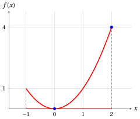
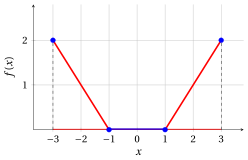
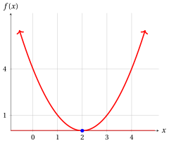
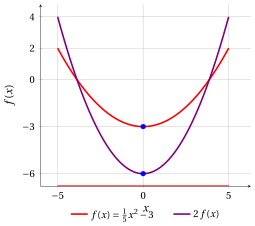
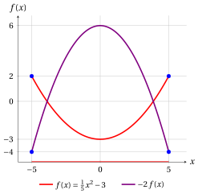
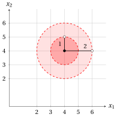

# Problemi di ottimizzazione

**Parte 2 · Problemi di ottimizzazione · Capitolo 5** · [:material-file-pdf-box: Dispensa, volume 2 (PDF)](../pdf/dispensa-2-problemi-di-ottimizzazione.pdf) · [:material-presentation: Slide](../pdf/slide-05-problemi-ottimizzazione.pdf) · [:material-pencil: Esercizi: Problemi di ottimizzazione](../esercizi/es-05-problemi-ottimizzazione.md) · [:material-gesture-tap: App: Ottimo su un intervallo](../interattivi/ottimo-intervallo.md) · [:material-gesture-tap: App: Ottimi locali e globali](../interattivi/ottimi-locali.md)

## 5.1 Problemi di ottimizzazione

!!! definizione "Definizione 5.1: problema di ottimizzazione in forma di minimo e in forma di massimo"

    Dati un insieme $F \subseteq \mathbb{R}^n$ e una funzione $f : D \subseteq \mathbb{R}^n \to \mathbb{R}$, con $F \subseteq D$, il <strong>problema di ottimizzazione</strong> associato $P$ consiste:

    - nella <strong>forma di minimo</strong>, nel trovare un punto $\tilde{\boldsymbol{x}}(P) \in F$ tale che

        $$
        f(\tilde{\boldsymbol{x}}(P)) \le f(\boldsymbol{x}), \qquad \forall \boldsymbol{x} \in F;
        $$

    - nella <strong>forma di massimo</strong>, nel trovare un punto $\tilde{\boldsymbol{x}}(P) \in F$ tale che

        $$
        f(\tilde{\boldsymbol{x}}(P)) \ge f(\boldsymbol{x}), \qquad \forall \boldsymbol{x} \in F.
        $$

### 5.1.1 Regione ammissibile e funzione obiettivo

- L'insieme $F$ si chiama <strong>regione ammissibile</strong> del problema di ottimizzazione; i suoi punti $\boldsymbol{x} \in F$ si chiamano <strong>soluzioni ammissibili</strong> del problema di ottimizzazione.

- La funzione $f$ è la <strong>funzione obiettivo</strong> del problema di ottimizzazione; essa assegna un valore obiettivo a ogni soluzione ammissibile.

!!! definizione "Definizione 5.2: soluzione ottima e valore ottimo"

    - Un punto $\tilde{\boldsymbol{x}}(P) \in F$ si chiama <strong>soluzione ottima</strong> del problema di ottimizzazione.

        1. Nella forma di minimo,

            $$
            \tilde{\boldsymbol{x}}(P) \in
            \argmin \{\, f(\boldsymbol{x}) \;\text{soggetto a}\; \boldsymbol{x} \in F \,\}.
            $$

        2. Nella forma di massimo,

            $$
            \tilde{\boldsymbol{x}}(P) \in
            \argmax \{\, f(\boldsymbol{x}) \;\text{soggetto a}\; \boldsymbol{x} \in F \,\}.
            $$

    - Il valore $f(\tilde{\boldsymbol{x}}(P))$ si chiama <strong>valore ottimo</strong> del problema di ottimizzazione e si indica con $z(P)$.

        1. Nella forma di minimo,

            $$
            z(P) =
            \underbrace{\min \{\, f(\boldsymbol{x}) \;\text{soggetto a}\; \boldsymbol{x} \in F \,\}}_{ =f(\tilde{\boldsymbol{x}}(P))}.
            $$

        2. Nella forma di massimo,

            $$
            z(P) =
            \underbrace{\max \{\, f(\boldsymbol{x}) \;\text{soggetto a}\; \boldsymbol{x} \in F \,\}}_{ =f(\tilde{\boldsymbol{x}}(P))}.
            $$

- Un problema di ottimizzazione può ammettere più soluzioni ottime (anche infinite) oppure nessuna. In questi casi, gli operatori $\argmin$ e $\argmax$ restituiscono l'intero insieme delle soluzioni ottime, quando esistono, e l'insieme vuoto altrimenti.

- Con un leggero abuso di notazione:

    1. nella <strong>forma di minimo</strong>, scriviamo il problema di ottimizzazione come

        $$
        \min \{\, f(\boldsymbol{x}) \;\text{soggetto a}\; \boldsymbol{x} \in F \,\}.
        $$

    2. nella <strong>forma di massimo</strong>, scriviamo il problema di ottimizzazione come

        $$
        \max \{\, f(\boldsymbol{x}) \;\text{soggetto a}\; \boldsymbol{x} \in F \,\}.
        $$

    !!! chiave ""

        Sebbene si usino i simboli “$\min$” e “$\max$”, l'obiettivo di un problema di ottimizzazione è <strong>trovare una soluzione ottima</strong> $\tilde{\boldsymbol{x}}(P)$, quando esiste, e non soltanto determinare il valore ottimo $z(P)$.

- Nelle figure di questo capitolo, il grafico della funzione obiettivo sulla regione ammissibile è rosso, la regione ammissibile è la parte rossa dell'asse $x$ e le soluzioni ottime sono blu. Un cerchio vuoto indica un estremo che non appartiene alla regione ammissibile.

!!! esempio "Esempio 5.1: un problema di ottimizzazione con funzione obiettivo quadratica"

    Consideriamo la seguente funzione obiettivo e la seguente regione ammissibile:

    $$
    f:\R \to \R,~ f: x \mapsto x^2
    \qquad \text{e} \qquad
    F=\{\, x \in \R : -1 \le x \le 2 \,\} = [-1,2].
    $$

    I problemi di ottimizzazione associati, in forma di minimo e in forma di massimo, sono:

    \begin{equation*}
    \min \bigg\{\, x^2 \ \text{ soggetto a } -1 \le x \le 2 \,\bigg\}
    \qquad \text{e} \qquad
    \max \bigg\{\, x^2 \ \text{ soggetto a } -1 \le x \le 2 \,\bigg\}
    \end{equation*}

    { .fig .ovale loading=lazy style="width:50%" }

    - Per la forma di minimo, poiché $f(x) = x^2 \ge 0 = f(0)$ per ogni $x$ ammissibile, e $x^2 = 0$ solo per $x=0$, l'unica soluzione ottima e il valore ottimo sono:

        $$
        \tilde{\boldsymbol x}(P) = (0)
        \quad \text{e} \quad
        z(P) = 0.
        $$

    - Per la forma di massimo, per ogni $x$ ammissibile abbiamo $|x| \le 2$ e quindi $f(x) = |x|^2 \le 4 = f(2)$, con $x^2 = 4$ solo per $x=-2$ e $x=2$; poiché $-2 \notin F$, l'unica soluzione ottima e il valore ottimo sono:

        $$
        \tilde{\boldsymbol x}(P) = (2)
        \quad \text{e} \quad
        z(P) = 4.
        $$

    Le soluzioni ottime si trovano direttamente dalla definizione: confrontiamo il valore della funzione obiettivo in un punto candidato con il suo valore in ogni soluzione ammissibile.

!!! esempio "Esempio 5.2: un problema di ottimizzazione con infinite soluzioni ottime"

    Consideriamo la seguente funzione obiettivo e la seguente regione ammissibile:

    $$
    f:\R \to \R,~ f: x \mapsto \max\{\, 0,\; |x|-1 \,\}
    \qquad \text{e} \qquad
    F=[-3,3].
    $$

    La funzione obiettivo vale $f(x) = 0$ per $-1 \le x \le 1$ e $f(x) = |x|-1$ altrimenti: il suo grafico è formato da tre segmenti.

    { .fig .ovale loading=lazy style="width:50%" }

    - Per la forma di minimo, $f(x) \ge 0$ per ogni $x$ ammissibile, e $f(x) = 0$ esattamente per $-1 \le x \le 1$. Il problema ha <strong>infinite</strong> soluzioni ottime (il segmento blu) e il valore ottimo è:

        $$
        \argmin \big\{\, \max\{0,|x|-1\} \ \text{ soggetto a } -3 \le x \le 3 \,\big\} = [-1,1]
        \quad \text{e} \quad
        z(P) = 0.
        $$

    - Per la forma di massimo, per ogni $x$ ammissibile abbiamo $|x| \le 3$ e quindi $f(x) \le \max\{0,\, 3-1\} = 2$, con $f(x) = 2$ solo per $x=-3$ e $x=3$. Il problema ha <strong>due</strong> soluzioni ottime e il valore ottimo è:

        $$
        \argmax \big\{\, \max\{0,|x|-1\} \ \text{ soggetto a } -3 \le x \le 3 \,\big\} = \{-3,\,3\}
        \quad \text{e} \quad
        z(P) = 2.
        $$

- Una soluzione ottima di un problema di ottimizzazione può non esistere per uno dei tre motivi seguenti:

    1. Se la funzione obiettivo decresce indefinitamente in un problema di minimo o cresce indefinitamente in un problema di massimo, il problema di ottimizzazione si dice <strong>illimitato</strong>. In questi casi si ha, rispettivamente, $z(P) = -\infty$ e $z(P) = +\infty$.

    2. Se la regione ammissibile è vuota, cioè non esistono soluzioni, il problema di ottimizzazione si dice <strong>inammissibile</strong>. In questi casi $z(P)$ non è definito.

    3. Se l'estremo inferiore (o superiore) della funzione obiettivo esiste ma non è raggiunto nella regione ammissibile, si dice che il problema di ottimizzazione ha un <strong>estremo inferiore (o superiore) non raggiunto</strong>, come negli Esempi [5.5](#box-7-exOptUnattainable) e [Esempio 5.6](#box-8-exOptUnattainableInf). In questi casi $z(P)$ non è definito.

- Nella <strong>forma di minimo</strong>, una soluzione ottima è un <strong>punto di minimo</strong> e il corrispondente valore ottimo è il <strong>minimo</strong> della funzione obiettivo sulla regione ammissibile.

    Analogamente, nella <strong>forma di massimo</strong>, una soluzione ottima è un <strong>punto di massimo</strong> e il corrispondente valore ottimo è il <strong>massimo</strong> della funzione obiettivo sulla regione ammissibile.

!!! esempio "Esempio 5.3: un problema di ottimizzazione illimitato"

    Consideriamo la seguente funzione obiettivo e la seguente regione ammissibile:

    $$
    f:\R \to \R,~ f: x \mapsto (x-2)^2
    \qquad \text{e} \qquad
    F=\R.
    $$

    La regione ammissibile è l'intera retta reale: il grafico prosegue verso l'alto su entrambi i lati della figura.

    { .fig .ovale loading=lazy style="width:50%" }

    - Per la forma di minimo, poiché $f(x) = (x-2)^2 \ge 0 = f(2)$ per ogni $x \in \R$, e $(x-2)^2 = 0$ solo per $x=2$, l'unica soluzione ottima e il valore ottimo sono:

        $$
        \tilde{\boldsymbol x}(P) = (2)
        \quad \text{e} \quad
        z(P) = 0.
        $$

    - Per la forma di massimo, la funzione obiettivo cresce indefinitamente: per ogni valore $M \ge 0$, la soluzione ammissibile $x = M+3$ ha

        $$
        f(M+3) = (M+1)^2 \ge M+1 > M.
        $$

        Nessuna soluzione ammissibile può essere ottima e il problema è <strong>illimitato</strong>: $z(P) = +\infty$.

!!! esempio "Esempio 5.4: un problema di ottimizzazione inammissibile"

    Consideriamo la seguente funzione obiettivo e la seguente regione ammissibile:

    $$
    f:\R \to \R,~ f: x \mapsto x^2
    \qquad \text{e} \qquad
    F=\{\, x \in \R : x^2 \le -1 \,\}.
    $$

    Poiché $x^2 \ge 0 > -1$ per ogni $x \in \R$, nessun punto soddisfa il vincolo e la regione ammissibile è vuota: $F = \emptyset$. Sia la forma di minimo sia la forma di massimo sono <strong>inammissibili</strong>: non hanno soluzioni ammissibili, quindi nemmeno soluzioni ottime, e $z(P)$ non è definito.

!!! esempio "Esempio 5.5: un problema di ottimizzazione con estremo inferiore non raggiunto"

    Consideriamo la seguente funzione obiettivo e la seguente regione ammissibile:

    $$
    f:\R \to \R,~ f: x \mapsto x^2
    \qquad \text{e} \qquad
    F=\{\, x \in \R : 0 < x \le 1 \,\} = (0,1].
    $$

    Il punto $x=0$ non appartiene alla regione ammissibile (cerchio vuoto nella figura).

    { .fig .ovale loading=lazy style="width:50%" }

    - Per la forma di minimo, $f(x) = x^2 > 0$ per ogni $x$ ammissibile, e i valori di $f$ si avvicinano a $0$ quanto vogliamo: l'estremo inferiore di $f$ su $F$ è $0$. Tuttavia, nessuna soluzione ammissibile è ottima: per ogni $x \in F$, il punto $\frac{x}{2}$ è ammissibile e

        $$
        f\Big(\frac{x}{2}\Big) = \frac{x^2}{4} < x^2 = f(x).
        $$

        Il problema ha un <strong>estremo inferiore non raggiunto</strong>: non esiste una soluzione ottima e $z(P)$ non è definito.

    - Per la forma di massimo, per ogni $x$ ammissibile abbiamo $0 < x \le 1$ e quindi $f(x) = x^2 \le 1 = f(1)$, con $x^2 = 1$ solo per $x=1$ in $F$. L'unica soluzione ottima e il valore ottimo sono:

        $$
        \tilde{\boldsymbol x}(P) = (1)
        \quad \text{e} \quad
        z(P) = 1.
        $$

!!! esempio "Esempio 5.6: un estremo inferiore non raggiunto all'infinito"

    Consideriamo la seguente funzione obiettivo e la seguente regione ammissibile:

    $$
    f:\R \setminus \{0\} \to \R,~ f: x \mapsto \frac{1}{x}
    \qquad \text{e} \qquad
    F=\{\, x \in \R : x > 0 \,\} = (0,+\infty).
    $$

    I problemi di ottimizzazione associati, in forma di minimo e in forma di massimo, sono:

    \begin{equation*}
    \min \bigg\{\, \frac{1}{x} \ \text{ soggetto a } x > 0 \,\bigg\}
    \qquad \text{e} \qquad
    \max \bigg\{\, \frac{1}{x} \ \text{ soggetto a } x > 0 \,\bigg\}
    \end{equation*}

    Il punto $x=0$ non appartiene alla regione ammissibile (cerchio vuoto nella figura). Il grafico prosegue verso destra, avvicinandosi all'asse $x$, e verso l'alto, avvicinandosi alla retta tratteggiata $x=0$.

    { .fig .ovale loading=lazy style="width:50%" }

    - Per la forma di minimo, $f(x) = \frac{1}{x} > 0$ per ogni $x$ ammissibile, e i valori di $f$ si avvicinano a $0$ quanto vogliamo per $x \to +\infty$: l'estremo inferiore di $f$ su $F$ è $0$. Tuttavia, nessuna soluzione ammissibile è ottima: per ogni $x \in F$, il punto $2x$ è ammissibile e

        $$
        f(2x) = \frac{1}{2x} < \frac{1}{x} = f(x).
        $$

        Il problema ha un <strong>estremo inferiore non raggiunto</strong>: non esiste una soluzione ottima e

        $$
        \inf \bigg\{\, \frac{1}{x} \ \text{ soggetto a } x > 0 \,\bigg\} = 0,
        \qquad z(P) \ \text{non è definito}.
        $$

    - Per la forma di massimo, la funzione obiettivo cresce indefinitamente per $x \to 0^+$: per ogni valore $M > 0$, la soluzione ammissibile $x = \frac{1}{M+1}$ ha

        $$
        f\Big(\frac{1}{M+1}\Big) = M+1 > M.
        $$

        Nessuna soluzione ammissibile può essere ottima e il problema è <strong>illimitato</strong>:

        $$
        \sup \bigg\{\, \frac{1}{x} \ \text{ soggetto a } x > 0 \,\bigg\} = +\infty
        \qquad \text{e} \qquad
        z(P) = +\infty.
        $$

### 5.1.2 Soluzioni ammissibili e limitazioni sul valore ottimo

- Data

    $$
    \underbrace{
    \begin{pmatrix}
    \bar x_1 \\
    \bar x_2 \\
    \vdots \\
    \bar x_n
    \end{pmatrix}
    }_{\bar{\boldsymbol x}(P)}
    \in F
    $$

    una <strong>soluzione ammissibile</strong> di un problema di ottimizzazione, abbiamo

    1. in forma di <strong>minimo</strong>, il seguente <strong>upper bound</strong>:

        $$
        z(P) \le
        \underbrace{f(\bar{\boldsymbol{x}}(P))}_{UB(\bar{\boldsymbol x})} .
        $$

    2. in forma di <strong>massimo</strong>, il seguente <strong>lower bound</strong>:

        $$
        \underbrace{f(\bar{\boldsymbol{x}}(P))}_{LB(\bar{\boldsymbol x})}
        \le z(P) .
        $$

    A titolo illustrativo, la figura seguente considera quattro soluzioni ammissibili

    $$
    \bar{\boldsymbol x}^{(1)}, \bar{\boldsymbol x}^{(2)}, \bar{\boldsymbol x}^{(3)}, \bar{\boldsymbol x}^{(4)} \in F
    $$

    e mostra come esse forniscano lower bound nel caso di massimo e upper bound nel caso di minimo per il valore ottimo $z(P)$ (la quarta raggiunge il valore ottimo).

    { .fig .cornice loading=lazy style="width:62%" }

!!! esempio "Esempio 5.7: limitazioni fornite da soluzioni ammissibili"

    Consideriamo di nuovo la funzione obiettivo $f(x) = x^2$ e la regione ammissibile $F=[-1,2]$ dell'esempio con funzione obiettivo quadratica, dove $z(P) = 0$ in forma di minimo e $z(P) = 4$ in forma di massimo. Le soluzioni ammissibili

    $$
    \bar{\boldsymbol x}^{(1)} = (-1), \qquad \bar{\boldsymbol x}^{(2)} = \Big(\frac{1}{2}\Big), \qquad \bar{\boldsymbol x}^{(3)} = (1)
    $$

    hanno valori obiettivo $1$, $\frac{1}{4}$ e $1$. Quindi:

    - in forma di minimo, forniscono gli upper bound $UB(\bar{\boldsymbol x}^{(1)}) = 1$, $UB(\bar{\boldsymbol x}^{(2)}) = \frac{1}{4}$ e $UB(\bar{\boldsymbol x}^{(3)}) = 1$ su $z(P) = 0$; il migliore è $\frac{1}{4}$, il più piccolo;

    - in forma di massimo, forniscono i lower bound $LB(\bar{\boldsymbol x}^{(1)}) = 1$, $LB(\bar{\boldsymbol x}^{(2)}) = \frac{1}{4}$ e $LB(\bar{\boldsymbol x}^{(3)}) = 1$ su $z(P) = 4$; il migliore è $1$, il più grande.

    Nessuna di queste limitazioni è uguale al valore ottimo: una limitazione ci dice quanto il valore ottimo può distare dal valore di una soluzione ammissibile nota, senza calcolarlo.

## 5.2 Proprietà dei problemi di ottimizzazione

- Le seguenti proprietà valgono per ogni problema di ottimizzazione.

- Nel seguito enunciamo le proprietà usando $\min$ e $\max$ solo nel caso in cui il minimo e il massimo esistono (cioè sono raggiunti sulla regione ammissibile); altrimenti, gli enunciati analoghi valgono sostituendo $\min/\max$ con $\inf/\sup$.

- Per ogni funzione obiettivo $f$ e ogni regione ammissibile $F$, abbiamo:

    \begin{align*}
    \label{PropMinMax}
    \min \bigg\{\, f(\boldsymbol{x}) \text{ soggetto a } \boldsymbol{x}\in F \,\bigg\}
    &= -\,\max \bigg\{\, -f(\boldsymbol{x}) \text{ soggetto a } \boldsymbol{x}\in F \,\bigg\} \tag{5.1}
    \end{align*}

- Le soluzioni ottime non cambiano: un punto minimizza $f$ su $F$ se e solo se massimizza $-f$ su $F$. Nelle figure di questa sezione, la funzione obiettivo originale è rossa, quella trasformata è viola, la regione ammissibile è la parte rossa dell'asse $x$ e le soluzioni ottime sono blu.

!!! esempio "Esempio 5.8: proprietà: minimo e massimo"

    $$
    \begin{aligned}
    &\underbrace{\min \left\{\, \frac{1}{5}x^2+1 \text{ soggetto a } -5 \le x \le 5 \,\right\}}_{=1}\\[1ex]
    &\qquad = -\,\underbrace{\max \left\{\, -\left( \frac{1}{5}x^2+1 \right) \text{ soggetto a } -5 \le x \le 5 \,\right\}}_{=-1}
    \end{aligned}
    $$

    Infatti, $\frac{1}{5}x^2+1 \ge 1$ e $-\left(\frac{1}{5}x^2+1\right) \le -1$ per ogni $x$, con l'uguaglianza solo per $x=0$: entrambi gli ottimi sono raggiunti in $x=0$.

    { .fig .ovale loading=lazy style="width:50%" }

- Per ogni funzione obiettivo, ogni regione ammissibile e ogni $a \in \R$, abbiamo:

    \begin{align*}
    \min \bigg\{\, a + f(\boldsymbol{x}) \text{ soggetto a } \boldsymbol{x}\in F \,\bigg\}
    &= a + \min \bigg\{\, f(\boldsymbol{x}) \text{ soggetto a } \boldsymbol{x}\in F \,\bigg\} \tag{5.2}
    \end{align*}

- Aggiungere una costante sposta il grafico della funzione obiettivo verso l'alto o verso il basso: le soluzioni ottime non cambiano.

!!! esempio "Esempio 5.9: proprietà: somma di una costante"

    $$
    \begin{aligned}
    &\underbrace{\min \left\{\, \frac{1}{5}x^2-6 \text{ soggetto a } -5 \le x \le 5 \,\right\}}_{=-6}\\[1ex]
    &\qquad = -6 + \underbrace{\min \left\{\, \frac{1}{5}x^2 \text{ soggetto a } -5 \le x \le 5 \,\right\}}_{=0}
    \end{aligned}
    $$

    Entrambi i minimi sono raggiunti in $x=0$, poiché $\frac{1}{5}x^2 \ge 0$ per ogni $x$, con l'uguaglianza solo per $x=0$.

    { .fig .ovale loading=lazy style="width:50%" }

- Per ogni funzione obiettivo, ogni regione ammissibile e ogni $a \in \R_{>0}$, abbiamo:

    \begin{align*}
    \min \bigg\{\, a\, f(\boldsymbol{x}) \text{ soggetto a } \boldsymbol{x}\in F \,\bigg\}
    &= a \; \min \bigg\{\, f(\boldsymbol{x}) \text{ soggetto a } \boldsymbol{x}\in F \,\bigg\} \tag{5.3}
    \end{align*}

- Moltiplicare per una costante positiva dilata (o comprime) il grafico in verticale: le soluzioni ottime non cambiano.

!!! esempio "Esempio 5.10: proprietà: moltiplicazione per una costante positiva"

    $$
    \begin{aligned}
    &\underbrace{\min \left\{\, 2\left(\frac{1}{5}x^2-3\right) \text{ soggetto a } -5 \le x \le 5 \,\right\}}_{=-6}\\[1ex]
    &\qquad = 2\,\underbrace{\min \left\{\, \frac{1}{5}x^2-3 \text{ soggetto a } -5 \le x \le 5 \,\right\}}_{=-3}
    \end{aligned}
    $$

    Entrambi i minimi sono raggiunti in $x=0$, poiché $\frac{1}{5}x^2-3 \ge -3$ per ogni $x$, con l'uguaglianza solo per $x=0$.

    { .fig .ovale loading=lazy style="width:50%" }

- Per ogni funzione obiettivo, ogni regione ammissibile e ogni $a \in \R_{<0}$, abbiamo:

    \begin{align*}
    \min \bigg\{\, a\, f(\boldsymbol{x}) \text{ soggetto a } \boldsymbol{x}\in F \,\bigg\}
    &= a \; \max \bigg\{\, f(\boldsymbol{x}) \text{ soggetto a } \boldsymbol{x}\in F \,\bigg\} \tag{5.4}
    \end{align*}

- Moltiplicare per una costante negativa capovolge il grafico: i punti di minimo di $a\,f$ sono i punti di massimo di $f$.

!!! esempio "Esempio 5.11: proprietà: moltiplicazione per una costante negativa"

    $$
    \begin{aligned}
    &\underbrace{\min \left\{\, -2\left(\frac{1}{5}x^2-3\right) \text{ soggetto a } -5 \le x \le 5 \,\right\}}_{=-4}\\[1ex]
    &\qquad = -2\,\underbrace{\max \left\{\, \frac{1}{5}x^2-3 \text{ soggetto a } -5 \le x \le 5 \,\right\}}_{=2}
    \end{aligned}
    $$

    Per ogni $x$ ammissibile abbiamo $|x| \le 5$ e quindi $\frac{1}{5}x^2-3 \le \frac{25}{5}-3 = 2$, con l'uguaglianza solo per $x=-5$ e $x=5$: entrambi i problemi hanno le <strong>due</strong> soluzioni ottime $x=-5$ e $x=5$.

    { .fig .ovale loading=lazy style="width:50%" }

## 5.3 Soluzioni ottime locali e globali

!!! definizione "Definizione 5.3: punto di minimo/massimo e minimo/massimo"

    Data una funzione $f:D\subseteq \R^n \rightarrow \R$, un punto $\tilde{\boldsymbol x} \in D$ è

    - un <strong>punto di minimo</strong> (<strong>punto di minimo globale</strong>) di $f$ in $D$ se

        \begin{equation*}
        f(\tilde{\boldsymbol x}) ~\le~ f({\boldsymbol x}),~~~~ \forall {\boldsymbol x} \in D
        \end{equation*}

        e $f(\tilde{\boldsymbol x})$ è il <strong>minimo</strong> di $f$ in $D$;

    - un <strong>punto di massimo</strong> (<strong>punto di massimo globale</strong>) di $f$ in $D$ se

        \begin{equation*}
        f(\tilde{\boldsymbol x}) ~\ge~ f({\boldsymbol x}),~~~~ \forall {\boldsymbol x} \in D
        \end{equation*}

        e $f(\tilde{\boldsymbol x})$ è il <strong>massimo</strong> di $f$ in $D$.

- Un punto di minimo (massimo) si chiama anche <strong>minimizzatore</strong> (<strong>massimizzatore</strong>) di $f$ in $D$.

- Possono esistere più punti di minimo (massimo), anche infiniti, come nell'[Esempio 5.2](#box-4-exOptMultiple).

- Le soluzioni ottime di un problema di minimo (massimo) con funzione obiettivo $f$ e regione ammissibile $F$ sono i punti di minimo (massimo) di $f$ in $F$: sono i suoi <strong>ottimi globali</strong>.

!!! definizione "Definizione 5.4: intorno sferico di raggio $\delta$"

    Dati un punto $\bar{\boldsymbol x} \in \R^n$ e un valore $\delta \in \R_{>0}$, l'<strong>intorno sferico di raggio $\delta$</strong> associato è:

    $$
    N(\bar{\boldsymbol x},\delta)=\bigg\{ ~~{\boldsymbol x} \in \R^n:~ ||\bar{\boldsymbol x}-{\boldsymbol x}|| < \delta~\bigg\}
    $$

- Il valore $||\bar{\boldsymbol x}-{\boldsymbol x}||$ è la <strong>distanza euclidea</strong> tra un generico punto ${\boldsymbol x} \in \R^n$ e il punto $\bar{\boldsymbol x} \in \R^n$, il <strong>centro</strong> dell'intorno:

    $$
    ||\bar{\boldsymbol x}-{\boldsymbol x}|| = \sqrt{\sum_{j=1}^n (\bar x_j - x_j)^2}.
    $$

    L'intorno $N(\bar{\boldsymbol x},\delta)$ contiene i punti la cui distanza dal centro è minore del <strong>raggio</strong> $\delta$: in $\R$ è l'intervallo aperto $(\bar x-\delta,\, \bar x+\delta)$, in $\R^2$ è il disco aperto di centro $\bar{\boldsymbol x}$ e raggio $\delta$, privo della circonferenza che lo delimita.

!!! esempio "Esempio 5.12: intorni sferici"

    Consideriamo il punto $\bar{\boldsymbol x} = \begin{pmatrix} 4 \\ 4 \end{pmatrix} \in \R^2$ e i raggi $\delta_1=1$ e $\delta_2=2$. Gli intorni sferici di raggio $\delta$ associati

    $$
    N\left(\begin{pmatrix} 4 \\ 4 \end{pmatrix},1\right)
    = \left\{ {\boldsymbol x} \in \R^2 : \sqrt{(4-x_1)^2+(4-x_2)^2} < 1 \right\}
    $$

    e

    $$
    N\left(\begin{pmatrix} 4 \\ 4 \end{pmatrix},2\right)
    = \left\{ {\boldsymbol x} \in \R^2 : \sqrt{(4-x_1)^2+(4-x_2)^2} < 2 \right\}
    $$

    sono i dischi rossi nella figura: il disco più scuro è $N\big(\bar{\boldsymbol x},1\big)$, che è contenuto in $N\big(\bar{\boldsymbol x},2\big)$. Le circonferenze che li delimitano sono tratteggiate perché non appartengono agli intorni: per esempio, i punti $\begin{pmatrix} 4 \\ 5 \end{pmatrix}$ e $\begin{pmatrix} 6 \\ 4 \end{pmatrix}$ (cerchi vuoti) hanno distanza dal centro esattamente $1$ e $2$, rispettivamente.

    { .fig .ovale loading=lazy style="width:50%" }

!!! definizione "Definizione 5.5: punto di minimo/massimo locale e minimo/massimo locale"

    Data una funzione $f:D\subseteq \R^n \rightarrow \R$, un punto $\bar{\boldsymbol x} \in D$ è

    - un <strong>punto di minimo locale</strong> di $f$ in $D$ se esiste un intorno sferico $N(\bar{\boldsymbol x},\delta)$ con $\delta \in \R_{>0}$ tale che:

        $$
        f(\bar{\boldsymbol x}) ~\le~ f({\boldsymbol x}),~~~~ \forall {\boldsymbol x} \in N(\bar{\boldsymbol x},\delta) \cap D
        $$

        e $f(\bar{\boldsymbol x})$ è un <strong>minimo locale</strong> di $f$ in $D$;

    - un <strong>punto di massimo locale</strong> di $f$ in $D$ se esiste un intorno sferico $N(\bar{\boldsymbol x},\delta)$ con $\delta \in \R_{>0}$ tale che:

        $$
        f(\bar{\boldsymbol x}) ~\ge~ f({\boldsymbol x}),~~~~ \forall {\boldsymbol x} \in N(\bar{\boldsymbol x},\delta) \cap D
        $$

        e $f(\bar{\boldsymbol x})$ è un <strong>massimo locale</strong> di $f$ in $D$.

- Possono esistere più punti di minimo (massimo) locale, anche infiniti.

- Per dimostrare con la definizione che un punto è un punto di minimo (massimo) locale, basta esibire <strong>un</strong> raggio $\delta$ per cui la disuguaglianza vale in $N(\bar{\boldsymbol x},\delta) \cap D$; anche ogni raggio più piccolo va bene.

!!! esempio "Esempio 5.13: punti di minimo locale"

    Consideriamo la seguente funzione:

    \begin{equation*}
    f: \R^2 \rightarrow \R,~~f: \begin{pmatrix}
    x_1 \\
    x_2
    \end{pmatrix} \mapsto x_1^2 + x_2^2 - \frac{1}{2}x_1^2 x_2^2.
    \end{equation*}

    Questo è il grafico della funzione in $[-3,3]\times[-3,3]$; il punto viola è $\big(0,0,f(0,0)\big) = (0,0,0)$.

    { .fig .ovale loading=lazy style="width:62%" }

    Per dimostrare che il punto $\begin{pmatrix}0\\0\end{pmatrix}$ è un punto di minimo locale, usiamo l'intorno sferico di raggio $\delta$ dato da $N\!\left(\begin{pmatrix}0\\0\end{pmatrix},1\right)$. Per ogni $\begin{pmatrix}x_1\\x_2\end{pmatrix}\in N\!\left(\begin{pmatrix}0\\0\end{pmatrix},1\right)$ abbiamo $x_2^2 \le x_1^2+x_2^2<1$, da cui $1-\dfrac{x_2^2}{2} > \dfrac{1}{2}$, e quindi:

    $$
    f\!\left(\begin{pmatrix}x_1\\x_2\end{pmatrix}\right)-f\!\left(\begin{pmatrix}0\\0\end{pmatrix}\right)
    = x_1^2 + x_2^2 - \frac{1}{2}x_1^2x_2^2
    = x_1^2\!\left(1-\frac{x_2^2}{2}\right)+x_2^2
    \ge \frac{1}{2}x_1^2 + x_2^2 \ge 0,
    $$

    con l'uguaglianza solo per $x_1=x_2=0$. Ne segue che

    $$
    f\!\left(\begin{pmatrix}0\\0\end{pmatrix}\right)\le
    f\!\left(\begin{pmatrix}x_1\\x_2\end{pmatrix}\right),
    \qquad
    \forall \begin{pmatrix}x_1\\x_2\end{pmatrix}\in N\!\left(\begin{pmatrix}0\\0\end{pmatrix},1\right),
    $$

    e $\begin{pmatrix}0\\0\end{pmatrix}$ è un punto di minimo locale di $f$ in $\R^2$, con minimo locale $0$. Non è un punto di minimo (globale), poiché

    $$
    f\!\left(\begin{pmatrix}3\\3\end{pmatrix}\right) = 9 + 9 - \frac{81}{2} = -\frac{45}{2} < 0 = f\!\left(\begin{pmatrix}0\\0\end{pmatrix}\right).
    $$

- Ogni punto di minimo (globale) è un punto di minimo locale (con qualsiasi $\delta$), e ogni punto di massimo (globale) è un punto di massimo locale. Il viceversa è falso: un punto di minimo locale può non essere un punto di minimo, come mostrano l'esempio precedente e il seguente.

!!! esempio "Esempio 5.14: un minimo locale che non è un minimo globale"

    Consideriamo la seguente funzione:

    $$
    f: [-4,4] \to \R,~ f: x \mapsto \min\big\{\, (x+2)^2,\; (x-2)^2+1 \,\big\}.
    $$

    Poiché $(x+2)^2 \le (x-2)^2+1$ se e solo se $8x \le 1$, abbiamo

    $$
    f(x) = \begin{cases} (x+2)^2 & \text{se } -4 \le x \le \frac{1}{8},\\[1ex] (x-2)^2+1 & \text{se } \frac{1}{8} \le x \le 4. \end{cases}
    $$

    Nella figura, i punti di minimo e di massimo globale sono blu e gli altri punti di minimo e di massimo locale sono viola.

    { .fig .ovale loading=lazy style="width:50%" }

    - <strong>Minimo globale.</strong> Sia $(x+2)^2$ sia $(x-2)^2+1$ sono non negativi, quindi $f(x) \ge 0 = f(-2)$ per ogni $x \in [-4,4]$; poiché $(x-2)^2+1 \ge 1$, $f(x) = 0$ solo per $x=-2$. Il punto $x=-2$ è l'unico punto di minimo e il minimo è $0$.

    - <strong>Minimo locale che non è globale.</strong> Nell'intorno $N\big((2),1\big) = (1,3)$ abbiamo $x \ge \frac{1}{8}$, e quindi

        $$
        f(x) = (x-2)^2+1 \ge 1 = f(2), \qquad \forall x \in N\big((2),1\big) \cap [-4,4] = (1,3).
        $$

        Il punto $x=2$ è un punto di minimo locale e $1$ è un minimo locale; non è un punto di minimo (globale), poiché $f(-2) = 0 < 1 = f(2)$.

    - <strong>Massimo globale.</strong> Per $-4 \le x \le \frac{1}{8}$ abbiamo $-2 \le x+2 \le \frac{17}{8}$ e quindi $f(x) = (x+2)^2 \le \big(\frac{17}{8}\big)^2 = \frac{289}{64} < 5$. Per $\frac{1}{8} \le x \le 4$ abbiamo $-\frac{15}{8} \le x-2 \le 2$ e quindi $f(x) = (x-2)^2+1 \le 4+1 = 5$, con l'uguaglianza solo per $x=4$. Il punto $x=4$ è l'unico punto di massimo e il massimo è $5$.

    - <strong>Massimi locali che non sono globali.</strong> In $N\big((-4),1\big) \cap [-4,4] = [-4,-3)$ abbiamo $-2 \le x+2 < -1$ e quindi $f(x) = (x+2)^2 \le 4 = f(-4)$: il punto $x=-4$ è un punto di massimo locale. In $N\big((\frac{1}{8}),1\big) = (-\frac{7}{8},\frac{9}{8})$ abbiamo $0 < x+2 \le \frac{17}{8}$ quando $x \le \frac{1}{8}$, per cui $f(x) = (x+2)^2 \le \frac{289}{64}$, e $-\frac{15}{8} \le x-2 < 0$ quando $x \ge \frac{1}{8}$, per cui $f(x) = (x-2)^2+1 \le \frac{225}{64}+1 = \frac{289}{64}$; in entrambi i casi $f(x) \le f(\frac{1}{8})$: il punto $x=\frac{1}{8}$ è un punto di massimo locale. Nessuno dei due è un punto di massimo (globale), poiché $f(-4) = 4 < 5$ e $f(\frac{1}{8}) = \frac{289}{64} < 5$.

    Consideriamo il problema di ottimizzazione $\min \{\, f(x) \text{ soggetto a } -4 \le x \le 4 \,\}$: un metodo che guarda solo i punti vicini a $x=2$ trova il minimo locale $1$, ma il valore ottimo è $z(P) = 0$, raggiunto in $\tilde{\boldsymbol x}(P) = (-2)$.

---

**Esercizi su questo capitolo:** [:material-pencil: Problemi di ottimizzazione](../esercizi/es-05-problemi-ottimizzazione.md)

<!-- laboratorio-interattivo: sezione generata da interattivi.py -->

## Laboratorio interattivo { #laboratorio-interattivo }

Le idee del capitolo, da toccare con mano: muovi i cursori e trascina i punti.
Tutti i grafici del corso sono nel [laboratorio interattivo](../interattivi/index.md#cap-5).

