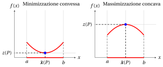
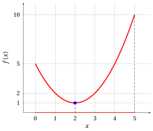
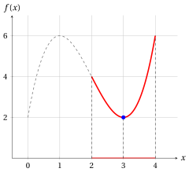
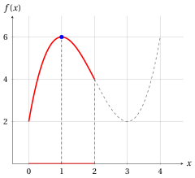

# Problemi di ottimizzazione convessi e concavi

**Parte 2 · Problemi di ottimizzazione · Capitolo 6** · [:material-file-pdf-box: Dispensa, volume 2 (PDF)](../pdf/dispensa-2-problemi-di-ottimizzazione.pdf) · [:material-presentation: Slide](../pdf/slide-06-problemi-convessi-concavi.pdf) · [:material-pencil: Esercizi](../esercizi/es-06-problemi-convessi-concavi.md)

## 6.1 Problemi di ottimizzazione convessi e concavi

!!! definizione "Definizione 6.1: problemi di ottimizzazione convessi e concavi"

    Dato un problema di ottimizzazione con una <strong>regione ammissibile convessa</strong>,

    - se la funzione obiettivo è convessa sulla regione ammissibile, il problema si chiama <strong>problema di ottimizzazione convesso</strong>;

    - se la funzione obiettivo è concava sulla regione ammissibile, il problema si chiama <strong>problema di ottimizzazione concavo</strong>.

- Nelle figure di questo capitolo, come nel capitolo «Problemi di ottimizzazione», il grafico della funzione obiettivo sulla regione ammissibile è rosso, la regione ammissibile è la parte rossa dell'asse $x$ e le soluzioni ottime sono blu. Esempi di un problema di minimizzazione convesso e di un problema di massimizzazione concavo con regione ammissibile $[a,b] \subseteq \R$:

{ .fig .ovale loading=lazy style="width:88%" }

- Le definizioni di funzione convessa e di funzione concava del capitolo «Funzioni convesse e concave» richiedono un dominio convesso: se la funzione obiettivo è convessa o concava sulla regione ammissibile, la regione ammissibile è un insieme convesso.

- La regione ammissibile è spesso descritta da un numero finito di vincoli, $F = \{\, {\boldsymbol x} \in \R^n : g_i({\boldsymbol x}) \le 0, ~ i \in \{1,2,\dots,m\} \,\}$. Se ogni funzione $g_i$ è convessa, $F$ è un insieme convesso, per la proprietà degli insiemi definiti da funzioni convesse del capitolo «Funzioni convesse e concave». Per esempio, l'intervallo $[a,b] = \{\, x \in \R : a - x \le 0, ~ x - b \le 0 \,\}$ è definito da due funzioni lineari, e quindi convesse.

## 6.2 Ottimi locali dei problemi convessi e concavi

- Ogni punto di minimo è anche un punto di minimo locale. La proposizione seguente afferma che, in un problema di minimizzazione convesso, vale anche il viceversa.

!!! teorema "Proposizione 6.2: minimi locali dei problemi di minimizzazione convessi"

    In un problema di minimizzazione convesso, con funzione obiettivo $f$ convessa sulla regione ammissibile convessa $F$, se un punto $\bar{\boldsymbol x} \in F$ è un punto di minimo locale di $f$ in $F$, allora è un punto di minimo di $f$ in $F$, cioè una soluzione ottima.

??? dimostrazione "Dimostrazione"

    Se $\bar{\boldsymbol x} \in F$ è un punto di minimo locale, esiste un intorno sferico $N(\bar{\boldsymbol x}, \delta)$ con $\delta > 0$ tale che:

    $$
    f(\bar{\boldsymbol x}) \le f(\boldsymbol x), \quad \forall\, \boldsymbol x \in N(\bar{\boldsymbol x}, \delta) \cap F
    $$

    Per ogni $\boldsymbol x \in F \setminus \{\bar{\boldsymbol x} \}$, poiché $F$ è convesso, tutti i punti della forma $\hat{\boldsymbol x} = \lambda\, \boldsymbol x + (1 - \lambda)\, \bar{\boldsymbol x}$ con $\lambda \in (0,1]$ appartengono anch'essi a $F$. Inoltre, per $\lambda$ sufficientemente piccolo, abbiamo $\hat{\boldsymbol x} \in N(\bar{\boldsymbol x}, \delta) \cap F$, e quindi:

    $$
    f(\bar{\boldsymbol x}) \le f(\hat{\boldsymbol x})
    $$

    Poiché $f$ è convessa, vale anche:

    $$
    f(\hat{\boldsymbol x}) \le \lambda\, f(\boldsymbol x) + (1 - \lambda)\, f(\bar{\boldsymbol x})
    $$

    Combinando le due disuguaglianze, otteniamo:

    $$
    \begin{array}{c}
    f(\bar{\boldsymbol x}) \le \lambda\, f(\boldsymbol x) + (1 - \lambda)\, f(\bar{\boldsymbol x}) \\[4pt]
    \Downarrow \\[4pt]
    \lambda\, f(\bar{\boldsymbol x}) \le \lambda\, f(\boldsymbol x) \\[4pt]
    \Downarrow \\[4pt]
    f(\bar{\boldsymbol x}) \le f(\boldsymbol x) \quad \text{(poiché $\lambda \in (0,1]$)}
    \end{array}
    $$

    Quindi,

    $$
    f(\bar{\boldsymbol x}) \le f(\boldsymbol x), \quad \forall\, \boldsymbol x \in F
    $$

    e $\bar{\boldsymbol x}$ è un punto di minimo. □

- In $\R^2$, l'idea della dimostrazione è data dalla figura seguente, con tre punti ${\boldsymbol x}^{(1)},{\boldsymbol x}^{(2)},{\boldsymbol x}^{(3)}$ in $F$ e tre punti $\hat{\boldsymbol x}^{(1)},\hat{\boldsymbol x}^{(2)},\hat{\boldsymbol x}^{(3)}$ in $N(\bar{\boldsymbol x},\delta) \cap F$, ciascuno sul segmento che unisce $\bar{\boldsymbol x}$ al corrispondente ${\boldsymbol x}^{(i)}$.

{ .fig .ovale loading=lazy style="width:44%" }

- In un problema di minimizzazione convesso abbiamo dimostrato che:

    \begin{equation*}
    \text{punto di minimo locale} \quad \Longrightarrow \quad \text{punto di minimo}
    \end{equation*}

    e l'implicazione vale anche nell'altro verso, perché un punto di minimo soddisfa la condizione della definizione in ogni punto di $F$, e quindi in particolare in ogni punto di un intorno. Le due nozioni sono equivalenti.

!!! teorema "Corollario 6.3: massimi locali dei problemi di massimizzazione concavi"

    In un problema di massimizzazione concavo, con funzione obiettivo $f$ concava sulla regione ammissibile convessa $F$, un punto $\bar{\boldsymbol x} \in F$ è un punto di massimo locale di $f$ in $F$ se e solo se è un punto di massimo di $f$ in $F$, cioè una soluzione ottima.

??? dimostrazione "Dimostrazione"

    Se $f$ è concava su $F$, allora $-f$ è convessa su $F$, e $\bar{\boldsymbol x}$ è un punto di massimo locale di $f$ se e solo se è un punto di minimo locale di $-f$. Per la proposizione precedente, è un punto di minimo di $-f$ in $F$, cioè un punto di massimo di $f$ in $F$, poiché $\max\{f({\boldsymbol x}) \text{ soggetto a } {\boldsymbol x} \in F\} = -\min\{-f({\boldsymbol x}) \text{ soggetto a } {\boldsymbol x} \in F\}$. □

!!! chiave ""

    - In un problema di minimizzazione convesso, ogni <strong>punto di minimo locale</strong> è anche un <strong>punto di minimo</strong>: ogni punto di minimo locale nella regione ammissibile è una soluzione ottima.

    - In un problema di massimizzazione concavo, ogni <strong>punto di massimo locale</strong> è anche un <strong>punto di massimo</strong>: ogni punto di massimo locale nella regione ammissibile è una soluzione ottima.

## 6.3 Esempi di problemi di ottimizzazione convessi e concavi

- Negli esempi seguenti, verifichiamo prima che la regione ammissibile sia un insieme convesso e che la funzione obiettivo sia convessa (o concava) su di essa, con la definizione del capitolo «Funzioni convesse e concave». Poi troviamo un punto di minimo (o di massimo) locale, confrontando il valore della funzione obiettivo in un punto candidato con i suoi valori nei punti ammissibili di un intorno. Per la proposizione e il corollario della sezione precedente, questo punto è una soluzione ottima.

- Il punto candidato è il punto in cui si annulla la derivata della funzione obiettivo. La derivata suggerisce soltanto il candidato: l'ottimalità locale si verifica direttamente con la definizione del capitolo «Problemi di ottimizzazione».

!!! esempio "Esempio 6.1: un problema di minimizzazione convesso"

    Consideriamo la seguente funzione obiettivo e la seguente regione ammissibile:

    $$
    f:\R \to \R,~ f: x \mapsto (x - 2)^2 + 1
    \qquad \text{e} \qquad
    F=[0,5].
    $$

    Il problema di ottimizzazione associato in forma di minimo è:

    $$
    \min \bigg\{\, (x - 2)^2 + 1 \ \text{ soggetto a } \ 0 \le x \le 5 \,\bigg\}
    $$

    { .fig .ovale loading=lazy style="width:50%" }

    - <strong>Regione ammissibile.</strong> La regione ammissibile $F=[0,5]$ è un intervallo, e quindi un insieme convesso.

    - <strong>Funzione obiettivo.</strong> Per ogni coppia di punti $p,w \in F$ e ogni $\lambda \in [0,1]$, abbiamo:

        \begin{align*}
        f\big(\lambda p+(1-\lambda)w\big)
        &= \big(\lambda p+(1-\lambda)w-2\big)^2 + 1 \\[2ex]
        &= \big(\lambda (p-2)+(1-\lambda)(w-2)\big)^2 + \lambda + (1-\lambda) \\[1ex]
        &\qquad (\text{poiché } \lambda + (1-\lambda) = 1) \\[2ex]
        &\le \lambda (p-2)^2+(1-\lambda)(w-2)^2 + \lambda + (1-\lambda) \\[1ex]
        &\qquad \text{(poiché } \big(\lambda a+(1-\lambda)b\big)^2\le \lambda a^2+(1-\lambda)b^2 \text{,} \\
        &\qquad \phantom{\text{(}}\text{capitolo «Funzioni convesse e concave»)} \\[2ex]
        &= \lambda \big((p-2)^2+1\big)+(1-\lambda)\big((w-2)^2+1\big) \\[2ex]
        &= \lambda f(p)+(1-\lambda)f(w)
        \end{align*}

        Quindi,

        $$
        f\big(\lambda p + (1-\lambda) w\big) \le \lambda f(p) + (1-\lambda) f(w)
        $$

        La funzione obiettivo è convessa sulla regione ammissibile convessa $F$, e il problema è un <strong>problema di minimizzazione convesso</strong>.

    - <strong>Punto di minimo locale.</strong> La derivata $f'(x) = 2x-4 = 2\,(x-2)$ si annulla in $x=2$. Nell'intorno $N\big((2),1\big) = (1,3)$, tutti i punti sono ammissibili e

        $$
        f(x) = (x-2)^2+1 \ge 1 = f(2), \qquad \forall x \in N\big((2),1\big) \cap F = (1,3).
        $$

        Il punto $x=2$ è un punto di minimo locale.

    - <strong>Soluzione ottima.</strong> Per la proposizione «minimi locali dei problemi di minimizzazione convessi», il punto $x=2$ è anche un punto di minimo, e la soluzione ottima e il valore ottimo sono:

        $$
        \tilde{\boldsymbol x}(P) = (2)
        \qquad \text{e} \qquad
        z(P) = f(2) = 1.
        $$

!!! esempio "Esempio 6.2: un problema di massimizzazione concavo"

    Consideriamo la seguente funzione obiettivo e la seguente regione ammissibile:

    $$
    f:\R \to \R,~ f: x \mapsto -(x - 3)^2 + 10
    \qquad \text{e} \qquad
    F=[0,5].
    $$

    Il problema di ottimizzazione associato in forma di massimo è:

    $$
    \max \bigg\{\, -(x - 3)^2 + 10 \ \text{ soggetto a } \ 0 \le x \le 5 \,\bigg\}
    $$

    { .fig .ovale loading=lazy style="width:50%" }

    - <strong>Regione ammissibile.</strong> La regione ammissibile $F=[0,5]$ è un intervallo, e quindi un insieme convesso.

    - <strong>Funzione obiettivo.</strong> Per ogni coppia di punti $p,w \in F$ e ogni $\lambda \in [0,1]$, abbiamo:

        \begin{align*}
        f\big(\lambda p+(1-\lambda)w\big)
        &= -\big(\lambda (p-3)+(1-\lambda)(w-3)\big)^2 + \lambda\,10 + (1-\lambda)\,10 \\[1ex]
        &\qquad (\text{poiché } \lambda + (1-\lambda) = 1) \\[2ex]
        &\ge -\lambda (p-3)^2-(1-\lambda)(w-3)^2 + \lambda\,10 + (1-\lambda)\,10 \\[1ex]
        &\qquad \text{(poiché } \big(\lambda a+(1-\lambda)b\big)^2\le \lambda a^2+(1-\lambda)b^2 \text{,} \\
        &\qquad \phantom{\text{(}}\text{e il fattore $-1$ inverte la disuguaglianza)} \\[2ex]
        &= \lambda \big(-(p-3)^2+10\big)+(1-\lambda)\big(-(w-3)^2+10\big) \\[2ex]
        &= \lambda f(p)+(1-\lambda)f(w)
        \end{align*}

        Quindi,

        $$
        f\big(\lambda p + (1-\lambda) w\big) \ge \lambda f(p) + (1-\lambda) f(w)
        $$

        La funzione obiettivo è concava sulla regione ammissibile convessa $F$, e il problema è un <strong>problema di massimizzazione concavo</strong>.

    - <strong>Punto di massimo locale.</strong> La derivata $f'(x) = -2x+6 = -2\,(x-3)$ si annulla in $x=3$. Nell'intorno $N\big((3),1\big) = (2,4)$, tutti i punti sono ammissibili e

        $$
        f(x) = -(x-3)^2+10 \le 10 = f(3), \qquad \forall x \in N\big((3),1\big) \cap F = (2,4).
        $$

        Il punto $x=3$ è un punto di massimo locale.

    - <strong>Soluzione ottima.</strong> Per il corollario «massimi locali dei problemi di massimizzazione concavi», il punto $x=3$ è anche un punto di massimo, e la soluzione ottima e il valore ottimo sono:

        $$
        \tilde{\boldsymbol x}(P) = (3)
        \qquad \text{e} \qquad
        z(P) = f(3) = 10.
        $$

- Negli ultimi due esempi, la funzione obiettivo è lo stesso polinomio di terzo grado

    $$
    f:\R \to \R,~ f: x \mapsto 2 + 9x - 6x^2 + x^3 = (x-2)^3 - 3\,(x-2) + 4,
    $$

    che non è né convesso né concavo in $\R$: con $p=0$, $w=2$ e $\lambda=\frac{1}{2}$ abbiamo $f(1) = 6 > 3 = \frac{1}{2}\,f(0)+\frac{1}{2}\,f(2)$, e con $p=2$, $w=4$ e $\lambda=\frac{1}{2}$ abbiamo $f(3) = 2 < 5 = \frac{1}{2}\,f(2)+\frac{1}{2}\,f(4)$. È convesso su $[2,4]$ e concavo su $[0,2]$: la definizione di problema di ottimizzazione convesso (concavo) riguarda soltanto i valori della funzione obiettivo sulla regione ammissibile. Per dimostrarlo, usiamo la disuguaglianza seguente.

!!! teorema "Osservazione 6.4"

    Per ogni $\lambda \in [0,1]$ e ogni $a,b \in \R$, abbiamo

    $$
    \lambda a^3+(1-\lambda)b^3-\big(\lambda a+(1-\lambda)b\big)^3 = \lambda(1-\lambda)(a-b)^2\big((1+\lambda)\,a+(2-\lambda)\,b\big)
    $$

    e, quindi,

    \begin{align*}
    \big(\lambda a+(1-\lambda)b\big)^3 &\le \lambda a^3+(1-\lambda)b^3 \qquad \text{se } a,b \ge 0, \\[1ex]
    \big(\lambda a+(1-\lambda)b\big)^3 &\ge \lambda a^3+(1-\lambda)b^3 \qquad \text{se } a,b \le 0.
    \end{align*}

??? dimostrazione "Dimostrazione"

    Sia $\mu = 1-\lambda$, così che $1-\lambda^2 = (1-\lambda)(1+\lambda) = \mu(1+\lambda)$ e $1-\mu^2 = \lambda(1+\mu)$. Sviluppando il cubo, abbiamo:

    \begin{align*}
    & \lambda a^3+\mu b^3-\big(\lambda a+\mu b\big)^3 \\[1ex]
    &\quad = \lambda(1-\lambda^2)\,a^3+\mu(1-\mu^2)\,b^3-3\lambda^2\mu\,a^2b-3\lambda\mu^2\,ab^2 \\[2ex]
    &\quad = \lambda\mu\,\big((1+\lambda)\,a^3+(1+\mu)\,b^3-3\lambda\,a^2b-3\mu\,ab^2\big) \\[2ex]
    &\quad = \lambda\mu\,(a^2-2ab+b^2)\,\big((1+\lambda)\,a+(1+\mu)\,b\big) \\[1ex]
    &\qquad \text{(poiché $(1+\mu)-2(1+\lambda) = -3\lambda$ e $(1+\lambda)-2(1+\mu) = -3\mu$)} \\[2ex]
    &\quad = \lambda(1-\lambda)(a-b)^2\big((1+\lambda)\,a+(2-\lambda)\,b\big)
    \end{align*}

    Poiché $\lambda(1-\lambda)(a-b)^2 \ge 0$, $1+\lambda > 0$ e $2-\lambda > 0$, il membro di destra è non negativo se $a,b \ge 0$, e non positivo se $a,b \le 0$. □

!!! esempio "Esempio 6.3: un problema di minimizzazione convesso con funzione obiettivo cubica"

    Consideriamo la seguente funzione obiettivo e la seguente regione ammissibile:

    $$
    f:\R \to \R,~ f: x \mapsto 2 + 9x - 6x^2 + x^3
    \qquad \text{e} \qquad
    F=[2,4].
    $$

    Il problema di ottimizzazione associato in forma di minimo è:

    $$
    \min \bigg\{\, 2 + 9x - 6x^2 + x^3 \ \text{ soggetto a } \ 2 \le x \le 4 \,\bigg\}
    $$

    Nella figura, il grafico della funzione obiettivo fuori dalla regione ammissibile è tratteggiato.

    { .fig .ovale loading=lazy style="width:50%" }

    - <strong>Regione ammissibile.</strong> La regione ammissibile $F=[2,4]$ è un intervallo, e quindi un insieme convesso.

    - <strong>Funzione obiettivo.</strong> Per ogni coppia di punti $p,w \in F$ e ogni $\lambda \in [0,1]$, con $a = p-2 \ge 0$ e $b = w-2 \ge 0$, abbiamo:

        \begin{align*}
        f\big(\lambda p+(1-\lambda)w\big)
        &= \big(\lambda p+(1-\lambda)w-2\big)^3 - 3\big(\lambda p+(1-\lambda)w-2\big) + 4 \\[1ex]
        &\qquad \text{(poiché } f(x) = (x-2)^3 - 3\,(x-2) + 4 \text{)} \\[2ex]
        &= \big(\lambda a+(1-\lambda)b\big)^3 - 3\big(\lambda a+(1-\lambda)b\big) + \lambda\,4 + (1-\lambda)\,4 \\[1ex]
        &\qquad \text{(poiché } \lambda p+(1-\lambda)w - 2 = \lambda a + (1-\lambda) b \text{,} \\
        &\qquad \phantom{\text{(}}\text{e } \lambda + (1-\lambda) = 1 \text{)} \\[2ex]
        &\le \lambda a^3+(1-\lambda)b^3 - 3\big(\lambda a+(1-\lambda)b\big) + \lambda\,4 + (1-\lambda)\,4 \\[1ex]
        &\qquad \text{(per l'osservazione precedente, poiché } a \ge 0 \text{ e } b \ge 0) \\[2ex]
        &= \lambda \big(a^3-3a+4\big)+(1-\lambda)\big(b^3-3b+4\big) \\[2ex]
        &= \lambda f(p)+(1-\lambda)f(w) \\[1ex]
        &\qquad \text{(poiché } f(p) = a^3-3a+4 \text{ e } f(w) = b^3-3b+4 \text{)}
        \end{align*}

        Quindi,

        $$
        f\big(\lambda p + (1-\lambda) w\big) \le \lambda f(p) + (1-\lambda) f(w)
        $$

        La funzione obiettivo è convessa sulla regione ammissibile convessa $F$, e il problema è un <strong>problema di minimizzazione convesso</strong>.

    - <strong>Punto di minimo locale.</strong> La derivata $f'(x) = 9 - 12x + 3x^2 = 3\,(x-1)\,(x-3)$ si annulla in $x=1$ e in $x=3$, e solo $x=3$ è ammissibile. Per ogni $x \in \R$ abbiamo $f(x) - 2 = x\,(x-3)^2$. Nell'intorno $N\big((3),1\big) = (2,4)$, tutti i punti sono ammissibili e positivi, e quindi

        $$
        f(x) = 2 + x\,(x-3)^2 \ge 2 = f(3), \qquad \forall x \in N\big((3),1\big) \cap F = (2,4).
        $$

        Il punto $x=3$ è un punto di minimo locale.

    - <strong>Soluzione ottima.</strong> Per la proposizione «minimi locali dei problemi di minimizzazione convessi», il punto $x=3$ è anche un punto di minimo, e la soluzione ottima e il valore ottimo sono:

        $$
        \tilde{\boldsymbol x}(P) = (3)
        \qquad \text{e} \qquad
        z(P) = f(3) = 2.
        $$

!!! esempio "Esempio 6.4: un problema di massimizzazione concavo con funzione obiettivo cubica"

    Consideriamo la stessa funzione obiettivo con una regione ammissibile diversa:

    $$
    f:\R \to \R,~ f: x \mapsto 2 + 9x - 6x^2 + x^3
    \qquad \text{e} \qquad
    F=[0,2].
    $$

    Il problema di ottimizzazione associato in forma di massimo è:

    $$
    \max \bigg\{\, 2 + 9x - 6x^2 + x^3 \ \text{ soggetto a } \ 0 \le x \le 2 \,\bigg\}
    $$

    Nella figura, il grafico della funzione obiettivo fuori dalla regione ammissibile è tratteggiato.

    { .fig .ovale loading=lazy style="width:50%" }

    - <strong>Regione ammissibile.</strong> La regione ammissibile $F=[0,2]$ è un intervallo, e quindi un insieme convesso.

    - <strong>Funzione obiettivo.</strong> Per ogni coppia di punti $p,w \in F$ e ogni $\lambda \in [0,1]$, con $a = p-2 \le 0$ e $b = w-2 \le 0$, abbiamo:

        \begin{align*}
        f\big(\lambda p+(1-\lambda)w\big)
        &= \big(\lambda p+(1-\lambda)w-2\big)^3 - 3\big(\lambda p+(1-\lambda)w-2\big) + 4 \\[1ex]
        &\qquad \text{(poiché } f(x) = (x-2)^3 - 3\,(x-2) + 4 \text{)} \\[2ex]
        &= \big(\lambda a+(1-\lambda)b\big)^3 - 3\big(\lambda a+(1-\lambda)b\big) + \lambda\,4 + (1-\lambda)\,4 \\[1ex]
        &\qquad \text{(poiché } \lambda p+(1-\lambda)w - 2 = \lambda a + (1-\lambda) b \text{,} \\
        &\qquad \phantom{\text{(}}\text{e } \lambda + (1-\lambda) = 1 \text{)} \\[2ex]
        &\ge \lambda a^3+(1-\lambda)b^3 - 3\big(\lambda a+(1-\lambda)b\big) + \lambda\,4 + (1-\lambda)\,4 \\[1ex]
        &\qquad \text{(per l'osservazione precedente, poiché } a \le 0 \text{ e } b \le 0) \\[2ex]
        &= \lambda \big(a^3-3a+4\big)+(1-\lambda)\big(b^3-3b+4\big) \\[2ex]
        &= \lambda f(p)+(1-\lambda)f(w) \\[1ex]
        &\qquad \text{(poiché } f(p) = a^3-3a+4 \text{ e } f(w) = b^3-3b+4 \text{)}
        \end{align*}

        Quindi,

        $$
        f\big(\lambda p + (1-\lambda) w\big) \ge \lambda f(p) + (1-\lambda) f(w)
        $$

        La funzione obiettivo è concava sulla regione ammissibile convessa $F$, e il problema è un <strong>problema di massimizzazione concavo</strong>.

    - <strong>Punto di massimo locale.</strong> La derivata $f'(x) = 3\,(x-1)\,(x-3)$ si annulla in $x=1$ e in $x=3$, e solo $x=1$ è ammissibile. Per ogni $x \in \R$ abbiamo $6 - f(x) = (x-1)^2\,(4-x)$. Nell'intorno $N\big((1),1\big) = (0,2)$, tutti i punti sono ammissibili e minori di $4$, e quindi

        $$
        f(x) = 6 - (x-1)^2\,(4-x) \le 6 = f(1), \qquad \forall x \in N\big((1),1\big) \cap F = (0,2).
        $$

        Il punto $x=1$ è un punto di massimo locale.

    - <strong>Soluzione ottima.</strong> Per il corollario «massimi locali dei problemi di massimizzazione concavi», il punto $x=1$ è anche un punto di massimo, e la soluzione ottima e il valore ottimo sono:

        $$
        \tilde{\boldsymbol x}(P) = (1)
        \qquad \text{e} \qquad
        z(P) = f(1) = 6.
        $$

<!-- laboratorio-interattivo: sezione generata da interattivi.py -->

## Laboratorio interattivo { #laboratorio-interattivo }

Le idee del capitolo, da toccare con mano: muovi i cursori e trascina i punti.
Tutti i grafici del corso sono nel [laboratorio interattivo](../interattivi/index.md#cap-6).

